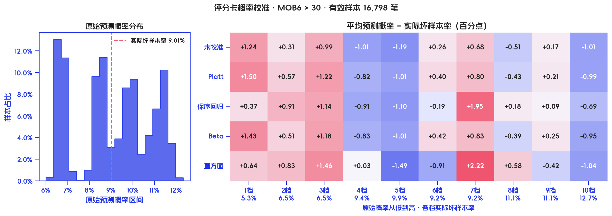
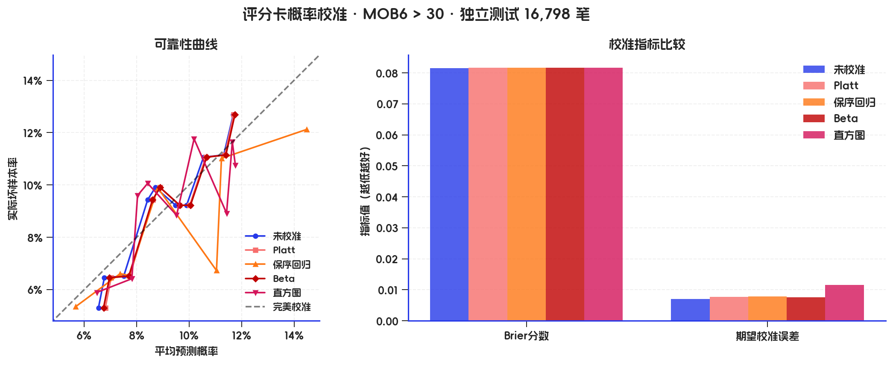
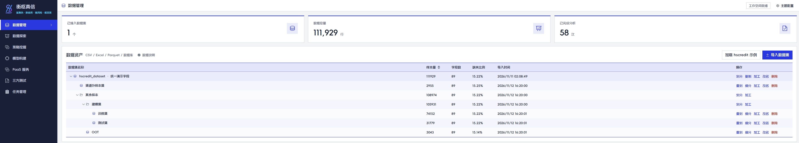
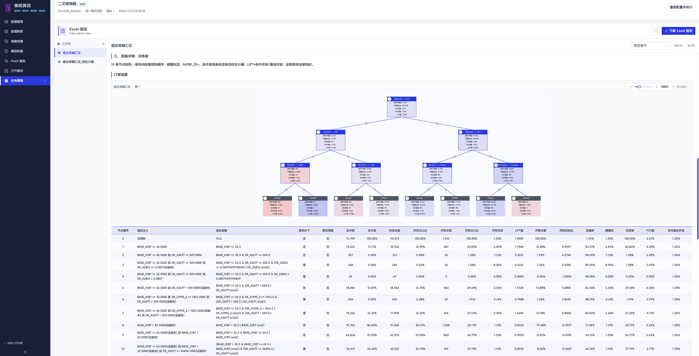
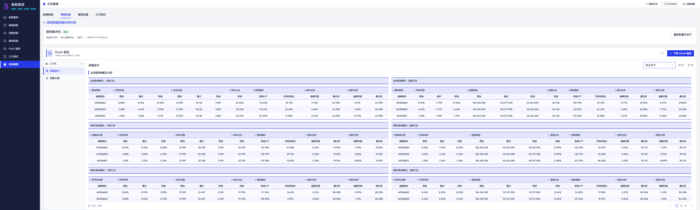

<p align="center">
  
</p>

<p align="center">
  
  <a href="https://pypi.org/project/hscredit/"></a>
  <a href="https://hscredit.hengshucredit.com/"></a>
  <a href="LICENSE"></a>
</p>

<p align="center"><strong>面向信贷全生命周期的量化风控工具箱</strong></p>

<p align="center">🔍 鉴真伪 · 📊 斟信用 · ⚖️ 衡风险 · 🎯 枢定策</p>

> **写在前面**
>
> `hscredit` 是我这些年信贷风控实践的一次落笔。起初，做策略、建模型、出报告，各有各的脚本。三四年里，经历了几种业务模式，在不同的风控场景里反复打磨，这些零散的方法才逐渐成了一套趁手的工具，后来又有了 Web 工作台和 Agent Skills。它先后支撑过 400 多亿元放款和 200 多亿元在贷资产的管理。
>
> 这些年，我见过互金行业从兴起走到鼎盛，也见过鼎盛之后的一片狼藉。一起做事的人，有的出海，有的转行，有的就此走散。互金这行，说好听些叫普惠金融，为下沉客群提供信贷服务。可在我看来，说到底，还是吃人血馒头。我从做解决方案实施转行做信贷风控，回头看，这一步终究有负师恩。
>
> 把 `hscredit` 整理出来，也算给这段经历做个收束。我把日常用得上的策略和建模方法留下来，把反复要做的分析、验证和报告尽量交给代码。行业潮水已退，这个包我还会继续维护和更新。同行若用得着，尽管取用。

信贷风控贯穿获客、授信、用信和贷后管理。在风险可控的前提下扩大盈利业务规模，追求的是**利润额最大化**。在规模不减的前提下降低欺诈与信用损失，追求的是**利润率最大化**。模型识别客群间的风险差异，策略结合产品的收入、成本和预期损失，将风险分层用于准入、额度、定价和催收决策。

**hscredit（衡枢真信）** 是面向信贷风控的开源 Python 工具箱，涵盖数据接入与探索、特征分箱与编码、变量筛选、评分卡与机器学习建模，以及规则挖掘与策略回测。工具箱支持模型调优、评估与解释，可生成风控图表和 Excel 评审报告，导出评分卡或发布模型与规则预测服务。各模块可在 Python 中组合使用，也可通过 Web 工作台或 Agent Skills 调用。

<a href="docs/assets/brand/hscredit-architecture.svg"></a>

## 为什么选 hscredit？

**hscredit 把变量开发、风险建模、策略回测和评审交付集成在一个 Python 包中。** 分箱和筛选可接入已有的 `Pipeline`，模型与规则可独立开发。各模块既返回可继续分析的明细，也能直接生成标准评审报告。

- **分箱可定制，筛选可追溯。** 提供 17 种一维分箱方法和二维交叉分箱。可按 IV、KS、Lift 或自定义目标选切点，也可设置单调性、最小样本占比和手工切点。9 种编码器覆盖 WOE、目标均值和树叶编码等方法。特征筛选可串联质量过滤、相关性与 VIF 检验、递归消除、Boruta 或模型重要性，逐字段记录保留与剔除原因。
- **多模型选型与部署。** 支持逻辑回归评分卡、随机森林、XGBoost、LightGBM、CatBoost 及 TabPFN 等模型。可对预处理和模型参数联合调优，用时间外样本比较区分度与校准误差，按业务成本或收益选择审批阈值。评分卡可导出分值表和 PMML，模型预测可用 SHAP 和原因码解释。
- **规则挖掘与增量回测。** 二叉树和多叉树支持自动挖掘、手工拆分与剪枝。单规则评估覆盖率和风险集中度，规则集按执行顺序核算每条规则的新增命中。新旧策略置换分析分别列出新增放行与拦截的客群、笔数和金额。
- **多维交叉比较。** 分箱、评分分段和规则节点均可跨样本集、月份、客群和逾期标签对照。按订单笔数与金额分别统计，可识别整体坏样本率平稳、风险却向大额订单集中的情况。
- **四类标准评审报告。** 三方数据分析、规则挖掘、模型上线和策略上线报告各有标准入口，均可直接生成 Excel。指标摘要、分组明细和图表可合入同一工作簿，支持多级表头、条件格式和原生透视表，评审人员可在 Excel 中调整汇总维度、复核结论。
- **安装与复现。** `pip install hscredit` 即可安装分箱、筛选、评分卡、SHAP 解释和 Excel 报告所需的基础组件，无需分别安装其他评分卡工具包。提升树、神经网络、调参及数据库驱动按需安装。发布版支持 Python 3.9–3.15，配套 API 文档和可执行 Notebook。[PyPI 发布信息](https://pypi.org/project/hscredit/0.1.6/) · [API 参考](docs/api/index.rst) · [完整示例](examples/29_readme_showcase.ipynb)
- **平台与 Agent。** Web 工作台可直接划分样本、编辑规则树、比较模型、导出报告，并将模型或规则集发布为预测 API。8 个 Agent Skills 将分箱、筛选、建模、回测、绘图和报告封装为可通过自然语言调用的操作。[平台指南](docs/platform.md) · [Skills 指南](docs/skills.md)

<table>
<tr>
  <td width="50%" valign="top">
    <h3>策略上线报告</h3><p>量化策略变更的增量影响，按置入、置出客群分别汇总笔数、金额与坏样本率。</p>
    <a href="docs/assets/readme/showcase/intro-strategy.png"></a><br>
    <a href="docs/assets/readme/showcase/swap-out.xlsx?raw=true" title="swap_out_report">下载 Excel</a>
  </td>
  <td width="50%" valign="top">
    <h3>模型上线报告</h3><p>跨训练、测试及时间外样本评估模型。分类报告提供区分度与分段坏样本率，回归报告提供预测误差。</p>
    <a href="docs/assets/readme/showcase/intro-model.png"></a><br>
    <a href="docs/assets/readme/showcase/auto-model-report.xlsx?raw=true" title="auto_model_report">下载 Excel</a>
  </td>
</tr>
<tr>
  <td width="50%" valign="top">
    <h3>规则挖掘报告</h3><p>按树节点列出规则条件、覆盖率、坏样本率和 Lift，比较候选规则在不同样本集上的表现。</p>
    <a href="docs/assets/readme/showcase/intro-rules.png"></a><br>
    <a href="docs/assets/readme/showcase/multiway-tree-report.xlsx?raw=true" title="multiway_tree.report">下载 Excel</a>
  </td>
  <td width="50%" valign="top">
    <h3>三方数据分析报告</h3><p>按字段评估数据覆盖率与风险区分度，对照各逾期标签下的分箱分布、坏样本率和 Lift。</p>
    <a href="docs/assets/readme/showcase/intro-features.png"></a><br>
    <a href="docs/assets/readme/showcase/feature-analysis.xlsx?raw=true" title="auto_feature_analysis">下载 Excel</a>
  </td>
</tr>
</table>


### 四种报告的调用示例

**四套标准 SOP，一行代码出一份 Excel 报告。** 准备好样本和待评估的变量、规则或模型，即可按统一口径比较不同客群、不同逾期标签的表现。下次评审，换一批样本就能复评，一行代码即可导出excel评审报告。

```python
from hscredit.report import swap_out_report, auto_model_report, auto_feature_analysis

# 分析标签定义
labels = {"overdue": ["MOB1", "MOB6"], "dpds": [0, 30], "overdue_operator": ">"}

# 策略置出分析报告，D类调优策略上线评审报告模板
swap_out_report(df, rules, date="授信时间", margins=True, save="策略.xlsx", **labels)

# 模型建模报告，新模型部署上线前评审报告模板
auto_model_report(model, datasets, features=features, amount="loan_amt", long_format=True, save="模型.xlsx", **labels)

# 决策树规则挖掘报告输出，综合评估各个数据集各个逾期标签下规则的有效性
tree.report(datasets, amount="loan_amt", group="GROUP", save="规则.xlsx", **labels)

# 数据有效性分析报告，适用于三方数据测试报告和内部可用数据有效性分析报告
auto_feature_analysis(df, features, amount="loan_amt", long_format=True, save="三方数据.xlsx", **labels)
```

#### 多报告合并

同一次评审的数据分析与策略回测可写入同一工作簿。向相应报告接口传入同一个 `ExcelWriter`，分别指定工作表，统一保存。


```python
from hscredit.excel import ExcelWriter

# 生成 excel writer 写入器
writer = ExcelWriter()

# 数据有效性分析报告
auto_feature_analysis(df, features, save=writer, sheet="三方数据", amount="loan_amt", long_format=True, **labels)

# 规则置出评审报告
swap_out_report(df, rules, save=writer, sheet="策略分析", date="授信时间", margins=True, **labels)

# 合并保存
writer.save("综合报告.xlsx")
```


<a href="https://hscredit.hengshucredit.com/showcase.html#gallery-reports" style="color:#c02dd4;">在文档中查看报告示例</a>

## 交流与关注

<div align="center">

<table align="center" width="100%">
<tr>
  <td align="center" valign="top" width="50%">
    itlubber
  </td>
  <td align="center" valign="top" width="50%">
    衡枢风控实验室 hscreditlab
  </td>
</tr>
<tr>
  <td align="center" valign="top" width="50%">
    <br>
  </td>
  <td align="center" valign="top" width="50%">
    <br>
    <br>
  </td>
</tr>
<tr>
  <td align="center" valign="top" width="50%">
    微信
  </td>
  <td align="center" valign="top" width="50%">
    公众号（加交流群私信「入群」）
  </td>
</tr>
</table>

<p>邮箱：<a href="mailto:hscredit@hengshucredit.com" style="color:#c02dd4;">hscredit@hengshucredit.com</a></p>

</div>

## 核心功能盘点

<div class="hs-capabilities" style="overflow-x:auto; max-width:100%; border:0;">
<table style="white-space:nowrap; width:max-content; border-collapse:collapse; color:#2b2540; font-size:13px;">
<thead><tr><th style="background:#2639E9; color:white; padding:8px 12px; text-align:left; white-space:nowrap; border-left:2px solid white;">模块</th><th style="background:#2639E9; color:white; padding:8px 12px; text-align:left; white-space:nowrap; border-left:2px solid white;">能力范围</th><th style="background:#2639E9; color:white; padding:8px 12px; text-align:left; white-space:nowrap; border-left:2px solid white;">落地功能</th></tr></thead>
<tbody>
<tr style="background:#ffffff;"><td nowrap style="padding:8px 12px; white-space:nowrap; border:0;"><a href="hscredit/core/binning" style="color:#c02dd4;"><strong>特征分箱</strong></a></td><td nowrap style="padding:8px 12px; white-space:nowrap; border:0;">17&nbsp;种一维方法&nbsp;·&nbsp;二维交叉分箱</td><td nowrap style="padding:8px 12px; white-space:nowrap; border:0;">自定义目标、多标签、金额口径、方法比较、按月与客群分析</td></tr>
<tr style="background:#dee1fb;"><td nowrap style="padding:8px 12px; white-space:nowrap; border:0;"><a href="hscredit/core/encoders" style="color:#c02dd4;"><strong>特征编码</strong></a></td><td nowrap style="padding:8px 12px; white-space:nowrap; border:0;">9&nbsp;种编码器</td><td nowrap style="padding:8px 12px; white-space:nowrap; border:0;">WOE、目标均值、有序编码、独热、频次、分位数、树叶编码、高基数处理</td></tr>
<tr style="background:#ffffff;"><td nowrap style="padding:8px 12px; white-space:nowrap; border:0;"><a href="hscredit/core/selectors" style="color:#c02dd4;"><strong>特征筛选</strong></a></td><td nowrap style="padding:8px 12px; white-space:nowrap; border:0;">过滤法&nbsp;·&nbsp;包装法&nbsp;·&nbsp;嵌入法</td><td nowrap style="padding:8px 12px; white-space:nowrap; border:0;">IV&nbsp;/&nbsp;KS&nbsp;/&nbsp;Lift&nbsp;/&nbsp;PSI、相关性、Null&nbsp;Importance、RFE、组合筛选报告</td></tr>
<tr style="background:#dee1fb;"><td nowrap style="padding:8px 12px; white-space:nowrap; border:0;"><a href="hscredit/core/models" style="color:#c02dd4;"><strong>风控建模</strong></a></td><td nowrap style="padding:8px 12px; white-space:nowrap; border:0;">经典模型&nbsp;·&nbsp;Boosting&nbsp;·&nbsp;表格神经网络</td><td nowrap style="padding:8px 12px; white-space:nowrap; border:0;">LR、评分卡、XGBoost、TabPFN、规则分类、调参、解释与部署</td></tr>
<tr style="background:#ffffff;"><td nowrap style="padding:8px 12px; white-space:nowrap; border:0;"><a href="hscredit/core/metrics" style="color:#c02dd4;"><strong>评估与优化</strong></a></td><td nowrap style="padding:8px 12px; white-space:nowrap; border:0;">分类&nbsp;·&nbsp;回归&nbsp;·&nbsp;业务损益</td><td nowrap style="padding:8px 12px; white-space:nowrap; border:0;">区分度、稳定性、校准、自定义评估函数与自定义损失</td></tr>
<tr style="background:#dee1fb;"><td nowrap style="padding:8px 12px; white-space:nowrap; border:0;"><a href="hscredit/core/rules" style="color:#c02dd4;"><strong>规则分析</strong></a></td><td nowrap style="padding:8px 12px; white-space:nowrap; border:0;">规则执行&nbsp;·&nbsp;规则挖掘&nbsp;·&nbsp;策略置换</td><td nowrap style="padding:8px 12px; white-space:nowrap; border:0;">Rule&nbsp;/&nbsp;RuleSet&nbsp;/&nbsp;RuleFlow、Swap、多规则迭代、二叉与多叉树</td></tr>
<tr style="background:#ffffff;"><td nowrap style="padding:8px 12px; white-space:nowrap; border:0;"><a href="hscredit/core/eda" style="color:#c02dd4;"><strong>数据挖掘</strong></a></td><td nowrap style="padding:8px 12px; white-space:nowrap; border:0;">EDA&nbsp;·&nbsp;VIZ&nbsp;·&nbsp;自动报告</td><td nowrap style="padding:8px 12px; white-space:nowrap; border:0;">数据摘要、KS、相关性、分布、混淆矩阵、PSI、坏率趋势、多标签报告</td></tr>
<tr style="background:#dee1fb;"><td nowrap style="padding:8px 12px; white-space:nowrap; border:0;"><a href="hscredit/excel" style="color:#c02dd4;"><strong>Excel 写入</strong></a></td><td nowrap style="padding:8px 12px; white-space:nowrap; border:0;">原生工作簿交付</td><td nowrap style="padding:8px 12px; white-space:nowrap; border:0;">条件格式、图片、超链接、冻结窗格、透视表、行高列宽</td></tr>
<tr style="background:#ffffff;"><td nowrap style="padding:8px 12px; white-space:nowrap; border:0;"><a href="hscredit/database" style="color:#c02dd4;"><strong>数据库读写</strong></a></td><td nowrap style="padding:8px 12px; white-space:nowrap; border:0;">7&nbsp;类&nbsp;SQL&nbsp;·&nbsp;2&nbsp;类&nbsp;NoSQL</td><td nowrap style="padding:8px 12px; white-space:nowrap; border:0;">连接池、参数化查询、流式读取、分批写入、元数据</td></tr>
<tr style="background:#dee1fb;"><td nowrap style="padding:8px 12px; white-space:nowrap; border:0;"><a href="#风控平台" style="color:#c02dd4;"><strong>风控平台</strong></a></td><td nowrap style="padding:8px 12px; white-space:nowrap; border:0;">浏览器工作台&nbsp;·&nbsp;FastAPI</td><td nowrap style="padding:8px 12px; white-space:nowrap; border:0;">数据集划分、变量 EDA、规则挖掘、模型选型、三方数据测试、在线预测服务</td></tr>
<tr style="background:#ffffff;"><td nowrap style="padding:8px 12px; white-space:nowrap; border:0;"><a href="skills/CATALOG.md" style="color:#c02dd4;"><strong>Agent 能力</strong></a></td><td nowrap style="padding:8px 12px; white-space:nowrap; border:0;">8&nbsp;个&nbsp;Skills</td><td nowrap style="padding:8px 12px; white-space:nowrap; border:0;">分箱、建模、规则、筛选、绘图与报告交付的自然语言入口</td></tr>
</tbody>
</table>
</div>

详细接口见<a href="docs/overview.md" style="color:#c02dd4;">功能总览</a>。

## 安装

当前源码支持 Python **3.9–3.15**，Python 3.15 已在 **Windows x64、CPython 3.15.2** 上验证。基础安装包含分箱、编码、筛选、经典模型、评分卡、SHAP、可视化、Excel 和内置数据集。

### Python 3.9–3.14

```bash
python -m pip install hscredit
```

扩展按需安装，也可组合为 `"hscredit[boost,tune]"`：

```bash
python -m pip install "hscredit[boost]"         # Boosting 模型
python -m pip install "hscredit[tune]"          # 调参与搜索看板
python -m pip install "hscredit[net]"           # TabPFN 等表格神经网络
python -m pip install "hscredit[pmml]"          # PMML 导出与加载，需要 Java 11+
python -m pip install "hscredit[database-all]"  # SQL / NoSQL 驱动
python -m pip install "hscredit[web]"           # 风控平台
python -m pip install "hscredit[all]"           # 安装全部依赖
```

安装 `web` 扩展后，运行 `python -m hscredit web` 即可打开[风控平台](docs/platform.md)。

### Python 3.15

[PyPI 0.1.6](https://pypi.org/project/hscredit/0.1.6/) 已支持 Python 3.15，基础包可直接通过 `python -m pip install hscredit` 安装。如需安装当前源码版本，在已激活的虚拟环境中进入源码目录执行以下命令。

```bash
python -m pip install --upgrade pip
python -m pip install .
```

**Windows x64 兼容依赖包**已提供在 [0.1.4 Release Assets](https://github.com/hengshu-credit/hscredit/releases/tag/v0.1.4)，可直接下载，省去这些依赖的本机编译或适配：

| 依赖包 | 下载 | 适用范围 |
|:---|:---|:---|
| CatBoost 1.2.10 | [wheel](https://github.com/hengshu-credit/hscredit/releases/download/v0.1.4/catboost-1.2.10-cp315-cp315-win_amd64.whl) | CPython 3.15、Windows x64；CPU 训练与预测，不含 Jupyter 交互式训练组件 |
| NGBoost 0.6.0 | [wheel](https://github.com/hengshu-credit/hscredit/releases/download/v0.1.4/ngboost-0.6.0-py3-none-any.whl) | 纯 Python 包，放宽 Python 版本约束以支持 3.15 |
| lifelines 0.30.3 | [wheel](https://github.com/hengshu-credit/hscredit/releases/download/v0.1.4/lifelines-0.30.3-py3-none-any.whl) | NGBoost 间接依赖，适配 Python 3.15 下的 pandas 3 |
| scikit-learn 1.8.0 | [wheel](https://github.com/hengshu-credit/hscredit/releases/download/v0.1.4/scikit_learn-1.8.0-cp315-cp315-win_amd64.whl) | CPython 3.15、Windows x64；兼容 PMML 所需的 `<1.9` 版本范围 |

需要 Boosting 模型时，将以上四个文件下载至源码目录下的 `native-wheels/`，依次执行；第一步仅安装兼容包，第二步由 pip 补齐依赖：

```bash
python -m pip install --no-index --no-deps --force-reinstall --find-links=./native-wheels catboost==1.2.10 ngboost==0.6.0 lifelines==0.30.3 scikit-learn==1.8.0
python -m pip install ".[boost]"
python -m pip check
```

其他扩展使用 `".[tune]"`、`".[net]"` 或 `".[pmml]"` 从当前源码安装。NumExpr、Bottleneck、LZ4 等依赖在缺少 3.15 wheel 时仍需 C++ 构建工具；PMML 的 JPype 源码构建还需 JDK 和 Apache Ant。其他平台的构建步骤及详细环境要求见 <a href="docs/installation.md#python-315">Python 3.15 安装指南</a>。

<a href="docs/installation.md" style="color:#c02dd4;">完整安装指南</a>

## 功能展示

<a href="#数据集" style="color:#c02dd4;">数据集</a> · <a href="#特征分箱" style="color:#c02dd4;">特征分箱</a> · <a href="#特征编码" style="color:#c02dd4;">特征编码</a> · <a href="#特征筛选" style="color:#c02dd4;">特征筛选</a> · <a href="#风控建模" style="color:#c02dd4;">风控建模</a> · <a href="#规则分析" style="color:#c02dd4;">规则分析</a> · <a href="#数据挖掘" style="color:#c02dd4;">数据挖掘</a> · <a href="#excel-写入" style="color:#c02dd4;">Excel 写入</a> · <a href="#数据库读写" style="color:#c02dd4;">数据库读写</a> · <a href="#风控平台" style="color:#c02dd4;">风控平台</a> · <a href="#agent-能力" style="color:#c02dd4;">Agent 能力</a> · <a href="#公共方法" style="color:#c02dd4;">公共方法</a>

<a href="examples/29_readme_showcase.ipynb" style="color:#c02dd4;">完整 Notebook 示例</a>

### 数据集

`hscredit` 是现金贷**单笔单批放款订单**数据集，每行对应一笔已放款订单。风险特征取自该笔借据的授信给额环节，订单信息与贷后表现按同一观察日期抽取，可用于变量分析、策略回测和评分建模。

#### 业务流程与时间口径

1. **渠道进件。** 客户经上游流量渠道进入平台，平台推送授信审批。
2. **授信给额。** 审批确定额度和期限，客户按获批条件选择是否借款。
3. **客户支用。** 获额客户在前端主动提交借款申请，系统记录申请时间。
4. **资金方分发。** 客户提交申请后，借款平台分配资金方。
5. **贷后观察。** 在抽数日按借据汇总历史最大逾期天数、前 n 期累计最大逾期天数及当前逾期天数。

样本取自业务早期波动阶段，同期业务的**授信通过率为 15%，支用借款率为 70%**。这两项转化率分别以授信申请和获额客群为分母，当前文件仅收录已形成放款订单的记录。


#### 数据集概况

| 项目 | 统计口径 |
| --- | --- |
| 样本规模 | 111,929 笔唯一订单，110,283 位客户，同一客户可有多笔订单 |
| 字段构成 | 共 8,516 列，其中订单信息 9 列、贷后逾期数据 14 列、授信时点风险特征 8,493 列 |
| 业务覆盖 | 6 家资金方、8 个流量渠道 |
| 授信推送时间 | 2023-12-15 09:01:02 至 2024-06-17 21:34:05 |
| 借款申请时间 | 2023-12-15 00:00:00 至 2024-06-17 23:57:25 |
| 观察日期 | `etl_date = 2025-11-07`，精度为天 |
| 存储与内存 | Parquet 文件 357.89 MiB，完整 DataFrame 约占 7.16 GiB（pandas 2.3.3，`memory_usage(deep=True)`）。读取与拆分还需临时空间，可通过 `columns` 按需读列 |

#### 字段说明与拆分边界

`order, overdue, X = hscredit_dataset(split=True)` 按字段用途返回三个 DataFrame，保留相同的行顺序与索引。

##### 订单信息

| 字段 | 含义 |
| --- | --- |
| `放款编码` | 唯一放款订单编号，用于订单级关联与去重 |
| `用户编码` | 与客户身份证一一对应的脱敏标识，用于客户关联与分组 |
| `loan_amt` | 授信审批额度，样本取值为 3,000 至 14,000 |
| `periods` | 授信审批期限，取值为 3、6、9、12 期 |
| `流量渠道` | 客户来源渠道 |
| `放款银行` | 借款平台在客户提交借款申请后分配的资金方 |
| `授信时间` | 平台推送授信审批的时间 |
| `放款时间` | 客户主动提交借款申请的时间。计算资金到账耗时需另取实际到账时间 |
| `etl_date` | 本次贷后表现的观察日期 |

额度和期限是授信审批结果，资金方在客户提交借款申请后分配，入模时需按决策时点核实字段可得性。样本中有 2,877 笔订单的借款申请时间记为授信当日零点，早于授信推送时间，计算小时级支用间隔时应单独处理。

##### 贷后逾期数据

| 字段 | 含义 |
| --- | --- |
| `DPD` | 截至观察日，本笔借据的历史最大逾期天数 |
| `MOB1` 至 `MOB12` | 前 n 期累计的最大逾期天数，如 `MOB6` 取前六期的最大值 |
| `CURRENT_DPD` | 观察日本笔借据的当前逾期天数 |

历史逾期已结清时，可同时出现 `DPD > 0` 和 `CURRENT_DPD = 0`。短期限订单也可能在 `MOB12` 列有值，构造标签时应结合合同期数、出账情况和观察日期核实表现期。

##### 授信时点风险特征

| 字段 | 含义 |
| --- | --- |
| `sex` | 性别编码，样本未附编码字典，分析时保留原值 |
| `age_year` | 授信时点的年龄 |
| `province` | 身份证前两位对应的户籍省份编码 |
| 其余特征 | 授信时点可得的多头、负债、还款、历史逾期、基础信息、社保和公共信息等风险数据 |

授信前的历史逾期信息归入 `X`，本笔借据的贷后表现归入 `overdue`，用于构造标签和验证效果。字段缺失码和加载方式见<a href="hscredit/resources/datasets/README.md">完整数据集说明</a>。

#### 表现期、标签与样本划分

样本开发需区分未观测表现与好样本，并隔离训练集与验证集。hscredit 支持按时间或客户切分。示例按客户分组切分，缺失值填充参数仅在训练集上估计。


```python
import numpy as np
import pandas as pd
from hscredit import hscredit_dataset
from sklearn.model_selection import GroupShuffleSplit

# 将授信字段映射为业务名称，后续报告沿用这些名称。
field_map = {
    "DK_X1995_2": "非银机构借款总金额",
    "BASE_X187": "最近12个月多头查询次数",
    "DK_X44": "个人消费贷借款总金额",
    "DK_X1223": "个人消费贷款账户数",
    "DK_X1689": "现行贷款账户数",
    "DK_X1925": "个人经营性贷款账户数",
    "VAR0252": "公积金记录数",
    "DK_X2812": "现用贷款账户数量占贷款账户数量比率",
    "DK_X597": "现用消费贷本金余额求和占现用消费贷本金求和比率",
    "JH_X10": "杠杆率",
    "DJK_X1435": "现行贷记卡已用额度与授信额度比率_最大值",
    "DK_X2677": "贷款本月应还金额",
    "DK_X515": "现行房贷本月应还款_求和",
    "DK_X1948": "现用贷款本月应还款最大",
}
category_map = {"BASE_X61": "行业", "BASINF_X19": "学位"}
data = hscredit_dataset(
    columns=["用户编码", "授信时间", "loan_amt", "MOB1", "MOB6", "GROUP", "BASE_X257", "BASE_X304", *field_map, *category_map]
)
df = data.rename(columns={**field_map, **category_map}).copy()
df["授信时间"] = pd.to_datetime(df["授信时间"])
df["授信月份"] = df["授信时间"].dt.to_period("M").astype(str)
# 未观测或无效的逾期天数保留为缺失，以免计入好样本。
for overdue in ["MOB1", "MOB6"]:
    df[overdue] = df[overdue].where(df[overdue].notna() & df[overdue].ge(0))
df["坏样本"] = df["MOB6"].gt(30).where(df["MOB6"].notna()).astype("Int64")
analysis_features = list(field_map.values())
features = ["非银机构借款总金额", "最近12个月多头查询次数", "个人消费贷款账户数", "杠杆率", "贷款本月应还金额", "现行贷款账户数"]
model_data = df.loc[df["坏样本"].notna()].copy()
# 按客户划分数据，防止同一客户的订单同时进入训练集和测试集。
train_idx, test_idx = next(
    GroupShuffleSplit(n_splits=1, test_size=0.25, random_state=42).split(
        model_data, groups=model_data["用户编码"]
    )
)
train, test = model_data.iloc[train_idx].copy(), model_data.iloc[test_idx].copy()
X_train, X_test = train[features], test[features]
y_train, y_test = train["坏样本"].astype(int), test["坏样本"].astype(int)
# 只从训练集计算中位数，再用同一组值填充测试集。
fill_values = X_train.median()
X_num, X_test_num = X_train.fillna(fill_values), X_test.fillna(fill_values)
X_all = train[analysis_features].fillna(train[analysis_features].median())

labels = {"overdue": ["MOB1", "MOB6"], "dpds": [0, 30], "overdue_operator": ">"}
```


### 特征分箱


支持等频、等宽等方法观察变量分布，也可按 IV、KS、Lift 或目标坏率寻找切点。对连续和类别变量，可指定切点或类别组合、单独处理缺失与特殊值，或加入单调性和自定义优化目标。分箱规则可复用于新样本，按订单、金额、标签、月份和客群比较效果。二维交叉分箱还能识别单个变量难以区分的人群。


| 方法族 | 支持方法 |
| --- | --- |
| 基础与聚类 | `uniform`、`quantile`、`kmeans` |
| 树与统计 | `tree`、`cart`、`chi`、`mdlp` |
| 风险目标 | `best_ks`、`best_iv`、`best_lift`、`target_bad_rate` |
| 形态与搜索 | `monotonic`、`genetic`、`smooth`、`kernel_density` |
| 约束优化 | `or_tools`、`cp_sat`，支持原生与自定义目标 |
| 二维分箱 | `OptimalBinning2D`、`feature_bin_stats_2d`、`bin_2d_plot` |

#### 单变量风险分档

多标签分箱可比较不同表现期的覆盖量、坏样本率和 Lift。示例标签“欺诈风险FPD@30”取 `MOB1 > 30`，衡量早期逾期风险。欺诈认定需使用独立核验标签。

```python
from hscredit.report import feature_bin_stats

bin_options = dict(
    feature="BASE_X257", method="quantile", max_n_bins=4,
    margins=True, long_format=True, missing_separate=True, n_jobs=1,
)
bin_targets = {
    "欺诈风险FPD@30": df["MOB1"].gt(30).where(df["MOB1"].notna()),
    "信用风险MOB6@60": df["MOB6"].gt(60).where(df["MOB6"].notna()),
}
# 复用分箱设置，分别统计两个逾期标签下的各档表现。
bins = feature_bin_stats(df, target=bin_targets, **bin_options)
bins.show()
```

**单变量分箱表** · `BASE_X257`

<a href="docs/assets/readme/showcase/binning.png"></a>

<a id="gallery-bin-tables"></a>

#### 分箱方法与客群比较

分箱方案需同时检验整体区分度、单箱覆盖量及跨期风险顺序。`feature_binning_summary` 比较分箱方法，`feature_group_binning_summary` 按月份或客群复核分档表现。

示例以 `BASE_X257` 为特征、MOB6 > 30 为坏样本定义。KS、Lift 取分箱最大值，坏样本数及坏样本率按组内全部订单计算。


```python
from hscredit.report import (
    feature_binning_summary,
    feature_group_binning_summary,
    feature_bin_stats_2d,
)

# 先比较各方法的整体分箱效果，再按月份和客群展开。
bin_tables, summary = feature_binning_summary(
    df,
    feature="BASE_X257",
    methods=["quantile", "tree", "chi"],
    target="坏样本",
    long_format=True,
    max_n_bins=4,
    margins=True,
    n_jobs=1,
)
summary.show()

month_tables, month_summary = feature_group_binning_summary(
    df, feature="BASE_X257", methods=["quantile", "tree", "chi"],
    target="坏样本", date="授信时间", freq="M", max_n_bins=4,
    margins=True, long_format=True, n_jobs=1,
)
month_summary.show()

cohort_tables, cohort_summary = feature_group_binning_summary(
    df,
    feature="BASE_X257",
    group="GROUP",
    dropna=False,
    methods="quantile",
    long_format=True,
    max_n_bins=4,
    margins=True,
    n_jobs=1,
    **labels,
)
cohort_summary.show()

# 交叉两项特征，查看组合客群在两个维度上的风险分布。
bins_2d, binner_2d = feature_bin_stats_2d(
    df,
    features=["BASE_X257", "BASE_X304"],
    target=bin_targets,
    max_n_bins=3, max_n_bins_2d=7, missing_separate=True, return_binner=True,
    margins=True,
    long_format=True,
    n_jobs=1,
)
bins_2d.show()
```


**不同分箱方法的特征效果**

<a href="docs/assets/readme/showcase/binning-methods.png"></a>

**各方法按授信月份的特征效果**

<a href="docs/assets/readme/showcase/binning-groups.png"></a>

#### 二维交叉分箱

二维分箱用于识别变量交互产生的客群风险差异。下表按 `BASE_X257` 与 `BASE_X304` 的交叉档位统计样本量、坏样本率和 Lift。

<a href="docs/assets/readme/showcase/binning-2d.png"></a>

<a href="https://hscredit.hengshucredit.com/showcase.html#gallery-bin-tables" style="color:#c02dd4;">在文档中查看分箱统计表</a>

#### 自定义目标分箱

`hscredit` 将切点选择建模为**带约束的优化问题**。通过 `objective` 指定评分函数，通过箱数、每箱最小样本占比和坏样本率单调性限定可行方案。例如，制定拦截策略时，可以要求最多分 4 箱、每箱至少覆盖 5% 的样本，再按「总 IV + 0.2 × 最高风险箱 Lift」选择切点，兼顾整体区分度与高风险客群识别。`ORBinning` 对自定义目标按函数得分搜索可行分区，IV 等内置目标还可交给 OR-Tools CP-SAT 求解。

`OptimalBinning` 的 `or_tools`、`cp_sat` 和 `genetic` 三种方法都支持下表的复合目标。每个目标都最大化 **总 IV × `iv_weight` + 附加指标 × 对应权重**。`iv_weight` 默认为 1.0。Lift 是箱内坏样本率与总体坏样本率之比，下表的“偏离”指 Lift 与 1 的绝对差。

| `objective` | 附加指标 | 选切点时侧重什么 |
| --- | --- | --- |
| `max_lift_iv` | 各箱 Lift 的最大值 | 提高最高风险箱的坏样本率，便于设置拦截档 |
| `min_lift_iv` | 各箱 Lift 的最小值 | 抬高最低风险箱的相对坏样本率 |
| `max_min_lift_sum_iv` | 最高 Lift + 最低 Lift | 同时对最高和最低 Lift 的上升给予加分 |
| `max_lift_distance_iv` | 各箱偏离的最大值 | 找出坏样本率明显高于或低于总体的箱 |
| `min_lift_distance_iv` | 各箱偏离的最小值 | 让最接近总体坏样本率的箱也有区分度 |
| `lift_distance_sum_iv` | 最大偏离 + 最小偏离 | 同时考虑区分度最强和最弱的箱 |
| `max_ks_iv` | 按分箱顺序累积的好、坏样本分布之差的最大绝对值 | 兼顾整体 IV 和切点上的 KS |
| `woe_variance_iv` | 各箱 WOE 的方差 | 拉开不同风险档位的 WOE |

前六项的附加权重为 `lift_weight`（默认 0.1），后两项分别为 `ks_weight`（默认 0.5）和 `variance_weight`（默认 0.1）。

| 使用或扩展目标 | 写法 |
| --- | --- |
| 查看可选目标 | `CustomObjectives.names()` 列出上表八项。`OptimalBinning.available_objectives("or_tools")` 同时列出该方法的原生目标。 |
| 调整预置目标的权重 | `ORBinning(objective="max_lift_iv", objective_params={"lift_weight": 0.2})` |
| 复用配好权重的目标 | `score = CustomObjectives.get("max_lift_iv", lift_weight=0.2)`，再将 `objective=score` 传给分箱器。 |
| 定义新的评分函数 | 将函数直接传给 `objective`，额外参数通过 `objective_params` 传入。函数返回一个有限实数，分数越高，方案越优。 |

下面用同一字段演示两种目标。自定义函数接收按箱排序的统计字典列表 `bin_stats` 和参与评分的好、坏样本总数 `total_good`、`total_bad`。每箱可读取 `count`、`good`、`bad`、`bad_rate`、`lift`、`woe` 和 `iv` 等字段。

```python
from hscredit.core.binning import ORBinning, CustomObjectives

feature = "最近12个月多头查询次数"
X_query = X_train[[feature]]
binner = ORBinning(
    max_n_bins=4,
    min_bin_size=0.05,
    objective=CustomObjectives.max_lift_iv(lift_weight=0.2),
    n_jobs=1,
)
binner.fit(X_query, y_train)

# 总 IV 扣除额外分箱的代价，每多一箱扣 0.01。
def iv_with_bin_cost(bin_stats, total_good, total_bad, *, cost):
    total_iv = sum(row["iv"] for row in bin_stats)
    return total_iv - cost * max(0, len(bin_stats) - 1)


compact_binner = ORBinning(
    max_n_bins=4,
    min_bin_size=0.05,
    objective=iv_with_bin_cost,
    objective_params={"cost": 0.01},
    n_jobs=1,
)
compact_binner.fit(X_query, y_train)
print("侧重高风险箱的切点", binner.splits_[feature])
print("计入分箱代价的切点", compact_binner.splits_[feature])
```

<a id="gallery-bin-charts"></a>

#### 分箱图与跨期趋势

跨期分箱图同时呈现各档样本占比与坏样本率，可按月份、客群区分客群结构变化与档内风险变化。


```python
from hscredit.core.viz import bin_plot, bin_overdues_plot, bin_trend_plot

# 先对照不同标签的分箱，再按月份和客群查看信用风险标签的趋势。
credit_bins = bins.loc[bins["逾期标签"].eq("信用风险MOB6@60")]
trend_data = df.assign(**bin_targets)
bin_plot(credit_bins)
bin_overdues_plot(bin_table=bins, max_cols=2, n_jobs=1)
bin_trend_plot(
    trend_data,
    feature="BASE_X257",
    target="信用风险MOB6@60",
    date="授信时间",
    freq="M",
    max_n_bins=4,
    n_jobs=1,
)
bin_trend_plot(
    trend_data,
    feature="BASE_X257",
    target="信用风险MOB6@60",
    group="GROUP",
    max_n_bins=4,
    n_jobs=1,
)
```


<table>
<tr>
  <td width="50%" align="center" valign="top"><strong>单变量分箱</strong><br>
    <a href="docs/assets/readme/showcase/binning-plot.png"></a></td>
  <td width="50%" align="center" valign="top"><strong>多标签分箱</strong><br>
    <a href="docs/assets/readme/showcase/binning-multi-plot.png"></a></td>
</tr>
<tr>
  <td width="50%" align="center" valign="top"><strong>授信月份趋势</strong><br>
    <a href="docs/assets/readme/showcase/binning-trend.png"></a></td>
  <td width="50%" align="center" valign="top"><strong>客群分箱趋势</strong><br>
    <a href="docs/assets/readme/showcase/binning-cohort-plot.png"></a></td>
</tr>
</table>

<a href="https://hscredit.hengshucredit.com/showcase.html#gallery-bin-charts" style="color:#c02dd4;">在文档中查看分箱图与跨期趋势</a>


#### 交叉风险分布图

交叉分箱图用于定位风险集中的变量组合，结合各单元格样本占比判断覆盖规模。

```python
from hscredit.core.viz import bin_2d_plot

bin_2d_plot(binner_2d, title="BASE_X257 × BASE_X304 · 欺诈风险FPD@30")
```


### 特征编码

编码方式取决于变量的含义。类别可以转成频数、独热向量或有序值，也可以利用目标均值、WOE 或 CatBoost 有序统计表达风险。连续变量可按分位数映射，树模型可以输出叶节点编码，高基数类别也能单独处理。各编码器都能与分箱、筛选和模型串入 Pipeline。

| 编码器 | 用途 |
| --- | --- |
| `WOEEncoder` | WOE 编码、平滑、截断、未知值和缺失值处理 |
| `TargetEncoder` | 平滑目标均值、OOF 编码 |
| `CatBoostEncoder` | 有序目标编码、训练时噪声 |
| `CountEncoder` / `OneHotEncoder` / `OrdinalEncoder` | 频次、独热与序数编码 |
| `QuantileEncoder` | 分位数映射 |
| `GBMEncoder` | 梯度提升树叶节点编码 |
| `CardinalityEncoder` | 高基数类别处理 |


#### 类别表示与目标编码

目标编码与有序编码使用训练标签估计类别风险。示例对照两种编码器在相同测试订单上的输出，并给出分箱与 WOE 的 Pipeline 写法。


```python
from hscredit import OptimalBinning
from hscredit.core.encoders import WOEEncoder, TargetEncoder, CatBoostEncoder
from sklearn.pipeline import Pipeline

# 在训练集拟合切点与 WOE 映射，测试集只做转换。
binner = OptimalBinning(method="quantile", max_n_bins=4, n_jobs=1).fit(X_train, y_train)
woe = WOEEncoder(n_jobs=1).fit(binner.transform(X_train, metric="indices"), y_train)
woe.transform(binner.transform(X_test, metric="indices")).show()

category_cols = ["GROUP", "行业", "学位"]
category_train = train[category_cols]
category_test = test[category_cols]
# 每种已知学位取一笔测试订单，两个编码器展示同一组样本。
preview = category_test.replace(["--", "nan"], np.nan).dropna().drop_duplicates("学位").head(6)
for encoder in [
    TargetEncoder(training_mode="oof", cv=3, random_state=42, n_jobs=1),
    CatBoostEncoder(random_state=42, n_jobs=1),
]:
    encoder.fit_transform(category_train, y_train)
    encoded = encoder.transform(category_test)
    preview.join(encoded.add_suffix("编码")).reset_index(drop=True).show()

# 将分箱与编码串联，预测时沿用同一套映射。
pipeline = Pipeline(
    [
        ("分箱", OptimalBinning(method="quantile", max_n_bins=4, n_jobs=1)),
        ("WOE", WOEEncoder(n_jobs=1)),
    ]
)
pipeline.fit(X_train, y_train)
pipeline.transform(X_test).show()
```


下表展示同一批测试订单的客群（`GROUP`）、行业和学位，以及各类别按训练集映射得到的编码值。

<table>
<tr>
  <th width="50%">TargetEncoder · 目标均值编码</th>
  <th width="50%">CatBoostEncoder · 有序目标编码</th>
</tr>
<tr>
  <td><a href="docs/assets/readme/showcase/encoder-target.png"></a></td>
  <td><a href="docs/assets/readme/showcase/encoder-catboost.png"></a></td>
</tr>
</table>

<table>
<tr>
  <th width="50%">WOEEncoder</th>
  <th width="50%">Pipeline · 分箱与 WOE</th>
</tr>
<tr>
  <td><a href="docs/assets/readme/showcase/encoder-woe.png"></a></td>
  <td><a href="docs/assets/readme/showcase/encoder-pipeline.png"></a></td>
</tr>
</table>

<a href="https://hscredit.hengshucredit.com/showcase.html#gallery-encoders" style="color:#c02dd4;">在文档中查看编码示例</a>

### 特征筛选

先用类型、字段名、缺失率、众数率、基数和方差清理候选字段，再用 IV、KS、Lift 和 PSI 权衡区分能力与稳定性。相关性与 VIF 可排查冗余变量。Boruta、递归消除、逐步回归和模型重要性则从模型效果挑选变量。组合筛选器和 Pipeline 可以保留每一步的指标、入选结果和剔除原因。

| 分类 | 组件与作用 |
| --- | --- |
| **过滤法** | Type、Regex、Null、Mode、Cardinality、Variance；IV、KS、Lift、PSI、相关性、VIF；MutualInfo、Chi2、FTest |
| **包装法** | RFE 递归消除、Sequential 顺序选择、Stepwise 逐步回归、Boruta 影子特征比较 |
| **嵌入法** | FeatureImportance 模型重要性（可配合稀疏线性或树模型） |
| **模型贡献检验与组合** | NullImportance 标签置乱检验、StabilityAware 稳定性、ScorecardFeatureSelection 评分卡组合、CompositeFeatureSelector |

#### 统计筛选与模型筛选

统计筛选衡量单变量表现和变量间冗余，模型筛选评估给定候选特征集下的变量贡献。各筛选器均可输出入选字段与筛选统计。


```python
from sklearn.ensemble import RandomForestClassifier
from hscredit.core.selectors import (
    LiftSelector,
    NullImportanceSelector,
    RFESelector,
    ScorecardFeatureSelection,
    selection_report,
)

forest = RandomForestClassifier(n_estimators=20, max_depth=3, random_state=42, n_jobs=1)
selectors = [
    LiftSelector(threshold=0.1, ratio=0.2, n_jobs=1),
    NullImportanceSelector(forest, cv=2, n_runs=2, n_jobs=1),
    RFESelector(forest, n_features_to_select=6, n_jobs=1),
    ScorecardFeatureSelection(iv_threshold=0.01, n_jobs=1),
]
# 在同一候选特征集上拟合各筛选器，便于对照入选结果。
for selector in selectors:
    selector.fit(X_all, y_train)
    summary, decisions = selection_report(selector)
    summary.show()
    decisions.show()
```


<table>
<tr>
  <td width="50%" align="center" valign="top"><strong>Lift 筛选</strong><br>
    <a href="docs/assets/readme/showcase/selector-lift.png"></a></td>
  <td width="50%" align="center" valign="top"><strong>Null Importance 筛选</strong><br>
    <a href="docs/assets/readme/showcase/selector-null-importance.png"></a></td>
</tr>
<tr>
  <td width="50%" align="center" valign="top"><strong>递归特征消除（RFE）</strong><br>
    <a href="docs/assets/readme/showcase/selector-rfe.png"></a></td>
  <td width="50%" align="center" valign="top"><strong>评分卡组合筛选</strong><br>
    <a href="docs/assets/readme/showcase/selector-scorecard.png"></a></td>
</tr>
</table>

<a href="https://hscredit.hengshucredit.com/showcase.html#gallery-selectors" style="color:#c02dd4;">在文档中查看筛选示例</a>

#### 组合筛选与剔除原因

`selection_report` 汇总 Pipeline 各阶段的变量数、入选清单与逐字段剔除原因，供入模变量复核。

```python
from hscredit.core.selectors import NullSelector, CorrSelector, selection_report
from sklearn.pipeline import Pipeline

selection = Pipeline(
    [
        ("缺失率", NullSelector(threshold=0.95, n_jobs=1)),
        (
            "相关性",
            CorrSelector(
                threshold=0.8,
                bin_params={"method": "best_iv", "max_n_bins": 5},
                n_jobs=1,
            ),
        ),
    ]
)
selection.fit(X_all, y_train)
# 分别取出每个阶段的汇总和各字段的保留、剔除记录。
summary, decisions = selection_report(selection)
summary.show()
```

<a href="docs/assets/readme/showcase/selection-summary.png"></a>

### 风控建模

从逻辑回归与评分卡，到随机森林、支持向量机、Boosting 和表格神经网络，可以针对评分、分类或回归任务比较模型。训练时可用自定义损失和业务指标做交叉验证与多目标调参。上线前可校准概率、转换评分，用 SHAP、原因码及反事实解释分析个体决策。多数据集报告和模型导出用于上线评审与部署。

| 模型族 | 组件 |
| --- | --- |
| 经典模型 | LogisticRegression、DecisionTree、RandomForest、ExtraTrees、GradientBoosting、SVM |
| Boosting | XGBoost、LightGBM、CatBoost、NGBoost |
| 表格神经网络 | ResNet、FTTransformer、TabM、TabNet、TabPFN |
| 评分卡 | ScoreCard、RoundScoreCard、ProbabilityScoreCard；分数转换与漂移调整 |
| 规则分类 | RulesClassifier，组合 Rule / RuleSet |
| 配套能力 | ModelTuner / AutoTuner、概率校准、SHAP、自定义损失、模型报告、推理导出 |

#### 评分卡构建与分值转换

评分卡将风险估计转换为决策分数。逻辑回归评分卡按分箱 WOE 与回归系数生成分项分值表，概率评分卡可将其他模型的预测概率映射到指定刻度。

```python
from hscredit import LogisticRegression, OptimalBinning, ScoreCard, WOEEncoder

binner = OptimalBinning(method="quantile", max_n_bins=4, n_jobs=1).fit(X_train, y_train)
bin_ids = binner.transform(X_train, metric="indices")
woe = WOEEncoder(n_jobs=1).fit(bin_ids, y_train)
X_woe = woe.transform(bin_ids)
lr = LogisticRegression(max_iter=500).fit(X_woe, y_train)
lr.summary().show()

# 把已拟合的分箱、WOE 与逻辑回归组合为一张评分卡。
card = ScoreCard(
    binner=binner, encoder=woe, lr_model=lr, base_score=650, base_odds=35, pdo=50
)
card.fit(X_train, y_train, input_type="raw")
card.scorecard_points().show()
card.scorecard_scale().show()
```

<table>
<tr>
  <td width="45%" align="center" valign="top"><strong>评分卡分值</strong><br>
    <a href="docs/assets/readme/showcase/scorecard-points.png"></a></td>
  <td width="55%" align="center" valign="top"><strong>逻辑回归统计摘要</strong><br>
    <a href="docs/assets/readme/showcase/lr-summary.png"></a><br>
    <strong>评分刻度</strong><br>
    <a href="docs/assets/readme/showcase/scorecard-scale.png"></a></td>
</tr>
</table>

<a href="https://hscredit.hengshucredit.com/showcase.html#gallery-scorecard" style="color:#c02dd4;">在文档中查看评分卡示例</a>

#### 联合调参与交叉验证

`ModelTuner` 支持联合搜索 sklearn Pipeline 中的预处理和模型参数，预处理仅在各训练折内拟合。单模型通过 `.tune()` 搜索，使用 `get_best_model()` 取回选定模型。示例比较 XGBoost 的验证 AUC 与训练、验证 KS 差异。

```python
from hscredit import XGBoost, AutoTuner

model = XGBoost(n_estimators=40, max_depth=3, n_jobs=1, random_state=42)
model.fit(X_num, y_train)
probability = model.predict_proba(X_test_num)[:, 1]

# 第一轮按交叉验证 AUC 选择参数。
best = model.tune(
    X_num,
    y_train,
    metric="auc",
    cv=2,
    n_trials=2,
    n_jobs=1,
    search_space={"max_depth": [2, 3], "learning_rate": [0.05, 0.1]},
)

# 第二轮同时比较 AUC 与 KS 差异，并保存每次试验。
pareto_tuner = AutoTuner.create(
    "xgboost",
    metric=["auc", "ks_diff"],
    cv=2,
    random_state=42,
    n_jobs=1,
    search_space={"max_depth": [2, 3, 4], "learning_rate": [0.03, 0.1, 0.2]},
    fixed_params={"n_estimators": 30, "n_jobs": 1},
    storage="sqlite:///hscredit.db",
    study_name="XGBoost多目标搜索",
)
pareto_tuner.fit(X_num, y_train, n_trials=8)
pareto_tuner.plot_pareto_front().show()
```

#### 搜索空间与试验预算

搜索空间限定候选参数，采样器与试验预算决定搜索范围。下表给出同一组 XGBoost 参数的等价声明，由 Optuna 执行。`sp` 为 hscredit 的兼容接口，`stats` 为 SciPy 分布。

```python
import numpy as np
from hscredit.core.models.tuning import search_space as sp
from scipy import stats
```

| 框架 / 空间写法 | `search_space` 配置示例 | 参数含义 |
| --- | --- | --- |
| scikit-learn · GridSearchCV 风格 | `{"max_depth": [2, 3, 4], "learning_rate": [0.03, 0.1]}` | 两组离散候选，共 6 种组合 |
| scikit-learn · RandomizedSearchCV 风格 | `{"max_depth": stats.randint(2, 5), "learning_rate": stats.loguniform(0.03, 0.1)}` | 树深取 2–4，学习率按对数尺度搜索 |
| scikit-optimize（skopt）风格 | `{"max_depth": sp.Integer(2, 4), "learning_rate": sp.Real(0.03, 0.1, prior="log-uniform")}` | 显式声明整数维度与对数实数维度 |
| Hyperopt 风格 | `{"max_depth": sp.choice("max_depth", [2, 3, 4]), "learning_rate": sp.loguniform("learning_rate", np.log(0.03), np.log(0.1))}` | `choice` 指定候选值，`loguniform` 的上下界取自然对数 |
| Bayesian Optimization（pbounds）风格 | `{"max_depth": (2, 4, int), "learning_rate": (0.03, 0.1)}` | 元组指定含两端的区间，树深限定为整数，学习率按线性尺度搜索 |
| Optuna 分布 | `{"max_depth": sp.IntDistribution(2, 4), "learning_rate": sp.FloatDistribution(0.03, 0.1, log=True)}` | 也支持直接传入 `optuna.distributions` 的原生分布对象 |

采样算法由 `sampler` 指定，例如 `"tpe"`、`"random"` 或多目标搜索的 `"nsgaii"`。要完整遍历首行的 6 种组合，令 `grid` 为该行字典，在 `AutoTuner.create(...)` 中传入 `search_space=grid, sampler="grid", sampler_kwargs={"search_space": grid}`，并设置 `n_trials=6`。

#### 多目标选型与 Pareto 前沿

验证 AUC 与训练、验证 KS 差异可作为联合选型指标。搜索看板记录各次试验，Pareto 前沿标出非支配参数组合。


```bash
hscredit dashboard sqlite:///hscredit.db
```

看板也可通过 `python -m hscredit dashboard sqlite:///hscredit.db` 启动，支持 `--host`、`--port`、`--artifact-dir` 和 `--quiet`。配置说明见<a href="docs/articles/tuning-guide.md">调参看板指南</a>。

#### 评估指标与训练损失

模型排序按区分度和风险捕获率评估，审批阈值按通过率、坏账及损益评估。`ProfitMetric` 按正常还款的单笔收益和违约损失计算审批利润，以全量申请的样本权重之和为分母。训练阶段可另行指定损失函数。

| 评估目标 | 指标入口 |
| --- | --- |
| 区分度与稳定性 | `AUCMetric`、`KSMetric`、`GiniMetric`、`PSIMetric` |
| 头部识别 | `TopKCaptureMetric`、`TopKLiftMetric` |
| 业务效果 | `BadDebtMetric`、`ApprovalRateMetric`、`ProfitMetric`、`ClassificationCostMetric` |
| 自定义 | `make_metric` / `CallableMetric`；`LossMetric` 评估损失；调参接受 callable |

| 损失目标 | 损失对象 |
| --- | --- |
| 不平衡样本 | FocalLoss、AsymmetricFocalLoss、BalancedFocalLoss、WeightedBCELoss |
| 成本与经营 | CostSensitiveLoss、BadDebtLoss、ApprovalRateLoss、ProfitMaxLoss、ExpectedProfitLoss |
| 排序与头部 | OrdinalRankLoss、LiftFocusedLoss、RankingAUCProxyLoss、KSFocusedLoss、TopKBadCaptureLoss |
| 金额与价值 | AmountWeightedLoss、ExpectedValueLoss |

```python
from hscredit.core.models.losses import FocalLoss, KSMetric

# 按 FocalLoss 训练，用 KS 评估风险排序。
risk_model = XGBoost(
    objective=FocalLoss(gamma=2.0),
    eval_metric=KSMetric(),
    n_estimators=40,
    max_depth=3,
    n_jobs=1,
)
risk_model.fit(X_num, y_train)
```

#### 模型解释与单笔评分依据

全局重要性与 SHAP 分布用于识别主要评分因素。单样本 SHAP 贡献、瀑布图与原因码用于复核个体预测。

```python
from hscredit.core.viz import plot_model_feature_importance, plot_model_sample_shap

# 先看全局变量贡献，再解释单笔预测。
plot_model_feature_importance(
    model, X_test_num.iloc[:150], y_test.iloc[:150], background_size=30, right_top_n=4
)
plot_model_sample_shap(
    model, X_test_num.iloc[[0]], background_data=X_num.iloc[:40],
    background_size=30, figsize=(18, 12),
)
```


#### 规则分类模型

`RulesClassifier` 将 `Rule` 或 `RuleSet` 封装为分类器，提供 `fit` 和 `predict` 接口，可与统计模型共用评估流程。

```python
from hscredit import Rule, RuleSet, RulesClassifier

# 阈值只在训练集确定，测试时沿用相同的规则。
payment_cut = train["贷款本月应还金额"].quantile(0.20)
query_cut = train["最近12个月多头查询次数"].quantile(0.25)
payment_rule = Rule(f"贷款本月应还金额 < {payment_cut:g}", name="低月应还额")
query_rule = Rule(f"最近12个月多头查询次数 < {query_cut:g}", name="低查询次数")
rule_set = RuleSet(rules=[payment_rule, query_rule], logic="or", n_jobs=1)
rule_model = RulesClassifier(rules=rule_set, n_jobs=1).fit(X_num, y_train)
rule_model.predict(X_test_num)
```

#### 表格模型的预训练与微调

表格模型可利用预训练权重或无标签特征。TabPFN 支持直接推理及有标签微调，训练模式取决于模型与权重配置。

安装 `hscredit[net]` 并准备模型权重后运行。下例固定抽取 2,000 条训练样本演示，预测取测试集前 256 条。

```python
from hscredit import TabPFN

# 按同一组行索引抽取训练特征和标签，保持样本对齐。
pfn_index = X_num.sample(n=min(2000, len(X_num)), random_state=42).index
X_pfn, y_pfn = X_num.loc[pfn_index], y_train.loc[pfn_index]
pfn = TabPFN(objective="binary", n_estimators=1, device="auto")
pfn.fit(X_pfn, y_pfn)
pfn.predict_proba(X_test_num.iloc[:256])

pfn_train = TabPFN(objective="binary", n_estimators=1, device="auto")
pfn_train.pretrain(X_pfn, pretraining_ratio=0.5, max_epochs=1, batch_size=128)
pfn_train.fit(
    X_pfn, y_pfn, finetune=True, finetune_params={"max_epochs": 1, "batch_size": 128}
)
```


图 2 展示了 TabPFN 如何生成用于预训练的合成表格数据。来源：Hollmann 等，<a href="https://www.nature.com/articles/s41586-024-08328-6#Fig2" style="color:#c02dd4;">Nature（2025）</a>，<a href="https://creativecommons.org/licenses/by/4.0/" style="color:#c02dd4;">CC BY 4.0</a>。


#### 模型上线评估报告

`auto_model_report` 可在一份报告内对照训练集、测试集和时间外样本。分类任务评估区分度与分段风险，回归任务评估预测误差与残差分布。

##### 分类模型的区分度与分段风险

报告按标签和分数段对照区分度与实际坏样本率。示例比较四组 MOB 逾期标签的 KS、AUC，并按订单和金额统计分段风险。

```python
from hscredit.report import auto_model_report

report_train, report_test = train.copy(), test.copy()
report_train[features], report_test[features] = X_num, X_test_num
# 用同一模型、字段清单和标签口径对照训练集与测试集。
report = auto_model_report(
    model,
    datasets={"训练集": report_train, "测试集": report_test},
    features=features,
    amount="loan_amt",
    date="授信时间",
    group="GROUP",
    long_format=True,
    save="模型评估.xlsx",
    n_jobs=1,
    **labels,
)
report.summary().show()
```

<a href="docs/assets/readme/showcase/intro-model.png"></a>

<a href="docs/assets/readme/showcase/auto-model-report.xlsx?raw=true" download style="color:#c02dd4;">下载多标签分类模型报告</a>

##### 回归模型的误差与基准

回归评估按目标变量的量纲解释绝对误差，同时报告均方根误差和决定系数。示例以 `loan_amt` 为目标，对照随机森林在训练集与测试集的金额误差。


```python
from sklearn.ensemble import RandomForestRegressor

regressor = RandomForestRegressor(n_estimators=40, max_depth=4, random_state=42)
regressor.fit(X_num, train["loan_amt"])
# 回归报告以连续金额为目标，输出各数据集的预测误差。
amount_report = auto_model_report(
    regressor,
    datasets={"训练集": report_train, "测试集": report_test},
    features=features,
    target="loan_amt",
    save="回归模型报告.xlsx",
    n_jobs=1,
)
amount_report.get_metrics().show()
```


<a href="docs/assets/readme/showcase/report-regression.png"></a>

按原始额度口径，测试集的平均绝对误差为 1,947.49，训练集为 1,940.93。<a href="docs/assets/readme/showcase/regression-model-report.xlsx?raw=true" download style="color:#c02dd4;">下载金额回归报告</a>

#### 概率校准

概率校准检验预测概率与同一表现期内实际坏样本率的一致性。校准映射在独立样本上拟合，效果由分段偏差与整体误差评估。评分换算使用坏好比 `p / (1 - p)`。[scorecardpipeline 评分卡转换说明](https://github.com/itlubber/scorecardpipeline/blob/a5865d8300a02da260942af4f23dc8c9f3ec92f8/docs/source/quickstart.md#评分卡转换)

| `ProbabilityCalibrator` 方法 | 如何调整原始概率 |
| --- | --- |
| `platt`（别名 `sigmoid`） | 在对数坏好比上拟合逻辑回归，调整整体概率水平和斜率。 |
| `isotonic`（保序回归） | 学习单调非递减映射，相邻风险水平可合并为相同概率。 |
| `beta` | 分别对 `log(p)` 和 `−log(1 − p)` 加权，允许低概率端与高概率端采用不同幅度的修正。 |
| `histogram`（直方图分箱） | 按原始概率分箱，以校准集各箱的实际坏样本率作为该箱的预测概率，支持等频和等宽分箱。 |

以下沿用现金贷评分卡，以 **MOB6 > 30** 为坏样本，按客户分开训练、校准和测试。16,798 笔测试订单的平均预测概率为 **9.07%**，实际坏样本率为 **9.01%**。`viz.calibration_bias_plot` 按原始概率固定分档，用同一批订单比较各方法。热力图中蓝色表示低估，红色表示高估，数值为该档平均预测概率减去实际坏样本率（百分点）。

<a href="docs/assets/readme/showcase/probability-calibration-bias.png"></a>

```python
from hscredit.core import viz

# predictions 保存各方法在同一测试集的坏样本概率。
evaluation = pd.DataFrame(predictions, index=y_eval.index)
# 固定原始评分的分档，对比各校准方法的概率偏差。
fig, bias = viz.calibration_bias_plot(
    evaluation, score="未校准", target=y_eval, calibrated=["Platt", "保序回归", "Beta", "直方图"],
    n_bins=10, title="评分卡概率校准 · MOB6 > 30", return_frame=True,
)
```

`plot_calibration_comparison` 在同一测试集上对照四种方法和未校准基线。各方法按自身预测概率等频分箱，点在对角线上方表示低估风险，下方表示高估。右图的 Brier 分数衡量逐笔概率预测的均方误差，ECE 衡量各箱按样本占比加权的平均绝对校准误差，两者均越低越好。

<a href="docs/assets/readme/showcase/probability-calibration.png"></a>

本次测试中，未校准时 ECE 为 **0.71 个百分点**，四种校准方法为 **0.76–1.16 个百分点**，原评分卡的整体校准误差最低。[校准 API](docs/api/calibration.rst) · [可复现 Notebook](examples/29_readme_showcase.ipynb#概率校准)

#### 评分卡导出与部署

跨系统计分需复用分箱、WOE 映射及评分刻度。评分卡可导出为 PMML 供兼容引擎调用，也可在 Python 中保存与恢复后按原始字段计分。

```python
# 交付给支持 PMML 的评分引擎
card.export_pmml("scorecard.pmml")

# 在 Python 服务中恢复分箱规则、WOE 映射和评分刻度
card.save_pickle("scorecard.pkl")
serving_card = ScoreCard.load_pickle("scorecard.pkl")
scores = serving_card.predict(X_test)
```

XGBoost 模型和 sklearn Pipeline 也可用通用的 `save_pickle`、`load_pickle` 保存与恢复。

```python
from hscredit import load_pickle, save_pickle

save_pickle(model, "xgboost.pkl")
risk_model = load_pickle("xgboost.pkl")
# 重新加载模型后，仍使用与训练阶段一致的输入特征。
risk_probability = risk_model.predict_proba(X_test_num)[:, 1]
```

<a href="examples/28_model_workflow.ipynb" style="color:#c02dd4;">模型流程</a> · <a href="examples/27_model_interpretability.ipynb" style="color:#c02dd4;">模型解释</a> · <a href="docs/articles/report-resources-deployment.md" style="color:#c02dd4;">部署文档</a>


### 规则分析

审批策略需明确触发条件、组合关系和执行顺序。`Rule` 定义条件，`RuleSet` 组合规则，`RuleFlow` 编排流程。候选规则可从决策树提取，并在独立样本上评估。

| 能力 | 入口 |
| --- | --- |
| 逻辑表达与执行 | `Rule` 支持与（`&`）、或（<code>&#124;</code>）、非（`~`）、异或（`^`），嵌套 `RuleSet`，串并行 `RuleFlow` |
| 单规则与规则集分析 | `Rule.report`、`ruleset_analysis`，件数 / 金额、多标签 |
| 策略置换 | `swap_analysis`、`rule_swap_analysis`，置入置出、风险估计、通过率变化 |
| 多规则迭代报告 | `swap_out_report`，组合规则、客群 / 时间比较、分箱明细与 Excel |
| 候选规则挖掘 | SingleFeatureRuleMiner、MultiFeatureRuleMiner、MultiLabelRuleMiner |
| 树规则挖掘 | TreeRuleExtractor、DecisionTreeAnalyzer、ManualTreeExtractor、MultiwayTreeExtractor |

#### 单条规则的覆盖与风险

单规则评估关注覆盖规模与风险集中度。`Rule.report` 分别统计命中及未命中客群，支持笔数和金额口径。

示例以训练集月应还金额第 20 百分位和多头查询次数第 25 百分位定界，在测试集先执行低月应还额规则，再对剩余客户执行低查询次数规则。“坏账改善”取该步执行前后剩余客群坏样本率的相对降幅。指定 `amount="loan_amt"` 时，样本数和坏样本数按授信额度汇总，坏样本率为坏样本额度占比。

```python
from hscredit import Rule

payment_cut = train["贷款本月应还金额"].quantile(0.20)
query_cut = train["最近12个月多头查询次数"].quantile(0.25)
payment_rule = Rule(f"贷款本月应还金额 < {payment_cut:g}", name="低月应还额")
query_rule = Rule(f"最近12个月多头查询次数 < {query_cut:g}", name="低查询次数")
# 列出按金额口径复核时要展示的覆盖、风险与改善指标。
rule_metrics = ["样本总数", "样本占比", "坏样本数", "坏样本率", "LIFT值", "坏账改善", "风险拒绝比"]
query_rule.report(
    test, prior_rules=payment_rule, amount="loan_amt", margins=True,
    long_format=True, filter_cols=rule_metrics, **labels,
).show()
```

<a href="docs/assets/readme/showcase/rule-report.png"></a>

#### 组合规则与增量贡献

规则重叠会影响组合后的实际拦截量。`ruleset_analysis` 按执行顺序统计每步新增命中及剩余客群的坏样本率，量化单条规则的边际贡献。

在独立测试集上，以 MOB6 > 30 为例，原始样本的金额坏样本率为 8.76%，执行低月应还额规则后降至 8.48%，再执行低查询次数规则后降至 7.92%。两条规则合计拒绝 30.15% 的授信额度，坏样本率相对下降 9.59%。

```python
from hscredit.report import ruleset_analysis

# 沿用既定规则顺序，计算各步新增的拦截效果。
ruleset_analysis(
    test,
    rules=[payment_rule, query_rule],
    amount="loan_amt",
    long_format=True,
    filter_cols=rule_metrics,
    n_jobs=1,
    **labels,
).show()
```

<a href="docs/assets/readme/showcase/ruleset-report.png"></a>

#### 新旧策略的置入与置出

策略置换在同一申请母集上比较新旧决策。`create_swap_dataset_from_rules` 按新旧策略标记置入、置出客群，`swap_analysis` 汇总置换规模与风险估计。`swap_out_report` 用于评估拒绝规则的逐步影响，支持按月份或客群对照订单与金额口径。

示例在训练集确定两条拒绝规则的切点，在独立测试集评估规则执行前后的风险。报告对照等频、运筹优化、目标坏率与自定义分位点分箱，并按标签保留合计行。


```python
from hscredit.report import swap_out_report
from hscredit.report.swap_analysis import create_swap_dataset_from_rules, swap_analysis
from hscredit.utils.overdue import overdue_label

reference = test.assign(模型风险概率=probability)
# 将旧策略的月应还额门槛从 1.2 万下调到训练集第 20 百分位，同时加入低查询次数规则。
swap_data = create_swap_dataset_from_rules(
    reference,
    original_rule=Rule("贷款本月应还金额 < 12000"),
    new_rule=payment_rule | query_rule,
    score_col="模型风险概率",
    n_jobs=1,
)
swap = swap_analysis(
    swap_data, reference_df=reference, score_col="模型风险概率", n_jobs=1, **labels
)
swap.get_summary_report(target=overdue_label("MOB6", 30, ">")).show()

# 策略迭代报告先评估低查询次数规则，再评估低月应还额规则。
strategy_rules = [query_rule, payment_rule]
strategy_features = ["最近12个月多头查询次数", "贷款本月应还金额"]
quantiles = [0.01, 0.03, 0.05, 0.1, 0.2, 0.3, 0.4, 0.5, 0.6, 0.7, 0.8, 0.9, 0.95, 0.97, 0.99, np.nan]
# 切点来自训练集，评估样本沿用同一组分档。
custom_splits = {
    feature: [*sorted(train[feature].quantile([q for q in quantiles if pd.notna(q)]).dropna().unique().tolist()), np.nan]
    for feature in strategy_features
}
strategy_methods = ["quantile", "or_tools", "target_bad_rate", "custom"]
strategy_bin_params = {
    "quantile": {"max_n_bins": 5},
    "or_tools": {"max_n_bins": 5, "min_bin_size": 0.05},
    "target_bad_rate": {"max_n_bins": 5, "min_bin_size": 0.05},
    "custom": {"rules": custom_splits},
}
swap_out_report(
    test,
    rules=strategy_rules,
    methods=strategy_methods,
    bin_params=strategy_bin_params,
    margins=True,
    date="授信时间",
    save="策略迭代.xlsx",
    n_jobs=1,
    **labels,
)

# 按客群比较同一组规则的命中率和坏样本率
swap_out_report(
    test, rules=strategy_rules, group="GROUP", margins=True,
    methods=strategy_methods, bin_params=strategy_bin_params,
    save="客群策略.xlsx", n_jobs=1, **labels,
)
```


<a href="docs/assets/readme/showcase/swap-summary.png"></a>

<a href="docs/assets/readme/showcase/intro-strategy.png"></a>

<a href="docs/assets/readme/showcase/swap-cohort-excel.png"></a>

<a href="docs/assets/readme/showcase/swap-out.xlsx?raw=true" download style="color:#c02dd4;">下载按月策略报告</a> · <a href="docs/assets/readme/showcase/swap-out-cohort.xlsx?raw=true" download style="color:#c02dd4;">下载客群策略报告</a>

<a id="gallery-trees"></a>

#### 二叉树与多叉树规则挖掘

规则树将变量和阈值组合转为可执行条件。支持自动提取二叉树或多叉树路径、手工调整节点切分，并在不同数据集及标签下比较节点覆盖率、坏样本率与 Lift。


```python
from hscredit.report.mining import ManualTreeExtractor, MultiwayTreeExtractor

binary_tree = ManualTreeExtractor(
    target="坏样本", features=features, max_depth=2, min_samples_leaf=100, n_jobs=1
)
binary_tree.fit(report_train, features=features)
binary_tree.manual_split(report_train, feature="贷款本月应还金额", threshold=20000, node=1)

multiway_tree = MultiwayTreeExtractor(
    target="坏样本", features=features, max_depth=2, max_n_bins=3, n_jobs=1
)
multiway_tree.fit(report_train, features=features)
# 从已拟合的树获取实际子节点编号，再调整该分支。
child = int(multiway_tree.get_node_table().set_index("节点编号").loc[0, "子节点"][0])
multiway_tree.manual_split(
    node=child, feature="贷款本月应还金额", thresholds=[5000, 20000], grow=False
)

# 两种树在相同数据集上分别出报告，便于比较。
for name, tree in [("二叉树", binary_tree), ("多叉树", multiway_tree)]:
    tree.report(
        datasets={"训练集": report_train, "测试集": report_test},
        date="授信时间",
        group="GROUP",
        amount="loan_amt",
        save=f"{name}策略挖掘.xlsx",
        **labels,
    )
```


<table>
<tr>
  <th scope="col" width="50%">二叉树</th>
  <th scope="col" width="50%">多叉树</th>
</tr>
<tr>
  <td width="50%" align="center" valign="top"><a href="docs/assets/readme/showcase/tree-binary.png"></a></td>
  <td width="50%" align="center" valign="top"><a href="docs/assets/readme/showcase/tree-multiway.png"></a></td>
</tr>
<tr>
  <th colspan="2">训练集节点效果</th>
</tr>
<tr>
  <td width="50%" align="center" valign="top"><a href="docs/assets/readme/showcase/binary-tree-report-excel.png"></a></td>
  <td width="50%" align="center" valign="top"><a href="docs/assets/readme/showcase/multiway-tree-report-excel.png"></a></td>
</tr>
<tr>
  <th colspan="2">测试集节点效果</th>
</tr>
<tr>
  <td width="50%" align="center" valign="top"><a href="docs/assets/readme/showcase/binary-tree-report-test-excel.png"></a></td>
  <td width="50%" align="center" valign="top"><a href="docs/assets/readme/showcase/multiway-tree-report-test-excel.png"></a></td>
</tr>
</table>

<a href="https://hscredit.hengshucredit.com/showcase.html#gallery-trees" style="color:#c02dd4;">在文档中查看决策树报告</a>

**多叉树组合策略汇总** · 按授信月份和客群比较样本分布，再对照订单与金额两种口径下的节点命中效果。

<a href="docs/assets/readme/showcase/intro-rules.png"></a>

<a href="docs/assets/readme/showcase/binary-tree-report.xlsx?raw=true" download style="color:#c02dd4;">下载二叉树报告</a> · <a href="docs/assets/readme/showcase/multiway-tree-report.xlsx?raw=true" download style="color:#c02dd4;">下载多叉树报告</a>

### 数据挖掘

变量有效性分析需同时核对字段覆盖、客群构成与目标表现。hscredit 支持字段摘要、分箱与相关性分析，可按月份、客群或风险标签输出对比表和图形。

| 能力 | 代表功能 |
| --- | --- |
| 数据质量与变量摘要 | `DataFrame.summary()`、缺失 / 唯一值 / 分位数 / 目标关联 |
| 模型与变量表现 | `ks_plot`、`corr_plot`、`hist_plot`、`confusion_matrix_plot` |
| 稳定性与时间趋势 | `psi_plot`、`bad_rate_trend_plot`、分组分箱、客群分布对照 |
| 账龄与风险分析 | Vintage 同账龄比较、各期逾期状态的户数与占比 |
| 自动报告 | `auto_feature_analysis`，多特征、多标签、金额、按月与相关性 |

#### 账龄表现与逾期状态分布

Vintage 按放款批次对齐账龄，便于比较同一表现期的逾期率。`roll_rate_analysis` 汇总各期各逾期状态的户数和占比。

#### 数据质量与字段摘要

字段质量核查覆盖缺失、基数和分位数。`DataFrame.summary()` 可将字段统计与目标关联指标汇总为变量清单。

```python
df[analysis_features + ["坏样本"]].summary(y="坏样本").show()
```

<a href="docs/assets/readme/showcase/eda-summary.png"></a>

<a id="gallery-diagnostics"></a>

#### 风险图表与跨期对照

KS、ROC 用于评估排序能力，相关性图用于排查变量冗余，PSI 与坏率趋势用于检验客群分布和跨期风险变化。


```python
from hscredit.core.viz import (
    ks_plot,
    corr_plot,
    hist_plot,
    confusion_matrix_plot,
    psi_plot,
    bad_rate_trend_plot,
)

ks_plot(probability, y_test)
corr_plot(X_all)
hist_plot(probability, y_test)
# 以训练集预测风险最高的 10% 为阈值，在测试集展示分类结果。
decision_threshold = np.quantile(model.predict_proba(X_num)[:, 1], 0.90)
confusion_matrix_plot(y_test, probability >= decision_threshold)
# 比较训练集与测试集的变量分布，再按授信时间查看坏率。
psi_plot(X_train["最近12个月多头查询次数"], X_test["最近12个月多头查询次数"])
bad_rate_trend_plot(df, date="授信时间", **labels)
```


<table>
<tr>
  <td width="33.33%" align="center" valign="top"><strong>KS 与 ROC</strong><br>
    <a href="docs/assets/readme/showcase/eda-ks.png"></a></td>
  <td width="33.33%" align="center" valign="top"><strong>特征相关性</strong><br>
    <a href="docs/assets/readme/showcase/eda-corr.png"></a></td>
  <td width="33.33%" align="center" valign="top"><strong>预测概率分布</strong><br>
    <a href="docs/assets/readme/showcase/eda-hist.png"></a></td>
</tr>
<tr>
  <td width="33.33%" align="center" valign="top"><strong>混淆矩阵</strong><br>
    <a href="docs/assets/readme/showcase/eda-confusion.png"></a></td>
  <td width="33.33%" align="center" valign="top"><strong>PSI 稳定性</strong><br>
    <a href="docs/assets/readme/showcase/eda-psi.png"></a></td>
  <td width="33.33%" align="center" valign="top"><strong>坏样本率趋势</strong><br>
    <a href="docs/assets/readme/showcase/eda-trend.png"></a></td>
</tr>
</table>

<a href="https://hscredit.hengshucredit.com/showcase.html#gallery-diagnostics" style="color:#c02dd4;">在文档中查看诊断图表</a>

#### 多标签特征分析报告

`auto_feature_analysis` 按风险标签汇总变量覆盖、分箱和分布，分别按笔数和金额统计各档表现，可用于三方数据评估与特征复核。

```python
from hscredit.report import auto_feature_analysis

# 一次汇总候选变量在多组逾期标签下的分箱和分布。
auto_feature_analysis(
    df,
    features=analysis_features,
    date="授信时间",
    amount="loan_amt",
    long_format=True,
    bin_params={"method": "quantile", "max_n_bins": 4},
    margins=True,
    save="特征分析.xlsx",
    n_jobs=1,
    **labels,
)
```

<a href="docs/assets/readme/showcase/intro-features.png"></a>

<a href="docs/assets/readme/showcase/feature-analysis.xlsx?raw=true" download style="color:#c02dd4;">下载多标签特征报告</a>

### Excel 写入

评审工作簿需同时保留指标摘要、分组图表与底层明细。hscredit 支持多工作表、多级表头、原生透视表和跨表导航。

| 能力 | 入口 / 配置 |
| --- | --- |
| 条件格式 | `color_cols` 色阶（推荐）、`centered_bar_cols` 居中双向数据条、`condition_cols` 实心数据条 |
| 内容格式 | `percent_cols`、`custom_format`、`set_number_format`、字体、对齐、填充、边框 |
| 数据 + 多图 | `dataframe2excel(..., figures=[...])`、`insert_pic2sheet` |
| 导航与阅读 | `insert_hyperlink2sheet`、`set_freeze_panes`、自动筛选 |
| 原生透视表 | `insert_pivot_table2sheet`，分组、聚合、占比与筛选 |
| 行高列宽 | `auto_width / auto_height`、`set_column_width / set_row_height` |

#### 工作表编排与条件格式

`ExcelWriter` 支持分区写入表格与配图，为金额、比例和样本数分别设置格式，并通过色阶和数据条突出指标差异。


```python
from hscredit.excel import ExcelWriter, dataframe2excel
from hscredit.core.viz import bin_plot, bin_trend_plot

bin_plot(credit_bins, title="BASE_X257 分箱 · 信用风险MOB6@60", figsize=(12, 6), dpi=130, save="分箱.png")
bin_trend_plot(
    trend_data, feature="BASE_X257", target="信用风险MOB6@60", date="授信时间", freq="M",
    max_n_bins=4, max_cols=4, figsize=(24, 7), title="按授信月份的分箱表现", n_jobs=1, dpi=120, save="月份.png",
)
writer = ExcelWriter()
sheet = writer.get_sheet_by_name("分箱分析")
sheet.sheet_format.defaultRowHeight = 18
sheet.sheet_format.customHeight = True
# 将分箱明细和配图写入同一张工作表。
dataframe2excel(
    bins,
    writer,
    sheet_name=sheet,
    title="BASE_X257 · 双标签分箱报告",
    figures=["分箱.png", "月份.png"],
    figsize=[(600, 350), (1200, 650)],
    image_bottom_padding_rows=1,
    percent_cols=["样本占比", "坏样本率", "坏账改善"],
    color_cols=["样本占比", "坏样本率", "LIFT值"],
    centered_bar_cols=["坏账改善"],
    auto_width=True,
)
writer.set_freeze_panes(sheet, "D5")
writer.set_column_width(sheet, "B", 26)
writer.insert_value2sheet(sheet, "B1", "查看透视分析", bold=True, font_color="2639E9")
writer.insert_hyperlink2sheet(sheet, "B1", sheet="透视分析", target_space="B2")
# 把原生透视表放到独立工作表，保留筛选和汇总功能。
writer.insert_pivot_table2sheet(
    worksheet="透视分析",
    data=df[["GROUP", "授信月份", "loan_amt"]],
    pivot_anchor="B2",
    rows="GROUP",
    columns="授信月份",
    values=[
        {
            "field": "loan_amt",
            "agg": "sum",
            "name": "额度合计",
            "number_format": "#,##0.00",
        },
        {
            "field": "loan_amt",
            "agg": "sum",
            "show_as": "全局占比",
            "name": "金额占比",
            "number_format": "0.00%",
        },
    ],
    theme_style=True,
)
# 三张工作表共用默认行高，固定后 Excel 不再按内容逐行调高。
for worksheet in writer.workbook.worksheets:
    worksheet.sheet_format.defaultRowHeight = 18
    worksheet.sheet_format.customHeight = True
writer.save("Excel功能展示.xlsx")
```


<a href="docs/assets/readme/showcase/excel-showcase.png"></a>

#### 原生透视表

Excel 原生透视表支持在交付后调整维度、筛选条件和聚合口径。示例按客群与授信月份汇总额度，刷新后沿用写入器字体、字号与主题色。

<a href="docs/assets/readme/showcase/excel-pivot.png"></a>

<a href="docs/assets/readme/showcase/excel-showcase.xlsx?raw=true" download style="color:#c02dd4;">下载 Excel 功能展示工作簿</a>

### 数据库读写

数据库接口覆盖样本抽取、特征读取与评分结果回写。SQL 后端按适配器能力支持元数据查询及批量读写，NoSQL 后端支持文档或键值操作。

| 类型 | 适配器 | 读写能力 |
| --- | --- | --- |
| SQL | MySQL / MariaDB、Hive、Impala、Oracle、StarRocks、ClickHouse、MaxCompute | 参数化查询、流式读取、批量与流式写入、表结构检查；依后端能力选择模式 |
| NoSQL | MongoDB、Redis | 统一 `read / read_one / read_many` 与 `write / write_one / write_many`，文档 / 键值操作 |


#### SQL 查询与流式读写

大表可分块抽取以限制内存占用。SQL 接口支持参数化查询与流式写入，示例将源库查询批次直接写入目标表。

```python
import os
from hscredit.database import Database

connection = {
    "host": os.environ["DB_HOST"],
    "user": os.environ["DB_USER"],
    "password": os.environ["DB_PASSWORD"],
    "database": os.environ["DB_NAME"],
}
# 源库逐批读取，目标表直接写入每批数据。
with Database("mysql", **connection) as source, Database(
    "mysql", **connection
) as destination:
    with source.stream_query(
        "SELECT DK_X1995_2, BASE_X187 FROM credit_features",
        chunksize=10000,
        retain=False,
    ) as batches:
        destination.stream_write(
            batches, "credit_features_demo", mode="a", batch_size=5000
        )
```


#### NoSQL 文档与键值读写

MongoDB 和 Redis 适用于按文档条件或键读取特征、回写评分。接口支持单条和批量操作，示例演示 MongoDB 条件查询与批量写入。

```python
# 按条件读取文档，再将示例评分写入演示集合。
with Database(
    "mongodb", host=os.environ["MONGO_HOST"], database=os.environ["MONGO_DATABASE"]
) as mongo:
    records = mongo.read_many("credit_features", {"BASE_X187": {"$gte": 60}})
    mongo.write_many("credit_features_demo", [{"样本编号": "演示001", "评分": 650}])
```


<a href="docs/api/database.rst" style="color:#c02dd4;">数据库 API</a>


## 公共方法

公共方法覆盖 pandas 并行计算、分组描述、内存优化与结果持久化。示例共用固定种子抽取的订单样本。

```python
import numpy as np
import pandas as pd
from hscredit import hscredit_dataset
from hscredit.utils import seed_everything

# 固定随机种子，让后续公共方法使用相同的样本。
seed_everything(42)
orders = hscredit_dataset(columns=["流量渠道", "loan_amt", "periods", "MOB3"])
sample = orders.iloc[np.random.choice(len(orders), size=2000, replace=False)].copy()
```

### DataFrame 与 Series 的并行 apply

导入 `hscredit` 后，可通过 `.hscredit.apply(...)` 对 DataFrame、Series 及分组对象并行计算，并设置并行预算与进度显示。

```python
def principal_per_period(row):
    return round(row["loan_amt"] / row["periods"], 2)

def overdue_band(days):
    if pd.isna(days) or days < 0:
        return "缺失或未观测"
    if days > 30:
        return "超过30天"
    return "1至30天" if days > 0 else "0天"

terms = sample[["loan_amt", "periods"]]
principal = terms.hscredit.apply(principal_per_period, axis=1)
bands = sample["MOB3"].hscredit.apply(overdue_band)

# 也可显式限制并行预算并关闭进度条
principal_limited = terms.hscredit(n_jobs=2, bar=False).apply(principal_per_period, axis=1)
```

### 单字段与分组描述

`feature_describe` 汇总字段样本数、查得率与分位数。`groupby_feature_describe` 按渠道等分组计算相同指标，用于比较覆盖和分布差异。

```python
from hscredit.utils import feature_describe, groupby_feature_describe

amount_profile = feature_describe(sample, feature="loan_amt", percentiles=[0.5, 0.9])
# 在各渠道内计算相同分位数，便于横向比较。
channel_profile = groupby_feature_describe(
    sample[["流量渠道", "loan_amt"]], by="流量渠道", percentiles=[0.5, 0.9], n_jobs=2
)
```

### 在 Jupyter 中重载模块

`reload` 在当前 Notebook 会话内重载本地模块，可复用已加载的样本和模型验证函数修改。

```python
from hscredit.utils import reload

describe = reload("hscredit.utils.describe")
describe.feature_describe(sample["loan_amt"], percentiles=[0.5, 0.9])
```

### 内存占用与结果保存

`reduce_memory_usage` 通过缩小数值类型降低内存占用，浮点列转换为 `float32`。`save_pickle` 和 `load_pickle` 用于保存和恢复中间对象。

```python
from hscredit.core.eda.utils import reduce_memory_usage
from hscredit.utils import save_pickle, load_pickle

compact = reduce_memory_usage(sample)
print("压缩前后字节数", sample.memory_usage(deep=True).sum(), compact.memory_usage(deep=True).sum())

# 保存已算好的统计表，后续会话可直接加载。
save_pickle({"额度": amount_profile, "渠道": channel_profile}, "字段描述.pkl")
profiles = load_pickle("字段描述.pkl")
profiles["渠道"].head()
```


## 风控平台

hscredit 风控平台是本地运行的可视化工作台，用于三方数据评估、策略开发和模型验证。按客户或时间划分样本、定义逾期标签后，可分月份和客群比较变量覆盖率与区分度。策略人员可交互式拆分或剪枝规则树，在独立样本上回测命中率与坏样本率。建模人员可批量比较候选模型，核对训练集、测试集和时间外样本的评分表现。任务保留数据版本与运行参数，支持导出 Excel 评审报告，并将模型或规则集发布为预测 API。

**启动方式。** 执行 `python -m pip install "hscredit[web]"` 安装平台依赖，再运行 `python -m hscredit web`。服务就绪后会自动在浏览器中打开 `http://127.0.0.1:8765/`，可上传文件或从数据库导入自有数据。如需预加载内置现金贷样本，启动命令使用 `python -m hscredit web --demo`。[平台使用指南](docs/platform.md)

### 数据集与样本划分

支持按客户分组、按时间切分及留出时间外样本，可分数据集核对字段分布。

<a href="docs/assets/readme/showcase/web-datasets.png"></a>

### 交互式规则挖掘

支持调整规则树的字段、切点和分支，并检查节点覆盖率与坏样本率。

<a href="docs/assets/readme/showcase/web-tree-report.png"></a>

### 策略回测与报告

按逾期标签对照新旧策略的通过率、坏样本率及置入置出明细。

<a href="docs/assets/readme/showcase/web-swap-out-report.png"></a>

## Agent 能力

通过 Agent Skills，风控人员可以直接用业务语言调用 hscredit。在对话中说明数据位置、样本范围、风险口径和交付要求，AI 会选择相应的 Skill、配置参数并调用 hscredit 计算，返回结果摘要和可复核的文件。需要比较不同口径时，可沿用原样本，在同一对话中调整逾期阈值或分组维度，再对照两次分析的结果。

### 客户端接入

这些 Skills 采用 `SKILL.md` 格式，运行环境需能执行 Python 并访问分析数据。在仓库根目录运行下列命令，Codex、Cursor 和 Gemini CLI 可从当前项目的 `.agents/skills` 加载整套 Skills。Claude Code 使用 `.claude/skills`，GitHub Copilot（VS Code）使用 `.github/skills`，安装时相应调整 `--target-dir`。ChatGPT 桌面端也可在启用相应 Skill 后调用。[Skills 安装与调用指南](docs/skills.md)

```bash
python skills/install.py --suite hscredit --target-dir .agents/skills
```

### 调用示例与交付物

| Skill | 功能与作用 | 自然语言调用示例 | 返回结果 |
| --- | --- | --- | --- |
| <a href="skills/hscredit/SKILL.md" style="color:#c02dd4;">hscredit</a> | 发现能力、选择操作与规划流程 | “我上传了现金贷数据，请帮我规划变量分析和建模流程，并选择合适的 hscredit 能力。” | 识别字段与目标，选择分箱、筛选、建模和报告入口 |
| <a href="skills/hsbin/SKILL.md" style="color:#c02dd4;">hsbin</a> | 比较分箱方法，评估变量分档风险与稳定性 | “请调用 hsbin，分析 BASE_X187 在 MOB1、MOB6 的 0 天和 30 天口径下的表现，比较分箱方法。” | 多标签分箱表、方法摘要和分箱图 |
| <a href="skills/hsselect/SKILL.md" style="color:#c02dd4;">hsselect</a> | 筛选候选特征，解释保留或剔除原因 | “请用 hsselect 以 MOB6 > 30 筛选这批授信字段，告诉我保留和剔除的原因。” | 特征清单、阶段汇总与逐特征决策 |
| <a href="skills/hsmodel/SKILL.md" style="color:#c02dd4;">hsmodel</a> | 训练、调优、解释模型并导出推理制品 | “请用 hsmodel 训练 XGBoost，以 AUC 调参，在独立测试集评估并解释高风险样本。” | 最佳模型、测试指标与解释表；SHAP 图通过 hsviz 生成 |
| <a href="skills/hsrule/SKILL.md" style="color:#c02dd4;">hsrule</a> | 执行规则、评估规则集和策略置换效果 | “请调用 hsrule，比较多头查询和月应还额规则，分析置入置出及客群差异。” | 规则集效果表、策略置换分析工作簿 |
| <a href="skills/hsviz/SKILL.md" style="color:#c02dd4;">hsviz</a> | 绘制变量、模型、评分和稳定性图表 | “请用 hsviz 为这份模型预测结果绘制 KS、ROC、混淆矩阵和按授信月份的坏率趋势。” | hscredit 字体与配色的原生图表 |
| <a href="skills/hsreport/SKILL.md" style="color:#c02dd4;">hsreport</a> | 汇总变量、模型或策略的完整分析报告 | “请调用 hsreport，把训练集和测试集的四种 MOB 标签整理成可下载的模型评估 Excel。” | 多数据集、多标签的最终报告工作簿 |
| <a href="skills/hsexcel/SKILL.md" style="color:#c02dd4;">hsexcel</a> | 编排多表、图像与单元格格式 | “请用 hsexcel 把分箱表和两张图写入 Excel，设置百分比、条件格式、冻结窗口和客群汇总表。” | 包含多表、图像与格式的最终 Excel |


## 品牌色与语义配色

hscredit 的色卡为风控图表和报告约定了样本、指标与对比系列的用色，便于对照不同客群、数据集和表现期的分析结果。具体用法见<a href="docs/brand-colors.md">配色指南</a>。

<a href="docs/assets/brand/hscredit-color-card.svg"></a>

## 参考引用

- itlubber 的 GitHub 主页：<https://github.com/itlubber>
- scorecardpipeline（评分卡建模、策略分析与报告生成）：<https://github.com/itlubber/scorecardpipeline>
- pdtr（单变量与决策树规则挖掘）：<https://github.com/itlubber/pdtr>
- hscredit 在线文档：<https://hscredit.hengshucredit.com/>
- hscredit Notebook 示例：<https://github.com/hengshu-credit/hscredit/tree/main/examples>
- scikit-learn（估计器、Pipeline 与模型评估）：<https://scikit-learn.org/>
- XGBoost：<https://xgboost.readthedocs.io/>
- LightGBM：<https://lightgbm.readthedocs.io/>
- CatBoost：<https://catboost.ai/>
- Optuna（超参数优化）：<https://optuna.org/>
- SHAP（模型解释）：<https://shap.readthedocs.io/>
- TabPFN（表格基础模型）：<https://github.com/PriorLabs/TabPFN>
- OR-Tools（约束优化）：<https://developers.google.com/optimization>
- toad：<https://github.com/amphibian-dev/toad>
- scorecardpy：<https://github.com/ShichenXie/scorecardpy>
- OptBinning（最优分箱）：<https://github.com/guillermo-navas-palencia/optbinning>

开源许可（MIT License）：<https://github.com/hengshu-credit/hscredit/blob/main/LICENSE>
