# hscredit

<p align="center">
  
</p>

<p align="center">
  
  <a href="https://pypi.org/project/hscredit/"></a>
  <a href="https://hscredit.hengshucredit.com/"></a>
  <a href="LICENSE"></a>
</p>

<p align="center"><strong>面向信贷风控的全流程量化工具箱</strong></p>

<p align="center">🔍 鉴真伪 · 📊 斟信用 · ⚖️ 衡风险 · 🎯 枢定策</p>


hscredit（衡枢真信）将数据探索、分箱编码、特征筛选、评分卡与机器学习、规则分析和 Excel 报告串成一套工作流。分箱、编码和筛选组件兼容 sklearn Pipeline，分析结果以中文指标、表格和图表返回。

[为什么选择 hscredit](#为什么选择-hscredit) · [功能模块](#核心功能模块) · [安装](#安装) · [功能演示](#核心功能演示) · [在线文档](https://hscredit.hengshucredit.com/)


## 为什么选择 hscredit

- **面向信贷业务。** 在同一套分析中处理逾期标签、灰客户、金额口径、账龄、客群和规则置换，减少分析与报告之间的重复计算。
- **贯通变量、模型与策略。** 从 EDA、分箱编码、组合筛选到逻辑回归、评分卡、集成模型和规则挖掘，复用相同的指标与报告入口。
- **兼容现有建模流程。** 分箱、编码、筛选等组件遵循 sklearn 接口；既支持 `fit(X, y)`，也可用 `target` 指定 DataFrame 中的标签列。
- **保留过程，便于复盘。** 可查看筛选决策、模型统计、试验指标、Pareto 候选、SHAP 解释和规则效果，并保存模型与训练记录。
- **分析结果直接交付。** 方法返回的 DataFrame、原生图表和多 Sheet Excel 可继续用于评审、监控和归档，支持百分比、条件格式、冻结窗格、超链接与透视表。

## 核心功能模块

数量按当前公开 API 统计；分箱按方法计数，其他项按函数、组件或适配器计数。各项单位见下表，基类、别名与内部辅助函数不计入算法数量，不跨模块累加。详细口径见[功能总览](docs/overview.md)。

| 模块目录 | 功能数量 | 主要功能 |
|:---|:---|:---|
| [`core/eda`](hscredit/core/eda) | 58 个分析函数 | 数据质量、分布、稳定性、客群、Vintage、Roll Rate |
| [`core/binning`](hscredit/core/binning) | 17 种一维方法 + 1 个二维分箱器 | 等频、卡方、树、最优 IV/KS/Lift、单调、约束优化 |
| [`core/encoders`](hscredit/core/encoders) | 9 种编码器 | WOE、Target、Count、OneHot、Ordinal、Quantile、CatBoost、GBM、Cardinality |
| [`core/selectors`](hscredit/core/selectors) | 23 个筛选器 + 1 个组合器 | 缺失率、IV/KS/PSI、相关性、VIF、模型重要性、递归与组合筛选 |
| [`core/metrics`](hscredit/core/metrics) | 43 个指标函数 + 3 个统计组件 | 分类、回归、区分度、稳定性、分箱统计与增量累计 |
| [`core/models`](hscredit/core/models) | 6 个经典 + 4 个 Boosting + 4 个神经网络模型 | 逻辑回归、随机森林、SVM、XGBoost、LightGBM、CatBoost、NGBoost、ResNet、FTTransformer、TabM、TabPFN |
| [`core/models/scorecard`](hscredit/core/models/scorecard) | 3 个评分卡 + 4 个分数转换器 + 1 个漂移校准器 | 标准、整分、概率评分卡，分值转换与漂移调整 |
| [`core/models/losses`](hscredit/core/models/losses) | 16 种损失 + 12 种注册指标 | Focal、成本、利润、审批率、坏账、排序、头部捕获 |
| [`core/models/calibration`](hscredit/core/models/calibration) | 4 种校准方法 | Platt、Isotonic、Beta、Histogram |
| [`core/models/tuning`](hscredit/core/models/tuning) | 2 个调参器 | ModelTuner、AutoTuner；单/多目标、交叉验证、剪枝、Pareto、试验复盘 |
| [`core/models/explainability`](hscredit/core/models/explainability) | 14 个函数 + 3 个解释组件 | SHAP、重要性、单样本贡献、原因码与反事实 |
| [`core/viz`](hscredit/core/viz) | 52 个绘图函数 + 1 个树图组件 | 分箱、模型、评分、策略、客群、漂移与决策树图 |
| [`core/rules`](hscredit/core/rules) | 2 个规则执行组件 | Rule 表达式、RuleFlow 流程；逻辑组合、规则评估 |
| [`report/mining`](hscredit/report/mining) | 6 个规则挖掘器 + 1 个树分析器 | 单变量、多变量、多标签、自动树、手工树、多叉树 |
| [`report`](hscredit/report) | 24 个报告及辅助函数 | 变量、模型、规则、策略置换、逾期、筛选报告与读写 |
| [`excel`](hscredit/excel) | 1 个写入器 + 3 个工具函数 | 多 Sheet、格式、条件色、冻结窗格、超链接、透视表 |
| [`database`](hscredit/database) | 9 类数据库适配器 | SQL / NoSQL 连接池、流式查询、批量写入、元数据 |
| [`core/feature_engineering`](hscredit/core/feature_engineering) · [`core/financial`](hscredit/core/financial) | 1 个衍生器 + 10 个金融函数 | 表达式衍生、现值、终值、年金、净现值与收益率 |

## 安装

支持 Python **3.9–3.14**。

```bash
pip install hscredit
```

基础安装包含分箱、编码、筛选、经典模型、评分卡、SHAP、可视化与 Excel 报告。扩展能力按需安装：

```bash
pip install "hscredit[boost]"         # Boosting 模型
pip install "hscredit[tune]"          # Optuna 调参与看板
pip install "hscredit[net]"           # 表格神经网络
pip install "hscredit[pmml]"          # PMML 导出与加载
pip install "hscredit[database-all]"  # 数据库驱动
pip install "hscredit[all]"           # 全部可选依赖
```

数据库驱动可单独选择，例如 `hscredit[db-mysql]`、`hscredit[db-clickhouse]`。详见[安装指南](docs/installation.md)。

## 核心功能演示

[分箱](#binning) · [分箱图](#binning-plots) · [EDA](#eda) · [筛选](#selection) · [逻辑回归](#logistic) · [评分卡](#scorecard) · [规则](#rules) · [手工树](#manual-tree) · [模型](#models) · [调参](#tuning) · [解释](#explainability) · [Excel](#excel)

以下图片来自实际 API 输出。分箱表使用 `DataFrame.show()` 的原生样式，Excel 内容以工作表截图展示，完整结果保留在链接的工作簿中。真实放款工作簿 `examples/hscredit_yyp.xlsx` 不随仓库和安装包分发；替换路径及字段即可使用自己的数据，无需本地工作簿的入门示例见[快速开始](examples/00_quickstart.ipynb)。

<a id="binning"></a>

### 分箱评估

`feature_bin_stats` 返回完整分箱指标，`show()` 自动处理多级表头、百分比、数据条与合计行。

```python
import pandas as pd
import hscredit
from hscredit.report import feature_bin_stats

df = pd.read_excel("examples/hscredit_yyp.xlsx")
table = feature_bin_stats(
    df, feature="衡枢鉴真分老客版", target="FPD",
    method="quantile", max_n_bins=4, margins=True, n_jobs=1,
)
table.show()
```

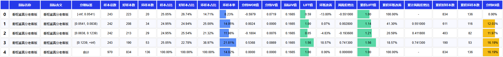

[分箱 Notebook](examples/01_binning.ipynb) · [完整展示 HTML](docs/assets/readme/binning-eda/binning-show.html) · [方法对比工作簿](docs/assets/readme/binning-eda/method-comparison-tables.xlsx) · [多标签金额工作簿](docs/assets/readme/binning-eda/multi-dpd-tables.xlsx)

同一入口可通过 `overdue=["MOB1"]`、`dpds=[7, 3, 0]` 分析多种逾期口径，通过 `amount="放款金额"` 增加金额指标；`feature_group_binning_summary` 支持按月份或客群比较。

<a id="binning-plots"></a>

### 分箱图

`bin_plot` 展示样本结构与坏率，`bin_2d_plot` 展示交叉风险，`bin_trend_plot` 检查跨期变化，`bin_overdues_plot` 比较多个逾期口径。

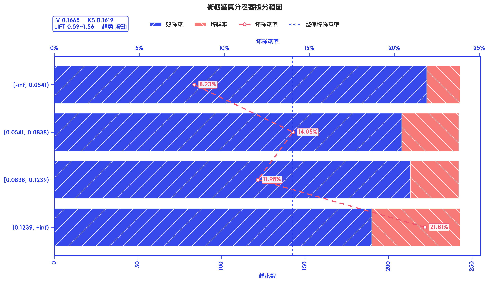

<details>
<summary>二维分箱与跨期趋势</summary>

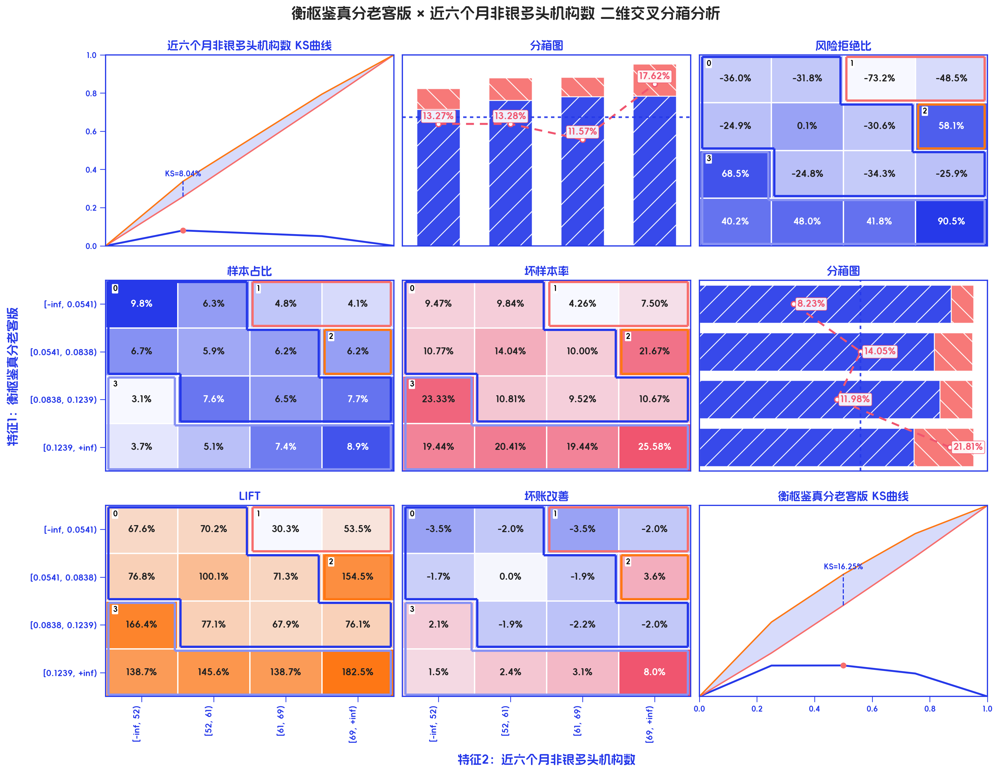

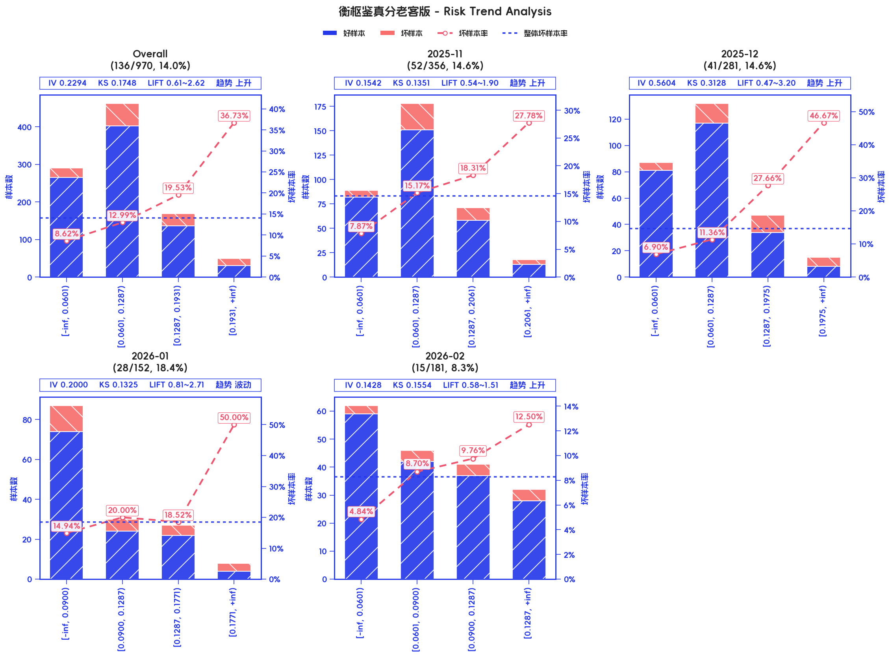

</details>

[分箱图 Notebook](examples/13_binning_plots.ipynb) · [二维分箱](examples/22_optimal_binning_2d.ipynb) · [分箱效率](examples/16_feature_efficiency_analysis.ipynb)

<a id="eda"></a>

### 数据探索

`df.summary()` 汇总数据质量、分布与区分度，`auto_feature_analysis` 生成多标签、金额和时间分析报告。客群迁移、Vintage 与 Roll Rate 可直接使用 EDA 函数。

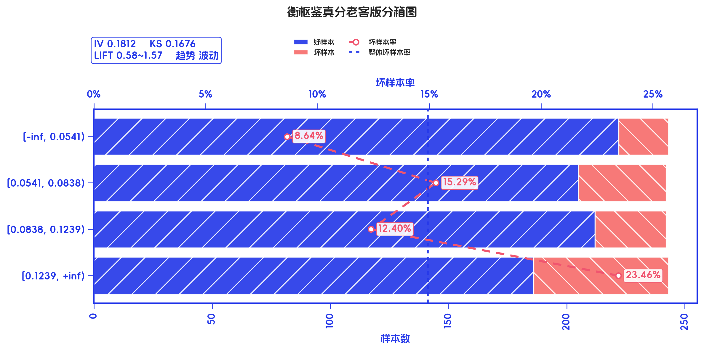

[EDA Notebook](examples/06_eda.ipynb) · [客群与策略](examples/15_population_strategy_eda.ipynb) · [数据摘要工作簿](docs/assets/readme/binning-eda/summary-tables.xlsx)

<a id="selection"></a>

### 特征筛选

`CompositeFeatureSelector` 串联筛选步骤，`SelectionReportCollector` 保留阶段汇总、逐特征决策和迭代记录。

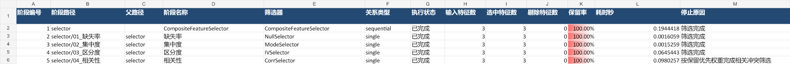

[筛选 Notebook](examples/03_selectors.ipynb) · [筛选工作簿](docs/assets/readme/strategy/组合筛选展示.xlsx)

<a id="logistic"></a>

### 逻辑回归

`LogisticRegression.summary()` 返回系数、标准误、显著性、置信区间和 VIF；`plot_weights` 直接绘制系数与置信区间。

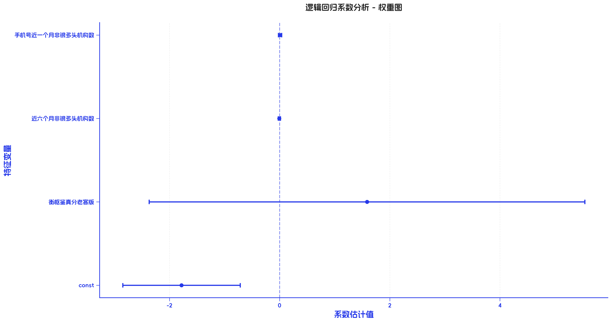

[模型 Notebook](examples/04_models.ipynb) · [统计摘要工作簿](docs/assets/readme/models/logistic-summary.xlsx)

<a id="scorecard"></a>

### 评分卡

`ScoreCard` 将 WOE 与逻辑回归转换为分值表；`RoundScoreCard` 提供整分卡，`ProbabilityScoreCard` 将模型概率映射到评分。

```python
from hscredit import OptimalBinning, ScoreCard
from sklearn.model_selection import train_test_split

features = ["衡枢鉴真分老客版", "近六个月非银多头机构数", "青云24"]
X_train, X_test, y_train, y_test = train_test_split(
    df[features], df["FPD"], test_size=0.25, stratify=df["FPD"], random_state=42,
)
binner = OptimalBinning(method="quantile", max_n_bins=4, n_jobs=1)
binner.fit(X_train, y_train)
card = ScoreCard(binner=binner, base_score=650, base_odds=35, pdo=50, rate=2)
card.fit(X_train, y_train, input_type="raw")
scores = card.predict(X_test)
points = card.export(to_frame=True)
```

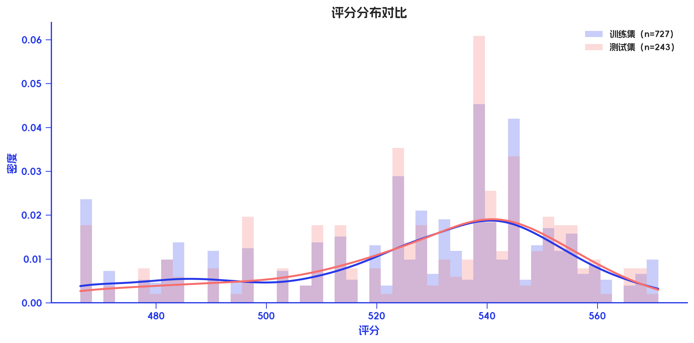

[评分卡 Notebook](examples/14_scorecard_germancredit.ipynb) · [整分卡](examples/17_round_scorecard_consistency.ipynb) · [示例分值工作簿](docs/assets/readme/models/scorecard-points.xlsx)

<a id="rules"></a>

### 规则与策略

`Rule` 支持与、或、非、异或组合，`Rule.report` 评估件数与金额效果。规则集分析和 Swap 分析用于对比新旧策略、定位置入置出人群。

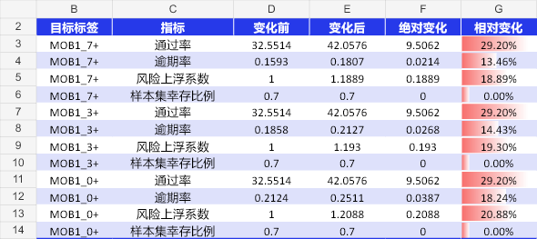

[规则 Notebook](examples/08_rules.ipynb) · [规则置换](examples/20_rule_swap_analysis.ipynb) · [置换工作簿](docs/assets/readme/strategy/规则置换完整分析.xlsx)

<a id="manual-tree"></a>

### 规则挖掘

从单变量、多变量与多标签中生成候选规则；树规则支持自动训练、手工干预和多叉分裂。

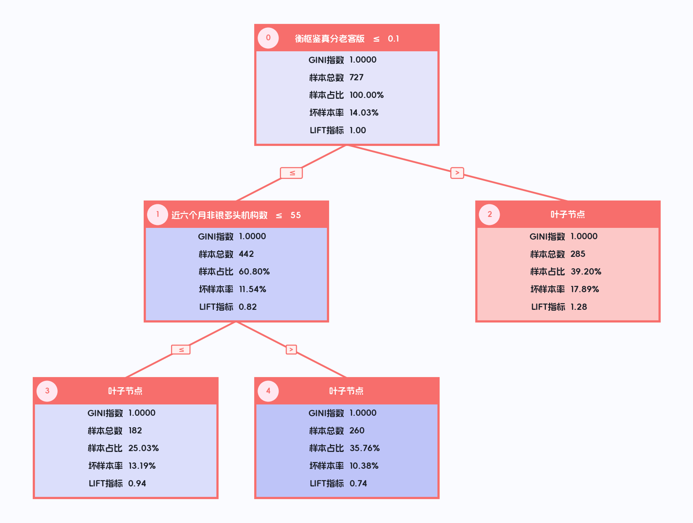

[手工树 Notebook](examples/25_manual_tree_rule_mining.ipynb) · [多叉树](examples/26_multiway_tree.ipynb) · [节点规则工作簿](docs/assets/readme/strategy/手工决策树完整规则.xlsx)

<a id="models"></a>

### 模型训练

经典模型、Boosting 与表格神经网络共享训练、评估、保存和报告入口。损失对象可传入支持的框架，`auto_model_report` 输出模型评估工作簿。神经网络支持预训练与微调，Boosting 支持继续训练。

[模型流程 Notebook](examples/28_model_workflow.ipynb) · [神经网络](examples/net_models.ipynb) · [迁移续训](examples/pretraining_and_continuation.ipynb) · [损失与指标](examples/losses_workflow.ipynb)

<a id="tuning"></a>

### 参数搜索

`ModelTuner` 与 `AutoTuner` 支持交叉验证、单/多目标、剪枝、试验记录与 Pareto 候选。Optuna Dashboard 可检查实际 Study 的训练过程。

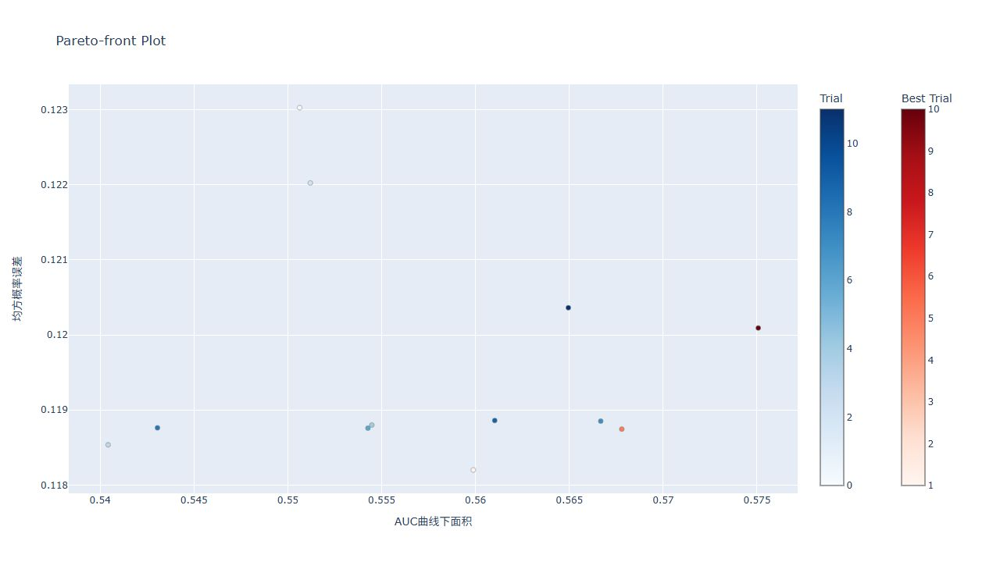

[调参 Notebook](examples/tuning_workflow.ipynb) · [候选模型工作簿](docs/assets/readme/models/pareto-trial-review.xlsx)

<a id="explainability"></a>

### 模型解释

统一解释接口提供全局重要性、SHAP 分布、依赖关系、单样本贡献、原因码与反事实候选。

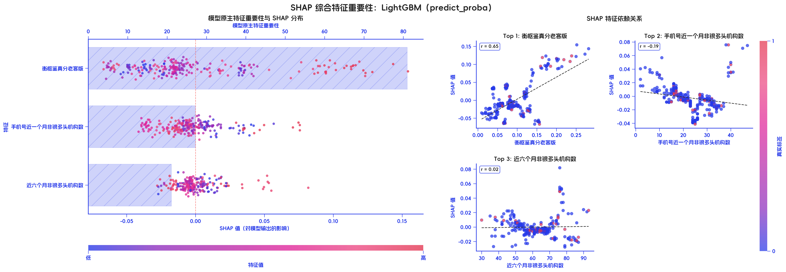

[解释 Notebook](examples/27_model_interpretability.ipynb) · [解释指南](docs/articles/model-interpretability.md)

<a id="excel"></a>

### Excel 报告

`ExcelWriter` 与 `dataframe2excel` 支持多 Sheet、图片、数字格式、条件格式、冻结窗格、超链接与原生透视表。`DataFrame.save()` 可直接保存分析结果：

```python
table.save(
    "分箱报告.xlsx", sheet_name="分箱统计", index=False, auto_width=True,
    percent_cols=["样本占比", "坏样本率"],
    condition_cols=["坏样本率", "LIFT值", "指标IV值"],
)
```

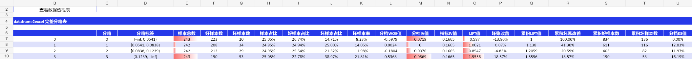

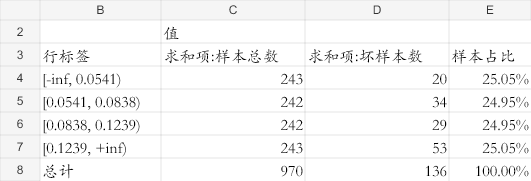

[Excel Notebook](examples/23_excel_writer.ipynb) · [完整功能工作簿](docs/assets/readme/excel/excel-features.xlsx) · [DataFrame.save 工作簿](docs/assets/readme/excel/dataframe-save.xlsx)

## 文档与复现

[在线文档](https://hscredit.hengshucredit.com/) · [API 参考](https://hscredit.hengshucredit.com/api/index.html) · [全部 Notebook](examples/) · [功能总览](docs/overview.md) · [版本规划](docs/ROADMAP.md)

演示以 Notebook 为入口，按单元格逐步执行。分箱截图可由上面的 `table.show().export_html("分箱展示.html")` 导出同一样式后在浏览器截图；Excel 图片对应链接工作簿中的实际内容。

```bash
python scripts/validate_examples.py --pattern 00_quickstart.ipynb
pytest tests/ -m "not slow and not integration"
```

问题与建议请提交到 [GitHub Issues](https://github.com/hengshu-credit/hscredit/issues)。

## 联系与许可

邮箱：`hscredit@hengshucredit.com` · 微信：`itlubber` · 公众号：**衡枢风控**（回复 `入群` 加入技术交流群）。

[MIT License](LICENSE)
