# hscredit

<p align="center">
  
</p>

<p align="center">
  
  <a href="https://pypi.org/project/hscredit/"></a>
  <a href="https://hscredit.hengshucredit.com/"></a>
  <a href="LICENSE"></a>
</p>

<p align="center"><strong>面向信贷风控的全流程量化工具箱</strong></p>

<p align="center">🔍 鉴真伪 · 📊 斟信用 · ⚖️ 衡风险 · 🎯 枢定策</p>


**hscredit（衡枢真信）** 是面向信贷风控的 Python 工具箱：从授信数据中筛选能区分风险的变量，用评分卡、机器学习或决策树构建模型与规则，再用历史样本回测新策略的通过率和坏账率。分箱、编码和筛选可直接接入 sklearn Pipeline；从变量初筛到上线评审，都能沿用同一套逾期定义。

## 为什么选 hscredit？

<table>
<tr>
  <td width="50%" valign="top">
    <p><strong>策略上线报告</strong><br>逐条回测候选规则，比较策略调整前后的通过率与坏样本率。</p>
    <a href="docs/assets/readme/showcase/intro-strategy.png">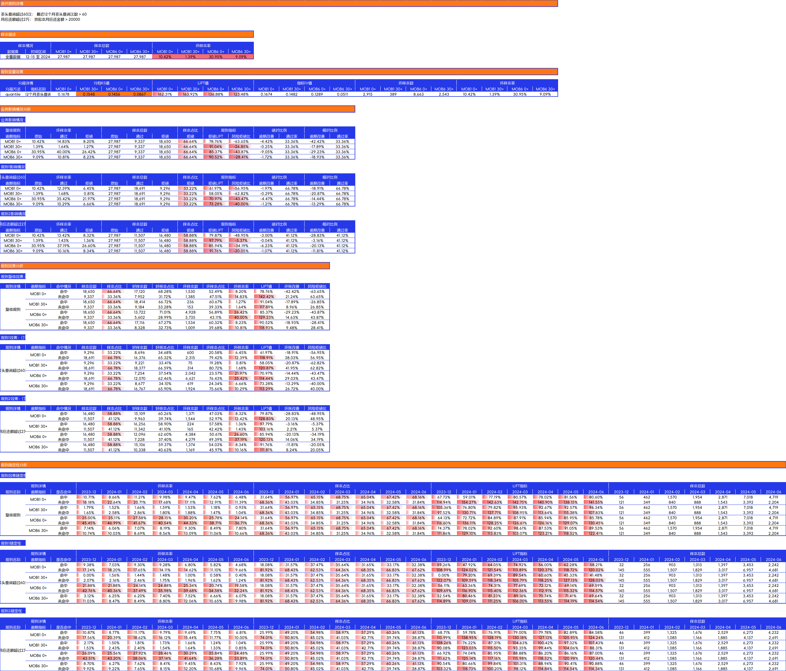</a><br>
    <a href="docs/assets/readme/showcase/swap-out.xlsx?raw=true" title="swap_out_report">下载 Excel</a>
  </td>
  <td width="50%" valign="top">
    <p><strong>模型上线报告</strong><br>对照训练集与测试集的 KS、AUC，检查高风险客群中的坏样本集中度。</p>
    <a href="docs/assets/readme/showcase/intro-model.png">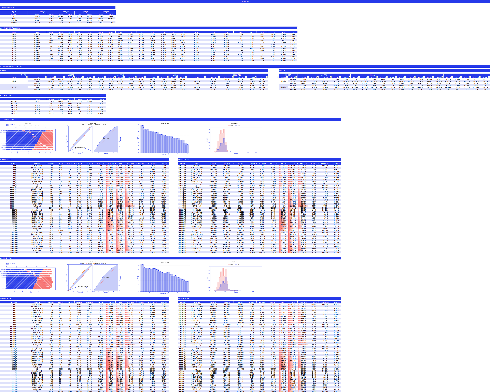</a><br>
    <a href="docs/assets/readme/showcase/auto-model-report.xlsx?raw=true" title="auto_model_report">下载 Excel</a>
  </td>
</tr>
<tr>
  <td width="50%" valign="top">
    <p><strong>规则挖掘报告</strong><br>把树的决策路径转为规则，按命中率、坏样本率和 Lift 比较节点。</p>
    <a href="docs/assets/readme/showcase/intro-rules.png">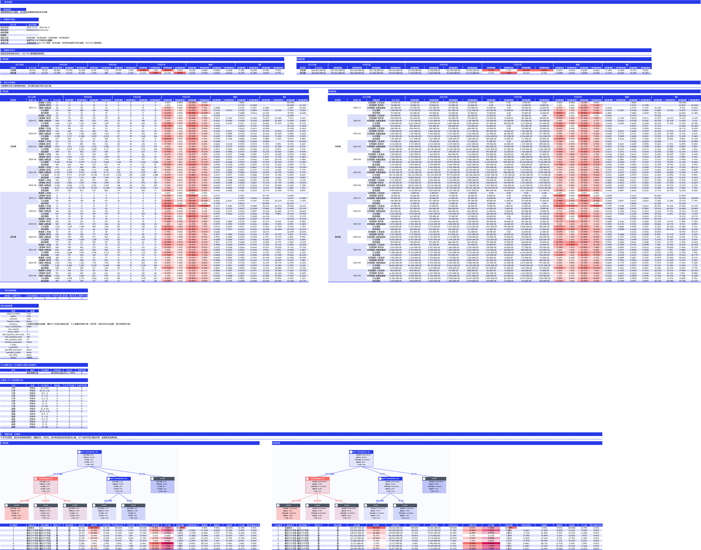</a><br>
    <a href="docs/assets/readme/showcase/multiway-tree-report.xlsx?raw=true" title="multiway_tree.report">下载 Excel</a>
  </td>
  <td width="50%" valign="top">
    <p><strong>三方数据分析报告</strong><br>用覆盖率、IV、KS 和分箱坏样本率判断哪些字段值得接入。</p>
    <a href="docs/assets/readme/showcase/intro-features.png">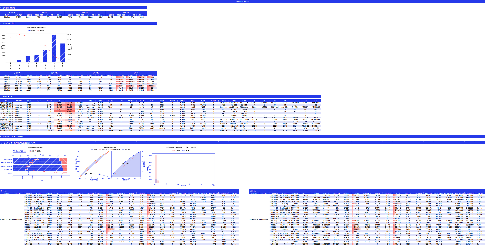</a><br>
    <a href="docs/assets/readme/showcase/feature-analysis.xlsx?raw=true" title="auto_feature_analysis">下载 Excel</a>
  </td>
</tr>
</table>

<details>
<summary>四种报告的调用示例</summary>

**四套标准 SOP，一行代码出一份 Excel 报告。** 准备好样本和待评估的变量、规则或模型，即可按统一口径比较不同客群、不同逾期标签的表现。下次评审，换一批样本就能复评。

下面使用已准备好的 `df`、`datasets`、`features`、`rules`、`model` 和 `multiway_tree`；数据与模型的准备步骤见后文示例。

```python
from hscredit.report import swap_out_report, auto_model_report, auto_feature_analysis

labels = {"overdue": ["MOB1", "MOB6"], "dpds": [0, 30], "overdue_operator": ">"}
swap_out_report(df, rules, date="授信时间", margins=True, save="策略.xlsx", **labels)
auto_model_report(model, datasets, features=features, amount="loan_amt", long_format=True, save="模型.xlsx", **labels)
multiway_tree.report(datasets, amount="loan_amt", group="GROUP", save="规则.xlsx", **labels)
auto_feature_analysis(df, features, amount="loan_amt", long_format=True, save="三方数据.xlsx", **labels)
```

`save` 统一接收文件路径或 `ExcelWriter`，`sheet` 接收工作表名称或 openpyxl `Worksheet`。传入 writer 时仅写入，最后统一调用 `writer.save(...)`。

```python
from hscredit.excel import ExcelWriter

writer = ExcelWriter()
feature_sheet = writer.get_sheet_by_name("三方数据")
auto_feature_analysis(df, features, save=writer, sheet=feature_sheet, amount="loan_amt", long_format=True, **labels)
swap_out_report(df, rules, save=writer, sheet="策略分析", date="授信时间", margins=True, **labels)
writer.save("综合报告.xlsx")
```

模型报告的 `sheet` 指定基本信息页，其他章节仍独立生成。`excel_path`、`excel_writer`、`sheet_name` 已从这些报告入口移除；底层 `dataframe2excel` 仍使用自己的 `sheet_name` 参数。完整可运行示例见 <a href="examples/29_api_reference.ipynb">公开 API Notebook</a>，参数与迁移说明见 <a href="docs/analysis_parameters.md">分析参数约定</a>。

</details>

<a href="https://hscredit.hengshucredit.com/showcase.html#gallery-reports" style="color:#c02dd4;">在文档中查看报告示例</a>

## 交流与关注

<div align="center">

<table align="center" width="100%">
<tr>
  <td align="center" valign="top" width="50%">
    <br>
    微信 · itlubber
  </td>
  <td align="center" valign="top" width="50%">
    <br>
    公众号 · 衡枢风控实验室<br>
    hscreditlab · 回复「入群」
  </td>
</tr>
</table>

<p>邮箱：<a href="mailto:hscredit@hengshucredit.com" style="color:#c02dd4;">hscredit@hengshucredit.com</a></p>

</div>

## 核心功能盘点

<div class="hs-capabilities" style="overflow-x:auto; max-width:100%; border:0;">
<table style="white-space:nowrap; width:max-content; border-collapse:collapse; color:#2b2540; font-size:13px;">
<thead><tr><th style="background:#2639E9; color:white; padding:8px 12px; text-align:left; white-space:nowrap; border-left:2px solid white;">模块</th><th style="background:#2639E9; color:white; padding:8px 12px; text-align:left; white-space:nowrap; border-left:2px solid white;">能力范围</th><th style="background:#2639E9; color:white; padding:8px 12px; text-align:left; white-space:nowrap; border-left:2px solid white;">落地功能</th></tr></thead>
<tbody>
<tr style="background:#ffffff;"><td nowrap style="padding:8px 12px; white-space:nowrap; border:0;"><a href="hscredit/core/binning" style="color:#c02dd4;"><strong>特征分箱</strong></a></td><td nowrap style="padding:8px 12px; white-space:nowrap; border:0;">17&nbsp;种一维方法&nbsp;·&nbsp;二维交叉分箱</td><td nowrap style="padding:8px 12px; white-space:nowrap; border:0;">自定义目标、多标签、金额口径、方法比较、按月与客群分析</td></tr>
<tr style="background:#dee1fb;"><td nowrap style="padding:8px 12px; white-space:nowrap; border:0;"><a href="hscredit/core/encoders" style="color:#c02dd4;"><strong>特征编码</strong></a></td><td nowrap style="padding:8px 12px; white-space:nowrap; border:0;">9&nbsp;种编码器</td><td nowrap style="padding:8px 12px; white-space:nowrap; border:0;">WOE、目标均值、有序编码、独热、频次、分位数、树叶编码、高基数处理</td></tr>
<tr style="background:#ffffff;"><td nowrap style="padding:8px 12px; white-space:nowrap; border:0;"><a href="hscredit/core/selectors" style="color:#c02dd4;"><strong>特征筛选</strong></a></td><td nowrap style="padding:8px 12px; white-space:nowrap; border:0;">过滤法&nbsp;·&nbsp;包装法&nbsp;·&nbsp;嵌入法</td><td nowrap style="padding:8px 12px; white-space:nowrap; border:0;">IV&nbsp;/&nbsp;KS&nbsp;/&nbsp;Lift&nbsp;/&nbsp;PSI、相关性、Null&nbsp;Importance、RFE、组合筛选报告</td></tr>
<tr style="background:#dee1fb;"><td nowrap style="padding:8px 12px; white-space:nowrap; border:0;"><a href="hscredit/core/models" style="color:#c02dd4;"><strong>风控建模</strong></a></td><td nowrap style="padding:8px 12px; white-space:nowrap; border:0;">经典模型&nbsp;·&nbsp;Boosting&nbsp;·&nbsp;表格神经网络</td><td nowrap style="padding:8px 12px; white-space:nowrap; border:0;">LR、评分卡、XGBoost、TabPFN、规则分类、调参、解释与部署</td></tr>
<tr style="background:#ffffff;"><td nowrap style="padding:8px 12px; white-space:nowrap; border:0;"><a href="hscredit/core/metrics" style="color:#c02dd4;"><strong>评估与优化</strong></a></td><td nowrap style="padding:8px 12px; white-space:nowrap; border:0;">分类&nbsp;·&nbsp;回归&nbsp;·&nbsp;业务损益</td><td nowrap style="padding:8px 12px; white-space:nowrap; border:0;">区分度、稳定性、校准、自定义评估函数与自定义损失</td></tr>
<tr style="background:#dee1fb;"><td nowrap style="padding:8px 12px; white-space:nowrap; border:0;"><a href="hscredit/core/rules" style="color:#c02dd4;"><strong>规则分析</strong></a></td><td nowrap style="padding:8px 12px; white-space:nowrap; border:0;">规则执行&nbsp;·&nbsp;规则挖掘&nbsp;·&nbsp;策略置换</td><td nowrap style="padding:8px 12px; white-space:nowrap; border:0;">Rule&nbsp;/&nbsp;RuleSet&nbsp;/&nbsp;RuleFlow、Swap、多规则迭代、二叉与多叉树</td></tr>
<tr style="background:#ffffff;"><td nowrap style="padding:8px 12px; white-space:nowrap; border:0;"><a href="hscredit/core/eda" style="color:#c02dd4;"><strong>数据挖掘</strong></a></td><td nowrap style="padding:8px 12px; white-space:nowrap; border:0;">EDA&nbsp;·&nbsp;VIZ&nbsp;·&nbsp;自动报告</td><td nowrap style="padding:8px 12px; white-space:nowrap; border:0;">数据摘要、KS、相关性、分布、混淆矩阵、PSI、坏率趋势、多标签报告</td></tr>
<tr style="background:#dee1fb;"><td nowrap style="padding:8px 12px; white-space:nowrap; border:0;"><a href="hscredit/excel" style="color:#c02dd4;"><strong>Excel 写入</strong></a></td><td nowrap style="padding:8px 12px; white-space:nowrap; border:0;">原生工作簿交付</td><td nowrap style="padding:8px 12px; white-space:nowrap; border:0;">条件格式、图片、超链接、冻结窗格、透视表、行高列宽</td></tr>
<tr style="background:#ffffff;"><td nowrap style="padding:8px 12px; white-space:nowrap; border:0;"><a href="hscredit/database" style="color:#c02dd4;"><strong>数据库读写</strong></a></td><td nowrap style="padding:8px 12px; white-space:nowrap; border:0;">7&nbsp;类&nbsp;SQL&nbsp;·&nbsp;2&nbsp;类&nbsp;NoSQL</td><td nowrap style="padding:8px 12px; white-space:nowrap; border:0;">连接池、参数化查询、流式读取、分批写入、元数据</td></tr>
<tr style="background:#dee1fb;"><td nowrap style="padding:8px 12px; white-space:nowrap; border:0;"><a href="skills/CATALOG.md" style="color:#c02dd4;"><strong>Agent 能力</strong></a></td><td nowrap style="padding:8px 12px; white-space:nowrap; border:0;">8&nbsp;个&nbsp;Skills</td><td nowrap style="padding:8px 12px; white-space:nowrap; border:0;">分箱、建模、规则、筛选、绘图与报告交付的自然语言入口</td></tr>
</tbody>
</table>
</div>

详细接口见<a href="docs/overview.md" style="color:#c02dd4;">功能总览</a>。

## 安装

当前源码支持 Python **3.9–3.15**，Python 3.15 已在 **Windows x64、CPython 3.15.2** 上验证。基础安装包含分箱、编码、筛选、经典模型、评分卡、SHAP、可视化、Excel 和内置数据集。

### Python 3.9–3.14

```bash
python -m pip install hscredit
```

扩展按需安装，也可组合为 `"hscredit[boost,tune]"`：

```bash
python -m pip install "hscredit[boost]"         # Boosting 模型
python -m pip install "hscredit[tune]"          # 调参与搜索看板
python -m pip install "hscredit[net]"           # TabPFN 等表格神经网络
python -m pip install "hscredit[pmml]"          # PMML 导出与加载，需要 Java 11+
python -m pip install "hscredit[database-all]"  # SQL / NoSQL 驱动
python -m pip install "hscredit[all]"           # 安装全部依赖
```

### Python 3.15

已发布的 [PyPI 0.1.4 主包](https://pypi.org/project/hscredit/0.1.4/)仍限制 Python `<3.15`。请在已激活的 Python 3.15 虚拟环境中，进入包含 3.15 适配的当前源码目录安装：

```bash
python -m pip install --upgrade pip
python -m pip install .
```

**Windows x64 兼容依赖包**已提供在 [0.1.4 Release Assets](https://github.com/hengshu-credit/hscredit/releases/tag/v0.1.4)，可直接下载，省去这些依赖的本机编译或适配：

| 依赖包 | 下载 | 适用范围 |
|:---|:---|:---|
| CatBoost 1.2.10 | [wheel](https://github.com/hengshu-credit/hscredit/releases/download/v0.1.4/catboost-1.2.10-cp315-cp315-win_amd64.whl) | CPython 3.15、Windows x64；CPU 训练与预测，不含 Jupyter 交互式训练组件 |
| NGBoost 0.6.0 | [wheel](https://github.com/hengshu-credit/hscredit/releases/download/v0.1.4/ngboost-0.6.0-py3-none-any.whl) | 纯 Python 包，放宽 Python 版本约束以支持 3.15 |
| lifelines 0.30.3 | [wheel](https://github.com/hengshu-credit/hscredit/releases/download/v0.1.4/lifelines-0.30.3-py3-none-any.whl) | NGBoost 间接依赖，适配 Python 3.15 下的 pandas 3 |
| scikit-learn 1.8.0 | [wheel](https://github.com/hengshu-credit/hscredit/releases/download/v0.1.4/scikit_learn-1.8.0-cp315-cp315-win_amd64.whl) | CPython 3.15、Windows x64；兼容 PMML 所需的 `<1.9` 版本范围 |

需要 Boosting 模型时，将以上四个文件下载至源码目录下的 `native-wheels/`，依次执行；第一步仅安装兼容包，第二步由 pip 补齐依赖：

```bash
python -m pip install --no-index --no-deps --force-reinstall --find-links=./native-wheels catboost==1.2.10 ngboost==0.6.0 lifelines==0.30.3 scikit-learn==1.8.0
python -m pip install ".[boost]"
python -m pip check
```

其他扩展使用 `".[tune]"`、`".[net]"` 或 `".[pmml]"` 从当前源码安装。NumExpr、Bottleneck、LZ4 等依赖在缺少 3.15 wheel 时仍需 C++ 构建工具；PMML 的 JPype 源码构建还需 JDK 和 Apache Ant。其他平台的构建步骤及详细环境要求见 <a href="docs/installation.md#python-315">Python 3.15 安装指南</a>。

<a href="docs/installation.md" style="color:#c02dd4;">完整安装指南</a>

## 功能展示

<a href="#数据集" style="color:#c02dd4;">数据集</a> · <a href="#特征分箱" style="color:#c02dd4;">特征分箱</a> · <a href="#特征编码" style="color:#c02dd4;">特征编码</a> · <a href="#特征筛选" style="color:#c02dd4;">特征筛选</a> · <a href="#风控建模" style="color:#c02dd4;">风控建模</a> · <a href="#规则分析" style="color:#c02dd4;">规则分析</a> · <a href="#数据挖掘" style="color:#c02dd4;">数据挖掘</a> · <a href="#excel-写入" style="color:#c02dd4;">Excel 写入</a> · <a href="#数据库读写" style="color:#c02dd4;">数据库读写</a> · <a href="#agent-能力" style="color:#c02dd4;">Agent 能力</a> · <a href="#公共方法" style="color:#c02dd4;">公共方法</a>

<a href="examples/29_readme_showcase.ipynb" style="color:#c02dd4;">完整 Notebook 示例</a>

### 数据集

现金贷订单可按需读取授信特征、放款信息和逐月逾期表现。通过 PyPI 安装后，首次加载优先从 GitHub Release 下载 357.89 MiB 的 Parquet。GitHub 连接失败或 5 秒内平均下载速度低于 100 KiB/s 时，会尝试 Gitee 镜像。文件通过 SHA-256 校验后即可离线使用。用 `split=True` 分开取数，再按业务表现期定义标签，即可跟踪同一变量在不同月份和客群中的风险变化。库中也提供 German Credit、Titanic 和 Iris 数据集，用于比较建模方法。

<div style="max-width:100%; overflow-x:auto;">
<table style="white-space:nowrap; border-collapse:collapse; font-size:13px;">
<thead><tr><th style="background:#2639E9; color:white; padding:8px 12px;">项目</th><th style="background:#2639E9; color:white; border-left:2px solid white; padding:8px 12px;">内容</th></tr></thead>
<tbody>
<tr style="background:#ffffff;"><td nowrap style="padding:7px 12px; border:0; white-space:nowrap;">数据集名称</td><td nowrap style="padding:7px 12px; border:0; white-space:nowrap;"><code>hscredit</code></td></tr>
<tr style="background:#dee1fb;"><td nowrap style="padding:7px 12px; border:0; white-space:nowrap;">格式</td><td nowrap style="padding:7px 12px; border:0; white-space:nowrap;">Parquet 文件 357.89 MiB，完整 DataFrame 约 7.16 GiB</td></tr>
<tr style="background:#ffffff;"><td nowrap style="padding:7px 12px; border:0; white-space:nowrap;">行数 / 字段数</td><td nowrap style="padding:7px 12px; border:0; white-space:nowrap;">111,929 / 8,516</td></tr>
<tr style="background:#dee1fb;"><td nowrap style="padding:7px 12px; border:0; white-space:nowrap;">唯一订单 / 唯一客户</td><td nowrap style="padding:7px 12px; border:0; white-space:nowrap;">111,929 / 110,283，同一客户可有多笔订单</td></tr>
<tr style="background:#ffffff;"><td nowrap style="padding:7px 12px; border:0; white-space:nowrap;">资金方 / 流量渠道</td><td nowrap style="padding:7px 12px; border:0; white-space:nowrap;">6 / 8</td></tr>
<tr style="background:#dee1fb;"><td nowrap style="padding:7px 12px; border:0; white-space:nowrap;">授信时间范围</td><td nowrap style="padding:7px 12px; border:0; white-space:nowrap;">2023-12-15 09:01:02 至 2024-06-17 21:34:05</td></tr>
<tr style="background:#ffffff;"><td nowrap style="padding:7px 12px; border:0; white-space:nowrap;">借款申请时间范围（<code>放款时间</code>）</td><td nowrap style="padding:7px 12px; border:0; white-space:nowrap;">2023-12-15 00:00:00 至 2024-06-17 23:57:25</td></tr>
<tr style="background:#dee1fb;"><td nowrap style="padding:7px 12px; border:0; white-space:nowrap;">观察时点 / 抽数日期</td><td nowrap style="padding:7px 12px; border:0; white-space:nowrap;"><code>etl_date = 2025-11-07</code></td></tr>
<tr style="background:#ffffff;"><td nowrap style="padding:7px 12px; border:0; white-space:nowrap;">拆分后的字段数</td><td nowrap style="padding:7px 12px; border:0; white-space:nowrap;">订单信息 9，逾期数据 14，授信时点特征 X 8,493</td></tr>
<tr style="background:#dee1fb;"><td nowrap style="padding:7px 12px; border:0; white-space:nowrap;">订单信息</td><td nowrap style="padding:7px 12px; border:0; white-space:nowrap;"><code>放款编码</code>、<code>用户编码</code>、<code>loan_amt</code>、<code>periods</code>、<code>放款银行</code>、<code>流量渠道</code>、<code>授信时间</code>、<code>放款时间</code>、<code>etl_date</code></td></tr>
<tr style="background:#ffffff;"><td nowrap style="padding:7px 12px; border:0; white-space:nowrap;">逾期数据</td><td nowrap style="padding:7px 12px; border:0; white-space:nowrap;"><code>DPD</code>、<code>CURRENT_DPD</code>、<code>MOB1</code>、<code>MOB2</code>、<code>MOB3</code>、<code>MOB4</code>、<code>MOB5</code>、<code>MOB6</code>、<code>MOB7</code>、<code>MOB8</code>、<code>MOB9</code>、<code>MOB10</code>、<code>MOB11</code>、<code>MOB12</code></td></tr>
<tr style="background:#dee1fb;"><td nowrap style="padding:7px 12px; border:0; white-space:nowrap;">授信特征</td><td nowrap style="padding:7px 12px; border:0; white-space:nowrap;">多头查询、贷款账户与余额、还款压力、杠杆率、信用卡使用、公积金等授信时点风险信息。</td></tr>
<tr style="background:#dee1fb;"><td nowrap style="padding:7px 12px; border:0; white-space:nowrap;">数据详情描述</td><td nowrap style="padding:7px 12px; border:0; white-space:nowrap;">每行是一笔现金贷放款订单，关联授信时的特征、审批额度与期数，以及放款后的逐期逾期表现。</td></tr>
</tbody></table>
</div>

<a href="https://hscredit.hengshucredit.com/datasets.html" style="color:#c02dd4;">数据集文档</a>

MOB1 的 0 天、30 天口径用于短期欺诈风险代理分析，MOB6 的对应口径用于长期信用风险分析。下例以 **MOB6 > 30** 为建模目标。

```python
from hscredit import hscredit_dataset

order, overdue, X = hscredit_dataset(
    split=True, columns=["用户编码", "授信时间", "MOB1", "MOB6", "BASE_X187"]
)
```

<details>
<summary>数据加载、标签与训练集划分</summary>

```python
import numpy as np
import pandas as pd
import hscredit
from sklearn.model_selection import GroupShuffleSplit

field_map = {
    "DK_X1995_2": "非银机构借款总金额",
    "BASE_X187": "最近12个月多头查询次数",
    "DK_X44": "个人消费贷借款总金额",
    "DK_X1223": "个人消费贷款账户数",
    "DK_X1689": "现行贷款账户数",
    "DK_X1925": "个人经营性贷款账户数",
    "VAR0252": "公积金记录数",
    "DK_X2812": "现用贷款账户数量占贷款账户数量比率",
    "DK_X597": "现用消费贷本金余额求和占现用消费贷本金求和比率",
    "JH_X10": "杠杆率",
    "DJK_X1435": "现行贷记卡已用额度与授信额度比率_最大值",
    "DK_X2677": "贷款本月应还金额",
    "DK_X515": "现行房贷本月应还款_求和",
    "DK_X1948": "现用贷款本月应还款最大",
}
data = hscredit_dataset(
    columns=["用户编码", "授信时间", "loan_amt", "MOB1", "MOB6", "GROUP", "BASE_X257", "BASE_X304", *field_map]
)
df = data.rename(columns=field_map).copy()
df["授信时间"] = pd.to_datetime(df["授信时间"])
df["授信月份"] = df["授信时间"].dt.to_period("M").astype(str)
for overdue in ["MOB1", "MOB6"]:
    df[overdue] = df[overdue].where(df[overdue].notna() & df[overdue].ge(0))
df["坏样本"] = df["MOB6"].gt(30).where(df["MOB6"].notna()).astype("Int64")
analysis_features = list(field_map.values())
features = ["非银机构借款总金额", "最近12个月多头查询次数", "个人消费贷款账户数", "杠杆率", "贷款本月应还金额", "现行贷款账户数"]
model_data = df.loc[df["坏样本"].notna()].copy()
train_idx, test_idx = next(
    GroupShuffleSplit(n_splits=1, test_size=0.25, random_state=42).split(
        model_data, groups=model_data["用户编码"]
    )
)
train, test = model_data.iloc[train_idx].copy(), model_data.iloc[test_idx].copy()
X_train, X_test = train[features], test[features]
y_train, y_test = train["坏样本"].astype(int), test["坏样本"].astype(int)
fill_values = X_train.median()
X_num, X_test_num = X_train.fillna(fill_values), X_test.fillna(fill_values)
X_all = train[analysis_features].fillna(train[analysis_features].median())

labels = {"overdue": ["MOB1", "MOB6"], "dpds": [0, 30], "overdue_operator": ">"}
```

</details>

<a href="docs/assets/readme/showcase/label-summary.png">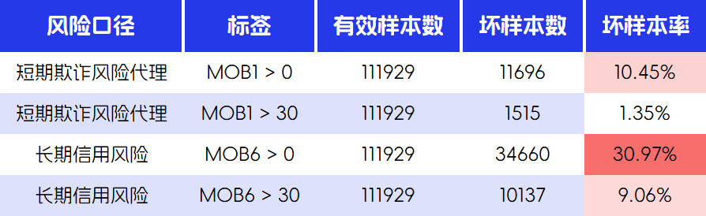</a>

### 特征分箱

可用等频、等宽等方法观察变量分布，也可按 IV、KS、Lift 或目标坏率寻找切点。对连续和类别变量，可指定切点或类别组合、单独处理缺失与特殊值，或加入单调性和自定义优化目标。分箱规则可复用于新样本，按订单、金额、标签、月份和客群比较效果。二维交叉分箱还能识别单个变量难以区分的人群。

| 方法族 | 支持方法 |
| --- | --- |
| 基础与聚类 | `uniform`、`quantile`、`kmeans` |
| 树与统计 | `tree`、`cart`、`chi`、`mdlp` |
| 风险目标 | `best_ks`、`best_iv`、`best_lift`、`target_bad_rate` |
| 形态与搜索 | `monotonic`、`genetic`、`smooth`、`kernel_density` |
| 约束优化 | `or_tools`、`cp_sat`，支持原生与自定义目标 |
| 二维分箱 | `OptimalBinning2D`、`feature_bin_stats_2d`、`bin_2d_plot` |

```python
from hscredit.report import feature_bin_stats

bin_options = dict(
    feature="BASE_X257", method="quantile", max_n_bins=4,
    margins=True, long_format=True, missing_separate=True, n_jobs=1,
)
bin_targets = {
    "欺诈风险FPD@30": df["MOB1"].gt(30).where(df["MOB1"].notna()),
    "信用风险MOB6@60": df["MOB6"].gt(60).where(df["MOB6"].notna()),
}
bins = feature_bin_stats(df, target=bin_targets, **bin_options)
bins.show()
```

**单变量分箱表** · `BASE_X257`

<a href="docs/assets/readme/showcase/binning.png">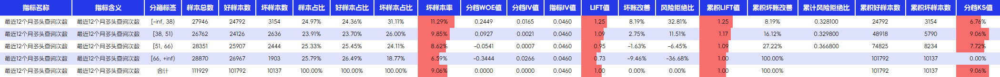</a>

**比较方法与客群。** `feature_binning_summary` 对比不同分箱方法；`feature_group_binning_summary` 按授信月份或原始字段 `GROUP`（客群划分）汇总。

下方两表均分析 `BASE_X257`，坏样本定义为 MOB6 > 30。KS 和 Lift 取各分箱的最大值，坏样本数与坏样本率按整组订单统计。

<details>
<summary>分箱摘要、客群比较与二维分箱表</summary>

```python
from hscredit.report import (
    feature_binning_summary,
    feature_group_binning_summary,
    feature_bin_stats_2d,
)

bin_tables, summary = feature_binning_summary(
    df,
    feature="BASE_X257",
    methods=["quantile", "tree", "chi"],
    target="坏样本",
    long_format=True,
    max_n_bins=4,
    margins=True,
    n_jobs=1,
)
summary.show()

month_tables, month_summary = feature_group_binning_summary(
    df, feature="BASE_X257", methods=["quantile", "tree", "chi"],
    target="坏样本", date="授信时间", freq="M", max_n_bins=4,
    margins=True, long_format=True, n_jobs=1,
)
month_summary.show()

cohort_tables, cohort_summary = feature_group_binning_summary(
    df,
    feature="BASE_X257",
    group="GROUP",
    dropna=False,
    methods="quantile",
    long_format=True,
    max_n_bins=4,
    margins=True,
    n_jobs=1,
    **labels,
)
cohort_summary.show()

bins_2d, binner_2d = feature_bin_stats_2d(
    df,
    features=["BASE_X257", "BASE_X304"],
    target=bin_targets,
    max_n_bins=3, max_n_bins_2d=7, missing_separate=True, return_binner=True,
    margins=True,
    long_format=True,
    n_jobs=1,
)
bins_2d.show()
```

</details>

**不同分箱方法的特征效果**

<a href="docs/assets/readme/showcase/binning-methods.png">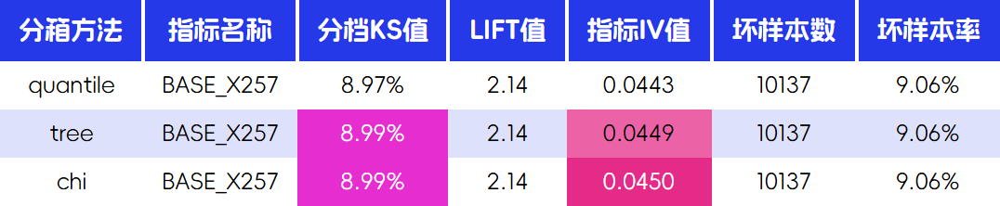</a>

**各方法按授信月份的特征效果**

<a href="docs/assets/readme/showcase/binning-groups.png">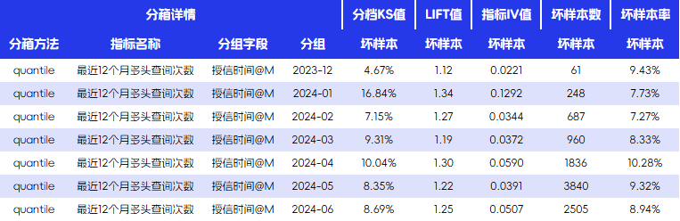</a>

**二维分箱表** · 将 `BASE_X257` 与 `BASE_X304` 交叉分箱，比较各组合的坏样本率和 Lift。

<a href="docs/assets/readme/showcase/binning-2d.png">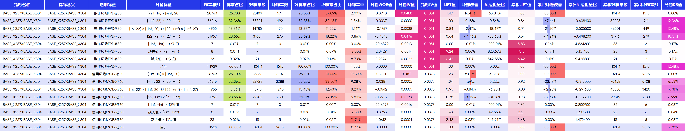</a>

<a href="https://hscredit.hengshucredit.com/showcase.html#gallery-bin-tables" style="color:#c02dd4;">在文档中查看分箱统计表</a>

<details>
<summary>自定义分箱优化目标</summary>

两个分箱方案的总 IV 可能很接近，但最高风险箱的坏样本率相差很大。制定拦截规则时，可以给最高风险箱的 Lift 加权，让切点更贴合拦截目标。如果策略需要尽量少的档位，也可以给每个额外分箱设置代价，在区分度相近时优先选择切点较少的方案。

`OptimalBinning` 的 `or_tools`、`cp_sat` 和 `genetic` 三种方法都支持下表的复合目标。每个目标都最大化 **总 IV × `iv_weight` + 附加指标 × 对应权重**。`iv_weight` 默认为 1.0。Lift 是箱内坏样本率与总体坏样本率之比，下表的“偏离”指 Lift 与 1 的绝对差。

| `objective` | 附加指标 | 选切点时侧重什么 |
| --- | --- | --- |
| `max_lift_iv` | 各箱 Lift 的最大值 | 提高最高风险箱的坏样本率，便于设置拦截档 |
| `min_lift_iv` | 各箱 Lift 的最小值 | 抬高最低风险箱的相对坏样本率 |
| `max_min_lift_sum_iv` | 最高 Lift + 最低 Lift | 同时对最高和最低 Lift 的上升给予加分 |
| `max_lift_distance_iv` | 各箱偏离的最大值 | 找出坏样本率明显高于或低于总体的箱 |
| `min_lift_distance_iv` | 各箱偏离的最小值 | 让最接近总体坏样本率的箱也有区分度 |
| `lift_distance_sum_iv` | 最大偏离 + 最小偏离 | 同时考虑区分度最强和最弱的箱 |
| `max_ks_iv` | 按分箱顺序累积的好、坏样本分布之差的最大绝对值 | 兼顾整体 IV 和切点上的 KS |
| `woe_variance_iv` | 各箱 WOE 的方差 | 拉开不同风险档位的 WOE |

前六项的附加权重为 `lift_weight`（默认 0.1），后两项分别为 `ks_weight`（默认 0.5）和 `variance_weight`（默认 0.1）。

| 使用或扩展目标 | 写法 |
| --- | --- |
| 查看可选目标 | `CustomObjectives.names()` 列出上表八项。`OptimalBinning.available_objectives("or_tools")` 同时列出该方法的原生目标。 |
| 调整预置目标的权重 | `ORBinning(objective="max_lift_iv", objective_params={"lift_weight": 0.2})` |
| 复用配好权重的目标 | `score = CustomObjectives.get("max_lift_iv", lift_weight=0.2)`，再将 `objective=score` 传给分箱器。 |
| 定义新的评分函数 | 将函数直接传给 `objective`，额外参数通过 `objective_params` 传入。函数返回一个有限实数，分数越高，方案越优。 |

下面用同一字段演示两种目标。自定义函数接收按箱排序的统计字典列表 `bin_stats` 和参与评分的好、坏样本总数 `total_good`、`total_bad`。每箱可读取 `count`、`good`、`bad`、`bad_rate`、`lift`、`woe` 和 `iv` 等字段。

```python
from hscredit.core.binning import ORBinning, CustomObjectives

feature = "最近12个月多头查询次数"
X_query = X_train[[feature]]
binner = ORBinning(
    max_n_bins=4,
    objective=CustomObjectives.max_lift_iv(lift_weight=0.2),
    n_jobs=1,
)
binner.fit(X_query, y_train)

# 总 IV 扣除额外分箱的代价，每多一箱扣 0.01。
def iv_with_bin_cost(bin_stats, total_good, total_bad, *, cost):
    total_iv = sum(row["iv"] for row in bin_stats)
    return total_iv - cost * max(0, len(bin_stats) - 1)


compact_binner = ORBinning(
    max_n_bins=4,
    objective=iv_with_bin_cost,
    objective_params={"cost": 0.01},
    n_jobs=1,
)
compact_binner.fit(X_query, y_train)
print("侧重高风险箱的切点", binner.splits_[feature])
print("计入分箱代价的切点", compact_binner.splits_[feature])
```

</details>

<details>
<summary>分箱图与跨期趋势</summary>

```python
from hscredit.core.viz import bin_plot, bin_overdues_plot, bin_trend_plot

credit_bins = bins.loc[bins["逾期标签"].eq("信用风险MOB6@60")]
trend_data = df.assign(**bin_targets)
bin_plot(credit_bins)
bin_overdues_plot(bin_table=bins, max_cols=2, n_jobs=1)
bin_trend_plot(
    trend_data,
    feature="BASE_X257",
    target="信用风险MOB6@60",
    date="授信时间",
    freq="M",
    max_n_bins=4,
    n_jobs=1,
)
bin_trend_plot(
    trend_data,
    feature="BASE_X257",
    target="信用风险MOB6@60",
    group="GROUP",
    max_n_bins=4,
    n_jobs=1,
)
```

</details>

<table>
<tr>
  <td width="50%" align="center" valign="top"><strong>单变量分箱</strong><br>
    <a href="docs/assets/readme/showcase/binning-plot.png">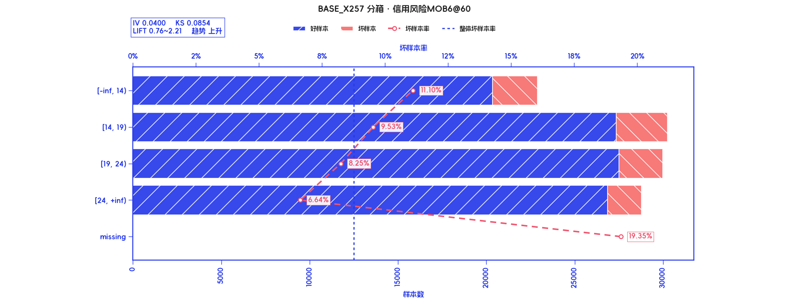</a></td>
  <td width="50%" align="center" valign="top"><strong>多标签分箱</strong><br>
    <a href="docs/assets/readme/showcase/binning-multi-plot.png">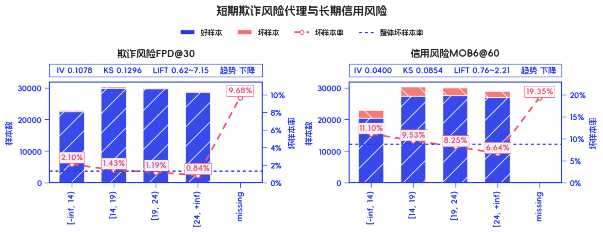</a></td>
</tr>
<tr>
  <td width="50%" align="center" valign="top"><strong>授信月份趋势</strong><br>
    <a href="docs/assets/readme/showcase/binning-trend.png">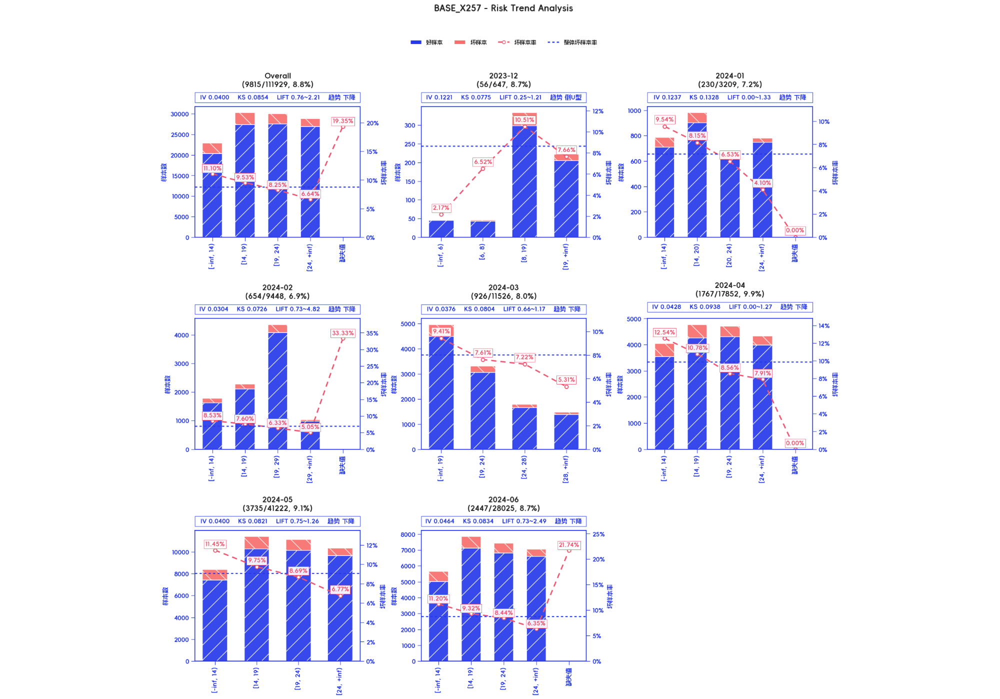</a></td>
  <td width="50%" align="center" valign="top"><strong>客群分箱趋势</strong><br>
    <a href="docs/assets/readme/showcase/binning-cohort-plot.png">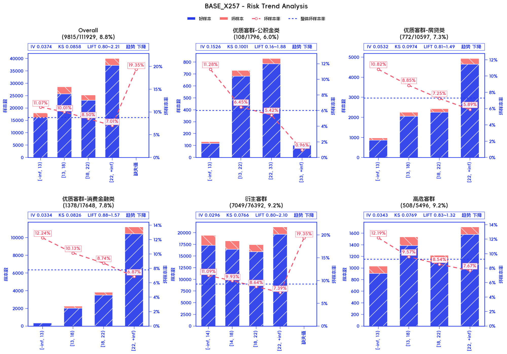</a></td>
</tr>
</table>

<a href="https://hscredit.hengshucredit.com/showcase.html#gallery-bin-charts" style="color:#c02dd4;">在文档中查看分箱图与跨期趋势</a>

<details>
<summary>二维交叉分箱</summary>

```python
from hscredit.core.viz import bin_2d_plot

bin_2d_plot(binner_2d, title="BASE_X257 × BASE_X304 · 欺诈风险FPD@30")
```

</details>

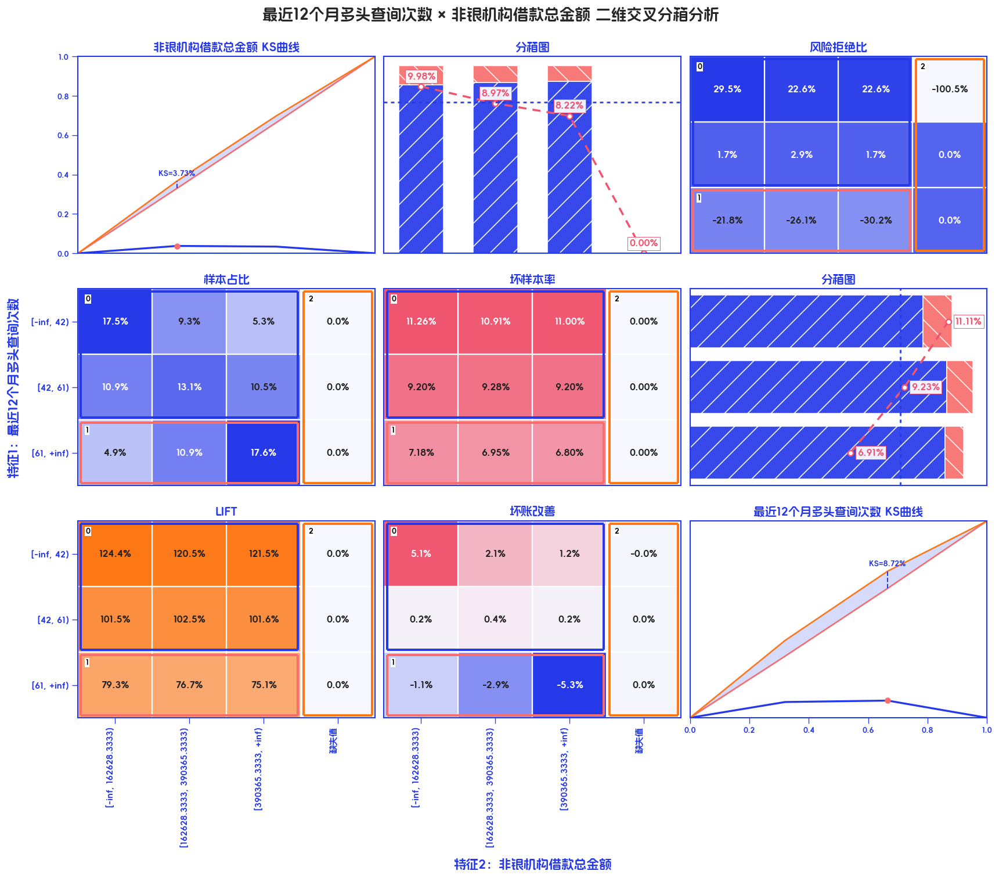

### 特征编码

编码方式取决于变量的含义。类别可以转成频数、独热向量或有序值，也可以利用目标均值、WOE 或 CatBoost 有序统计表达风险。连续变量可按分位数映射，树模型可以输出叶节点编码，高基数类别也能单独处理。各编码器都能与分箱、筛选和模型串入 sklearn Pipeline。

| 编码器 | 用途 |
| --- | --- |
| `WOEEncoder` | WOE 编码、平滑、截断、未知值和缺失值处理 |
| `TargetEncoder` | 平滑目标均值、OOF 编码 |
| `CatBoostEncoder` | 有序目标编码、训练时噪声 |
| `CountEncoder` / `OneHotEncoder` / `OrdinalEncoder` | 频次、独热与序数编码 |
| `QuantileEncoder` | 分位数映射 |
| `GBMEncoder` | 梯度提升树叶节点编码 |
| `CardinalityEncoder` | 高基数类别处理 |

<details>
<summary>WOE、目标编码与 Pipeline</summary>

```python
from hscredit import OptimalBinning
from hscredit.core.encoders import WOEEncoder, TargetEncoder, CatBoostEncoder
from sklearn.pipeline import Pipeline

binner = OptimalBinning(method="quantile", max_n_bins=4, n_jobs=1).fit(X_train, y_train)
woe = WOEEncoder(n_jobs=1).fit(binner.transform(X_train, metric="indices"), y_train)
woe.transform(binner.transform(X_test, metric="indices")).show()

for encoder in [
    TargetEncoder(cv=3, n_jobs=1),
    CatBoostEncoder(random_state=42, n_jobs=1),
]:
    encoder.fit_transform(train[["GROUP"]], y_train)
    encoder.transform(test[["GROUP"]]).show()

pipeline = Pipeline(
    [
        ("分箱", OptimalBinning(method="quantile", max_n_bins=4, n_jobs=1)),
        ("WOE", WOEEncoder(n_jobs=1)),
    ]
)
pipeline.fit(X_train, y_train)
pipeline.transform(X_test).show()
```

</details>

<table>
<tr>
  <th width="1%" align="left">TargetEncoder</th>
  <th>WOEEncoder</th>
</tr>
<tr>
  <td colspan="2" align="center">
    <a href="docs/assets/readme/showcase/encoder-target.png">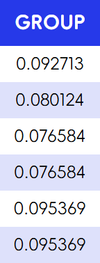</a>
    <a href="docs/assets/readme/showcase/encoder-woe.png">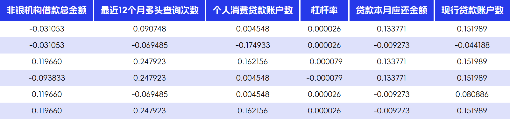</a>
  </td>
</tr>
</table>

<table>
<tr>
  <th width="1%" align="left">CatBoostEncoder</th>
  <th>Pipeline · 分箱与 WOE</th>
</tr>
<tr>
  <td colspan="2" align="center">
    <a href="docs/assets/readme/showcase/encoder-catboost.png">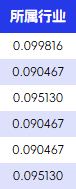</a>
    <a href="docs/assets/readme/showcase/encoder-pipeline.png"></a>
  </td>
</tr>
</table>

<a href="https://hscredit.hengshucredit.com/showcase.html#gallery-encoders" style="color:#c02dd4;">在文档中查看编码示例</a>

### 特征筛选

先用类型、字段名、缺失率、众数率、基数和方差清理候选字段，再用 IV、KS、Lift 和 PSI 权衡区分能力与稳定性。相关性与 VIF 可排查冗余变量。Boruta、递归消除、逐步回归和模型重要性则从模型效果挑选变量。组合筛选器和 Pipeline 可以保留每一步的指标、入选结果和剔除原因。

| 分类 | 组件与作用 |
| --- | --- |
| **过滤法** | Type、Regex、Null、Mode、Cardinality、Variance；IV、KS、Lift、PSI、相关性、VIF；MutualInfo、Chi2、FTest |
| **包装法** | RFE 递归消除、Sequential 顺序选择、Stepwise 逐步回归、Boruta 影子特征比较 |
| **嵌入法** | FeatureImportance 模型重要性（可配合稀疏线性或树模型） |
| 模型贡献检验与组合 | NullImportance 标签置乱检验、StabilityAware 稳定性、ScorecardFeatureSelection 评分卡组合、CompositeFeatureSelector |

<details>
<summary>四种筛选器</summary>

```python
from sklearn.ensemble import RandomForestClassifier
from hscredit.core.selectors import (
    LiftSelector,
    NullImportanceSelector,
    RFESelector,
    ScorecardFeatureSelection,
    selection_report,
)

forest = RandomForestClassifier(n_estimators=20, max_depth=3, random_state=42, n_jobs=1)
selectors = [
    LiftSelector(threshold=0.1, ratio=0.2, n_jobs=1),
    NullImportanceSelector(forest, cv=2, n_runs=2, n_jobs=1),
    RFESelector(forest, n_features_to_select=6, n_jobs=1),
    ScorecardFeatureSelection(iv_threshold=0.01, n_jobs=1),
]
for selector in selectors:
    selector.fit(X_all, y_train)
    summary, decisions = selection_report(selector)
    summary.show()
    decisions.show()
```

</details>

<table>
<tr>
  <td width="50%" align="center" valign="top"><strong>Lift 筛选</strong><br>
    <a href="docs/assets/readme/showcase/selector-lift.png">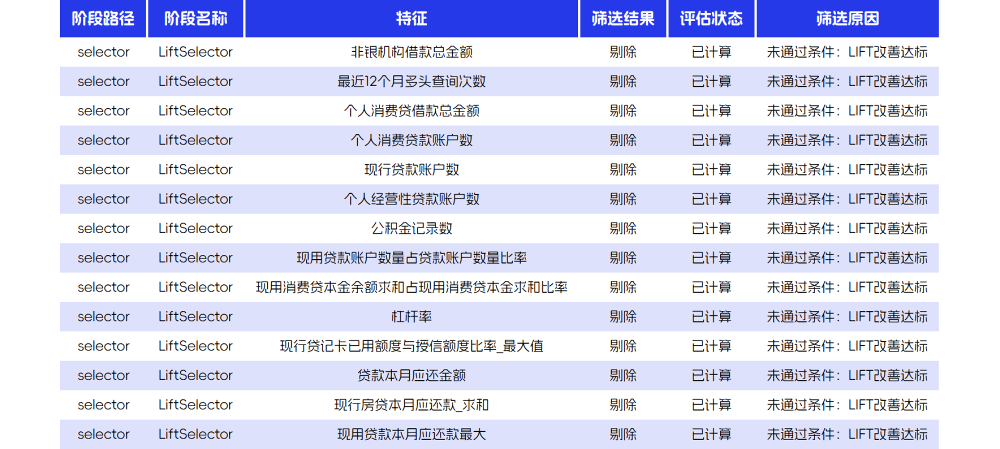</a></td>
  <td width="50%" align="center" valign="top"><strong>Null Importance 筛选</strong><br>
    <a href="docs/assets/readme/showcase/selector-null-importance.png">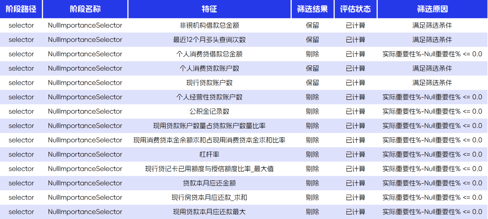</a></td>
</tr>
<tr>
  <td width="50%" align="center" valign="top"><strong>递归特征消除（RFE）</strong><br>
    <a href="docs/assets/readme/showcase/selector-rfe.png">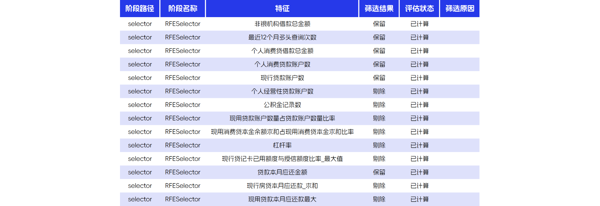</a></td>
  <td width="50%" align="center" valign="top"><strong>评分卡组合筛选</strong><br>
    <a href="docs/assets/readme/showcase/selector-scorecard.png">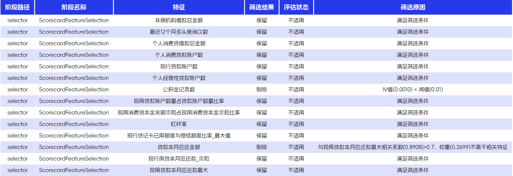</a></td>
</tr>
</table>

<a href="https://hscredit.hengshucredit.com/showcase.html#gallery-selectors" style="color:#c02dd4;">在文档中查看筛选示例</a>

```python
from hscredit.core.selectors import NullSelector, CorrSelector, selection_report
from sklearn.pipeline import Pipeline

selection = Pipeline(
    [
        ("缺失率", NullSelector(threshold=0.95, n_jobs=1)),
        (
            "相关性",
            CorrSelector(
                threshold=0.8,
                bin_params={"method": "best_iv", "max_n_bins": 5},
                n_jobs=1,
            ),
        ),
    ]
)
selection.fit(X_all, y_train)
summary, decisions = selection_report(selection)
summary.show()
```

<a href="docs/assets/readme/showcase/selection-summary.png">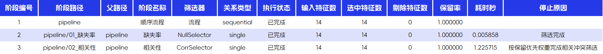</a>

### 风控建模

从逻辑回归与评分卡，到随机森林、支持向量机、Boosting 和表格神经网络，可以针对评分、分类或回归任务比较模型。训练时可用自定义损失和业务指标做交叉验证与多目标调参。上线前可校准概率、转换评分，用 SHAP、原因码及反事实解释分析个体决策。多数据集报告和模型导出用于上线评审与部署。

| 模型族 | 组件 |
| --- | --- |
| 经典模型 | LogisticRegression、DecisionTree、RandomForest、ExtraTrees、GradientBoosting、SVM |
| Boosting | XGBoost、LightGBM、CatBoost、NGBoost |
| 表格神经网络 | ResNet、FTTransformer、TabM、TabNet、TabPFN |
| 评分卡 | ScoreCard、RoundScoreCard、ProbabilityScoreCard；分数转换与漂移调整 |
| 规则分类 | RulesClassifier，组合 Rule / RuleSet |
| 配套能力 | ModelTuner / AutoTuner、概率校准、SHAP、自定义损失、模型报告、推理导出 |

**LR + Scorecard。** 查看回归系数与统计诊断，把 WOE 转换为分值表和评分刻度。

```python
from hscredit import LogisticRegression, OptimalBinning, ScoreCard, WOEEncoder

binner = OptimalBinning(method="quantile", max_n_bins=4, n_jobs=1).fit(X_train, y_train)
bin_ids = binner.transform(X_train, metric="indices")
woe = WOEEncoder(n_jobs=1).fit(bin_ids, y_train)
X_woe = woe.transform(bin_ids)
lr = LogisticRegression(max_iter=500).fit(X_woe, y_train)
lr.summary().show()

card = ScoreCard(
    binner=binner, encoder=woe, lr_model=lr, base_score=650, base_odds=35, pdo=50
)
card.fit(X_train, y_train, input_type="raw")
card.scorecard_points().show()
card.scorecard_scale().show()
```

<table>
<tr>
  <td width="50%" align="center" valign="top"><strong>评分卡分值</strong><br>
    <a href="docs/assets/readme/showcase/scorecard-points.png">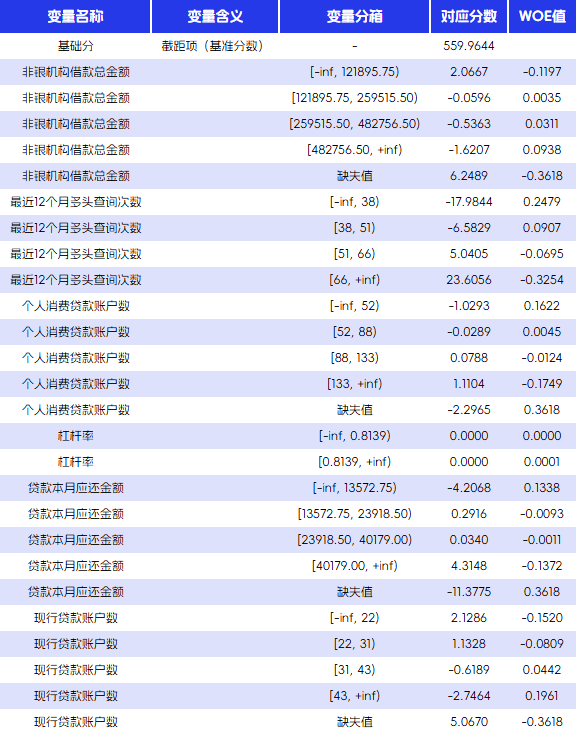</a></td>
  <td width="50%" align="center" valign="top"><strong>逻辑回归统计摘要</strong><br>
    <a href="docs/assets/readme/showcase/lr-summary.png">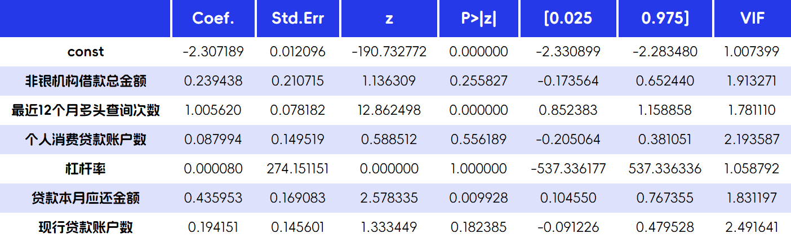</a><br>
    <strong>评分刻度</strong><br>
    <a href="docs/assets/readme/showcase/scorecard-scale.png">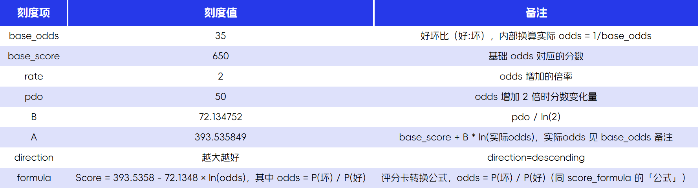</a></td>
</tr>
</table>

<a href="https://hscredit.hengshucredit.com/showcase.html#gallery-scorecard" style="color:#c02dd4;">在文档中查看评分卡示例</a>

**XGBoost 与超参数搜索。** 用 `.tune()` 指定搜索空间，也可用 `AutoTuner` 的预设空间；Dashboard 查看搜索过程，Pareto 前沿比较多个优化目标。

```python
from hscredit import XGBoost, AutoTuner

model = XGBoost(n_estimators=40, max_depth=3, n_jobs=1, random_state=42)
model.fit(X_num, y_train)
probability = model.predict_proba(X_test_num)[:, 1]

best = model.tune(
    X_num,
    y_train,
    metric="auc",
    cv=2,
    n_trials=2,
    n_jobs=1,
    search_space={"max_depth": [2, 3], "learning_rate": [0.05, 0.1]},
)

pareto_tuner = AutoTuner.create(
    "xgboost",
    metric=["auc", "ks_diff"],
    cv=2,
    random_state=42,
    n_jobs=1,
    search_space={"max_depth": [2, 3, 4], "learning_rate": [0.03, 0.1, 0.2]},
    fixed_params={"n_estimators": 30, "n_jobs": 1},
    storage="sqlite:///hscredit.db",
    study_name="XGBoost多目标搜索",
)
pareto_tuner.fit(X_num, y_train, n_trials=8)
pareto_tuner.plot_pareto_front().show()
```

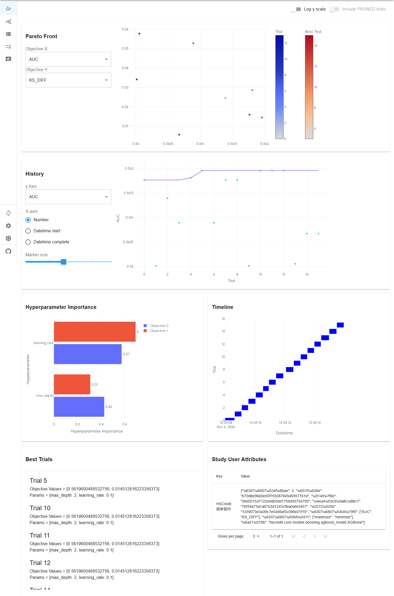

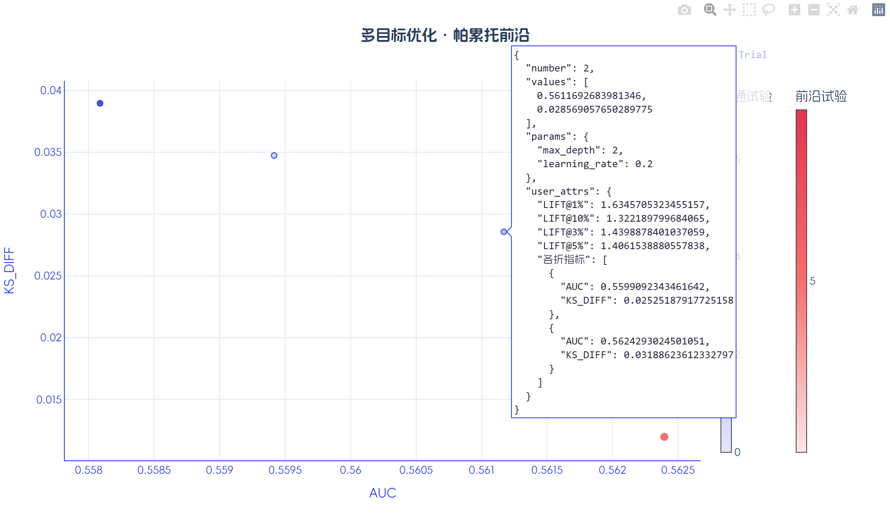

```bash
hscredit dashboard sqlite:///hscredit.db
```

该入口自动使用 hscredit 配色和内置字体，页面控件与 Plotly 图表一起应用主题；也可运行 `python -m hscredit dashboard sqlite:///hscredit.db`。支持 `--host`、`--port`、`--artifact-dir` 和 `--quiet`。安装依赖及主题兼容说明见<a href="docs/articles/tuning-guide.md">调参看板指南</a>。

**评估与损失。** 选择区分度、稳定性、成本或利润指标，并为支持的模型配置自定义损失。

| 评估目标 | 指标入口 |
| --- | --- |
| 区分度与稳定性 | `AUCMetric`、`KSMetric`、`GiniMetric`、`PSIMetric` |
| 头部识别 | `TopKCaptureMetric`、`TopKLiftMetric` |
| 业务效果 | `BadDebtMetric`、`ApprovalRateMetric`、`ProfitMetric`、`ClassificationCostMetric` |
| 自定义 | `make_metric` / `CallableMetric`；`LossMetric` 评估损失；调参接受 callable |

| 损失目标 | 损失对象 |
| --- | --- |
| 不平衡样本 | FocalLoss、AsymmetricFocalLoss、BalancedFocalLoss、WeightedBCELoss |
| 成本与经营 | CostSensitiveLoss、BadDebtLoss、ApprovalRateLoss、ProfitMaxLoss、ExpectedProfitLoss |
| 排序与头部 | OrdinalRankLoss、LiftFocusedLoss、RankingAUCProxyLoss、KSFocusedLoss、TopKBadCaptureLoss |
| 金额与价值 | AmountWeightedLoss、ExpectedValueLoss |

```python
from hscredit.core.models.losses import FocalLoss, KSMetric

risk_model = XGBoost(
    objective=FocalLoss(gamma=2.0),
    eval_metric=KSMetric(),
    n_estimators=40,
    max_depth=3,
    n_jobs=1,
)
risk_model.fit(X_num, y_train)
```

**模型解释。** 全局重要性与 SHAP 分布定位主要风险因素；力图和瀑布图解释单个样本的预测贡献。

```python
from hscredit.core.viz import plot_model_feature_importance, plot_model_sample_shap

plot_model_feature_importance(
    model, X_test_num.iloc[:150], y_test.iloc[:150], background_size=30, right_top_n=4
)
plot_model_sample_shap(
    model, X_test_num.iloc[[0]], background_data=X_num.iloc[:40],
    background_size=30, figsize=(18, 12),
)
```

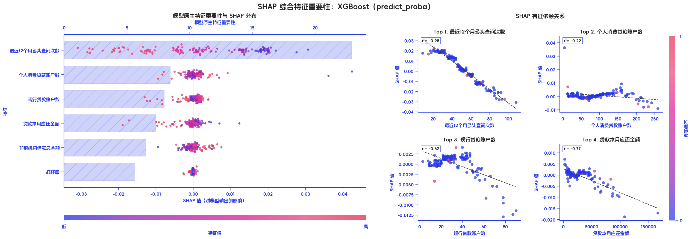

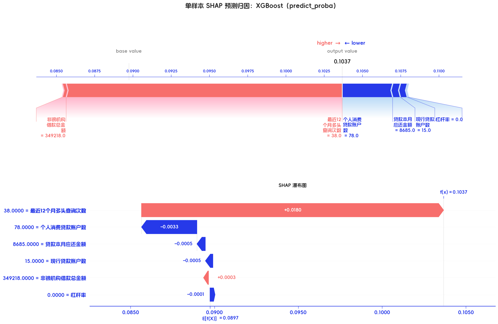

**RulesClassifier。** 将 Rule / RuleSet 组合成具有 `fit / predict` 接口的分类器。

```python
from hscredit import Rule, RuleSet, RulesClassifier

query_rule = Rule("最近12个月多头查询次数 > 60", name="多头查询超过60次")
payment_rule = Rule("贷款本月应还金额 > 20000", name="月应还额超过2万")
rule_set = RuleSet(rules=[query_rule, payment_rule], logic="or", n_jobs=1)
rule_model = RulesClassifier(rules=rule_set, n_jobs=1).fit(X_num, y_train)
rule_model.predict(X_test_num)
```

**TabPFN 预训练与微调。** 可以直接用预训练模型做上下文推理，也可以先用无标签授信特征预训练，再用逾期标签微调。

安装 `hscredit[net]` 并准备模型权重后运行。下例固定抽取 2,000 条训练样本演示，预测取测试集前 256 条。

```python
from hscredit import TabPFN

pfn_index = X_num.sample(n=min(2000, len(X_num)), random_state=42).index
X_pfn, y_pfn = X_num.loc[pfn_index], y_train.loc[pfn_index]
pfn = TabPFN(objective="binary", n_estimators=1, device="auto")
pfn.fit(X_pfn, y_pfn)
pfn.predict_proba(X_test_num.iloc[:256])

pfn_train = TabPFN(objective="binary", n_estimators=1, device="auto")
pfn_train.pretrain(X_pfn, pretraining_ratio=0.5, max_epochs=1, batch_size=128)
pfn_train.fit(
    X_pfn, y_pfn, finetune=True, finetune_params={"max_epochs": 1, "batch_size": 128}
)
```

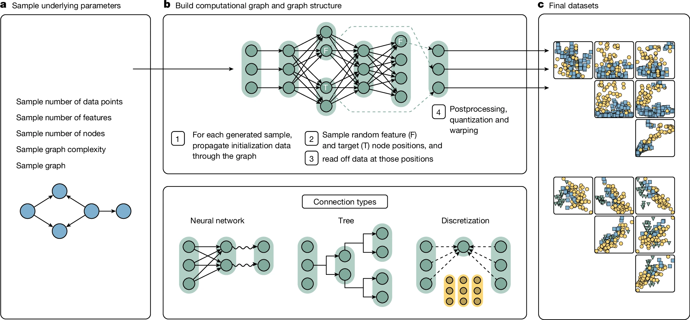

图 2 展示了 TabPFN 如何生成用于预训练的合成表格数据。来源：Hollmann 等，<a href="https://www.nature.com/articles/s41586-024-08328-6#Fig2" style="color:#c02dd4;">Nature（2025）</a>，<a href="https://creativecommons.org/licenses/by/4.0/" style="color:#c02dd4;">CC BY 4.0</a>。

**模型评估与上线报告**

`auto_model_report` 可以把训练集、测试集和时间外样本放在同一份报告中。预测逾期时，关注风险排序能否区分好坏客户。预测授信额度时，关注预测值偏离实际额度多少。

**分类模型预测逾期。** 用四种 MOB 逾期标签比较 KS 和 AUC，再按订单与金额查看各分数段的坏账表现。

```python
from hscredit.report import auto_model_report

report_train, report_test = train.copy(), test.copy()
report_train[features], report_test[features] = X_num, X_test_num
report = auto_model_report(
    model,
    datasets={"训练集": report_train, "测试集": report_test},
    features=features,
    amount="loan_amt",
    date="授信时间",
    group="GROUP",
    long_format=True,
    save="模型评估.xlsx",
    n_jobs=1,
    **labels,
)
report.summary().show()
```

<a href="docs/assets/readme/showcase/intro-model.png"></a>

<a href="docs/assets/readme/showcase/auto-model-report.xlsx?raw=true" download style="color:#c02dd4;">下载多标签分类模型报告</a>

**回归模型预测金额。** 当目标从「是否逾期」换为「审批额度」，同一个报告接口会改用平均绝对误差、均方根误差和决定系数。下面用随机森林预测 `loan_amt`，比较模型在训练集和测试集上的金额误差。

<details>
<summary>训练额度预测模型并生成回归报告</summary>

```python
from sklearn.ensemble import RandomForestRegressor

regressor = RandomForestRegressor(n_estimators=40, max_depth=4, random_state=42)
regressor.fit(X_num, train["loan_amt"])
amount_report = auto_model_report(
    regressor,
    datasets={"训练集": report_train, "测试集": report_test},
    features=features,
    target="loan_amt",
    save="回归模型报告.xlsx",
    n_jobs=1,
)
amount_report.get_metrics().show()
```

</details>

<a href="docs/assets/readme/showcase/report-regression.png">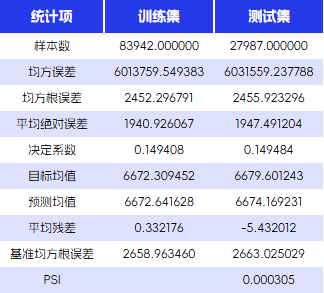</a>

按原始额度口径，测试集的平均绝对误差为 1,947.49，训练集为 1,940.93。<a href="docs/assets/readme/showcase/regression-model-report.xlsx?raw=true" download style="color:#c02dd4;">下载金额回归报告</a>

**评分卡部署。** 将同一张评分卡导出为 PMML，供评分引擎直接计算客户分数。Python 服务也可保存并加载整张评分卡，用原始授信字段得到分数。

```python
# 交付给支持 PMML 的评分引擎
card.export_pmml("scorecard.pmml")

# 在 Python 服务中恢复分箱规则、WOE 映射和评分刻度
card.save_pickle("scorecard.pkl")
serving_card = ScoreCard.load_pickle("scorecard.pkl")
scores = serving_card.predict(X_test)
```

XGBoost 模型和 sklearn Pipeline 也可用通用的 `save_pickle`、`load_pickle` 保存与恢复。

```python
from hscredit import load_pickle, save_pickle

save_pickle(model, "xgboost.pkl")
risk_model = load_pickle("xgboost.pkl")
risk_probability = risk_model.predict_proba(X_test_num)[:, 1]
```

<a href="examples/28_model_workflow.ipynb" style="color:#c02dd4;">模型流程</a> · <a href="examples/27_model_interpretability.ipynb" style="color:#c02dd4;">模型解释</a> · <a href="docs/articles/report-resources-deployment.md" style="color:#c02dd4;">部署文档</a>

### 规则分析

用 Rule 表达单条条件，用与、或、非组合规则，用 RuleFlow 编排决策流程。已有策略可按规则命中、风险覆盖、通过率、坏样本和影响金额回测，再用 Swap 比较新旧策略放进和拦下了哪些客户。寻找新策略时，可开展单变量、多变量或多标签规则挖掘，也可在二叉树、多叉树上逐个调整业务分支。

| 能力 | 入口 |
| --- | --- |
| 逻辑表达与执行 | `Rule` 的 `&` / `&#124;` / `~` / `^`，嵌套 `RuleSet`，串并行 `RuleFlow` |
| 单规则与规则集分析 | `Rule.report`、`ruleset_analysis`，件数 / 金额、多标签 |
| 策略置换 | `swap_analysis`、`rule_swap_analysis`，置入置出、风险估计、通过率变化 |
| 多规则迭代报告 | `swap_out_report`，组合规则、客群 / 时间比较、分箱明细与 Excel |
| 候选规则挖掘 | SingleFeatureRuleMiner、MultiFeatureRuleMiner、MultiLabelRuleMiner |
| 树规则挖掘 | TreeRuleExtractor、DecisionTreeAnalyzer、ManualTreeExtractor、MultiwayTreeExtractor |

**单规则：`rule.report`**

先用“贷款本月应还金额超过 2 万”筛出已命中客户，再在剩余客户中验证“多头查询超过 60 次”。报告按四种逾期标签分别列出先验规则和验证规则的命中、未命中与合计。传入 `amount="loan_amt"` 后，样本总数和坏样本率按授信额度统计。

```python
from hscredit import Rule

query_rule = Rule("最近12个月多头查询次数 > 60", name="多头查询超过60次")
payment_rule = Rule("贷款本月应还金额 > 20000", name="月应还额超过2万")
rule_metrics = ["样本总数", "样本占比", "坏样本率", "LIFT值", "坏账改善"]
query_rule.report(
    test, prior_rules=payment_rule, amount="loan_amt", margins=True,
    long_format=True, filter_cols=rule_metrics, **labels,
).show()
```

<a href="docs/assets/readme/showcase/rule-report.png">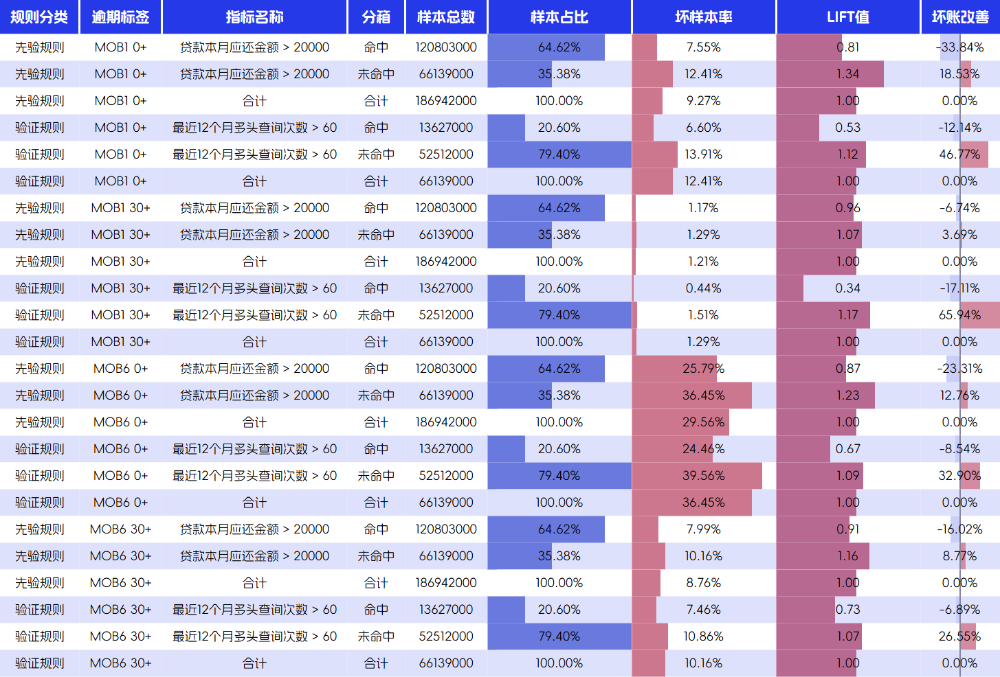</a>

**规则集：`ruleset_analysis`**

```python
from hscredit.report import ruleset_analysis

ruleset_analysis(
    test,
    rules=[query_rule, payment_rule],
    amount="loan_amt",
    long_format=True,
    filter_cols=rule_metrics,
    n_jobs=1,
    **labels,
).show()
```

<a href="docs/assets/readme/showcase/ruleset-report.png">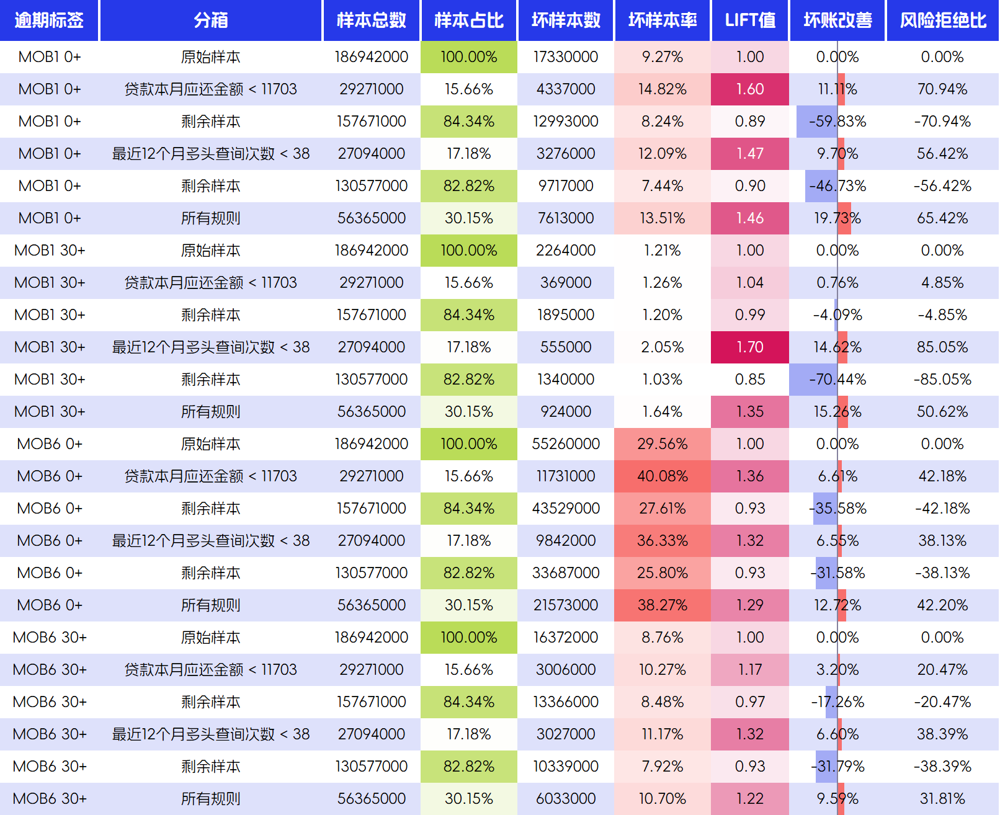</a>

**置换与多规则报告。** `swap_analysis` 量化新旧策略的置入置出；`swap_out_report` 汇总组合效果、业务影响、时间或客群稳定性及分箱明细。

策略迭代示例用训练集分位点定义两条拒绝规则，再在独立测试集比较执行前后的坏样本率。报告纳入全部规则字段，对比等频、运筹优化、目标坏率和自定义分位点分箱，各标签分箱表均保留合计行。

<details>
<summary>Swap 与多规则报告</summary>

```python
from hscredit.report import swap_out_report
from hscredit.report.swap_analysis import create_swap_dataset_from_rules, swap_analysis
from hscredit.utils.overdue import overdue_label

reference = test.assign(模型风险概率=probability)
swap_data = create_swap_dataset_from_rules(
    reference,
    original_rule=query_rule,
    new_rule=payment_rule,
    score_col="模型风险概率",
    n_jobs=1,
)
swap = swap_analysis(
    swap_data, reference_df=reference, score_col="模型风险概率", n_jobs=1, **labels
)
swap.get_summary_report(target=overdue_label("MOB6", 30, ">")).show()

# 阈值取自训练集，规则效果在独立测试集验证。
query_cut = train["最近12个月多头查询次数"].quantile(0.25)
payment_cut = train["贷款本月应还金额"].quantile(0.20)
strategy_rules = [
    Rule(f"最近12个月多头查询次数 < {query_cut:g}", name="低查询次数"),
    Rule(f"贷款本月应还金额 < {payment_cut:g}", name="低月应还额"),
]
strategy_features = ["最近12个月多头查询次数", "贷款本月应还金额"]
quantiles = [0.01, 0.03, 0.05, 0.1, 0.2, 0.3, 0.4, 0.5, 0.6, 0.7, 0.8, 0.9, 0.95, 0.97, 0.99, np.nan]
custom_splits = {
    feature: [*sorted(train[feature].quantile([q for q in quantiles if pd.notna(q)]).dropna().unique().tolist()), np.nan]
    for feature in strategy_features
}
strategy_methods = ["quantile", "or_tools", "target_bad_rate", "custom"]
strategy_bin_params = {
    "quantile": {"max_n_bins": 5},
    "or_tools": {"max_n_bins": 5, "min_bin_size": 0.05},
    "target_bad_rate": {"max_n_bins": 5, "min_bin_size": 0.05},
    "custom": {"rules": custom_splits},
}
swap_out_report(
    test,
    rules=strategy_rules,
    methods=strategy_methods,
    bin_params=strategy_bin_params,
    margins=True,
    date="授信时间",
    save="策略迭代.xlsx",
    n_jobs=1,
    **labels,
)

# 按客群比较同一组规则的命中率和坏样本率
swap_out_report(
    test, rules=strategy_rules, group="GROUP", margins=True,
    methods=strategy_methods, bin_params=strategy_bin_params,
    save="客群策略.xlsx", n_jobs=1, **labels,
)
```

</details>

<a href="docs/assets/readme/showcase/swap-summary.png">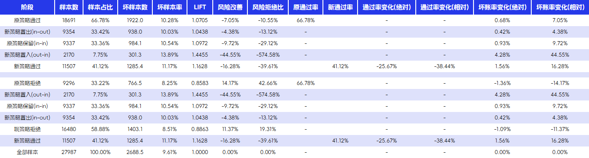</a>

<a href="docs/assets/readme/showcase/intro-strategy.png"></a>

<a href="docs/assets/readme/showcase/swap-cohort-excel.png">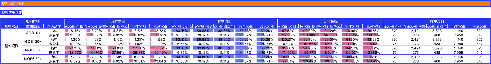</a>

<a href="docs/assets/readme/showcase/swap-out.xlsx?raw=true" download style="color:#c02dd4;">下载按月策略报告</a> · <a href="docs/assets/readme/showcase/swap-out-cohort.xlsx?raw=true" download style="color:#c02dd4;">下载客群策略报告</a>

**二叉树与多叉树挖掘。** 从树自动找到的首个风险切点出发，按业务条件细分子客群，再对照训练集和测试集的节点覆盖率、坏样本率与 Lift。

<details>
<summary>手工拆分与多数据集策略报告</summary>

```python
from hscredit.report.mining import ManualTreeExtractor, MultiwayTreeExtractor

binary_tree = ManualTreeExtractor(
    target="坏样本", features=features, max_depth=2, min_samples_leaf=100, n_jobs=1
)
binary_tree.fit(report_train, features=features)
binary_tree.manual_split(report_train, feature="贷款本月应还金额", threshold=20000, node=1)

multiway_tree = MultiwayTreeExtractor(
    target="坏样本", features=features, max_depth=2, max_n_bins=3, n_jobs=1
)
multiway_tree.fit(report_train, features=features)
child = int(multiway_tree.get_node_table().set_index("节点编号").loc[0, "子节点"][0])
multiway_tree.manual_split(
    node=child, feature="贷款本月应还金额", thresholds=[5000, 20000], grow=False
)

for name, tree in [("二叉树", binary_tree), ("多叉树", multiway_tree)]:
    tree.report(
        datasets={"训练集": report_train, "测试集": report_test},
        date="授信时间",
        group="GROUP",
        amount="loan_amt",
        save=f"{name}策略挖掘.xlsx",
        **labels,
    )
```

</details>

<table>
<tr>
  <th scope="col" width="50%">二叉树</th>
  <th scope="col" width="50%">多叉树</th>
</tr>
<tr>
  <td width="50%" align="center" valign="top"><a href="docs/assets/readme/showcase/tree-binary.png">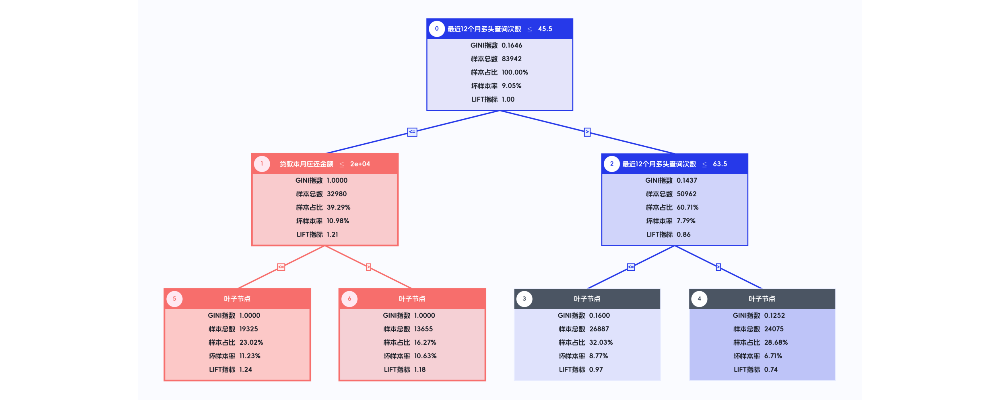</a></td>
  <td width="50%" align="center" valign="top"><a href="docs/assets/readme/showcase/tree-multiway.png"></a></td>
</tr>
<tr>
  <th colspan="2">训练集节点效果</th>
</tr>
<tr>
  <td width="50%" align="center" valign="top"><a href="docs/assets/readme/showcase/binary-tree-report-excel.png">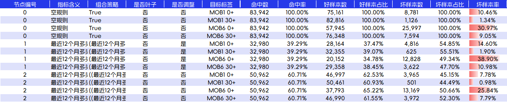</a></td>
  <td width="50%" align="center" valign="top"><a href="docs/assets/readme/showcase/multiway-tree-report-excel.png">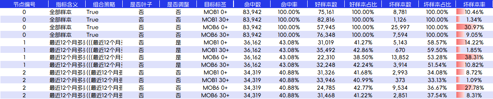</a></td>
</tr>
<tr>
  <th colspan="2">测试集节点效果</th>
</tr>
<tr>
  <td width="50%" align="center" valign="top"><a href="docs/assets/readme/showcase/binary-tree-report-test-excel.png">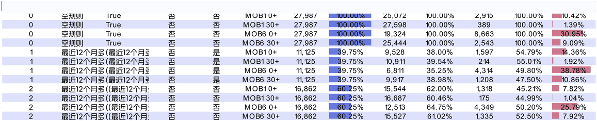</a></td>
  <td width="50%" align="center" valign="top"><a href="docs/assets/readme/showcase/multiway-tree-report-test-excel.png">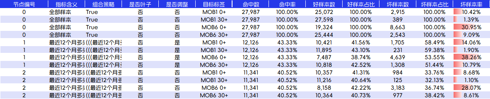</a></td>
</tr>
</table>

<a href="https://hscredit.hengshucredit.com/showcase.html#gallery-trees" style="color:#c02dd4;">在文档中查看决策树报告</a>

**多叉树组合策略汇总** · 按授信月份和客群比较样本分布，再对照订单与金额两种口径下的节点命中效果。

<a href="docs/assets/readme/showcase/intro-rules.png"></a>

<a href="docs/assets/readme/showcase/binary-tree-report.xlsx?raw=true" download style="color:#c02dd4;">下载二叉树报告</a> · <a href="docs/assets/readme/showcase/multiway-tree-report.xlsx?raw=true" download style="color:#c02dd4;">下载多叉树报告</a>

### 数据挖掘

从字段缺失、异常值、分布和相关性入手，结合分箱、交叉分析和时间趋势，判断风险信号在哪些客群中有效。Vintage 和 Roll Rate 用于观察逾期随账龄的发展与迁移。KS、ROC、混淆矩阵和 PSI 用于诊断模型区分度与漂移。可以单独取统计表、绘图，也可以把多标签和金额分析汇为一份特征报告。

| 能力 | 代表功能 |
| --- | --- |
| 数据质量与变量摘要 | `DataFrame.summary()`、缺失 / 唯一值 / 分位数 / 目标关联 |
| 模型与变量表现 | `ks_plot`、`corr_plot`、`hist_plot`、`confusion_matrix_plot` |
| 稳定性与时间趋势 | `psi_plot`、`bad_rate_trend_plot`、分组分箱、客群迁移 |
| 账龄与风险分析 | Vintage、Roll Rate、逾期表现与策略分析 |
| 自动报告 | `auto_feature_analysis`，多特征、多标签、金额、按月与相关性 |

```python
df[analysis_features + ["坏样本"]].summary(y="坏样本").show()
```

<a href="docs/assets/readme/showcase/eda-summary.png">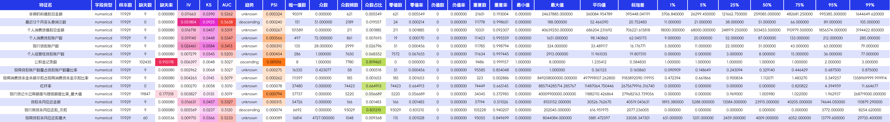</a>

<details>
<summary>常用图表</summary>

```python
from hscredit.core.viz import (
    ks_plot,
    corr_plot,
    hist_plot,
    confusion_matrix_plot,
    psi_plot,
    bad_rate_trend_plot,
)

ks_plot(probability, y_test)
corr_plot(X_all)
hist_plot(probability, y_test)
# 以训练集预测风险最高的 10% 为阈值，在测试集展示分类结果。
decision_threshold = np.quantile(model.predict_proba(X_num)[:, 1], 0.90)
confusion_matrix_plot(y_test, probability >= decision_threshold)
psi_plot(X_train["最近12个月多头查询次数"], X_test["最近12个月多头查询次数"])
bad_rate_trend_plot(df, date="授信时间", **labels)
```

</details>

<table>
<tr>
  <td width="33.33%" align="center" valign="top"><strong>KS 与 ROC</strong><br>
    <a href="docs/assets/readme/showcase/eda-ks.png">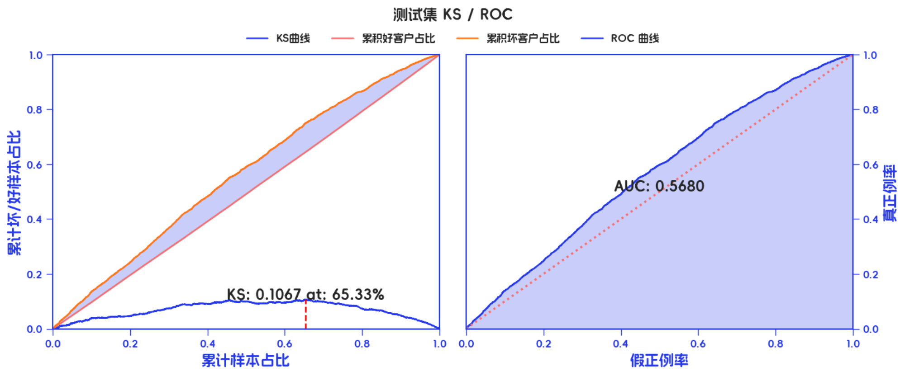</a></td>
  <td width="33.33%" align="center" valign="top"><strong>特征相关性</strong><br>
    <a href="docs/assets/readme/showcase/eda-corr.png">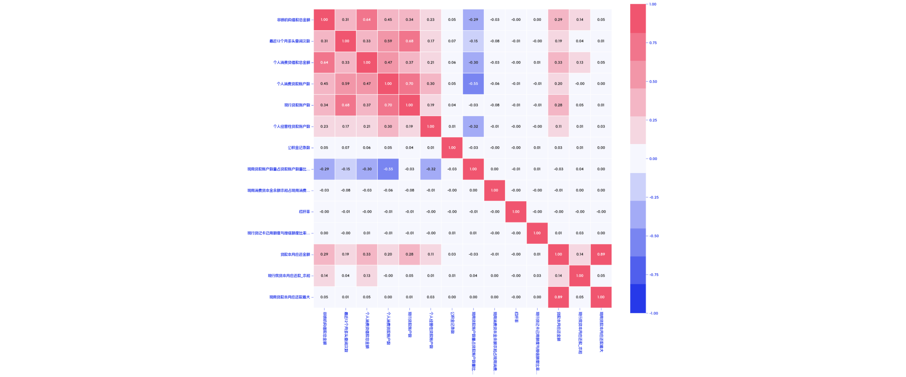</a></td>
  <td width="33.33%" align="center" valign="top"><strong>预测概率分布</strong><br>
    <a href="docs/assets/readme/showcase/eda-hist.png">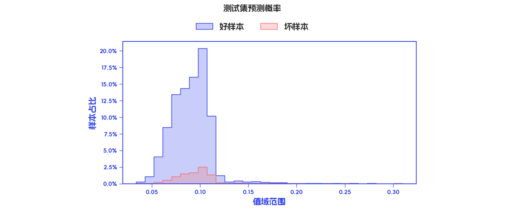</a></td>
</tr>
<tr>
  <td width="33.33%" align="center" valign="top"><strong>混淆矩阵</strong><br>
    <a href="docs/assets/readme/showcase/eda-confusion.png">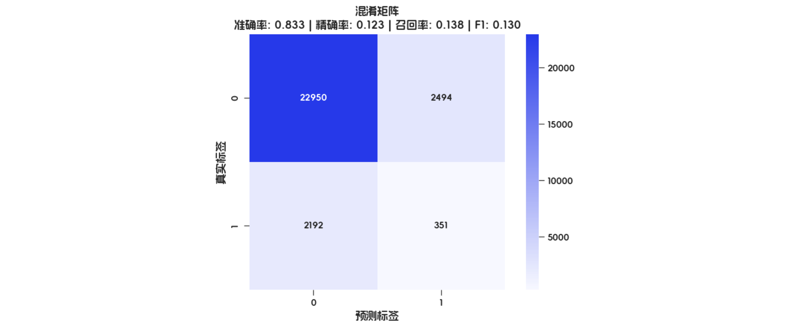</a></td>
  <td width="33.33%" align="center" valign="top"><strong>PSI 稳定性</strong><br>
    <a href="docs/assets/readme/showcase/eda-psi.png">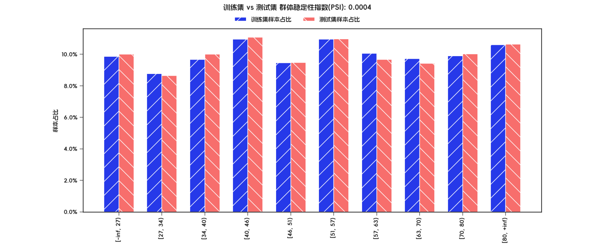</a></td>
  <td width="33.33%" align="center" valign="top"><strong>坏样本率趋势</strong><br>
    <a href="docs/assets/readme/showcase/eda-trend.png">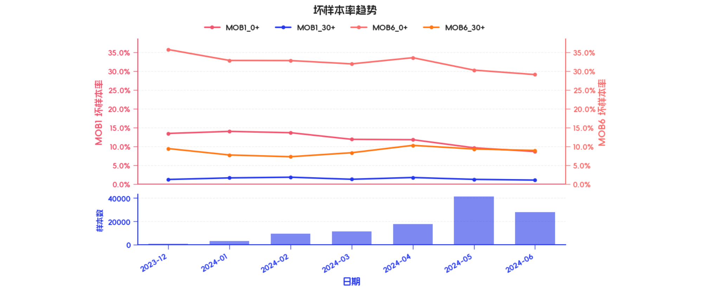</a></td>
</tr>
</table>

<a href="https://hscredit.hengshucredit.com/showcase.html#gallery-diagnostics" style="color:#c02dd4;">在文档中查看诊断图表</a>

**auto_feature_analysis：多标签特征报告。** 一次输出数据摘要和变量分布，按逾期标签纵向展示各分箱的订单与金额表现。

```python
from hscredit.report import auto_feature_analysis

auto_feature_analysis(
    df,
    features=analysis_features,
    date="授信时间",
    amount="loan_amt",
    long_format=True,
    bin_params={"method": "quantile", "max_n_bins": 4},
    margins=True,
    save="特征分析.xlsx",
    n_jobs=1,
    **labels,
)
```

<a href="docs/assets/readme/showcase/intro-features.png"></a>

<a href="docs/assets/readme/showcase/feature-analysis.xlsx?raw=true" download style="color:#c02dd4;">下载多标签特征报告</a>

### Excel 写入

从一个 DataFrame 到多工作表报告，都可以按业务阅读顺序安排。支持多级表头、合并单元格、数值和条件格式、图片、原生图表、迷你图与透视表，也可设置超链接、筛选、冻结窗格和行高列宽。

| 能力 | 入口 / 配置 |
| --- | --- |
| 条件格式 | `color_cols` 色阶（推荐）、`centered_bar_cols` 居中双向数据条、`condition_cols` 实心数据条 |
| 内容格式 | `percent_cols`、`custom_format`、`set_number_format`、字体、对齐、填充、边框 |
| 数据 + 多图 | `dataframe2excel(..., figures=[...])`、`insert_pic2sheet` |
| 导航与阅读 | `insert_hyperlink2sheet`、`set_freeze_panes`、自动筛选 |
| 原生透视表 | `insert_pivot_table2sheet`，分组、聚合、占比与筛选 |
| 行高列宽 | `auto_width / auto_height`、`set_column_width / set_row_height` |

<details>
<summary>写入数据、多图、格式与透视表</summary>

```python
from hscredit.excel import ExcelWriter, dataframe2excel
from hscredit.core.viz import bin_plot, bin_trend_plot

bin_plot(credit_bins, save="分箱.png")
bin_trend_plot(
    trend_data, feature="BASE_X257", target="信用风险MOB6@60", date="授信时间", n_jobs=1, save="月份.png"
)
writer = ExcelWriter()
dataframe2excel(
    bins,
    writer,
    sheet_name="分箱分析",
    title="BASE_X257 · 双标签分箱报告",
    figures=["分箱.png", "月份.png"],
    image_bottom_padding_rows=4,
    percent_cols=["样本占比", "坏样本率", "坏账改善"],
    color_cols=["样本占比", "坏样本率", "LIFT值"],
    centered_bar_cols=["坏账改善"],
    auto_width=True,
)
sheet = writer.get_sheet_by_name("分箱分析")
writer.set_freeze_panes(sheet, "D5")
writer.set_column_width(sheet, "B", 26)
writer.set_row_height(sheet, 2, 30)
writer.insert_value2sheet(sheet, "B1", "查看透视分析", bold=True, font_color="2639E9")
writer.insert_hyperlink2sheet(sheet, "B1", sheet="透视分析", target_space="B2")
writer.insert_pivot_table2sheet(
    worksheet="透视分析",
    data=df[["GROUP", "授信月份", "loan_amt"]],
    pivot_anchor="B2",
    rows="GROUP",
    columns="授信月份",
    values=[
        {
            "field": "loan_amt",
            "agg": "sum",
            "name": "额度合计",
            "number_format": "#,##0.00",
        },
        {
            "field": "loan_amt",
            "agg": "sum",
            "show_as": "全局占比",
            "name": "金额占比",
            "number_format": "0.00%",
        },
    ],
    theme_style=True,
)
writer.save("Excel功能展示.xlsx")
```

</details>

<a href="docs/assets/readme/showcase/excel-showcase.png">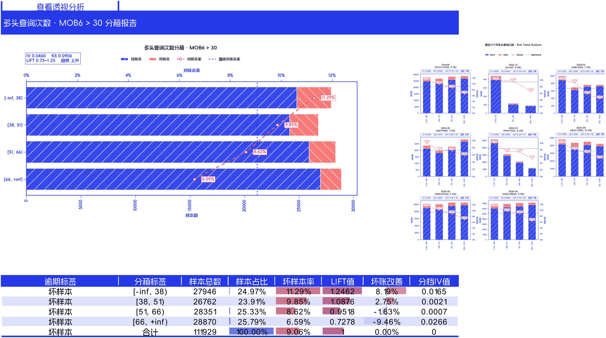</a>

<a href="docs/assets/readme/showcase/excel-pivot.png">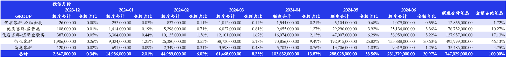</a>

<a href="docs/assets/readme/showcase/excel-showcase.xlsx?raw=true" download style="color:#c02dd4;">下载 Excel 功能展示工作簿</a>

### 数据库读写

同一套连接接口覆盖关系型数据库、数仓以及 MongoDB、Redis。SQL 端可查询表结构、导出字段清单、按 DataFrame 建表、执行参数化查询，并分批读写大表。NoSQL 端提供单条与批量增删改查，便于在特征明细、模型结果和线上查询之间交换数据。

| 类型 | 适配器 | 读写能力 |
| --- | --- | --- |
| SQL | MySQL / MariaDB、Hive、Impala、Oracle、StarRocks、ClickHouse、MaxCompute | 参数化查询、流式读取、批量与流式写入、表结构检查；依后端能力选择模式 |
| NoSQL | MongoDB、Redis | 统一 `read / read_one / read_many` 与 `write / write_one / write_many`，文档 / 键值操作 |

<details>
<summary>SQL 流式读写</summary>

```python
import os
from hscredit.database import Database

connection = {
    "host": os.environ["DB_HOST"],
    "user": os.environ["DB_USER"],
    "password": os.environ["DB_PASSWORD"],
    "database": os.environ["DB_NAME"],
}
with Database("mysql", **connection) as source, Database(
    "mysql", **connection
) as destination:
    with source.stream_query(
        "SELECT DK_X1995_2, BASE_X187 FROM credit_features",
        chunksize=10000,
        retain=False,
    ) as batches:
        destination.stream_write(
            batches, "credit_features_demo", mode="a", batch_size=5000
        )
```

</details>

<details>
<summary>NoSQL 文档读写</summary>

```python
with Database(
    "mongodb", host=os.environ["MONGO_HOST"], database=os.environ["MONGO_DATABASE"]
) as mongo:
    records = mongo.read_many("credit_features", {"BASE_X187": {"$gte": 60}})
    mongo.write_many("credit_features_demo", [{"样本编号": "演示001", "评分": 650}])
```

</details>

<a href="docs/api/database.rst" style="color:#c02dd4;">数据库 API</a>

### Agent 能力

通过自然语言调用八个 Skills，从发现可用操作、评估变量和筛选特征，到训练解释模型、回测规则、绘图和交付 Excel。可以让 ChatGPT 针对一个问题返回结果，也可以让它在同一份数据上依次调用多个能力。

```bash
python skills/install.py --suite hscredit
```

| Skill | 功能与作用 | 用户对 ChatGPT 说 | 返回结果 |
| --- | --- | --- | --- |
| <a href="skills/hscredit/SKILL.md" style="color:#c02dd4;">hscredit</a> | 发现能力、选择操作与规划流程 | “我上传了现金贷数据，请帮我规划变量分析和建模流程，并选择合适的 hscredit 能力。” | 识别字段与目标，选择分箱、筛选、建模和报告入口 |
| <a href="skills/hsbin/SKILL.md" style="color:#c02dd4;">hsbin</a> | 比较分箱方法，评估变量分档风险与稳定性 | “请调用 hsbin，分析 BASE_X187 在 MOB1、MOB6 的 0 天和 30 天口径下的表现，比较分箱方法。” | 多标签分箱表、方法摘要和分箱图 |
| <a href="skills/hsselect/SKILL.md" style="color:#c02dd4;">hsselect</a> | 筛选候选特征，解释保留或剔除原因 | “请用 hsselect 以 MOB6 > 30 筛选这批授信字段，告诉我保留和剔除的原因。” | 特征清单、阶段汇总与逐特征决策 |
| <a href="skills/hsmodel/SKILL.md" style="color:#c02dd4;">hsmodel</a> | 训练、调优、解释模型并导出推理制品 | “请用 hsmodel 训练 XGBoost，以 AUC 调参，在独立测试集评估并解释高风险样本。” | 最佳模型、测试指标与解释表；SHAP 图通过 hsviz 生成 |
| <a href="skills/hsrule/SKILL.md" style="color:#c02dd4;">hsrule</a> | 执行规则、评估规则集和策略置换效果 | “请调用 hsrule，比较多头查询和月应还额规则，分析置入置出及客群差异。” | 多规则效果、策略置换结果和迭代报告 |
| <a href="skills/hsviz/SKILL.md" style="color:#c02dd4;">hsviz</a> | 绘制变量、模型、评分和稳定性图表 | “请用 hsviz 为这份模型预测结果绘制 KS、ROC、混淆矩阵和按授信月份的坏率趋势。” | hscredit 字体与配色的原生图表 |
| <a href="skills/hsreport/SKILL.md" style="color:#c02dd4;">hsreport</a> | 汇总变量、模型或策略的完整分析报告 | “请调用 hsreport，把训练集和测试集的四种 MOB 标签整理成可下载的模型评估 Excel。” | 多数据集、多标签的最终报告工作簿 |
| <a href="skills/hsexcel/SKILL.md" style="color:#c02dd4;">hsexcel</a> | 编排多表、图像与单元格格式 | “请用 hsexcel 把分箱表和两张图写入 Excel，设置百分比、条件格式、冻结窗口和客群汇总表。” | 包含多表、图像与格式的最终 Excel |

## 公共方法

下面从现金贷订单中取一份可复现的小样本，演示并行计算、字段描述和结果保存。

```python
import numpy as np
import pandas as pd
from hscredit import hscredit_dataset
from hscredit.utils import seed_everything

seed_everything(42)
orders = hscredit_dataset(columns=["流量渠道", "loan_amt", "periods", "MOB3"])
sample = orders.iloc[np.random.choice(len(orders), size=2000, replace=False)].copy()
```

### DataFrame 与 Series 的并行 apply

`import hscredit` 会注册 pandas 访问器。`n_jobs=2` 指定最多使用两个工作单元，适合拆分较耗时的自定义函数。下面分别按行估算每期本金、按元素划分逾期档位。

```python
def principal_per_period(row):
    return round(row["loan_amt"] / row["periods"], 2)

def overdue_band(days):
    if pd.isna(days) or days < 0:
        return "缺失或未观测"
    if days > 30:
        return "超过30天"
    return "1至30天" if days > 0 else "0天"

principal = sample[["loan_amt", "periods"]].hscredit(n_jobs=2).apply(
    principal_per_period, axis=1
)
bands = sample["MOB3"].hscredit(n_jobs=2).apply(overdue_band)
```

### 单字段与分组描述

`feature_describe` 给出样本数、查得率和分位数。`groupby_feature_describe` 在各渠道内计算同一组指标，便于比较额度分布。

```python
from hscredit.utils import feature_describe, groupby_feature_describe

amount_profile = feature_describe(sample, feature="loan_amt", percentiles=[0.5, 0.9])
channel_profile = groupby_feature_describe(
    sample[["流量渠道", "loan_amt"]], by="流量渠道", percentiles=[0.5, 0.9], n_jobs=2
)
```

### 在 Jupyter 中重载模块

修改本地模块源码后，在下一个单元格用 `reload` 取得新的模块对象，再从该对象调用函数。

```python
from hscredit.utils import reload

describe = reload("hscredit.utils.describe")
describe.feature_describe(sample["loan_amt"], percentiles=[0.5, 0.9])
```

### 内存占用与结果保存

`reduce_memory_usage` 返回采用较小数据类型的副本，浮点列会转换为 `float32`。可用 `memory_usage(deep=True)` 比较字节数。用 `save_pickle` 保存两张统计结果，下次打开 Notebook 后通过 `load_pickle` 读取。

```python
from hscredit.core.eda.utils import reduce_memory_usage
from hscredit.utils import save_pickle, load_pickle

compact = reduce_memory_usage(sample)
print("压缩前后字节数", sample.memory_usage(deep=True).sum(), compact.memory_usage(deep=True).sum())

save_pickle({"额度": amount_profile, "渠道": channel_profile}, "字段描述.pkl")
profiles = load_pickle("字段描述.pkl")
profiles["渠道"].head()
```

## 品牌色与语义配色

图表、HTML 表格与 Excel 报告使用 hscredit 品牌配色。主题蓝用于品牌、好样本与基准；珊瑚红用于正样本强调和规则命中率；黄绿用于样本占比、金额占比与通过率。色卡列出了完整的颜色分配及使用示例。

<a href="docs/assets/brand/hscredit-color-card.svg">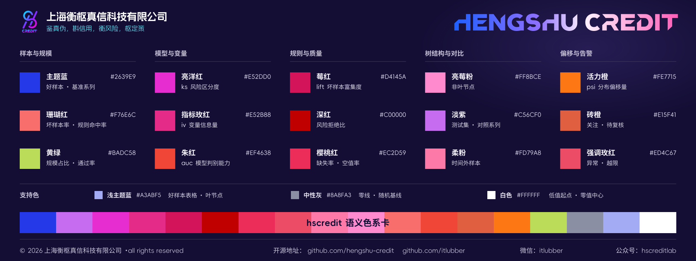</a>

常规指标采用白色到指标色的色阶，常量列不整列染色。坏账改善保留以零为中心的双向数据条。完整语义、支持色及当前接入范围见<a href="docs/brand-colors.md">品牌色与语义配色指南</a>。

<details>
<summary>常用指标配色与条件格式</summary>

| 指标 | 颜色 | HEX |
|:---|:---|:---|
| 样本占比、金额占比、通过率 | 黄绿 | `#BADC58` |
| 好样本相关指标 | 浅主题蓝 | `#A3ABF5` |
| 规则命中率、坏样本率、逾期率、坏样本占比与数量 | 珊瑚红 | `#F76E6C` |
| Lift、累积 Lift | 莓红 | `#D4145A` |
| KS | 亮洋红 | `#E52DD0` |
| IV | 玫红 | `#E52B88` |
| AUC | 朱红 | `#EF4638` |
| PSI | 活力橙 | `#FE7715` |
| 缺失率 | 樱桃红 | `#EC2D59` |
| 风险拒绝比 | 深红 | `#C00000` |

默认以色阶高亮占比、坏样本率、Lift、KS、IV、AUC、PSI 和缺失率；数量类指标可通过 `color_cols` 指定。`highlight_iv`、`highlight_ks`、`highlight_bad_rate`、`highlight_lift` 控制相应指标的自动高亮；`color_cols=[]` 可关闭自动高亮，显式传入 `condition_cols` 可选择数据条。`condition_color` 的显式配置优先于默认配色。

可通过 `viz.get_palette("secondary")`、`viz.get_palette("ordinary")` 和 `viz.get_palette("extended")` 获取副主题色、普通强调色与当前运行时的扩展色板；具体接口与色卡中的新增分配范围见配色指南。

</details>

## 参考引用

- <a href="https://github.com/itlubber" style="color:#c02dd4;">itlubber 的 GitHub 主页</a>
- <a href="https://github.com/itlubber/scorecardpipeline" style="color:#c02dd4;">scorecardpipeline</a> · 评分卡建模、风控策略分析与报告生成。
- <a href="https://github.com/itlubber/pdtr" style="color:#c02dd4;">pdtr</a> · 单变量规则与决策树规则挖掘。
- <a href="https://hscredit.hengshucredit.com/" style="color:#c02dd4;">hscredit 在线文档</a> · <a href="https://hscredit.hengshucredit.com/api/index.html" style="color:#c02dd4;">API 参考</a> · <a href="examples/" style="color:#c02dd4;">全部 Notebook</a> · <a href="https://github.com/hengshu-credit/hscredit/issues" style="color:#c02dd4;">GitHub Issues</a>
- <a href="https://scikit-learn.org/" style="color:#c02dd4;">scikit-learn</a>：估计器接口、Pipeline 与模型评估。
- <a href="https://xgboost.readthedocs.io/" style="color:#c02dd4;">XGBoost</a> · <a href="https://lightgbm.readthedocs.io/" style="color:#c02dd4;">LightGBM</a> · <a href="https://catboost.ai/" style="color:#c02dd4;">CatBoost</a> · <a href="https://optuna.org/" style="color:#c02dd4;">Optuna</a>：梯度提升与参数优化。
- <a href="https://shap.readthedocs.io/" style="color:#c02dd4;">SHAP</a> · <a href="https://github.com/PriorLabs/TabPFN" style="color:#c02dd4;">TabPFN</a> · <a href="https://developers.google.com/optimization" style="color:#c02dd4;">OR-Tools</a>：模型解释、表格基础模型与约束优化。
- <a href="https://github.com/amphibian-dev/toad" style="color:#c02dd4;">toad</a> · <a href="https://github.com/ShichenXie/scorecardpy" style="color:#c02dd4;">scorecardpy</a> · <a href="https://github.com/guillermo-navas-palencia/optbinning" style="color:#c02dd4;">OptBinning</a>：评分卡与分箱生态参考。

开源许可：<a href="LICENSE" style="color:#c02dd4;">MIT License</a>。
