# hscredit

<p align="center">
  
</p>

<p align="center">
  
  <a href="https://pypi.org/project/hscredit/"></a>
  <a href="https://hscredit.hengshucredit.com/"></a>
  <a href="LICENSE"></a>
</p>

<p align="center"><strong>面向信贷风控的全流程量化工具箱</strong></p>

<p align="center">🔍 鉴真伪 · 📊 斟信用 · ⚖️ 衡风险 · 🎯 枢定策</p>


**hscredit（衡枢真信）** 是面向信贷风控的 Python 工具箱：从授信数据中筛选能区分风险的变量，用评分卡、机器学习或决策树构建模型与规则，再用历史样本回测新策略的通过率和坏账率。分箱、编码和筛选可直接接入 sklearn Pipeline；从变量初筛到上线评审，都能沿用同一套逾期定义。

<a href="#为什么选-hscredit" style="color:#c02dd4;">为什么选 hscredit</a> · <a href="#交流关注" style="color:#c02dd4;">交流关注</a> · <a href="#核心功能盘点" style="color:#c02dd4;">核心功能</a> · <a href="#安装" style="color:#c02dd4;">安装</a> · <a href="#功能展示" style="color:#c02dd4;">功能展示</a> · <a href="https://hscredit.hengshucredit.com/" style="color:#c02dd4;">在线文档</a>

## 为什么选 hscredit？

**四套标准 SOP，一行代码出一份 Excel 报告。** 准备好样本和待评估的变量、规则或模型，即可按统一口径比较不同客群、不同逾期标签的表现。下次评审，换一批样本就能复评。

<div style="max-width:100%; overflow-x:auto;">
<table role="presentation" width="100%" style="display:table; table-layout:fixed; width:100%; min-width:960px; border:0; border-collapse:collapse;">
<tbody>
<tr>
<td width="50%" valign="top" style="border:0; padding:8px;">
  <strong>策略上线报告</strong> · <a href="docs/assets/readme/showcase/swap-out.xlsx?raw=true" download style="color:#c02dd4;">下载 Excel</a><br>
  逐条回测候选规则，对照策略调整前后的通过率和坏样本率，判断多拦住一批坏样本要牺牲多少通过量。
  <p style="min-height:3em;"><code style="word-break:keep-all;">swap_out_report(df, rules, date="授信时间", save="策略.xlsx", **labels)</code></p>
  <div style="height:320px; overflow:auto;"><a href="docs/assets/readme/showcase/intro-strategy.png"></a></div>
</td>
<td width="50%" valign="top" style="border:0; padding:8px;">
  <strong>模型上线报告</strong> · <a href="docs/assets/readme/showcase/auto-model-report.xlsx?raw=true" download style="color:#c02dd4;">下载 Excel</a><br>
  并排比较训练集和测试集的 KS、AUC，再看风险最高的前 1%、5% 客群的坏样本率和 Lift，检验模型的区分能力。
  <p style="min-height:3em;"><code style="word-break:keep-all;">auto_model_report(model, datasets, features=features, amount="loan_amt", excel_path="模型.xlsx", **labels)</code></p>
  <div style="height:320px; overflow:auto;"><a href="docs/assets/readme/showcase/intro-model.png"></a></div>
</td>
</tr>
<tr>
<td width="50%" valign="top" style="border:0; padding:8px;">
  <strong>规则挖掘报告</strong> · <a href="docs/assets/readme/showcase/multiway-tree-report.xlsx?raw=true" download style="color:#c02dd4;">下载 Excel</a><br>
  把训练好的多叉树转成规则清单，按节点对照命中率、坏样本率和 Lift，找出既能覆盖足够样本、又能识别高风险的条件组合。
  <p style="min-height:3em;"><code style="word-break:keep-all;">multiway_tree.report(datasets, amount="loan_amt", group="GROUP", save="规则.xlsx", **labels)</code></p>
  <div style="height:320px; overflow:auto;"><a href="docs/assets/readme/showcase/intro-rules.png"></a></div>
</td>
<td width="50%" valign="top" style="border:0; padding:8px;">
  <strong>三方数据分析报告</strong> · <a href="docs/assets/readme/showcase/feature-analysis.xlsx?raw=true" download style="color:#c02dd4;">下载 Excel</a><br>
  用缺失率看字段覆盖，用 IV、KS 和分箱坏样本率比较长短期风险的区分度，筛出值得接入的三方变量。
  <p style="min-height:3em;"><code style="word-break:keep-all;">auto_feature_analysis(df, features, amount="loan_amt", bin_params={"long_format": True}, excel_writer="三方数据.xlsx", **labels)</code></p>
  <div style="height:320px; overflow:auto;"><a href="docs/assets/readme/showcase/intro-features.png"></a></div>
</td>
</tr>
</tbody>
</table>
</div>

客群按数据中的 <code>GROUP</code> 划分，跨期表现按授信月份比较。四份示例使用相同的<a href="#数据集" style="color:#c02dd4;">标签配置</a> <code>labels</code>：分别评估 MOB1、MOB6 逾期超过 0 天及超过 30 天的表现。

## 交流关注

<div align="center">

| 微信 · itlubber | 微信公众号 · 衡枢风控 |
|:---:|:---:|
| <br>扫一扫，添加微信交流 | <br>扫一扫关注，回复「入群」 |

邮箱：<a href="mailto:hscredit@hengshucredit.com" style="color:#c02dd4;">hscredit@hengshucredit.com</a>

</div>

## 核心功能盘点

<div class="hs-capabilities" style="overflow-x:auto; max-width:100%; border:0;">
<table style="white-space:nowrap; width:max-content; border-collapse:collapse; color:#2b2540; font-size:13px;">
<thead><tr><th style="background:#2639E9; color:white; padding:8px 12px; text-align:left; white-space:nowrap; border-left:2px solid white;">模块</th><th style="background:#2639E9; color:white; padding:8px 12px; text-align:left; white-space:nowrap; border-left:2px solid white;">能力范围</th><th style="background:#2639E9; color:white; padding:8px 12px; text-align:left; white-space:nowrap; border-left:2px solid white;">落地功能</th></tr></thead>
<tbody>
<tr style="background:#ffffff;"><td nowrap style="padding:8px 12px; white-space:nowrap; border:0;"><a href="hscredit/core/binning" style="color:#c02dd4;"><strong>特征分箱</strong></a></td><td nowrap style="padding:8px 12px; white-space:nowrap; border:0;">17&nbsp;种一维方法&nbsp;·&nbsp;二维交叉分箱</td><td nowrap style="padding:8px 12px; white-space:nowrap; border:0;">自定义目标、多标签、金额口径、方法比较、按月与客群分析</td></tr>
<tr style="background:#dee1fb;"><td nowrap style="padding:8px 12px; white-space:nowrap; border:0;"><a href="hscredit/core/encoders" style="color:#c02dd4;"><strong>特征编码</strong></a></td><td nowrap style="padding:8px 12px; white-space:nowrap; border:0;">9&nbsp;种编码器</td><td nowrap style="padding:8px 12px; white-space:nowrap; border:0;">WOE、目标均值、有序编码、独热、频次、分位数、树叶编码、高基数处理</td></tr>
<tr style="background:#ffffff;"><td nowrap style="padding:8px 12px; white-space:nowrap; border:0;"><a href="hscredit/core/selectors" style="color:#c02dd4;"><strong>特征筛选</strong></a></td><td nowrap style="padding:8px 12px; white-space:nowrap; border:0;">过滤法&nbsp;·&nbsp;包装法&nbsp;·&nbsp;嵌入法</td><td nowrap style="padding:8px 12px; white-space:nowrap; border:0;">IV&nbsp;/&nbsp;KS&nbsp;/&nbsp;Lift&nbsp;/&nbsp;PSI、相关性、Null&nbsp;Importance、RFE、组合筛选报告</td></tr>
<tr style="background:#dee1fb;"><td nowrap style="padding:8px 12px; white-space:nowrap; border:0;"><a href="hscredit/core/models" style="color:#c02dd4;"><strong>风控建模</strong></a></td><td nowrap style="padding:8px 12px; white-space:nowrap; border:0;">经典模型&nbsp;·&nbsp;Boosting&nbsp;·&nbsp;表格神经网络</td><td nowrap style="padding:8px 12px; white-space:nowrap; border:0;">LR、评分卡、XGBoost、TabPFN、规则分类、调参、解释与部署</td></tr>
<tr style="background:#ffffff;"><td nowrap style="padding:8px 12px; white-space:nowrap; border:0;"><a href="hscredit/core/metrics" style="color:#c02dd4;"><strong>评估与优化</strong></a></td><td nowrap style="padding:8px 12px; white-space:nowrap; border:0;">分类&nbsp;·&nbsp;回归&nbsp;·&nbsp;业务损益</td><td nowrap style="padding:8px 12px; white-space:nowrap; border:0;">区分度、稳定性、校准、自定义评估函数与自定义损失</td></tr>
<tr style="background:#dee1fb;"><td nowrap style="padding:8px 12px; white-space:nowrap; border:0;"><a href="hscredit/core/rules" style="color:#c02dd4;"><strong>规则分析</strong></a></td><td nowrap style="padding:8px 12px; white-space:nowrap; border:0;">规则执行&nbsp;·&nbsp;规则挖掘&nbsp;·&nbsp;策略置换</td><td nowrap style="padding:8px 12px; white-space:nowrap; border:0;">Rule&nbsp;/&nbsp;RuleSet&nbsp;/&nbsp;RuleFlow、Swap、多规则迭代、二叉与多叉树</td></tr>
<tr style="background:#ffffff;"><td nowrap style="padding:8px 12px; white-space:nowrap; border:0;"><a href="hscredit/core/eda" style="color:#c02dd4;"><strong>数据挖掘</strong></a></td><td nowrap style="padding:8px 12px; white-space:nowrap; border:0;">EDA&nbsp;·&nbsp;VIZ&nbsp;·&nbsp;自动报告</td><td nowrap style="padding:8px 12px; white-space:nowrap; border:0;">数据摘要、KS、相关性、分布、混淆矩阵、PSI、坏率趋势、多标签报告</td></tr>
<tr style="background:#dee1fb;"><td nowrap style="padding:8px 12px; white-space:nowrap; border:0;"><a href="hscredit/excel" style="color:#c02dd4;"><strong>Excel 写入</strong></a></td><td nowrap style="padding:8px 12px; white-space:nowrap; border:0;">原生工作簿交付</td><td nowrap style="padding:8px 12px; white-space:nowrap; border:0;">条件格式、图片、超链接、冻结窗格、透视表、行高列宽</td></tr>
<tr style="background:#ffffff;"><td nowrap style="padding:8px 12px; white-space:nowrap; border:0;"><a href="hscredit/database" style="color:#c02dd4;"><strong>数据库读写</strong></a></td><td nowrap style="padding:8px 12px; white-space:nowrap; border:0;">7&nbsp;类&nbsp;SQL&nbsp;·&nbsp;2&nbsp;类&nbsp;NoSQL</td><td nowrap style="padding:8px 12px; white-space:nowrap; border:0;">连接池、参数化查询、流式读取、分批写入、元数据</td></tr>
<tr style="background:#dee1fb;"><td nowrap style="padding:8px 12px; white-space:nowrap; border:0;"><a href="skills/CATALOG.md" style="color:#c02dd4;"><strong>Agent 能力</strong></a></td><td nowrap style="padding:8px 12px; white-space:nowrap; border:0;">8&nbsp;个&nbsp;Skills</td><td nowrap style="padding:8px 12px; white-space:nowrap; border:0;">分箱、建模、规则、筛选、绘图与报告交付的自然语言入口</td></tr>
</tbody>
</table>
</div>

表格按单行排布，窄屏可横向滚动。详细接口见<a href="docs/overview.md" style="color:#c02dd4;">功能总览</a>。

## 安装

支持 Python **3.9–3.14**。

```bash
pip install hscredit
```

基础安装包含分箱、编码、筛选、经典模型、评分卡、SHAP、可视化、Excel 和内置数据集。扩展按需安装：

```bash
pip install "hscredit[boost]"         # Boosting 模型
pip install "hscredit[tune]"          # 调参与搜索看板
pip install "hscredit[net]"           # TabPFN 等表格神经网络
pip install "hscredit[pmml]"          # PMML 导出与加载
pip install "hscredit[database-all]"  # SQL / NoSQL 驱动
```

<a href="docs/installation.md" style="color:#c02dd4;">安装指南</a>

## 功能展示

<a href="#数据集" style="color:#c02dd4;">数据集</a> · <a href="#特征分箱" style="color:#c02dd4;">特征分箱</a> · <a href="#特征编码" style="color:#c02dd4;">特征编码</a> · <a href="#特征筛选" style="color:#c02dd4;">特征筛选</a> · <a href="#风控建模" style="color:#c02dd4;">风控建模</a> · <a href="#规则分析" style="color:#c02dd4;">规则分析</a> · <a href="#数据挖掘" style="color:#c02dd4;">数据挖掘</a> · <a href="#excel-写入" style="color:#c02dd4;">Excel 写入</a> · <a href="#数据库读写" style="color:#c02dd4;">数据库读写</a> · <a href="#agent-能力" style="color:#c02dd4;">Agent 能力</a>

<a href="examples/29_readme_showcase.ipynb" style="color:#c02dd4;">完整 Notebook 示例</a>

### 数据集

`hscredit_dataset()` 加载内置现金贷放款订单数据；`split=True` 依次返回订单信息、逾期表现和授信时点特征 X，`columns` 支持按需读取字段。

<div style="max-width:100%; overflow-x:auto;">
<table style="white-space:nowrap; border-collapse:collapse; font-size:13px;">
<thead><tr><th style="background:#2639E9; color:white; padding:8px 12px;">项目</th><th style="background:#2639E9; color:white; border-left:2px solid white; padding:8px 12px;">内容</th></tr></thead>
<tbody>
<tr style="background:#ffffff;"><td nowrap style="padding:7px 12px; border:0; white-space:nowrap;">数据集名称</td><td nowrap style="padding:7px 12px; border:0; white-space:nowrap;"><code>hscredit</code></td></tr>
<tr style="background:#dee1fb;"><td nowrap style="padding:7px 12px; border:0; white-space:nowrap;">格式</td><td nowrap style="padding:7px 12px; border:0; white-space:nowrap;">Parquet 文件 333.11 MiB，完整 DataFrame 约 7.16 GiB</td></tr>
<tr style="background:#ffffff;"><td nowrap style="padding:7px 12px; border:0; white-space:nowrap;">行数 / 字段数</td><td nowrap style="padding:7px 12px; border:0; white-space:nowrap;">111,929 / 8,516</td></tr>
<tr style="background:#dee1fb;"><td nowrap style="padding:7px 12px; border:0; white-space:nowrap;">唯一订单 / 唯一客户</td><td nowrap style="padding:7px 12px; border:0; white-space:nowrap;">111,929 / 110,283，同一客户可有多笔订单</td></tr>
<tr style="background:#ffffff;"><td nowrap style="padding:7px 12px; border:0; white-space:nowrap;">资金方 / 流量渠道</td><td nowrap style="padding:7px 12px; border:0; white-space:nowrap;">6 / 8</td></tr>
<tr style="background:#dee1fb;"><td nowrap style="padding:7px 12px; border:0; white-space:nowrap;">授信时间范围</td><td nowrap style="padding:7px 12px; border:0; white-space:nowrap;">2023-12-15 09:01:02 至 2024-06-17 21:34:05</td></tr>
<tr style="background:#ffffff;"><td nowrap style="padding:7px 12px; border:0; white-space:nowrap;">借款申请时间范围（<code>放款时间</code>）</td><td nowrap style="padding:7px 12px; border:0; white-space:nowrap;">2023-12-15 00:00:00 至 2024-06-17 23:57:25</td></tr>
<tr style="background:#dee1fb;"><td nowrap style="padding:7px 12px; border:0; white-space:nowrap;">观察时点 / 抽数日期</td><td nowrap style="padding:7px 12px; border:0; white-space:nowrap;"><code>etl_date = 2025-11-07</code></td></tr>
<tr style="background:#ffffff;"><td nowrap style="padding:7px 12px; border:0; white-space:nowrap;">拆分后的字段数</td><td nowrap style="padding:7px 12px; border:0; white-space:nowrap;">订单信息 9，逾期数据 14，授信时点特征 X 8,493</td></tr>
<tr style="background:#dee1fb;"><td nowrap style="padding:7px 12px; border:0; white-space:nowrap;">订单信息</td><td nowrap style="padding:7px 12px; border:0; white-space:nowrap;"><code>放款编码</code>、<code>用户编码</code>、<code>loan_amt</code>、<code>periods</code>、<code>放款银行</code>、<code>流量渠道</code>、<code>授信时间</code>、<code>放款时间</code>、<code>etl_date</code></td></tr>
<tr style="background:#ffffff;"><td nowrap style="padding:7px 12px; border:0; white-space:nowrap;">逾期数据</td><td nowrap style="padding:7px 12px; border:0; white-space:nowrap;"><code>DPD</code>、<code>CURRENT_DPD</code>、<code>MOB1</code>、<code>MOB2</code>、<code>MOB3</code>、<code>MOB4</code>、<code>MOB5</code>、<code>MOB6</code>、<code>MOB7</code>、<code>MOB8</code>、<code>MOB9</code>、<code>MOB10</code>、<code>MOB11</code>、<code>MOB12</code></td></tr>
<tr style="background:#dee1fb;"><td nowrap style="padding:7px 12px; border:0; white-space:nowrap;">授信特征</td><td nowrap style="padding:7px 12px; border:0; white-space:nowrap;">多头查询、贷款账户与余额、还款压力、杠杆率、信用卡使用、公积金等授信时点风险信息。</td></tr>
</tbody></table>
</div>

<a href="https://hscredit.hengshucredit.com/datasets.html" style="color:#c02dd4;">数据集文档</a>

MOB1 的 0 天、30 天口径用于短期欺诈风险代理分析，MOB6 的对应口径用于长期信用风险分析。下例以 **MOB6 > 30** 为建模目标。

```python
from hscredit import hscredit_dataset

order, overdue, X = hscredit_dataset(
    split=True, columns=["用户编码", "授信时间", "MOB1", "MOB6", "BASE_X187"]
)
```

<details>
<summary>数据加载、标签与训练集划分</summary>

```python
import numpy as np
import pandas as pd
import hscredit
from sklearn.model_selection import GroupShuffleSplit

field_map = {
    "DK_X1995_2": "非银机构借款总金额",
    "BASE_X187": "最近12个月多头查询次数",
    "DK_X44": "个人消费贷借款总金额",
    "DK_X1223": "个人消费贷款账户数",
    "DK_X1689": "现行贷款账户数",
    "DK_X1925": "个人经营性贷款账户数",
    "VAR0252": "公积金记录数",
    "DK_X2812": "现用贷款账户数量占贷款账户数量比率",
    "DK_X597": "现用消费贷本金余额求和占现用消费贷本金求和比率",
    "JH_X10": "杠杆率",
    "DJK_X1435": "现行贷记卡已用额度与授信额度比率_最大值",
    "DK_X2677": "贷款本月应还金额",
    "DK_X515": "现行房贷本月应还款_求和",
    "DK_X1948": "现用贷款本月应还款最大",
}
data = hscredit_dataset(
    columns=["用户编码", "授信时间", "loan_amt", "MOB1", "MOB6", "GROUP", *field_map]
)
df = data.rename(columns=field_map).copy()
df["授信时间"] = pd.to_datetime(df["授信时间"])
df["授信月份"] = df["授信时间"].dt.to_period("M").astype(str)
for overdue in ["MOB1", "MOB6"]:
    df[overdue] = df[overdue].where(df[overdue].notna() & df[overdue].ge(0))
df["坏样本"] = df["MOB6"].gt(30).where(df["MOB6"].notna()).astype("Int64")
analysis_features = list(field_map.values())
features = ["非银机构借款总金额", "最近12个月多头查询次数", "个人消费贷款账户数", "杠杆率", "贷款本月应还金额", "现行贷款账户数"]
model_data = df.loc[df["坏样本"].notna()].copy()
train_idx, test_idx = next(
    GroupShuffleSplit(n_splits=1, test_size=0.25, random_state=42).split(
        model_data, groups=model_data["用户编码"]
    )
)
train, test = model_data.iloc[train_idx].copy(), model_data.iloc[test_idx].copy()
X_train, X_test = train[features], test[features]
y_train, y_test = train["坏样本"].astype(int), test["坏样本"].astype(int)
fill_values = X_train.median()
X_num, X_test_num = X_train.fillna(fill_values), X_test.fillna(fill_values)
X_all = train[analysis_features].fillna(train[analysis_features].median())

labels = {"overdue": ["MOB1", "MOB6"], "dpds": [0, 30], "overdue_operator": ">"}
```

</details>

<table role="presentation" style="display:block; width:max-content; max-width:100%; overflow-x:auto; border:0; border-collapse:collapse;"><tr><td style="padding:0; border:0;">
<table role="presentation" style="display:table; width:max-content; max-width:none; border:0; border-collapse:collapse;"><tr><td style="padding:0; border:0;">

</td></tr></table>
</td></tr></table>

### 特征分箱

统一处理数值、类别、缺失和特殊值，支持手工切分、自定义优化目标、单调约束，以及多标签、金额和二维交叉分析。

| 方法族 | 支持方法 |
| --- | --- |
| 基础与聚类 | `uniform`、`quantile`、`kmeans` |
| 树与统计 | `tree`、`cart`、`chi`、`mdlp` |
| 风险目标 | `best_ks`、`best_iv`、`best_lift`、`target_bad_rate` |
| 形态与搜索 | `monotonic`、`genetic`、`smooth`、`kernel_density` |
| 约束优化 | `or_tools`、`cp_sat`，支持原生与自定义目标 |
| 二维分箱 | `OptimalBinning2D`、`feature_bin_stats_2d`、`bin_2d_plot` |

```python
from hscredit.report import feature_bin_stats

bin_options = dict(
    feature="最近12个月多头查询次数", method="quantile", max_n_bins=4, margins=True, n_jobs=1
)
bins = feature_bin_stats(df, target="坏样本", **bin_options)
multi_bins = feature_bin_stats(df, **bin_options, **labels)
bins.show()
multi_bins.show()
```

<table role="presentation" style="display:block; width:max-content; max-width:100%; overflow-x:auto; border:0; border-collapse:collapse;"><tr><td style="padding:0; border:0;">
<table role="presentation" style="display:table; width:max-content; max-width:none; border:0; border-collapse:collapse;"><tr><td style="padding:0; border:0;">
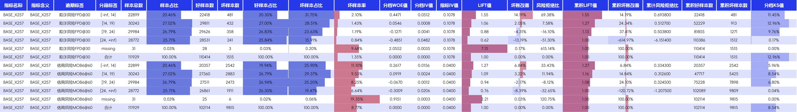
</td></tr></table>
</td></tr></table>

**比较方法与客群。** `feature_binning_summary` 对比不同分箱方法；`feature_group_binning_summary` 按授信月份或原始字段 `GROUP`（客群划分）汇总。

<details>
<summary>分箱摘要、客群比较与二维分箱表</summary>

```python
from hscredit.report import (
    feature_binning_summary,
    feature_group_binning_summary,
    feature_bin_stats_2d,
)

bin_tables, summary = feature_binning_summary(
    df,
    feature="最近12个月多头查询次数",
    methods=["quantile", "tree", "chi"],
    target="坏样本",
    max_n_bins=4,
    margins=True,
    n_jobs=1,
)
summary.show()

cohort_tables, cohort_summary = feature_group_binning_summary(
    df,
    feature="最近12个月多头查询次数",
    group="GROUP",
    dropna=False,
    methods="quantile",
    max_n_bins=4,
    margins=True,
    n_jobs=1,
    **labels,
)
cohort_summary.show()

feature_bin_stats_2d(
    df,
    features=["最近12个月多头查询次数", "非银机构借款总金额"],
    target="坏样本",
    max_n_bins=3,
    margins=True,
    n_jobs=1,
).show()
```

</details>

<div style="max-width:100%; overflow-x:auto;">
<table role="presentation" width="100%" style="display:table; width:100%; min-width:640px; table-layout:fixed; border:0; border-collapse:collapse;">
<tr>
<td width="50%" valign="top" style="width:50%; padding:4px; border:0; vertical-align:top;">
<strong>方法摘要</strong>
<div style="height:268px; max-width:100%; overflow:auto;">
<table role="presentation" style="display:table; width:max-content; max-width:none; border:0; border-collapse:collapse;"><tr><td style="padding:0; border:0;">

</td></tr></table>
</div></td>
<td width="50%" valign="top" style="width:50%; padding:4px; border:0; vertical-align:top;">
<strong>授信月份摘要</strong>
<div style="height:268px; max-width:100%; overflow:auto;">
<table role="presentation" style="display:table; width:max-content; max-width:none; border:0; border-collapse:collapse;"><tr><td style="padding:0; border:0;">

</td></tr></table>
</div></td>
</tr>
<tr>
<td width="50%" valign="top" style="width:50%; padding:4px; border:0; vertical-align:top;">
<strong>单标签分箱表</strong>
<div style="height:268px; max-width:100%; overflow:auto;">
<table role="presentation" style="display:table; width:max-content; max-width:none; border:0; border-collapse:collapse;"><tr><td style="padding:0; border:0;">

</td></tr></table>
</div></td>
<td width="50%" valign="top" style="width:50%; padding:4px; border:0; vertical-align:top;">
<strong>二维分箱表</strong>
<div style="height:268px; max-width:100%; overflow:auto;">
<table role="presentation" style="display:table; width:max-content; max-width:none; border:0; border-collapse:collapse;"><tr><td style="padding:0; border:0;">

</td></tr></table>
</div></td>
</tr>
</table>
</div>

<details>
<summary>自定义分箱优化目标</summary>

```python
from hscredit.core.binning import ORBinning, CustomObjectives

binner = ORBinning(
    max_n_bins=4,
    objective=CustomObjectives.max_lift_iv(lift_weight=0.1),
    n_jobs=1,
)
binner.fit(X_train[["最近12个月多头查询次数"]], y_train)
```

</details>

<details>
<summary>分箱图与跨期趋势</summary>

```python
from hscredit.core.viz import bin_plot, bin_overdues_plot, bin_trend_plot

bin_plot(bins)
bin_overdues_plot(bin_table=multi_bins, n_jobs=1)
bin_trend_plot(
    df,
    feature="最近12个月多头查询次数",
    target="坏样本",
    date="授信时间",
    freq="M",
    max_n_bins=4,
    n_jobs=1,
)
bin_trend_plot(
    df,
    feature="最近12个月多头查询次数",
    target="坏样本",
    group="GROUP",
    max_n_bins=4,
    n_jobs=1,
)
```

</details>

<table width="100%" style="display:table; width:100%; table-layout:fixed; border-collapse:collapse;">
<tr>
<td width="50%" valign="top"><strong>单变量分箱与坏率</strong><br>
<a href="docs/assets/readme/showcase/binning-plot.png">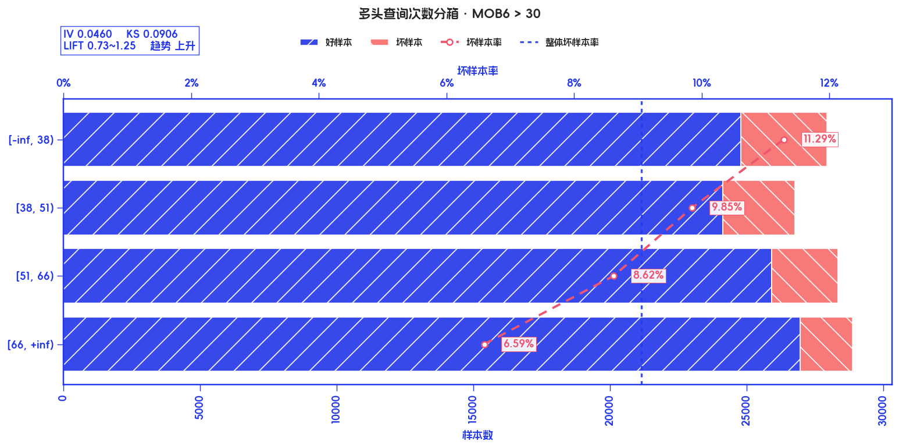</a></td>
<td width="50%" valign="top"><strong>MOB1 与 MOB6 多标签分箱</strong><br>
<a href="docs/assets/readme/showcase/binning-multi-plot.png"></a></td>
</tr>
<tr>
<td colspan="2" valign="top"><strong>按授信月份的分箱趋势</strong><br>
<a href="docs/assets/readme/showcase/binning-trend.png">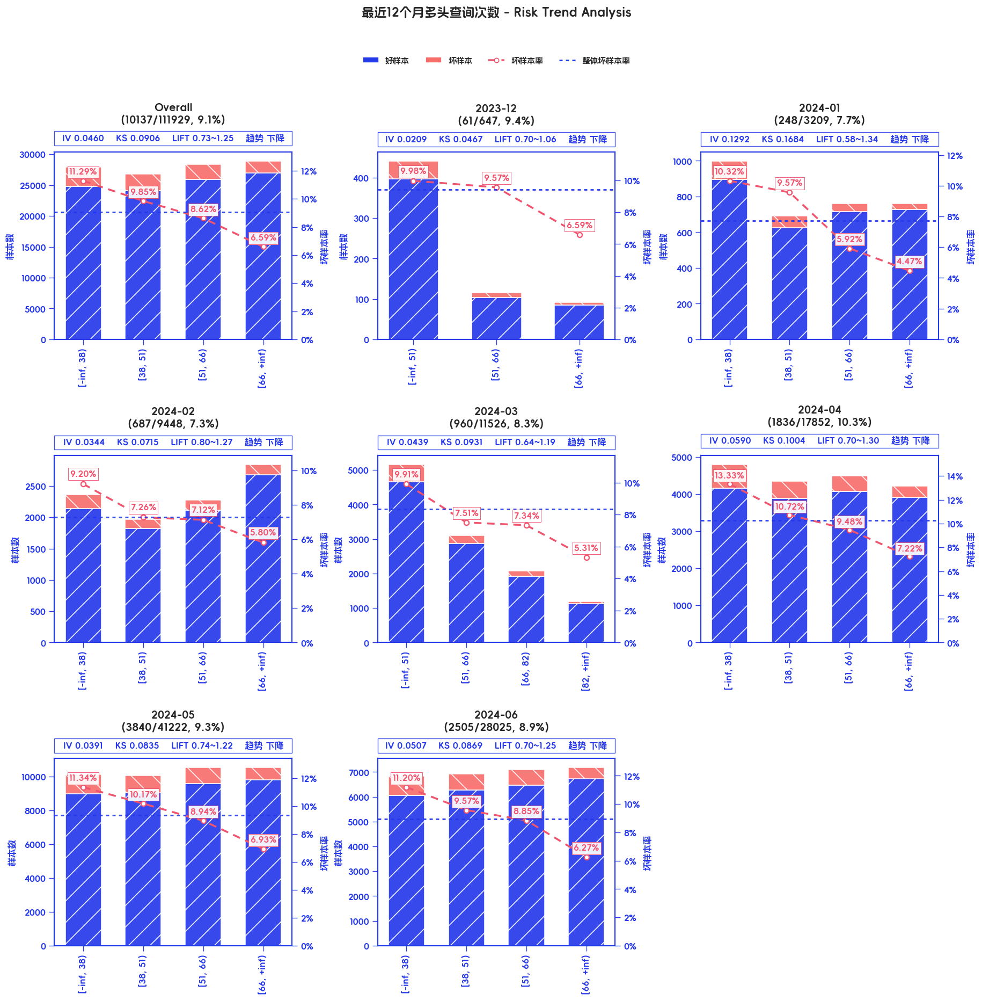</a></td>
</tr>
</table>

<details>
<summary>二维交叉分箱</summary>

```python
from hscredit.core.viz import bin_2d_plot

bin_2d_plot(
    df,
    features=["最近12个月多头查询次数", "非银机构借款总金额"],
    target="坏样本",
    max_n_bins=3,
)
```

</details>


### 特征编码

编码器遵循 `fit / transform / fit_transform` 接口，可直接接入 sklearn Pipeline。WOE 表达风险证据，TargetEncoder 提供 OOF 目标编码，CatBoostEncoder 提供有序目标编码。

| 编码器 | 用途 |
| --- | --- |
| `WOEEncoder` | WOE 编码、平滑、截断、未知值和缺失值处理 |
| `TargetEncoder` | 平滑目标均值、OOF 编码 |
| `CatBoostEncoder` | 有序目标编码、训练时噪声 |
| `CountEncoder` / `OneHotEncoder` / `OrdinalEncoder` | 频次、独热与序数编码 |
| `QuantileEncoder` | 分位数映射 |
| `GBMEncoder` | 梯度提升树叶节点编码 |
| `CardinalityEncoder` | 高基数类别处理 |

<details>
<summary>WOE、目标编码与 Pipeline</summary>

```python
from hscredit import OptimalBinning
from hscredit.core.encoders import WOEEncoder, TargetEncoder, CatBoostEncoder
from sklearn.pipeline import Pipeline

binner = OptimalBinning(method="quantile", max_n_bins=4, n_jobs=1).fit(X_train, y_train)
woe = WOEEncoder(n_jobs=1).fit(binner.transform(X_train, metric="indices"), y_train)
woe.transform(binner.transform(X_test, metric="indices")).show()

for encoder in [
    TargetEncoder(cv=3, n_jobs=1),
    CatBoostEncoder(random_state=42, n_jobs=1),
]:
    encoder.fit_transform(train[["GROUP"]], y_train)
    encoder.transform(test[["GROUP"]]).show()

pipeline = Pipeline(
    [
        ("分箱", OptimalBinning(method="quantile", max_n_bins=4, n_jobs=1)),
        ("WOE", WOEEncoder(n_jobs=1)),
    ]
)
pipeline.fit(X_train, y_train)
pipeline.transform(X_test).show()
```

</details>

<table>
<tr>
<td width="1%" nowrap align="right" valign="top"><strong>TargetEncoder</strong><br>
<a href="docs/assets/readme/showcase/encoder-target.png"></a></td>
<td valign="top"><strong>WOEEncoder</strong><br>
<a href="docs/assets/readme/showcase/encoder-woe.png"></a></td>
</tr>
<tr>
<td width="1%" nowrap align="right" valign="top"><strong>CatBoostEncoder</strong><br>
<a href="docs/assets/readme/showcase/encoder-catboost.png"></a></td>
<td valign="top"><strong>Pipeline</strong><br>
<a href="docs/assets/readme/showcase/encoder-pipeline.png"></a></td>
</tr>
</table></td>
</tr>
</table>
</div>

### 特征筛选

从数据质量、风险区分度、稳定性和模型贡献筛选变量，保留各阶段的入选、剔除原因和迭代记录。

| 分类 | 组件与作用 |
| --- | --- |
| **过滤法** | Type、Regex、Null、Mode、Cardinality、Variance；IV、KS、Lift、PSI、相关性、VIF；MutualInfo、Chi2、FTest |
| **包装法** | RFE 递归消除、Sequential 顺序选择、Stepwise 逐步回归、Boruta 影子特征比较 |
| **嵌入法** | FeatureImportance 模型重要性（可配合稀疏线性或树模型） |
| 模型贡献检验与组合 | NullImportance 标签置乱检验、StabilityAware 稳定性、ScorecardFeatureSelection 评分卡组合、CompositeFeatureSelector |

<details>
<summary>四种筛选器</summary>

```python
from sklearn.ensemble import RandomForestClassifier
from hscredit.core.selectors import (
    LiftSelector,
    NullImportanceSelector,
    RFESelector,
    ScorecardFeatureSelection,
    selection_report,
)

forest = RandomForestClassifier(n_estimators=20, max_depth=3, random_state=42, n_jobs=1)
selectors = [
    LiftSelector(threshold=0.1, ratio=0.2, n_jobs=1),
    NullImportanceSelector(forest, cv=2, n_runs=2, n_jobs=1),
    RFESelector(forest, n_features_to_select=6, n_jobs=1),
    ScorecardFeatureSelection(iv_threshold=0.01, n_jobs=1),
]
for selector in selectors:
    selector.fit(X_all, y_train)
    summary, decisions = selection_report(selector)
    summary.show()
    decisions.show()
```

</details>

<div style="max-width:100%; overflow-x:auto;">
<table role="presentation" width="100%" style="display:table; width:100%; min-width:640px; table-layout:fixed; border:0; border-collapse:collapse;">
<tr>
<td width="50%" valign="top" style="width:50%; padding:4px; border:0; vertical-align:top;">
<strong>LiftSelector</strong>
<div style="height:417px; max-width:100%; overflow:auto;">
<table role="presentation" style="display:table; width:max-content; max-width:none; border:0; border-collapse:collapse;"><tr><td style="padding:0; border:0;">
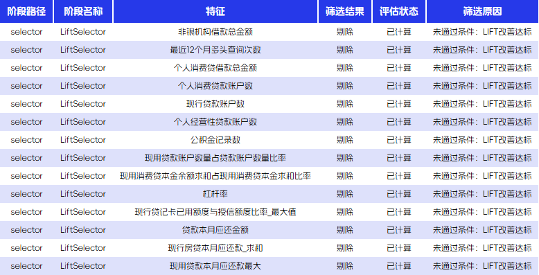
</td></tr></table>
</div></td>
<td width="50%" valign="top" style="width:50%; padding:4px; border:0; vertical-align:top;">
<strong>NullImportanceSelector</strong>
<div style="height:417px; max-width:100%; overflow:auto;">
<table role="presentation" style="display:table; width:max-content; max-width:none; border:0; border-collapse:collapse;"><tr><td style="padding:0; border:0;">
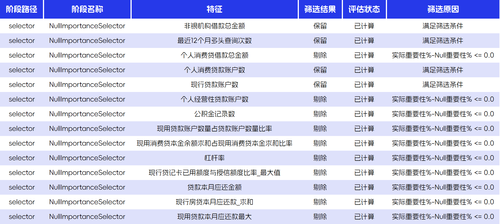
</td></tr></table>
</div></td>
</tr>
<tr>
<td width="50%" valign="top" style="width:50%; padding:4px; border:0; vertical-align:top;">
<strong>RFESelector</strong>
<div style="height:417px; max-width:100%; overflow:auto;">
<table role="presentation" style="display:table; width:max-content; max-width:none; border:0; border-collapse:collapse;"><tr><td style="padding:0; border:0;">
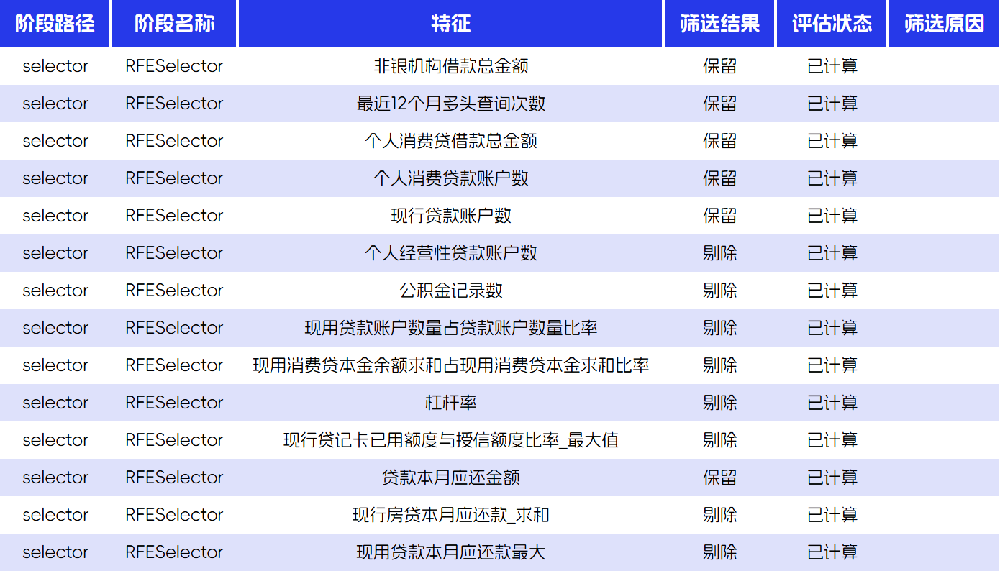
</td></tr></table>
</div></td>
<td width="50%" valign="top" style="width:50%; padding:4px; border:0; vertical-align:top;">
<strong>ScorecardFeatureSelection</strong>
<div style="height:417px; max-width:100%; overflow:auto;">
<table role="presentation" style="display:table; width:max-content; max-width:none; border:0; border-collapse:collapse;"><tr><td style="padding:0; border:0;">
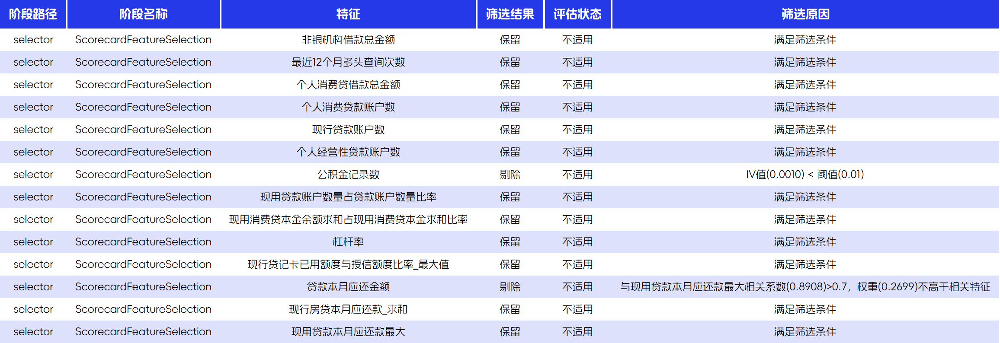
</td></tr></table>
</div></td>
</tr>
</table>
</div>

```python
from hscredit.core.selectors import NullSelector, CorrSelector, selection_report
from sklearn.pipeline import Pipeline

selection = Pipeline(
    [
        ("缺失率", NullSelector(threshold=0.95, n_jobs=1)),
        (
            "相关性",
            CorrSelector(
                threshold=0.8,
                bin_params={"method": "best_iv", "max_n_bins": 5},
                n_jobs=1,
            ),
        ),
    ]
)
selection.fit(X_all, y_train)
summary, decisions = selection_report(selection)
summary.show()
```

<table role="presentation" style="display:block; width:max-content; max-width:100%; overflow-x:auto; border:0; border-collapse:collapse;"><tr><td style="padding:0; border:0;">
<table role="presentation" style="display:table; width:max-content; max-width:none; border:0; border-collapse:collapse;"><tr><td style="padding:0; border:0;">

</td></tr></table>
</td></tr></table>

### 风控建模

从评分卡、Boosting 到表格神经网络，统一组织训练、评估、调参、解释和部署。

| 模型族 | 组件 |
| --- | --- |
| 经典模型 | LogisticRegression、DecisionTree、RandomForest、ExtraTrees、GradientBoosting、SVM |
| Boosting | XGBoost、LightGBM、CatBoost、NGBoost |
| 表格神经网络 | ResNet、FTTransformer、TabM、TabNet、TabPFN |
| 评分卡 | ScoreCard、RoundScoreCard、ProbabilityScoreCard；分数转换与漂移调整 |
| 规则分类 | RulesClassifier，组合 Rule / RuleSet |
| 配套能力 | ModelTuner / AutoTuner、概率校准、SHAP、自定义损失、模型报告、推理导出 |

**LR + Scorecard。** 查看回归系数与统计诊断，把 WOE 转换为分值表和评分刻度。

```python
from hscredit import LogisticRegression, OptimalBinning, ScoreCard, WOEEncoder

binner = OptimalBinning(method="quantile", max_n_bins=4, n_jobs=1).fit(X_train, y_train)
bin_ids = binner.transform(X_train, metric="indices")
woe = WOEEncoder(n_jobs=1).fit(bin_ids, y_train)
X_woe = woe.transform(bin_ids)
lr = LogisticRegression(max_iter=500).fit(X_woe, y_train)
lr.summary().show()

card = ScoreCard(
    binner=binner, encoder=woe, lr_model=lr, base_score=650, base_odds=35, pdo=50
)
card.fit(X_train, y_train, input_type="raw")
card.scorecard_points().show()
card.scorecard_scale().show()
```

<table role="presentation" style="display:block; width:max-content; max-width:100%; overflow-x:auto; border:0; border-collapse:collapse;">
<tr>
<td valign="top" style="padding:0 12px 0 0; border:0; vertical-align:top;">
<table role="presentation" style="display:table; width:max-content; max-width:none; border:0; border-collapse:collapse;"><tr><td style="padding:0; border:0;">
<strong>评分卡分值表</strong>

</td></tr></table>
</td>
<td valign="top" style="padding:0; border:0; vertical-align:top;">
<table role="presentation" style="display:table; width:max-content; max-width:none; border:0; border-collapse:collapse;">
<tr><td style="padding:0 0 12px; border:0;">
<strong>LR 统计摘要</strong>

</td></tr>
<tr><td style="padding:0; border:0;">
<strong>评分刻度</strong>

</td></tr></table>
</td></tr></table>

**XGBoost 与超参数搜索。** 用 `.tune()` 指定搜索空间，也可用 `AutoTuner` 的预设空间；Dashboard 查看搜索过程，Pareto 前沿比较多个优化目标。

```python
from hscredit import XGBoost, AutoTuner

model = XGBoost(n_estimators=40, max_depth=3, n_jobs=1, random_state=42)
model.fit(X_num, y_train)
probability = model.predict_proba(X_test_num)[:, 1]

best = model.tune(
    X_num,
    y_train,
    metric="auc",
    cv=3,
    n_trials=20,
    n_jobs=1,
    search_space={"max_depth": [2, 3, 4], "learning_rate": [0.03, 0.1]},
)

pareto_tuner = AutoTuner.create(
    "xgboost",
    metric=["auc", "ks_diff"],
    cv=2,
    random_state=42,
    n_jobs=1,
    search_space={"max_depth": [2, 3, 4], "learning_rate": [0.03, 0.1, 0.2]},
    fixed_params={"n_estimators": 30, "n_jobs": 1},
    storage="sqlite:///搜索记录.db",
    study_name="XGBoost多目标搜索",
)
pareto_tuner.fit(X_num, y_train, n_trials=8)
pareto_tuner.plot_pareto_front().show()
```


```bash
optuna-dashboard sqlite:///搜索记录.db
```

**评估与损失。** 选择区分度、稳定性、成本或利润指标，并为支持的模型配置自定义损失。

| 评估目标 | 指标入口 |
| --- | --- |
| 区分度与稳定性 | `AUCMetric`、`KSMetric`、`GiniMetric`、`PSIMetric` |
| 头部识别 | `TopKCaptureMetric`、`TopKLiftMetric` |
| 业务效果 | `BadDebtMetric`、`ApprovalRateMetric`、`ProfitMetric`、`ClassificationCostMetric` |
| 自定义 | `make_metric` / `CallableMetric`；`LossMetric` 评估损失；调参接受 callable |

| 损失目标 | 损失对象 |
| --- | --- |
| 不平衡样本 | FocalLoss、AsymmetricFocalLoss、BalancedFocalLoss、WeightedBCELoss |
| 成本与经营 | CostSensitiveLoss、BadDebtLoss、ApprovalRateLoss、ProfitMaxLoss、ExpectedProfitLoss |
| 排序与头部 | OrdinalRankLoss、LiftFocusedLoss、RankingAUCProxyLoss、KSFocusedLoss、TopKBadCaptureLoss |
| 金额与价值 | AmountWeightedLoss、ExpectedValueLoss |

```python
from hscredit.core.models.losses import FocalLoss, KSMetric

risk_model = XGBoost(
    objective=FocalLoss(gamma=2.0),
    eval_metric=KSMetric(),
    n_estimators=40,
    max_depth=3,
    n_jobs=1,
)
risk_model.fit(X_num, y_train)
```

**模型解释。** 全局重要性与 SHAP 分布定位主要风险因素；力图和瀑布图解释单个样本的预测贡献。

```python
from hscredit.core.viz import plot_model_feature_importance, plot_model_sample_shap

plot_model_feature_importance(
    model, X_test_num.iloc[:150], y_test.iloc[:150], right_top_n=4
)
plot_model_sample_shap(model, X_test_num.iloc[[0]], background_data=X_num.iloc[:40])
```


**RulesClassifier。** 将 Rule / RuleSet 组合成具有 `fit / predict` 接口的分类器。

```python
from hscredit import Rule, RuleSet, RulesClassifier

query_rule = Rule("最近12个月多头查询次数 > 60", name="多头查询超过60次")
payment_rule = Rule("贷款本月应还金额 > 20000", name="月应还额超过2万")
rule_set = RuleSet(rules=[query_rule, payment_rule], logic="or", n_jobs=1)
rule_model = RulesClassifier(rules=rule_set, n_jobs=1).fit(X_num, y_train)
rule_model.predict(X_test_num)
```

**TabPFN。** 支持预训练模型的上下文推理、无标签预训练和监督微调。

<details>
<summary>TabPFN 预训练与微调</summary>

```python
from hscredit import TabPFN

pfn = TabPFN(objective="binary", n_estimators=1, device="auto")
pfn.fit(X_num, y_train)
pfn.predict_proba(X_test_num)

pfn_train = TabPFN(objective="binary", n_estimators=1, device="auto")
pfn_train.pretrain(X_num, pretraining_ratio=0.5, max_epochs=1, batch_size=128)
pfn_train.fit(
    X_num, y_train, finetune=True, finetune_params={"max_epochs": 1, "batch_size": 128}
)
```

</details>

**auto_model_report。** 在训练、测试和时间外数据集上，生成分类或回归评估、变量分析、稳定性、训练过程与部署信息；分类报告支持多个逾期标签。

```python
from hscredit.report import auto_model_report

report_train, report_test = train.copy(), test.copy()
report_train[features], report_test[features] = X_num, X_test_num
report = auto_model_report(
    model,
    datasets={"训练集": report_train, "测试集": report_test},
    features=features,
    amount="loan_amt",
    date="授信时间",
    group="GROUP",
    excel_path="模型评估.xlsx",
    n_jobs=1,
    **labels,
)
report.summary().show()
```

<table role="presentation" style="display:block; width:max-content; max-width:100%; overflow-x:auto; border:0; border-collapse:collapse;"><tr><td style="padding:0; border:0;">
<table role="presentation" style="display:table; width:max-content; max-width:none; border:0; border-collapse:collapse;"><tr><td style="padding:0; border:0;">
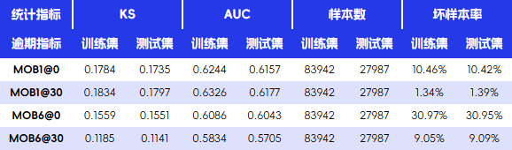
</td></tr></table>
</td></tr></table>

<div style="max-width:100%; max-height:640px; overflow:auto;"><a href="docs/assets/readme/showcase/intro-model.png"></a></div>

<table role="presentation" style="display:block; width:max-content; max-width:100%; overflow-x:auto; border:0; border-collapse:collapse;"><tr><td style="padding:0; border:0;">
<table role="presentation" style="display:table; width:max-content; max-width:none; border:0; border-collapse:collapse;"><tr><td style="padding:0; border:0;">
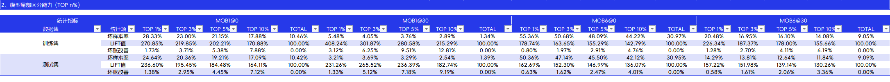
</td></tr></table>
</td></tr></table>

<a href="docs/assets/readme/showcase/auto-model-report.xlsx?raw=true" download style="color:#c02dd4;">下载模型报告</a>

<details>
<summary>回归模型报告</summary>

```python
from sklearn.ensemble import RandomForestRegressor

regressor = RandomForestRegressor(n_estimators=40, max_depth=4, random_state=42)
regressor.fit(X_num, train["loan_amt"])
auto_model_report(
    regressor,
    datasets={"训练集": report_train, "测试集": report_test},
    features=features,
    target="loan_amt",
    excel_path="回归模型报告.xlsx",
    n_jobs=1,
)
```

</details>

<table role="presentation" style="display:block; width:max-content; max-width:100%; overflow-x:auto; border:0; border-collapse:collapse;"><tr><td style="padding:0; border:0;">
<table role="presentation" style="display:table; width:max-content; max-width:none; border:0; border-collapse:collapse;"><tr><td style="padding:0; border:0;">

</td></tr></table>
</td></tr></table>

**部署。** 保存完整模型或导出推理模型，使用相同的字段和预处理完成预测。

```python
model.save_inference("xgboost_inference.pkl")
restored = XGBoost.load("xgboost_inference.pkl")
restored.predict_proba(X_test_num)
```

<a href="examples/28_model_workflow.ipynb" style="color:#c02dd4;">模型流程</a> · <a href="examples/27_model_interpretability.ipynb" style="color:#c02dd4;">模型解释</a> · <a href="docs/articles/report-resources-deployment.md" style="color:#c02dd4;">部署文档</a>

### 规则分析

把候选规则组合为策略，分析命中、风险覆盖、金额效果、客群差异与置入置出。

| 能力 | 入口 |
| --- | --- |
| 逻辑表达与执行 | `Rule` 的 `&` / `&#124;` / `~` / `^`，嵌套 `RuleSet`，串并行 `RuleFlow` |
| 单规则与规则集分析 | `Rule.report`、`ruleset_analysis`，件数 / 金额、多标签 |
| 策略置换 | `swap_analysis`、`rule_swap_analysis`，置入置出、风险估计、通过率变化 |
| 多规则迭代报告 | `swap_out_report`，组合规则、客群 / 时间比较、分箱明细与 Excel |
| 候选规则挖掘 | SingleFeatureRuleMiner、MultiFeatureRuleMiner、MultiLabelRuleMiner |
| 树规则挖掘 | TreeRuleExtractor、DecisionTreeAnalyzer、ManualTreeExtractor、MultiwayTreeExtractor |

**单规则：`rule.report`**

```python
from hscredit import Rule

query_rule = Rule("最近12个月多头查询次数 > 60", name="多头查询超过60次")
query_rule.report(test, amount="loan_amt", margins=True, **labels).show()
```

<table role="presentation" style="display:block; width:max-content; max-width:100%; overflow-x:auto; border:0; border-collapse:collapse;"><tr><td style="padding:0; border:0;">
<table role="presentation" style="display:table; width:max-content; max-width:none; border:0; border-collapse:collapse;"><tr><td style="padding:0; border:0;">

</td></tr></table>
</td></tr></table>

**规则集：`ruleset_analysis`**

```python
from hscredit.report import ruleset_analysis

payment_rule = Rule("贷款本月应还金额 > 20000", name="月应还额超过2万")
ruleset_analysis(
    test,
    rules=[query_rule, payment_rule],
    amount="loan_amt",
    n_jobs=1,
    **labels,
).show()
```

<table role="presentation" style="display:block; width:max-content; max-width:100%; overflow-x:auto; border:0; border-collapse:collapse;"><tr><td style="padding:0; border:0;">
<table role="presentation" style="display:table; width:max-content; max-width:none; border:0; border-collapse:collapse;"><tr><td style="padding:0; border:0;">

</td></tr></table>
</td></tr></table>

**置换与多规则报告。** `swap_analysis` 量化新旧策略的置入置出；`swap_out_report` 汇总组合效果、业务影响、时间或客群稳定性及分箱明细。

<details>
<summary>Swap 与多规则报告</summary>

```python
from hscredit.report import swap_out_report
from hscredit.report.swap_analysis import create_swap_dataset_from_rules, swap_analysis
from hscredit.utils.overdue import overdue_label

reference = test.assign(模型风险概率=probability)
swap_data = create_swap_dataset_from_rules(
    reference,
    original_rule=query_rule,
    new_rule=payment_rule,
    score_col="模型风险概率",
    n_jobs=1,
)
swap = swap_analysis(
    swap_data, reference_df=reference, score_col="模型风险概率", n_jobs=1, **labels
)
swap.get_summary_report(target=overdue_label("MOB6", 30, ">")).show()

swap_out_report(
    test,
    rules=[query_rule, payment_rule],
    features=["最近12个月多头查询次数"],
    date="授信时间",
    save="策略迭代.xlsx",
    n_jobs=1,
    **labels,
)

# 按客群比较同一组规则的命中率和坏样本率
swap_out_report(
    test, rules=[query_rule, payment_rule], group="GROUP",
    features=["最近12个月多头查询次数"], save="客群策略.xlsx", n_jobs=1, **labels,
)
```

</details>

<table role="presentation" style="display:block; width:max-content; max-width:100%; overflow-x:auto; border:0; border-collapse:collapse;"><tr><td style="padding:0; border:0;">
<table role="presentation" style="display:table; width:max-content; max-width:none; border:0; border-collapse:collapse;"><tr><td style="padding:0; border:0;">

</td></tr></table>
</td></tr></table>

<div style="max-width:100%; max-height:640px; overflow:auto;"><a href="docs/assets/readme/showcase/intro-strategy.png"></a></div>

<a href="docs/assets/readme/showcase/swap-out.xlsx?raw=true" download style="color:#c02dd4;">下载按月策略报告</a>

**二叉树与多叉树挖掘。** 根节点自动学习，非根节点按业务条件手工拆分；同一套规则在训练、测试集及多个标签上评估。

<details>
<summary>手工拆分与多数据集策略报告</summary>

```python
from hscredit.report.mining import ManualTreeExtractor, MultiwayTreeExtractor

binary_tree = ManualTreeExtractor(
    target="坏样本", features=features, max_depth=2, min_samples_leaf=100, n_jobs=1
)
binary_tree.fit(report_train, features=features)
binary_tree.manual_split(report_train, feature="贷款本月应还金额", threshold=20000, node=1)

multiway_tree = MultiwayTreeExtractor(
    target="坏样本", features=features, max_depth=2, max_n_bins=3, n_jobs=1
)
multiway_tree.fit(report_train, features=features)
child = int(multiway_tree.get_node_table().set_index("节点编号").loc[0, "子节点"][0])
multiway_tree.manual_split(
    node=child, feature="贷款本月应还金额", thresholds=[5000, 20000], grow=False
)

for name, tree in [("二叉树", binary_tree), ("多叉树", multiway_tree)]:
    tree.report(
        datasets={"训练集": report_train, "测试集": report_test},
        date="授信时间",
        group="GROUP",
        amount="loan_amt",
        save=f"{name}策略挖掘.xlsx",
        **labels,
    )
```

</details>

<table>
<tr>
<td width="50%" valign="top"><strong>二叉树</strong><br>
<a href="docs/assets/readme/showcase/tree-binary.png">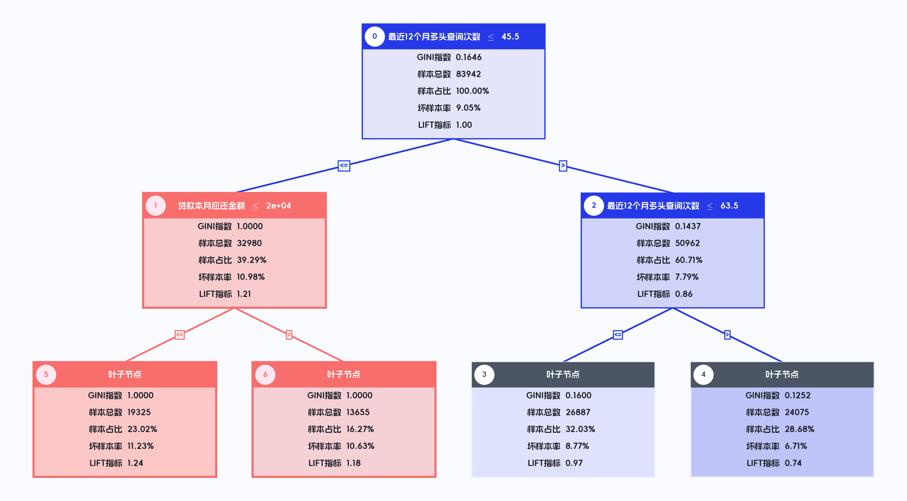</a></td>
<td width="50%" valign="top"><strong>多叉树</strong><br>
<a href="docs/assets/readme/showcase/tree-multiway.png">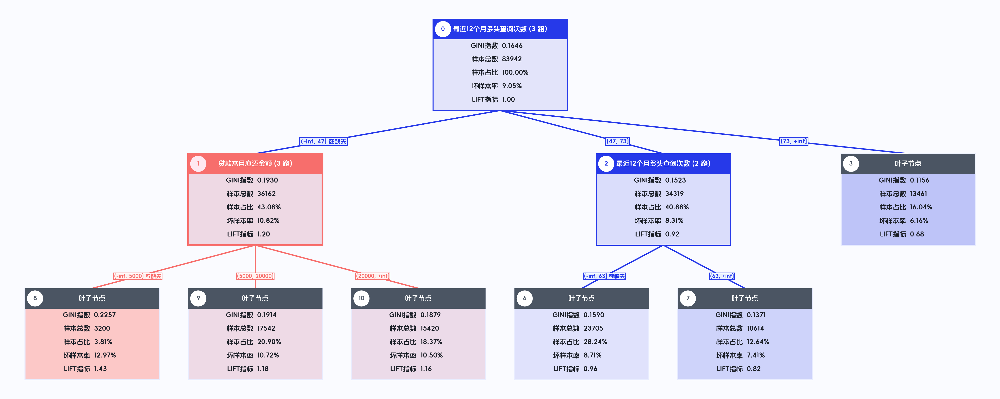</a></td>
</tr>
<tr>
<td width="50%" valign="top"><strong>训练集节点效果</strong><br>
<a href="docs/assets/readme/showcase/binary-tree-report-excel.png"></a></td>
<td width="50%" valign="top"><strong>训练集节点效果</strong><br>
<a href="docs/assets/readme/showcase/multiway-tree-report-excel.png"></a></td>
</tr>
<tr>
<td width="50%" valign="top"><strong>测试集节点效果</strong><br>
<a href="docs/assets/readme/showcase/binary-tree-report-test-excel.png"></a></td>
<td width="50%" valign="top"><strong>测试集节点效果</strong><br>
<a href="docs/assets/readme/showcase/multiway-tree-report-test-excel.png"></a></td>
</tr>
</table>

<a href="docs/assets/readme/showcase/binary-tree-report.xlsx?raw=true" download style="color:#c02dd4;">下载二叉树报告</a> · <a href="docs/assets/readme/showcase/multiway-tree-report.xlsx?raw=true" download style="color:#c02dd4;">下载多叉树报告</a>

### 数据挖掘

从样本质量、分布、区分度与稳定性出发，分析变量在不同时间、客群和逾期口径下的表现。

| 能力 | 代表功能 |
| --- | --- |
| 数据质量与变量摘要 | `DataFrame.summary()`、缺失 / 唯一值 / 分位数 / 目标关联 |
| 模型与变量表现 | `ks_plot`、`corr_plot`、`hist_plot`、`confusion_matrix_plot` |
| 稳定性与时间趋势 | `psi_plot`、`bad_rate_trend_plot`、分组分箱、客群迁移 |
| 账龄与风险分析 | Vintage、Roll Rate、逾期表现与策略分析 |
| 自动报告 | `auto_feature_analysis`，多特征、多标签、金额、按月与相关性 |

```python
df[analysis_features + ["坏样本"]].summary(y="坏样本").show()
```

<table role="presentation" style="display:block; width:max-content; max-width:100%; overflow-x:auto; border:0; border-collapse:collapse;"><tr><td style="padding:0; border:0;">
<table role="presentation" style="display:table; width:max-content; max-width:none; border:0; border-collapse:collapse;"><tr><td style="padding:0; border:0;">

</td></tr></table>
</td></tr></table>

<details>
<summary>常用图表</summary>

```python
from hscredit.core.viz import (
    ks_plot,
    corr_plot,
    hist_plot,
    confusion_matrix_plot,
    psi_plot,
    bad_rate_trend_plot,
)

ks_plot(probability, y_test)
corr_plot(X_all)
hist_plot(probability, y_test)
confusion_matrix_plot(y_test, probability >= 0.5)
psi_plot(X_train["最近12个月多头查询次数"], X_test["最近12个月多头查询次数"])
bad_rate_trend_plot(df, date="授信时间", **labels)
```

</details>

<table>
<tr>
<td width="33%" valign="top"><strong>KS / ROC</strong><br>
<a href="docs/assets/readme/showcase/eda-ks.png"></a></td>
<td width="33%" valign="top"><strong>相关性</strong><br>
<a href="docs/assets/readme/showcase/eda-corr.png">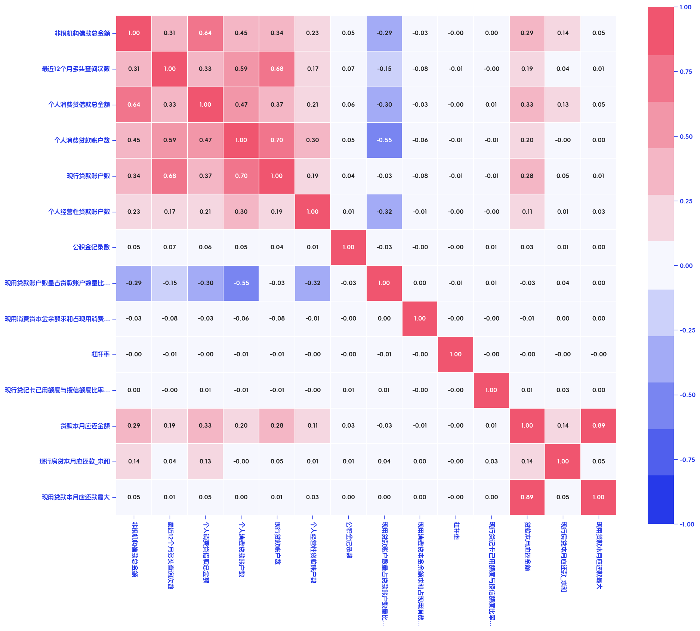</a></td>
<td width="33%" valign="top"><strong>预测概率分布</strong><br>
<a href="docs/assets/readme/showcase/eda-hist.png">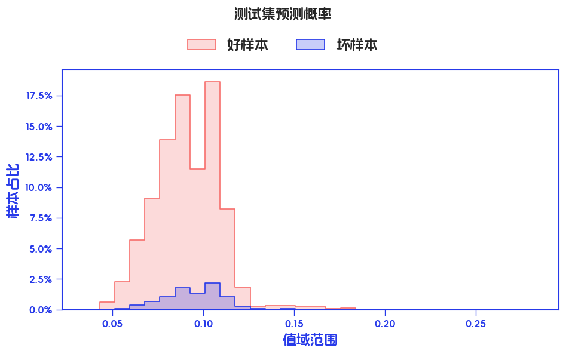</a></td>
</tr>
<tr>
<td width="33%" valign="top"><strong>混淆矩阵</strong><br>
<a href="docs/assets/readme/showcase/eda-confusion.png">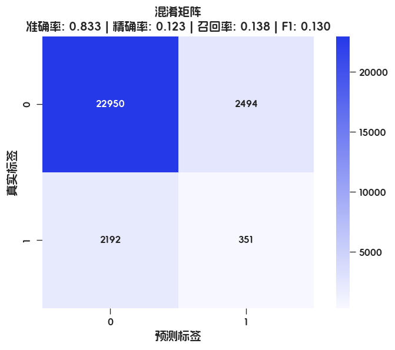</a></td>
<td width="33%" valign="top"><strong>PSI 稳定性</strong><br>
<a href="docs/assets/readme/showcase/eda-psi.png">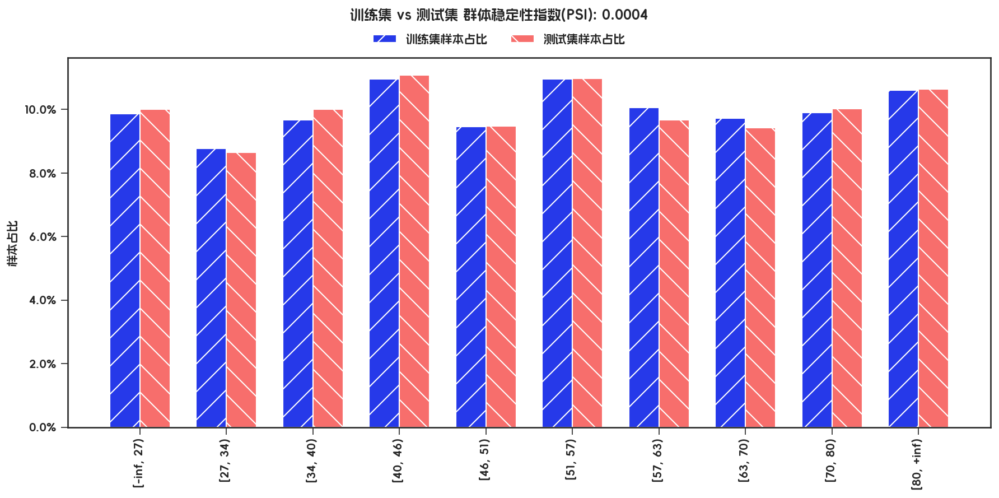</a></td>
<td width="33%" valign="top"><strong>授信月份坏率趋势</strong><br>
<a href="docs/assets/readme/showcase/eda-trend.png">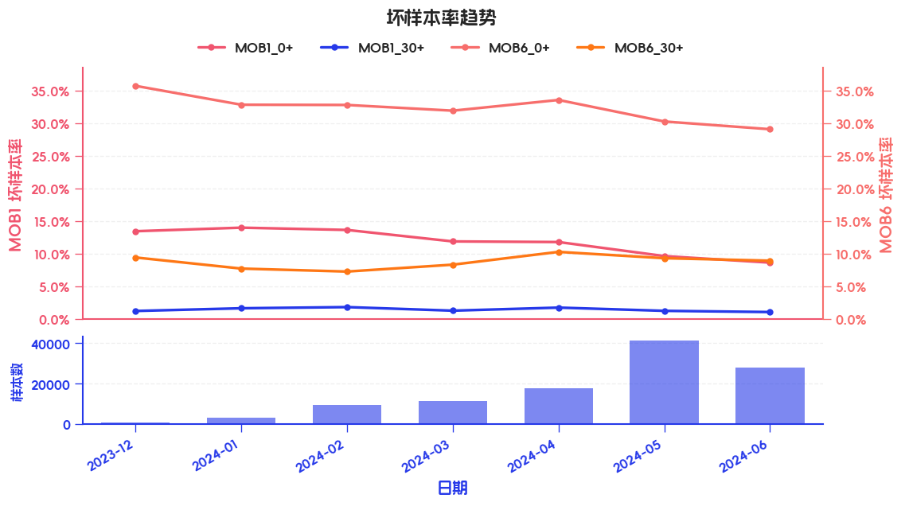</a></td>
</tr>
</table>

**auto_feature_analysis：多标签特征报告。** 一次输出数据摘要和变量分布，按逾期标签纵向展示各分箱的订单与金额表现。

```python
from hscredit.report import auto_feature_analysis

auto_feature_analysis(
    df,
    features=analysis_features,
    date="授信时间",
    amount="loan_amt",
    bin_params={"method": "quantile", "max_n_bins": 4, "long_format": True},
    margins=True,
    excel_writer="特征分析.xlsx",
    n_jobs=1,
    **labels,
)
```

<div style="max-width:100%; max-height:640px; overflow:auto;"><a href="docs/assets/readme/showcase/intro-features.png"></a></div>

<a href="docs/assets/readme/showcase/feature-analysis.xlsx?raw=true" download style="color:#c02dd4;">下载多标签特征报告</a>

### Excel 写入

将数据、图表、格式、超链接和原生透视表放入同一工作簿，支持快速导出和逐单元格调整。

| 能力 | 入口 / 配置 |
| --- | --- |
| 条件格式 | `condition_cols` 数据条、`color_cols` 色阶、`add_conditional_formatting` |
| 内容格式 | `percent_cols`、`custom_format`、`set_number_format`、字体、对齐、填充、边框 |
| 数据 + 多图 | `dataframe2excel(..., figures=[...])`、`insert_pic2sheet` |
| 导航与阅读 | `insert_hyperlink2sheet`、`set_freeze_panes`、自动筛选 |
| 原生透视表 | `insert_pivot_table2sheet`，分组、聚合、占比与筛选 |
| 行高列宽 | `auto_width / auto_height`、`set_column_width / set_row_height` |

<details>
<summary>写入数据、多图、格式与透视表</summary>

```python
from hscredit.excel import ExcelWriter, dataframe2excel
from hscredit.core.viz import bin_plot, bin_trend_plot

bin_plot(bins, save="分箱.png")
bin_trend_plot(
    df, feature="最近12个月多头查询次数", target="坏样本", date="授信时间", n_jobs=1, save="月份.png"
)
writer = ExcelWriter()
dataframe2excel(
    bins,
    writer,
    sheet_name="分箱分析",
    figures=["分箱.png", "月份.png"],
    percent_cols=["坏样本率"],
    condition_cols=["LIFT值"],
    condition_color="F76E6C",
    auto_width=True,
)
sheet = writer.get_sheet_by_name("分箱分析")
writer.set_freeze_panes(sheet, "D5")
writer.set_column_width(sheet, "B", 26)
writer.set_row_height(sheet, 2, 30)
writer.insert_hyperlink2sheet(sheet, "B1", sheet="透视分析", target_space="B2")
writer.insert_pivot_table2sheet(
    worksheet="透视分析",
    data=df[["GROUP", "授信月份", "loan_amt"]],
    pivot_anchor="B2",
    rows="GROUP",
    columns="授信月份",
    values=[
        {
            "field": "loan_amt",
            "agg": "sum",
            "name": "额度合计",
            "number_format": "#,##0.00",
        },
        {
            "field": "loan_amt",
            "agg": "sum",
            "show_as": "全局占比",
            "name": "金额占比",
            "number_format": "0.00%",
        },
    ],
    theme_style=True,
)
writer.save("Excel功能展示.xlsx")
```

</details>

<table role="presentation" style="display:block; width:max-content; max-width:100%; overflow-x:auto; border:0; border-collapse:collapse;"><tr><td style="padding:0; border:0;">
<table role="presentation" style="display:table; width:max-content; max-width:none; border:0; border-collapse:collapse;"><tr><td style="padding:0; border:0;">

</td></tr></table>
</td></tr></table>

<table role="presentation" style="display:block; width:max-content; max-width:100%; overflow-x:auto; border:0; border-collapse:collapse;"><tr><td style="padding:0; border:0;">
<table role="presentation" style="display:table; width:max-content; max-width:none; border:0; border-collapse:collapse;"><tr><td style="padding:0; border:0;">

</td></tr></table>
</td></tr></table>

<a href="docs/assets/readme/showcase/excel-showcase.xlsx?raw=true" download style="color:#c02dd4;">下载 Excel 功能展示工作簿</a>

### 数据库读写

统一连接池、参数化查询、元数据和写入接口；以迭代器分块读取、分批写入大表。

| 类型 | 适配器 | 读写能力 |
| --- | --- | --- |
| SQL | MySQL / MariaDB、Hive、Impala、Oracle、StarRocks、ClickHouse、MaxCompute | 参数化查询、流式读取、批量与流式写入、表结构检查；依后端能力选择模式 |
| NoSQL | MongoDB、Redis | 统一 `read / read_one / read_many` 与 `write / write_one / write_many`，文档 / 键值操作 |

<details>
<summary>SQL 流式读写</summary>

```python
import os
from hscredit.database import Database

connection = {
    "host": os.environ["DB_HOST"],
    "user": os.environ["DB_USER"],
    "password": os.environ["DB_PASSWORD"],
    "database": os.environ["DB_NAME"],
}
with Database("mysql", **connection) as source, Database(
    "mysql", **connection
) as destination:
    with source.stream_query(
        "SELECT DK_X1995_2, BASE_X187 FROM credit_features",
        chunksize=10000,
        retain=False,
    ) as batches:
        destination.stream_write(
            batches, "credit_features_demo", mode="a", batch_size=5000
        )
```

</details>

<details>
<summary>NoSQL 文档读写</summary>

```python
with Database(
    "mongodb", host=os.environ["MONGO_HOST"], database=os.environ["MONGO_DATABASE"]
) as mongo:
    records = mongo.read_many("credit_features", {"BASE_X187": {"$gte": 60}})
    mongo.write_many("credit_features_demo", [{"样本编号": "演示001", "评分": 650}])
```

</details>

<a href="docs/api/database.rst" style="color:#c02dd4;">数据库 API</a>

### Agent 能力

向已接入 hscredit Skills 的 ChatGPT 描述数据、目标和输出要求，模型调用相应能力并返回图表、模型或工作簿。

```bash
python skills/install.py --suite hscredit
```

| Skill | 功能与作用 | 用户对 ChatGPT 说 | 返回结果 |
| --- | --- | --- | --- |
| <a href="skills/hscredit/SKILL.md" style="color:#c02dd4;">hscredit</a> | 发现能力、选择操作与规划流程 | “我上传了现金贷数据，请帮我规划变量分析和建模流程，并选择合适的 hscredit 能力。” | 识别字段与目标，选择分箱、筛选、建模和报告入口 |
| <a href="skills/hsbin/SKILL.md" style="color:#c02dd4;">hsbin</a> | 比较分箱方法，评估变量分档风险与稳定性 | “请调用 hsbin，分析 BASE_X187 在 MOB1、MOB6 的 0 天和 30 天口径下的表现，比较分箱方法。” | 多标签分箱表、方法摘要和分箱图 |
| <a href="skills/hsselect/SKILL.md" style="color:#c02dd4;">hsselect</a> | 筛选候选特征，解释保留或剔除原因 | “请用 hsselect 以 MOB6 > 30 筛选这批授信字段，告诉我保留和剔除的原因。” | 特征清单、阶段汇总与逐特征决策 |
| <a href="skills/hsmodel/SKILL.md" style="color:#c02dd4;">hsmodel</a> | 训练、调优、解释模型并导出推理制品 | “请用 hsmodel 训练 XGBoost，以 AUC 调参，在独立测试集评估并解释高风险样本。” | 最佳模型、测试指标、重要性与单样本解释 |
| <a href="skills/hsrule/SKILL.md" style="color:#c02dd4;">hsrule</a> | 执行规则、评估规则集和策略置换效果 | “请调用 hsrule，比较多头查询和月应还额规则，分析置入置出及客群差异。” | 多规则效果、策略置换结果和迭代报告 |
| <a href="skills/hsviz/SKILL.md" style="color:#c02dd4;">hsviz</a> | 绘制变量、模型、评分和稳定性图表 | “请用 hsviz 为这份模型预测结果绘制 KS、ROC、混淆矩阵和按授信月份的坏率趋势。” | hscredit 字体与配色的原生图表 |
| <a href="skills/hsreport/SKILL.md" style="color:#c02dd4;">hsreport</a> | 汇总变量、模型或策略的完整分析报告 | “请调用 hsreport，把训练集和测试集的四种 MOB 标签整理成可下载的模型评估 Excel。” | 多数据集、多标签的最终报告工作簿 |
| <a href="skills/hsexcel/SKILL.md" style="color:#c02dd4;">hsexcel</a> | 编排多表、图像、格式和原生透视表 | “请用 hsexcel 把分箱表和两张图写入 Excel，设置百分比、条件格式、冻结窗口和客群透视表。” | 带原生透视表和格式的最终 Excel |

## 参考引用

- <a href="https://hscredit.hengshucredit.com/" style="color:#c02dd4;">hscredit 在线文档</a> · <a href="https://hscredit.hengshucredit.com/api/index.html" style="color:#c02dd4;">API 参考</a> · <a href="examples/" style="color:#c02dd4;">全部 Notebook</a> · <a href="https://github.com/hengshu-credit/hscredit/issues" style="color:#c02dd4;">GitHub Issues</a>
- <a href="https://scikit-learn.org/" style="color:#c02dd4;">scikit-learn</a>：估计器接口、Pipeline 与模型评估。
- <a href="https://xgboost.readthedocs.io/" style="color:#c02dd4;">XGBoost</a> · <a href="https://lightgbm.readthedocs.io/" style="color:#c02dd4;">LightGBM</a> · <a href="https://catboost.ai/" style="color:#c02dd4;">CatBoost</a> · <a href="https://optuna.org/" style="color:#c02dd4;">Optuna</a>：梯度提升与参数优化。
- <a href="https://shap.readthedocs.io/" style="color:#c02dd4;">SHAP</a> · <a href="https://github.com/PriorLabs/TabPFN" style="color:#c02dd4;">TabPFN</a> · <a href="https://developers.google.com/optimization" style="color:#c02dd4;">OR-Tools</a>：模型解释、表格基础模型与约束优化。
- <a href="https://github.com/amphibian-dev/toad" style="color:#c02dd4;">toad</a> · <a href="https://github.com/ShichenXie/scorecardpy" style="color:#c02dd4;">scorecardpy</a> · <a href="https://github.com/guillermo-navas-palencia/optbinning" style="color:#c02dd4;">OptBinning</a>：评分卡与分箱生态参考。

开源许可：<a href="LICENSE" style="color:#c02dd4;">MIT License</a>。
