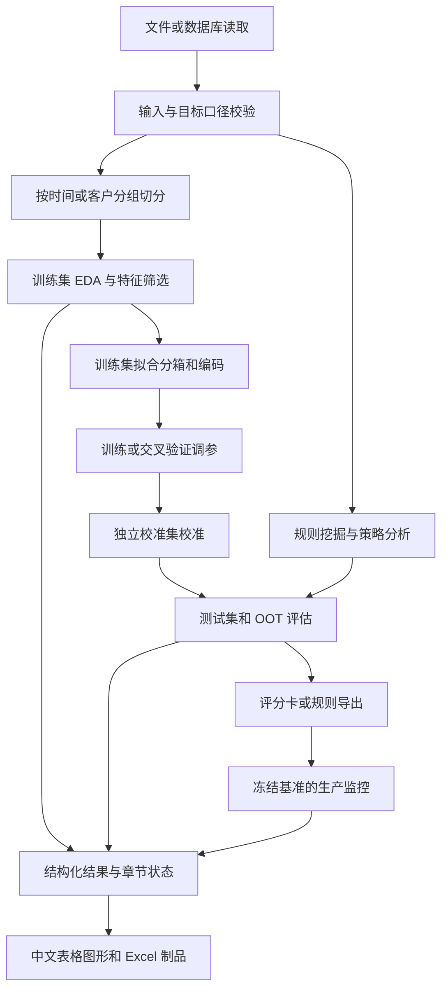

# HSCredit 项目现状深度分析与后续建设建议

> 本文记录修复前的审查状态。后续修复与完整复核结果见 [问题修复与功能复核记录](../docs/HSCREDIT_REPAIR_VERIFICATION_2026-10-22.md)。

审查日期：2026-10-22（Asia/Shanghai）
对象：`E:\workspace\hscredit` 当前工作区，分支 `main`，起始 HEAD `e4e3fb1c0503d967e6c00c45683471cd4d8e55e0`，源码版本 `0.1.3`。
性质：独立源码审查、运行验证和容量探针；本次未修复产品代码。

## 1. 结论与证据边界

HSCredit 已形成覆盖数据接入、分析、特征处理、建模、规则策略、解释、校准、部署导出与中文报告的工具库。核心抽象和复用基础较完整，尤其是统一分箱、规则表达式、模型生命周期、固定基准监控、并行预算与制品事务。下一阶段最有价值的工作是**修复真实入口缺陷、统一结果完整性和资源契约、补齐大数据端到端执行路径**，继续增加算法数量的收益相对较低。

本次独立复现了以下重点问题：

1. 类别特征返回分箱规则时崩溃；多特征统计内部要求返回规则，因此包含类别字段的常见调用也会失败。
2. Pandas 3 环境下，独热编码修改只读数组，稠密和稀疏两条路径均失败。
3. 规则流的输出行数、内存预算没有覆盖实际输出；1,000 行、100 条规则的输出约 1.82 MB，仍能通过 50,000 字节和 10 行的预算配置。
4. 监控报告静默排除不存在的字段和缺失日期记录，缺少完整性披露。
5. 自动分箱选择传递整个宽表，却按单字段估算输入；无效评价指标也未被拒绝。
6. 特征类型推断把高唯一值比例的连续变量和日期判成 ID，甚至先于显式 `force_numeric`。
7. 自定义数据库别名可在未声明替换时遮蔽内置数据库名称。
8. 显式传入的模型重要性计算失败会被吞掉，返回结果中没有失败状态。
9. 树规则挖掘对类别缺失值使用了两种不一致的字符串转换，当前 Pandas 环境下会将训练时见过的缺失值视作未知标签。

此外，当前本机依赖环境存在真实不兼容，广域测试不能作为通过的发布依据。测试失败、环境失败、性能风险和未来能力建议在本文分别标明，不能将它们合计成“已确认 bug 数”。

### 1.1 本次依据

- 对 `hscredit/` 的全部 259 个 Python 文件做 AST 清点、规模统计和 SHA256 记录；起始快照共 136,356 行，含注释及空行。
- 清点 263 个 `test_*.py` 文件；阅读构建元数据、测试配置、CI 配置和关键测试。
- 沿关键调用链审读核心实现，重点检查目标口径、分箱/规则复用、训练与验证边界、错误反馈、内存保留及导出。
- 使用指定真实数据集 `examples/hscredit_yyp.xlsx` 做独立验证：970 行、18 列，FPD 好样本 834、坏样本 136。
- 使用确定性合成数据执行 1 万、10 万、100 万行探针；输出耗时和进程 RSS。
- 未使用本地历史分析报告、路线图、记忆结论或旧测试数字推导建议。AGENTS.md 仅用于操作规范和指定验证数据；其中历史问题描述没有作为证据。

这不是对 13.6 万行代码逐行形式化证明，也没有证明所有 API 在所有依赖版本上正确。真实数据库服务、完整的 Python 3.9—3.14 矩阵、全部第三方模型和 PMML 执行环境未在本次认证。报告中涉及算法复杂度的推导，是由实现结构得出的风险判断，不等于已发生生产故障。

### 1.2 工作区快照限制

开始时已有大量未提交改动，均保留。审查期间检测到 `report/model_report.py` 和 `report/rule_analysis.py` 发生外部更新，最终指纹另存；广域测试是在这个活动工作区运行，不能称为单个冻结版本的完整回归。独立复现脚本在后续重新执行，缺陷主路径所在文件未出现该轮漂移。结束时 HEAD 已由外部进程更新为 `24d39ea39449c0501a0d04ac40ae79e58f86abba`；本次没有创建该提交。报告正文位于 `docs/HSCREDIT_CURRENT_STATE_ANALYSIS_2026-10-22.md`，原始证据位于 `docs/audits/2026-10-22-current-state/`。

## 2. 当前功能地图与项目结构

以下数量来自源码清点，类数量包含内部辅助类，不等于公开 API 数。

| 模块 | Python 文件 / 行数 | 当前职责与设计 |
|---|---:|---|
| `core/binning` | 25 / 21,298 | 分箱基类、工厂、预分箱、约束、类别协议、二维分箱、规则导入导出 |
| `core/encoders` | 12 / 4,126 | WOE、目标、计数、独热、序数、分位数、CatBoost、GBM、基数编码 |
| `core/selectors` | 28 / 11,303 | 22 个具体筛选器，另有基类、组合器、报告收集及历史控制 |
| `core/models` | 57 / 28,446 | 经典/boosting 模型、评分卡、损失适配、调参、校准、解释 |
| `core/metrics` | 11 / 4,251 | 二分类/回归、分箱、稳定性、金融业务指标、可合并统计与冻结监控基准 |
| `core/rules` | 6 / 2,313 | 表达式解析/优化、Rule、RuleFlow、规则制品和流式计数 |
| `core/eda` | 13 / 7,286 | 概览、特征/标签、相关性、稳定性、人群、策略、Vintage 和综合报告 |
| `core/viz` | 10 / 11,213 | 分箱、模型、策略、树、人群、评分与主题样式 |
| `core/financial` | 3 / 704 | 现值/终值、还款、年金、现金流收益等数值计算 |
| `core/feature_engineering` | 2 / 404 | 基于受限表达式的衍生变量 |
| `core/model_selection.py` | 1 / 198 | 按时间、OOT、按组切分 |
| `report` | 20 / 22,498 | 特征、模型、解释、筛选、规则、逾期估计、换入换出、漂移及规则挖掘 |
| `database` | 24 / 8,208 | 9 类数据库适配、分块查询、结果状态、JSON 投影、元数据、写入 |
| `excel` | 3 / 4,640 | 富格式工作簿、图表、透视表、迷你图、DataFrame 写入 |
| `skills_runtime` | 18 / 2,927 | 操作白名单、参数契约、依赖处理、输入/输出、不可变版本制品发布 |
| `utils` | 19 / 5,550 | 数据/标签/日期契约、并行执行、序列化、IO、字体及 Pandas 扩展 |

工厂 `OptimalBinning.VALID_METHODS` 当前实际有 **17 个方法键**：`uniform / quantile / tree / chi / best_ks / best_iv / mdlp / or_tools / cp_sat / cart / kmeans / monotonic / genetic / smooth / kernel_density / best_lift / target_bad_rate`。`OptimalBinning2D` 是独立能力，不应不加口径地混入工厂方法数量。

数据库适配器包括 MySQL、Hive、Impala、Oracle、StarRocks、ClickHouse、MaxCompute、Redis、MongoDB。`database/registry.py` 保存惰性导入路径，驱动按需加载；目前的分布式能力主要是连接外部数据库，不能由此推断模型训练和报告已经采用分布式计算。

顶层 `__init__.py` 汇总大量公开 API。Boosting、调参和解释器有惰性入口，但普通导入仍聚合多个子模块，并调用 `init_setting()` 修改 Pandas/Matplotlib 全局设置。代码已有显式保留警告的默认值；当前不能再将“导入默认屏蔽全部警告”列为缺陷。

## 3. 整体分析流程与正确的使用边界



### 3.1 数据与业务口径

`utils/data_contracts.py` 提供 `TargetSpec / PreparedData / prepare_xy`，负责重复列检查、目标隔离、二分类标签验证和位置/索引对齐。默认位置对齐是明确选择，不是按索引自动取交集。外部标签优先，配置的目标列仍从训练特征中移除。

`utils/arguments.py`、`utils/targets.py`、`utils/overdue.py` 将列名、数组、映射等输入规范化，并处理多逾期阈值。金额、日期、分组字段属于辅助业务角色，不应仅因存在于表中就自动参与模型训练。建议在最终运行清单中保存这些角色、比较符、灰样本处理和有效样本数。

数据先切分，再拟合任何依赖标签的变换。已有 `time_train_test_split / oot_split / group_train_test_split`，但它们分别解决时间与分组问题；一个借款人跨多个日期、多个订单的场景仍需要组合约束。`gap` 当前按行数计，不是标签观察期长度。它本身没有实现成熟度窗口和按客户隔离的联合交叉验证。

### 3.2 EDA、分箱和编码

EDA 中基础数值统计可按列批量计算，特征任务可以并行，PSI 预计算分组位置。监督分箱、编码和筛选均应在训练折内部完成；不能先在全量标签上分箱，再交叉验证下游模型。

分箱器先处理目标/类别/缺失及特殊值，再搜索候选边界，执行样本数、坏率、单调性等约束，计算统一统计并保存状态。`BaseBinning.__init_subclass__` 包装 fit，实现候选状态成功后提交；这有助于避免重复拟合失败污染旧状态。`OptimalBinning` 还负责用户规则与普通字段混合、预分箱和最终状态同步，是复杂度较高的编排层。

`compute_bin_stats` 支持二分类、连续目标及金额加权口径。`BinStatsAccumulator` 当前流式支持的是固定整数分箱的二分类计数；不能将该能力泛化为“所有统计口径都已支持流式”。

编码器共用拟合/转换/映射保存协议，目标编码已有 `training_mode='oof'` 和自定义 splitter 支持。缺失、未知类别、透传目标、稀有类别和稀疏输出都有专门设计。但目标编码默认仍为 `in_sample`，时间切分的 OOF 可产生未覆盖行；应显式处理该 NaN 区间，不得把训练内效果解释为泛化效果。

### 3.3 筛选、建模和调参

筛选器有统一输出及报告历史，`CompositeFeatureSelector` 能串联步骤，收集器生成总体摘要。CorrSelector 采用分块相关与按优先级逐步保留策略，无缺失 Pearson 有矩阵乘法路径；不能再建议“首次加入分块相关”。VIF 有共享 QR，数值病态时回退逐列 OLS，且保留平局复核，因此不同数据分布的性能可能差异很大。

模型层有通用输入/正类/特征顺序契约及训练生命周期记录。经典模型、Boosting、自定义损失使用不同适配层；损失适配涉及原始分数到概率的链接函数、样本权重和梯度/Hessian，验证要覆盖数值导数及框架真实训练，不能只检查类可以实例化。

ModelTuner 支持指标方向、多目标、交叉验证、分组、持久化 study、诊断保留策略及最佳参数后的重训。已有 `storage/load_if_exists`，因此后续“断点恢复”建议应限定为一般数据分析任务和分块处理，不应声称调参完全没有续跑能力。`fit()` 返回最佳参数而非 self，是当前明确 API，需要调用层特别处理。

评分卡代码覆盖原始特征、分箱、WOE 输入、多种外部组件兼容、刻度转换、原因码以及 SQL/Python/Java/PMML 导出。大量职责集中于同一文件，未来应拆分部署生成器、输入适配器和核心评分计算，并用一组边界样本做跨语言一致性验收。

### 3.4 规则、业务分析、解释和监控

Rule 将表达式解析、组合、预测及报告集中管理；RuleFlow 支持串行拦截与并行命中，并输出首次命中、命中组合和通过结果。RuleAccumulator 对固定规则按块累计，适合不需要逐行明细的场景。

规则挖掘包括单特征、双特征交叉、多标签、自动树与手工树。交叉挖掘已缓存特征准备结果并限制特征对数。不过自动候选在字段多于 10 时按数值方差和类别基数筛选，之后按组合顺序截断，不能理解为对全特征空间完成了最优风险规则搜索。方差依赖量纲，此处宜输出候选选择依据，并支持用训练折指标或人工白名单控制。

OverduePredictor 将分箱坏率映射到新样本，保存分箱权重并支持多目标、结构化边界。它代表“基于参考分箱分布的风险估计”；当新客群存在选择偏差、未见分布或样本不足时，点估计本身不能证明迁移后的风险准确。未来应补充分箱不确定性、有效样本数和外推标记。

Vintage 已有 panel/snapshot/event、观察截止时间、账户粒度及金额口径；legacy 路径仍保留并警告。未来应改善默认入口和向导，使使用者明确选择口径，而不是重新实现一套 Vintage。

解释层提供 SHAP 结果对象、重要性、单样本解释、原因码、交互及反事实。背景样本默认有上限，但 `explain(max_samples=None)` 可以解释全部输入，精确交互先生成完整张量再取 top-N，因此 top-N 不代表计算量受限。

MonitoringBaseline 冻结分箱/词典、生成版本指纹，分别报告缺失和未知，并支持 `evaluate_batches`。这是持续监控的良好基础；外层报告仍需要明确缺列、缺日、基准版本和样本完整性。

### 3.5 报告、Excel 和自动化执行

`ReportResult` 已有章节计划、成功/失败/不适用状态、strict/best_effort、输入输出行数及发布检查。部分报告也支持事务发布。问题是不同入口采用程度不同：有的返回路径，有的返回字典，有的要显式参数才得到结构化状态，内部辅助方法仍可能将异常转换为空表或省略列。

ExcelWriter 基于常规 openpyxl Workbook，支持富格式、图表及透视表，已设 `max_table_cells` 和快写路径；仍在内存中维护单元格对象。适合呈现汇总结果，不适合承担全量明细的数据存储层。

Skills runtime 使用白名单操作、结构化错误、依赖检查和 `ArtifactTransaction`。后者有暂存目录、不可变版本目录和完成清单，不应重新提出“首次加入原子制品发布”；应把同样的完整性语义扩展到普通 Python 报告入口和长任务。

## 4. 已复现的问题清单

优先级含义：P1 阻断常用能力、可造成结果遗漏或突破明确资源约束；P2 影响可信度、扩展性或异常体验；P3 维护和演进改进。本次没有把未验证的可能性提升为 P0。

### F01 · P1 · 类别特征规则导出假定 splits 为 ndarray

证据：[feature_analyzer.py:1471](../hscredit/report/feature_analyzer.py)、[feature_analyzer.py:1748](../hscredit/report/feature_analyzer.py)。

触发一：`feature_bin_stats(df, '商品类别', target='FPD', method='quantile', return_rules=True)`。触发二：将该类别与三个数值字段放进特征列表，即使外部没有要求 `return_rules=True`，内部逐字段任务也会要求它。

实际：类别规则为 Python list，`.tolist()` 抛 `AttributeError`；多字段时被包装为 `ParallelExecutionError`。单个类别、默认不返回规则的调用可以成功，不能描述为所有类别分箱都失败。

改进：复用分箱器的规则导出协议，保留嵌套类别组、缺失与特殊值语义。验收覆盖单/多字段、数字/类别混合、return_rules/return_binner 组合、特殊值与未知类别，输出样本数与原数据一致。

### F02 · P1 · 独热编码写入 Pandas 返回的只读数组

证据：[one_hot_encoder.py:282](../hscredit/core/encoders/one_hot_encoder.py)。

最小输入 `DataFrame({'类别':[1,2,1]})`，在本机 Pandas 3.0.6 下，稠密/稀疏编码均抛 `assignment destination is read-only`。100,000 行、1,000 类探针同样失败。

原因：`values.map(...).fillna(-1).to_numpy(dtype=int)` 可能返回只读视图，下一行原地覆盖缺失位置；即使没有缺失值，这个赋值操作仍要求数组可写。

改进：需要修改的数组显式建立独立可写缓冲，系统排查同类 `to_numpy` 后原地赋值。验收覆盖 Pandas 2/3、数值/字符串、缺失/未知、CSR/DataFrame、重复索引，并校验源数据未被修改。该缺陷有源码和最小复现，不应归为纯第三方环境问题。

### F03 · P1 · 规则流预算没有覆盖命中矩阵与说明字符串

证据：[rule_flow.py:416](../hscredit/core/rules/rule_flow.py)、[parallel.py:412](../hscredit/utils/parallel.py)。

复现配置：1,000 行、100 条规则，`memory_budget_bytes=50000, max_output_rows=10`。实际返回 1,000×104 表，`memory_usage(deep=True)` 为 **1,824,319 字节**，没有拒绝。

原因：该调用传入的 workload 未提供结果字节及输出行数估算，规划器按默认零值检查，且后续还生成规则序号与文本组合。并行预算是估算机制，本就不等于操作系统硬限制；此处连确定可预知的输出行数也未覆盖。

改进：补齐预测阶段 workload，构造前校验输出；提供 `summary / mask / detail` 模式。summary 应只累计计数，mask 可按块/压缩存储，文本明细按需生成。验收需证明超预算时未开始构造大结果，并测试分块与整表规则口径一致。

### F04 · P1 · 漂移报告缺列和缺失日期没有完整性反馈

证据：[population_drift.py:98](../hscredit/report/population_drift.py)。

复现：请求 `['正常字段','不存在字段']`，数据 6 行，其中 1 行日期缺失。函数直接输出成功的 Excel，仅包含正常字段和有日期的 5 行，无警告、失败清单或被排除行数。

这里不将“按月子集 PSI 不为零”误判为公式问题；真实问题是请求字段和实际统计样本不一致且没有披露。

改进：严格模式预先校验所有请求字段；容错模式逐字段记录状态；日期缺失采用显式 error/drop/separate 策略，输出总行数、纳入行数、排除行数。验收满足 `纳入 + 排除 = 输入`，缺失字段不能从结果清单消失。

### F05 · P1（宽表场景）· 自动分箱任务载荷与内存声明不一致

证据：[optimal_binning.py:2065](../hscredit/core/binning/optimal_binning.py)、[optimal_binning.py:66](../hscredit/core/binning/optimal_binning.py)。

任务元组携带整个 X，worker 内才取 `X[[feature]]`；workload 却只计算一个字段和 y。本次拦截调度边界，100×100 表的载荷 DataFrame 为 **80,132 字节**，声明输入仅 **1,864 字节**，且载荷确实包含 100 列。

这是载荷/估算差异的直接验证，不是对实际进程复制倍率的测量。真实内存还受 Joblib 传输、共享内存和 dtype 影响。

改进：调度前投影到目标字段，任务只携带必要数据；预算包含列投影、目标、工作区、结果和子任务。宽表验收使用 1/100/1,000 列保持目标列不变，确认无关字段不进入 worker。

### F06 · P2 · 无效自动选箱评价指标被当作 IV

证据：[optimal_binning.py:81](../hscredit/core/binning/optimal_binning.py)。

`criterion='not-a-metric'` 返回 `quantile` 且无警告。实现只区分 `criterion == 'ks'`，其余进入 IV 分支。配置拼写错误会变成另一项合法计算。

改进：入口只接受明确枚举并提供中文错误；返回候选评分、失败原因、时间和选择依据，而非只返回方法字符串。验收包括非法值、全部候选失败、单类标签及无有效指标。

### F07 · P2 · 字段类型优先级不符合显式配置

证据：[_feature_summary.py:435](../hscredit/core/eda/_feature_summary.py)。

100 个唯一浮点金额值和 100 个唯一日期均被标记为 `id`；对金额指定 `force_numeric` 仍为 `id`。原因是唯一值比例 >95% 的判断先于日期类型及显式强制字段处理。

影响已确认到摘要字段类型；本文不据此断言这些字段一定被下游模型删除。改进应使显式配置优先，唯一率成为单独“疑似标识”诊断，而非覆盖语义类型。

### F08 · P2 · 数据库别名可以遮蔽内置规范名称

证据：[registry.py:88](../hscredit/database/registry.py)。

在隔离验证进程中注册 `register_adapter('audit_custom', TestAdapter, aliases=['mysql'])`，未设置 replace，之后 `canonical_adapter_name('mysql') == 'audit_custom'`。

原因：别名冲突检查只检查 `_ALIASES`，没有检查 `_ADAPTERS` 中已有的规范名称。没有执行任何真实数据库连接。

改进：规范名与别名共用冲突检查；校验 adapter_class 是兼容实现；所有冲突校验通过后才提交注册状态。验收覆盖内置规范名、内置别名、自定义规范名、自冲突和显式替换。

### F09 · P2 · 显式模型重要性异常被静默省略

证据：[overview.py:362](../hscredit/core/eda/overview.py)。

向 `feature_summary(models=...)` 传入一个 `get_feature_importances()` 抛 RuntimeError 的模型。函数仍完成，结果没有该重要性列，也没有警告。调用方无法区分“未要求该功能”和“要求后失败”。

AST 初始清点发现 280 个宽泛异常处理（Exception/BaseException/bare），其中 37 个 handler 的整个主体仅为 pass。数量只是审查线索；清理不能机械删除所有捕获，因为资源释放、依赖回退等场景有合理用途。

改进：显式请求的计算失败进入结构化状态；strict 抛错，best_effort 返回失败原因及关联模型/字段。优先处理计算分支，随后处理图形装饰等可选分支。

### F10 · P2 · 格式门禁与实际 CI 存在落差

本机 `black --check hscredit tests` 可以运行，但报告 **296 个文件需要格式化，248 个无需变更**。因此问题是格式基线未收敛，而非格式器无法解析配置。关键 flake8 检查和指定三个文件的 mypy 检查通过；这不等于全库 lint 或全库类型检查通过。

CI 配置中有关键静态错误检查、局部类型检查、测试矩阵及构建，但 quality job 没有执行 black 检查。Makefile 的 check 会执行格式检查，开发本地与 CI 的门禁不一致。

改进：先限定增量格式门禁，再用独立、无功能变化的提交清理存量；类型检查按高复用契约模块扩大。验收以 CI 实际命令和结果为准，不以“配置写了矩阵”代替矩阵执行证据。

### F11 · P1 · 树规则挖掘的类别缺失值编码不一致

证据：[tree_extractor.py:363](../hscredit/report/mining/tree_extractor.py)，聚焦回归 `test_tree_raw_category_and_missing_numeric_leaf_equivalence`，独立脚本也复现。

输入类别为 `['a','b',None,"a'b"]` 重复 30 次，同时含数值缺失。`TreeRuleExtractor(algorithm='dt', ...)` 拟合失败，提示 `y contains previously unseen labels: 'nan'`。拟合 LabelEncoder 时使用 `Series.astype(str)`，建立原始值映射时却使用 Python `str(value)`；当前 Pandas 字符串/缺失语义下，两种转换并不等价。

改进：训练、转换、规则表达式还原共享同一类别 token 和缺失协议；不可把真正缺失与字符串 `'nan'`、`'None'` 混为一类。验收覆盖 Pandas 2/3、object/StringDtype、引号/逗号类别、缺失数值，以及原始 Rule 命中和树叶节点命中的逐行一致性。

### F12 · P2 · 两项计数编码测试断言依赖 Pandas 私有模块位置

证据：[test_parallel_encoders.py:281](../tests/test_encoding/test_parallel_encoders.py)。两项 threading/loky 失败均断言 NaT 类模块为 `pandas._libs.tslibs.nattype`，当前实际为 `pandas.api.typing`。

独立复核 CountEncoder 的缺失值计数输出为 `[2,2,1,1,1,1]`，符合用例预期；None、NaN、NaT、NA 的映射键仍存在。因此这两项应归为**测试兼容性问题**，不能宣称 CountEncoder 计数已算错。

改进：断言缺失类型语义、映射保真和转换结果，避免依赖第三方私有模块路径；继续保留并行/串行、导出/恢复的等价性测试。

## 5. 大数据集能力与瓶颈

### 5.1 本次性能探针

机器：Windows，24 个物理核心/32 个逻辑核心，约 31.81 GiB RAM。Python 3.11.5、NumPy 2.4.6、Pandas 3.0.6、scikit-learn 1.6.1。每项在独立子进程内执行，原生线程设为 1，10ms 采样 RSS；基线在输入构造后记录。以下为单次运行，包含少量测量框架开销；同机有其他任务，不作为 SLA 或严格速度对比。

| 操作 | 数据规模 | 耗时（秒） | 输入构造后 RSS 增量（MiB） | 解释 |
|---|---|---:|---:|---|
| 整表固定分箱统计 | 1 万 / 10 万 / 100 万行 | 0.0665 / 0.0706 / 0.0956 | 1.84 / 5.74 / 18.66 | 预先生成 10 个箱号，未包含拟合分箱 |
| 分块固定分箱累计 | 同上，每块 1 万行 | 0.0634 / 0.0675 / 0.0843 | 1.85 / 1.82 / 1.84 | 计数中间量较稳定；整个输入仍由脚本预先生成 |
| 等频分箱 fit + transform | 1 万 / 10 万 / 100 万行 ×3列 | 0.0926 / 0.1564 / 1.1510 | 3.15 / 10.48 / 94.56 | 仅证明该方法和合成分布可运行 |
| Pearson CorrSelector | 1 万 / 10 万行 ×100列 | 0.1573 / 0.2447 | 9.91 / 103.18 | 显式等权、无缺失；不包含 IV 预分箱 |
| 稀疏独热编码 | 10 万行、1,000 类 | 失败 | 未报告 | F02，只读数组错误 |
| RuleFlow 并行命中模式 | 10 万行、30条规则、3个输入字段 | 0.2037 | 111.30 | 输出 34 列，含文本命中说明 |
| Excel 富格式写入并保存 | 1 万行 ×10列 | 1.0935 | 45.76 | 普通 Workbook，无图片 |
| Excel 富格式写入并保存 | 5 万行 ×10列 | 5.1420 | 229.12 | 原始 float64 数值仅约 3.8 MiB |

实际进程峰值也在 `benchmark.json` 中，例如百万行等频分箱约 332 MiB，5 万行 Excel 约 440 MiB。不能把增量值当作完整进程峰值，也不能把已有输入排除后的“稳定增量”称为端到端恒定内存。

### 5.2 分场景评估

| 场景 | 已有优化 | 剩余风险与建议 |
|---|---|---|
| 数据库大表读取 | QueryStream、chunksize、retain=False、资源关闭/中断状态 | 默认 retain=True 累积所有分块；to_dataframe 会 concat。新增明确的消费管线及读取/转换/统计/落盘全链预算 |
| 多字段 EDA | 数值批量统计、字段批次、共享分组位置 | 精确 value_counts/quantile 仍需全量；高基数字符串开销大。提供统计需求裁剪、可选近似算法及误差说明 |
| 多日期/分组 PSI | 位置缓存、冻结基准监控已有 | feature_summary 对全部窗口两两组合，G 个窗口有 G(G−1)/2 对；默认摘要可采用固定基准或相邻窗口，全对全显式开启 |
| 分箱拟合 | 预分箱、MDLP 前缀计数、候选搜索 deadline、IV 动态规划 | 非可加目标/单调约束仍可能枚举组合；样本数小也可能因候选点多而昂贵。增加候选数/状态数预算及求解状态 |
| 特征相关性 | 分块、排名缓冲复用、BLAS 预算 | 分块减少 p² 常驻结果，不消除 O(np²) 工作；缺失/Spearman/Kendall 路径不同，需独立基准 |
| VIF/逐步筛选 | 共享 QR、病态回退、历史容量限制 | 多轮删除和 OLS 回退成本仍高。先做低成本筛选，缓存可复用分解，提供预计迭代成本 |
| 高基数编码 | CSR、稀有类别合并、max_categories、输出预算 | 先修复 F02；检查整个 Pipeline 是否支持稀疏，避免下游隐式稠密化 |
| 规则命中/规则挖掘 | 固定规则累加、候选对数上限、缓存 | N×R 矩阵及字符串说明、规则交叉表缓存占用；摘要模式应避免保存所有命中，输出选择候选的覆盖范围 |
| 调参 | 持久化 study、保留策略、嵌套预算 | Trial×折数×预处理会重复扫描；最外层并发、模型线程、折数据副本需共用预算 |
| SHAP 解释 | 背景抽样、结果缓存和统一解释对象 | 普通解释 O(np) 存储，精确交互 O(np²)；先算后 top-N 无法控内存，需分批归约和输出前估算 |
| 模型/业务报告 | 部分结构化状态、事务发布、图表封装 | 预测/排序/分箱可能被多章节重复执行，缓存生命周期需受控；计算结果与渲染应分离 |
| Excel | 单表单元格上限、快写路径、格式复用 | 工作簿单元格对象仍全量在内存。汇总进 Excel，全量明细进入分区 Parquet，提供清单引用 |

对于 100 万行×1,000 列 float64，仅原始数组就是 8 GB（约 7.45 GiB）；多个拷贝、缺失掩码、排序和进程传输叠加后，32 GiB 主机没有宽裕余量。一个 100 万行×1,000 类的 int64 稠密独热结果同样约 8 GB。精确 SHAP 交互若为 10 万行×100×100×8 字节，仅张量就约 8 GB。以上是理论载荷计算，不是本次实际分配结果。

“支持百万行”应注明字段数、基数、缺失率、算法、规则数、窗口数、返回明细与否。当前有部分适合百万行的原语，但**尚不足以声称所有端到端报告、训练和解释都支持超内存数据集**。

## 6. 从当前实现推导的设计完善方向

### 6.1 将隐含口径提升为统一分析计划

已有 TargetSpec、MetricSpec、MonitoringBaseline 和 ReportResult，建议在它们之上定义不可变 `AnalysisSpec`，而非另建一套分箱/规则/指标实现。它记录字段角色、正类、目标/DPD 比较符、灰样本、金额口径、日期窗口、分组粒度、基准版本、分箱配置、随机种子及资源预算。

运行返回 `AnalysisResult`：表、状态、行数勾稽、警告、有效配置、版本和产物清单。旧 API 作为薄适配层；逐步保留 DataFrame/dict 兼容输出，避免一次性破坏使用者代码。

### 6.2 区分统计正确性、搜索策略与结果展示

统计层只计算完整精度数据；候选搜索明确目标、约束和超时状态；展示层负责中文、舍入、颜色和 Excel 格式。不要从已经格式化的区间文本反推唯一业务规则；优先使用 BinSpec 和结构化类别组。

“最优”应注明候选集合、目标、数据集和求解状态。训练集 IV 最大、受预算截断的候选最优、证明全局最优是不同结论，应分别呈现。

### 6.3 把资源预算贯穿上下游

资源计划至少包含输入投影、工作区、并行副本、保留结果、输出明细和渲染成本。已有 ParallelWorkload 适合成为唯一承载点；新增一个协议审计，禁止大结果入口在不知道 output_rows/result_bytes 时宣称已执行输出预算。

对于所有不能流式化的步骤，先完成 dry-run，明确必须物化的数据量和停止条件。精确分位数、训练型算法、精确 SHAP 不应被包装成没有限制的“流式”接口。

### 6.4 训练、校准和评估的数据职责显式化

保留现有 OOF 和 group/time splitter，增加联合时间/实体/标签成熟度切分。将监督预处理包进折内 Pipeline，明确校准集、最终测试集和 OOT 各自职责。校准器自身拟合数据上的改善是拟合诊断，应另附独立样本评价；建议提供时间切分校准选项，当前自动校准使用随机分层切分。

规则挖掘与多候选筛选存在择优偏差，后续应增加独立验证集、最低样本数、置信区间、跨期稳定性和收益敏感性分析；这些属于建议能力，不能认定为当前库承诺后未实现的 bug。

### 6.5 维护边界

起始快照有 11 个超过 2,000 行的文件。`model_report.py` 和 `scorecard.py` 各超过 5,000 行，基类也承载大量子功能。建议按可独立测试的职责拆分：输入与业务口径、纯统计、模型状态、导出生成器、报告编排、渲染器。文件长不是缺陷证明，但当前同一能力跨多层保留旧入口和适配分支，确实提高修改和回归成本。

导入仍有全局显示/字体副作用。建议提供显式 `init_notebook()` 或样式上下文，常规 import 尽量只注册能力；保留兼容开关及迁移提示。依赖安装方面，可以评估将 SHAP、求解器和富报告依赖从最小核心安装中拆为明确 extras，这需要先用真实安装矩阵验证，不能只改元数据名称。

## 7. 后续功能与改进清单

下列计划只依据本次源码及验证结果制定。S/M/L 是相对工作量，不是日历承诺：S 为局部修复，M 为单模块贯通，L 为跨模块协议/迁移。

| ID | 优先级 / 规模 | 建设项 | 依赖 | 可验收结果 |
|---|---|---|---|---|
| R01 | P1 / S | 类别规则统一导出，修复 F01 | 无 | 数字/类别混合报告及返回规则参数矩阵通过，970 行勾稽一致 |
| R02 | P1 / S | Pandas 可写数组修复与编码兼容矩阵 | 无 | Pandas 2/3 下 dense/CSR、缺失/未知/稀有类别全部通过 |
| R03 | P1 / M | 规则流资源与输出模式 | 无 | F03 在构造前拒绝；summary 不分配 N×R 明细，结果与整表等价 |
| R04 | P1 / S | 自动分箱最小数据载荷与指标枚举 | 无 | 宽表只传必要列；非法 criterion 在任何拟合前报错 |
| R05 | P1 / M | 监控报告完整性及缺失日期策略 | 无 | 请求字段逐项有状态；输入=纳入+排除；strict 禁止缺章节发布 |
| R06 | P2 / S | 数据库规范名/别名注册冲突 | 无 | 所有名称统一校验，冲突失败不改变注册状态 |
| R07 | P2 / S | 特征类型显式优先与疑似 ID 标记 | 无 | force_numeric 和日期类型不被唯一率覆盖；保留诊断理由 |
| R08 | P1 / M | 可重现依赖环境与测试闭环 | 无 | 最小依赖、全部依赖、旧下界、最新支持版分别验证；失败可追溯 |
| R09 | P2 / M | 统一分析规范与结果清单 | R01–R05 | AnalysisSpec 可序列化；各入口返回相同口径、行数及错误状态 |
| R10 | P2 / M | 显式请求错误可见化 | R09 | F09 与分箱/绘图内部失败均有状态；strict 与 best_effort 契约一致 |
| R11 | P1 / L | 数据流到统计到落盘的批处理管线 | R03,R09 | retain=False 读取、固定分箱/规则归约、分区文件、完成清单贯通 |
| R12 | P2 / M | 累加器扩展与可恢复检查点 | R11 | 金额/多标签/分组统计可合并；随机分块顺序不影响结果；重启无重计 |
| R13 | P2 / M | 分析资源 dry-run 与运行遥测 | R03,R04,R09 | 输出预计行数/字节/任务数；实测峰值和估算误差可查 |
| R14 | P2 / M | 多窗口稳定性分析模式 | R09 | 固定基准/相邻/全对全显式选择；冻结箱版本可追踪 |
| R15 | P2 / L | 时间+实体+成熟度切分与折内预处理 | R09 | 同实体和观察窗口不跨边界；改变验证标签不影响训练变换 |
| R16 | P2 / M | 验证驱动的规则搜索和风险估计 | R15 | 候选覆盖率、独立验证表现、跨期稳定性、区间估计可见 |
| R17 | P2 / L | 分批模型解释和交互归约 | R13 | 限额前置；批次结果与小规模全量结果匹配；标注近似/精确 |
| R18 | P2 / M | 报告计算与渲染分离、明细外置 | R09,R11 | 同一统计结果可渲染多格式；Excel 仅汇总，明细 Parquet 有哈希清单 |
| R19 | P2 / M | 评分卡跨语言一致性验收 | R08 | Python/SQL/Java/PMML 覆盖端点、缺失、特殊/未知、精度和截断 |
| R20 | P3 / L | 大文件职责拆分与兼容层收敛 | R08,R09 | 公共 API 与历史制品保持兼容，纯计算与渲染可独立测试 |
| R21 | P2 / M | 性能回归与故障注入门禁 | R08,R13 | N/P/基数/窗口/规则数矩阵；超预算、超时、中断、发布失败均验证 |
| R22 | P3 / M | 轻量导入和依赖分层 | R08,R20 | 基础导入副作用可控；最小安装能力清单清楚；可选模块按需加载 |
| R23 | P2 / M | API/参数文档由契约生成 | R09 | 参数优先级、返回值、目标口径、支持 dtype 与能力矩阵自动核验 |
| R24 | P3 / M | 格式与类型质量基线收敛 | R08 | 本地与 CI 相同门禁；先增量后存量；格式变更与逻辑变更隔离 |
| R25 | P1 / M | 树规则类别编码与缺失 token 统一 | R02 | 修复 F11；原始数据 Rule 与树节点命中一致，缺失与同名字面值不混淆 |

### 7.1 建议实施顺序

**第一批：恢复可信的常用入口。** R01–R08、R25。先处理已复现的崩溃、结果遗漏和预算失效，同时得到可复现环境；不把环境不兼容掩盖成“测试已跳过”。R08 同时修正 F12 的测试兼容性。

**第二批：统一结果与大数据路径。** R09–R14、R18。复用现有基类、累加器、MonitoringBaseline、ReportResult 与 ArtifactTransaction，完成一个真实闭环：数据库分块→投影→固定规则/分箱统计→状态勾稽→汇总报告+明细文件。

**第三批：建模与策略可信度。** R15–R19。完善验证边界、候选搜索解释、校准评价及导出一致性。优化收益应以真实业务指标和独立样本为依据。

**持续建设：维护与质量。** R20–R24。先建立契约和证据，再拆大文件；避免在没有回归基线时同时进行全库格式化、公共 API 改名和统计逻辑修改。

第一批的发布标准不是“修了几个文件”，而是：指定真实数据的核心流程全部可执行；本文 F01–F09、F11、F12 各有可自动重放的回归证据；环境/依赖问题已清晰解决或明确限制；没有无状态的结果遗漏。

## 8. 验证结果和复现材料

### 8.1 真实数据流程

独立脚本使用 AGENTS 指定字段与 FPD/MOB1/放款金额/放款时间/商品类别，不读取本地已有分析方案。

- 时间切分为训练 679 行、测试 291 行；训练集等频分箱→WOE→sklearn LR→ScoreCard 评分成功；序列化恢复后的 WOE 转换完全一致；ModelReport 核心指标为 5×3 表。
- 测试 AUC 为 0.5361，仅是功能 smoke check，无调参、特征治理和业务建模验收，不能用于评价最终模型质量。
- 三个数值特征、金额统计、MOB1 的 `[7,3,0]` 多阈值成功；包含类别并返回规则的路径失败见 F01。
- 四字段按月特征摘要成功，输出 4×30 表。
- 固定规则整表/113 行分块计数完全一致；规则金额报告成功。
- 固定分箱整表/101 行分块统计完全一致；MonitoringBaseline 整表/分块自比较 PSI 均为 0，总样本数 970。
- 这些是指定路径验证，不代表所有功能与参数组合通过。

### 8.2 环境与广域测试限制

初始广域测试在收集阶段出现 5 个错误，主要涉及：

- statsmodels 相关路径引用 `numpy.linalg.linalg`，当前 NumPy 环境不存在该路径；
- CatBoost 导入出现 `numpy.dtype size changed` 二进制兼容错误；
- SHAP 导入链的 Numba 0.57.1 要求 NumPy 不高于 1.24，本机却为 2.4.6。

本机 SHAP 为 0.49.1，而当前项目元数据对 Python 3.11 要求 SHAP 0.51 系列，说明本机环境并未满足当前安装契约。本文未擅自升级共享环境，也未将这些收集错误全部归因于产品逻辑。

随后允许收集错误继续执行的广域运行只留下约 85% 的进度，未取得完整 JUnit 结果，停止后不能报告通过总数。辅助广域运行退出码为 1，日志止于约 33%，同样未产生完整 JUnit；原因未在该次日志中确定。二者只作失败/未完成证据，不计算总体通过率。

**完成的聚焦回归：999 项，977 通过、13 失败、9 跳过，约 28.03 秒，收集错误 0。** 覆盖编码、数据库、规则语义、损失公式、校准、分箱契约、报告参数/状态、并行内存、金融及可视化正确性。准确范围和失败 nodeid 保存在 JUnit 与 `test-summary.json`，不能外推为全仓测试结果。

| 失败分类 | 用例数 | 判断 |
|---|---:|---|
| 独热编码只读数组 | 7 | 已确认代码兼容性缺陷 F02 |
| CatBoost 与 NumPy 二进制不兼容 | 3 | 当前依赖环境阻塞，未执行到相应业务断言 |
| NaT 私有模块路径断言 | 2 | 测试兼容性问题 F12，独立计数结果正确 |
| 树规则类别缺失编码 | 1 | 已确认缺陷 F11 |

9 项跳过全部因未配置对应真实数据库服务；数据库模拟测试通过并不能代替真实驱动/服务器集成验证。

聚焦回归的完整可重放命令保存在 `run_focused_checks.ps1`。

静态验证：关键 flake8 检查通过；指定三个基础设施文件 mypy 通过；black 失败（296 文件需格式化）。CI 文件声明的多版本覆盖不等于本次已经执行过该覆盖。

### 8.3 证据索引

| 文件 | 内容 |
|---|---|
| `inspect_source.py` / `source-inventory.json` | 初始 AST 文件规模、类/方法、异常处理及源文件 SHA256 |
| `initial-git-status.txt` / `source-drift.json` | 起始工作区与结束时源码漂移记录 |
| `verify_current.py` / `verification.json` / `verification.log` | 真实数据验证、最小缺陷复现和原始异常 |
| `benchmark_current.py` / `benchmark.json` / `benchmark.log` | 可重放容量探针、机器信息、单次耗时/RSS |
| `pytest.log` / `pytest.xml` | 初始收集错误，非完整回归 |
| `pytest-continued.log` / `pytest-auxiliary.log` | 未完成或未正常汇总的广域运行，不作通过证明 |
| `pytest-focused.log` / `pytest-focused.xml` / `test-summary.json` | 完成的聚焦回归证据和失败分组 |
| `lint.log` / `types.log` / `format.log` | 只读质量检查结果 |

在仓库根目录用当前解释器执行：

```powershell
$env:PYTHONUTF8 = '1'
$env:MPLBACKEND = 'Agg'
python docs/audits/2026-10-22-current-state/verify_current.py
python docs/audits/2026-10-22-current-state/benchmark_current.py
```

`verification.json` 中“完成”表示探针完成采集，并不代表行为正确；例如 F03 的探针成功返回，恰好证明预算未生效。复现崩溃的探针则记录为“异常”。不应直接统计这些字段为产品测试通过率。
