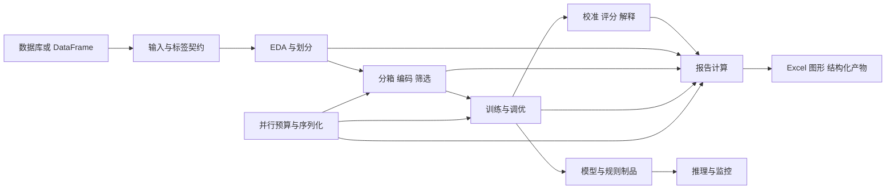

# hscredit 当前能力与问题分析报告

评估日期：2026 年 11 月 4 日。代码版本：`0.1.3`，提交 `bab104b19216309f10ed09184888aa69dac30ff5`。

hscredit 已经具备从数据接入、探索分析、分箱编码、特征筛选、模型训练调优，到解释、评分卡、规则策略和 Excel 报告的完整工具链。当前最值得投入的方向是让这些环节共享一致的计算口径和交付协议。已有代码足以支持常规分析，但部分入口的默认行为会改变样本分母、权重或分箱边界，导致代码成功执行而结果不能直接比较。

本次从当前源码、测试、打包配置和可执行样例重新评估，没有读取或沿用已有规划、路线图及历史审计报告。新增功能建议见同目录 `2026-11-04-optimization-roadmap.md`。本报告区分实际复现的问题、已有明确约定但容易误用的行为，以及尚需专项验证的工程风险；没有把源码体积、异常捕获数量或单次耗时直接等同于缺陷。

## 评估范围与证据

- 静态盘点覆盖 `hscredit` 下全部 295 个 Python 文件，共 161,171 行，包含文档字符串及空行；发现 332 个类定义。顶层 `__all__` 有 511 个符号，另有 15 个懒加载入口。逐文件能力清单位于 `docs/analysis/2026-11-04-evidence/capability-inventory.json`。
- 测试目录有 319 个 `test_*.py` 文件，examples 根目录有 46 个 Notebook。没有逐个执行全部 Notebook，也没有将静态遍历等同于逐行证明正确。
- 在 Python 3.9.13 与 Python 3.14 两套本机环境执行了相同语义探针；下文 F01—F11 所述行为均获得两套环境的探针支持，其中 F03/F04 和 F10/F11 分别共用一个探针。
- 使用本地 `examples/hscredit_yyp.xlsx` 跑通真实数据主流程；不在本报告中包含客户明细。
- 非 slow、非 integration 的完整测试运行结果单独记录在本报告的验证结果部分。真实数据库服务、GPU、全部深度模型、跨机器 PMML 执行和全部图形视觉布局不属于本次动态覆盖范围。

探针结果分别保存在 `docs/analysis/2026-11-04-evidence/evidence-py39.json` 和 `evidence-py314.json`。同目录 `reproduce.ipynb` 提供完整复现步骤，已在 Python 3.9.13 下执行完成。源码行号对应上述提交。

## 当前能力地图

| 模块 | 当前功能 | 主要设计与成熟度判断 |
| --- | --- | --- |
| `core.binning`，27 文件，24,013 行 | 等宽、等频、树/CART、卡方、KS/IV/Lift、MDLP、聚类、核密度、单调、遗传、平滑、目标坏率、OR/CP-SAT、二维分箱 | `BaseBinning`、`OptimalBinning` 统一入口；支持缺失、特殊值、未知类别、手工切点、约束和 WOE；`BinSpec` 保存执行边界，避免依赖展示文本 |
| `core.encoders`，12 文件，4,639 行 | WOE、Target、Count、OneHot、Ordinal、Quantile、CatBoost、GBM、Cardinality | 有公共类别协议、字段校验、并行和序列化；Target 等监督编码具有 OOF 路径，但安全训练方式仍需用户选择 |
| `core.selectors`，27 文件，11,948 行 | 缺失、方差、众数、类型、正则、基数、相关、VIF、IV/KS/Lift/PSI、互信息、卡方/F 检验、重要性、空重要性、RFE、顺序/逐步、Boruta、稳定性、复合筛选 | 有 `SelectionReportCollector`、保留/剔除原因及过程记录；组合能力较完整，仍需统一训练折范围和元数据传递 |
| `core.models`，80 文件，36,236 行 | LR、RF、ExtraTrees、GBDT、SVM、决策树、XGBoost、LightGBM、CatBoost、NGBoost、ResNet、FTTransformer、TabM、TabPFN、TabNet | 公共字段 schema、训练生命周期、验证集、业务损失/指标、概率评分卡和推理导出；框架间适配覆盖面很广 |
| 模型调优 | Optuna 多采样器、搜索空间适配、单次验证、多折、自定义划分、多指标、OOF、续跑、最优模型、可视化 | 有 `full/predictions/summary/best/disk` 保留策略、数据签名及折模型管理；`fit` 返回最佳参数字典是明确保留的历史协议 |
| 校准与评分 | Platt、Isotonic、Beta、Histogram；概率转分数、传统 WOE 评分卡、舍入评分卡、分数漂移校准 | 已经具备概率与分数双体系；校准训练权重、训练内指标标识仍有缺口 |
| 模型解释 | SHAP、解释结果缓存/校验、原因码、反事实、重要性、稳定性及解释报告 | 不能再把“模型解释”当作待从零建设的功能；应补约束、适用边界和决策报告整合 |
| `core.metrics`，12 文件，4,829 行 | KS/AUC/Gini、分类/回归、IV/WOE、PSI/CSI、Lift、坏率、分箱和金融指标 | 有风险方向、排名同分规则、`MonitoringBaseline` 冻结基准和 `BinStatsAccumulator` 流式充分统计 |
| `core.eda`，13 文件，8,228 行 | 数据概览、质量、缺失、目标、相关、特征、关系、客群、时间稳定性、策略、Vintage、报告 | 已有 Vintage 的账户、批次、成熟度、事件/快照/面板模式；需要向通用建模报告传播观察窗口信息 |
| `core.rules` 与 `report.mining` | 规则表达式、规则流、规则制品、累加统计；单特征、多特征、多标签、树、手工树、多叉树挖掘 | 具备执行与展示分离、复合规则和策略分析基础；大规模规则集的成本需要按真实工作负载验证 |
| `report`，30 文件，30,668 行 | 特征报告、模型报告、多标签规则报告、策略替换/Swap、逾期率预估、客群漂移、筛选报告 | `ReportResult` 已提供章节状态；模型报告已有严格模式、事务发布、训练过程、部署需求、解释等内容，覆盖程度在不同入口之间不一致 |
| `core.viz`，10 文件，12,576 行 | 分箱、分布、相关、ROC/PR/KS/Lift、校准、阈值、稳定性、策略、树和重要性等图形 | 种类丰富，渲染成本、图表口径复用及视觉验收应独立管理 |
| `excel`，3 文件，5,130 行 | Excel 样式、数据表、图像、布局、格式及 pandas 导出 | 报告主要交付渠道；需要计算结果与 Excel 表现层进一步分离 |
| `database`，24 文件，8,636 行 | MySQL、Hive、Impala、Oracle、StarRocks、ClickHouse、MaxCompute、Redis、MongoDB；查询、流读、流写、元数据、JSON 投影 | 有适配器注册、能力描述、异常上下文、连接池、写入结果与 MySQL 原子替换；跨数据库语义仍应以适配器能力为准 |
| `utils`，19 文件，6,149 行 | 数据契约、目标绑定、日期、逾期标签、并行、字体、日志、序列化、随机种子、数据集、pandas 扩展 | 实际承担大量基础设施职责；是后续收敛公共协议的主要位置 |
| `skills_runtime`，18 文件，3,027 行 | 请求校验、操作注册、对象管理、环境准备、模型/规则/报告操作、制品事务 | 已有自动化执行基础；应消费统一结果对象，减少自行解释各模块返回值 |
| 金融与特征表达式 | FV/PV/PMT/NPER/IPMT/PPMT/IRR/NPV/MIRR、NumExpr 派生 | 金融计算和表达式特征属于现有能力；表达式派生目前不是完整的时间窗口/多表特征平台 |

表中的文件/行数按物理目录统计，模型子能力和规则挖掘行不重复计入合计。完整符号清单比 README 的概括更适合作为下一轮 API 兼容清单。

## 项目结构与依赖设计

### 主要执行链

这个分层在职责上成立，但源码依赖还不是严格单向：`core.eda` 使用 `report.result`，模型的便捷方法调用 `report`，`core.viz.tree_plots` 引用报告中的多叉树，而 `ModelReport` 的事务导出又使用 `skills_runtime.artifacts.ArtifactTransaction`。这些调用大多有意延迟导入，不能直接判定为运行期循环导入故障；问题在于核心计算、报告和自动化层不能独立演进。公共结果协议和通用制品事务更适合下沉为中立基础设施。

当前最大的五个文件分别是 `model_report.py` 5,955 行、`scorecard.py` 5,530 行、`binning_plots.py` 4,425 行、`feature_analyzer.py` 4,264 行、`excel/writer.py` 4,003 行。尤其模型报告同时承担数据绑定、预测、统计、缓存、图形、布局、元数据和发布，修改一个功能容易触及多个行为边界。拆分目标应是可单独验证的职责，而不是仅减少单文件行数。

### 安装与运行时依赖

`pyproject.toml` 是安装依赖的事实来源。基础安装包含 NumPy、pandas、PyArrow、SciPy、sklearn、statsmodels、NumExpr、Bottleneck、Joblib、Excel、Matplotlib/Seaborn、pyecharts、Graphviz、OR-Tools、SHAP 和多种序列化/压缩依赖。Boost、Net、PMML、Tune、各数据库驱动、Dev、Docs 采用 extras。

已有良好设计包括：Python 3.9—3.14 的声明范围；SHAP/XGBoost 按 Python 版本约束；PMML 对 sklearn 的约束局限在相应 extra；Boost/Net/Tune/Explainer 的部分懒加载；构建期通过 AST 提取版本，避免导入整个包。

仍需处理的边界：

1. 基础安装包含求解、解释和可视化依赖，部署只读推理服务也要承担安装成本。部分模型懒加载只减少导入开销，不能减少安装依赖。
2. `hscredit/__init__.py:29-76` 聚合大量模块并调用 `init_setting()`；后者修改 pandas 显示设置、Matplotlib 字体/样式等进程全局状态。实测新进程导入时已加载 `matplotlib.pyplot`、`ortools`。一次并发测试期间测得导入约 4.6 秒，此数字仅为本机观察，不能当性能回归结论。
3. 主 CI 全功能测试安装 `[all]`。虽然另有 pandas、模型和 CPU 组合矩阵，也有打包验证，但缺少独立基础安装以及单个 extra 的安装后冒烟任务，可能漏掉可选依赖不隔离的问题。
4. `AGENTS.md` 仍列出 `[lightgbm]`、`[catboost]`、`[explain]` 等未在当前 pyproject 中定义的 extra；基础依赖列表也和当前文件不同。项目指导文件应从依赖声明生成或接受自动一致性检查。
5. 本机 Python 3.9 实际导入 sklearn `1.6.1`、Joblib `1.5.3`，分发元数据却报告 `1.0.2`、`1.5.2`。这是当前环境问题，不是已证明的库实现缺陷；但依赖快照和兼容适配若仅信任元数据，会记录错误版本。应增加环境自检，而不是直接修改依赖以迁就污染环境。

## 已复现的问题和易误用行为

优先级：P1 表示可能改变评估或决策结果，应先处理；P2 表示可集成性、可诊断性或工程可靠性缺口。本次没有证据足以将问题定为需立即停止所有使用的 P0。

### F01 同一标签通过不同入口传入会改变结果

**P1，已复现的公共语义不一致。** 5 行标签 `[0, 1, NaN, 0, 1]`，固定同一模型和特征：

| 入口 | 有效样本数 | 坏样本率 | AUC |
| --- | ---: | ---: | ---: |
| 显式 `y_train` | 4 | 0.50 | 0.75 |
| `target='target'`，默认不剔灰 | 5 | 0.40 | 0.666667 |
| `target='target', del_grey=True` | 4 | 0.50 | 0.75 |

`utils/targets.py:73-110` 将非 1 值映射为 0；目标列的默认路径没有保留缺失。模型报告对显式 y 则保留缺失并过滤。`report/_model_protocol.py:43-94` 已能描述这种差异，因此不能称为完全未公开；但这仍破坏用户对双 API 等价性的合理预期。观察期未满、标签尚未回流和真实好样本尤其不应默认混为一类。

建议把缺失标签策略与灰样本业务策略分开，提供 `missing_target='exclude|raise|negative'` 等明确选项；新工作流默认排除或报错，旧行为经过兼容入口保留。验收必须比较有效样本位置、分母及最终指标，而不只比较输出形状。

### F02 校准器静默接受但不使用训练参数

**P1，已复现。** `ProbabilityCalibrator(model=m, calib_ratio=None).fit(...)` 在以下四种输入下得到完全相同的校准概率：不传额外参数、坏样本权重设为 30、传入长度错误且为负的 `sample_weight=[-1]`、传入不存在的 `misspelled_parameter=123`。

原因见 `core/models/calibration/model.py:276-289`：`fit_params` 只在内部重训基础模型时使用；基础模型不重训时，参数没有被消费或拒绝，底层校准器调用也没有权重入口。带 `calib_ratio` 时训练子集接收权重，校准子集仍按等权拟合。评估权重已有支持，不代表校准拟合也支持权重。

建议明确区分基础模型训练参数与校准拟合参数；未知和未消费参数必须报错。若暂不支持某种加权校准，应明确拒绝，避免“接受参数即已生效”的错觉。

### F03 同一报告的坏样本率使用不同权重

**P1，已复现。** 200 行中 67 个坏样本，坏样本权重为 20、好样本权重为 1：`get_metrics()` 坏样本率为 **0.909708**，同一报告 `get_bin_table()` 合计为 **0.335**。前者是加权比例，后者是件数比例，但列名都是“坏样本率”。

`report/model_report.py:1466-1497` 给总体指标传权重；`:1639-1657` 的分箱统计没有传该权重。PSI 路径 `:1503-1504` 同样使用无权重分布。按件数统计本身有效，问题是同一报告缺乏可识别的混合口径声明。

建议分别表达件数、权重和、金额；报告每张表携带统计口径。先阻止含糊混用，再逐步增加权重统计能力，不应把浮点权重和直接命名为“样本数”。

### F04 分类报告跨数据集重新拟合分箱

**P1，已复现的对比能力缺口。** 同一模型训练/测试报告的三箱边界分别为 `[0.3333, 0.3366]` 与 `[0.3216, 0.3248]`。`_compute_bin_table()` 对当前数据集独立调用 `feature_bin_stats`，没有将训练集 binner 传给其他数据集，见 `model_report.py:1598-1657`、`:1538-1553`。

等频分箱分别描述各数据集排序能力是合理用法，但不适合直接比较“同一分档”的风险，也可能把整体分布移动重新分配成近似均匀占比。回归报告已有训练切点复用说明，分类与回归协议也因此不同。

建议提供显式 `binning_reference`：训练基准、指定基准、每集独立。风险监控/跨期对比默认用冻结基准；排序分析可保留独立分位箱，并在标题中说明。

### F05 groups 与整数 cv 的组合仍会跨客户泄漏

**P1，已复现的易误用行为。** 20 个客户、每客 5 行，`ModelTuner(cv=3)` 传入 groups 后，三个训练/验证折分别共享 **19、19、19** 个客户。

`tuning.py:1576-1605` 在 `cv=None` 时使用 GroupShuffleSplit，而整数 cv 使用 StratifiedKFold/KFold；后者忽略 groups。底层 sklearn 会给出警告。文档把 groups 定义为传给自定义分割器，因此这不是已承诺分组隔离的实现被破坏，而是不同 cv 方式的安全语义不一致。`:1661-1685` 仅检查行索引相交，未检查实体相交。

建议整数 cv 加 groups 时自动选择分组切分，或者明确要求分组 splitter 并拒绝不生效的组合；为时间、实体和标签成熟度增加可检查的划分协议。

### F06 监督编码默认仍使用样本内目标信息

**P1，已复现的默认风险。** 100 个完全唯一、无预测信息的 ID，交替二分类标签：默认 TargetEncoder 训练编码对标签的 AUC 为 **1.0**；使用 `training_mode='oof', random_state=42` 后为 **0.444**。

OOF 能力已经存在，见 `encoders/base.py:552-631`；默认 `training_mode='in_sample'` 见 `target_encoder.py:134`。这里测量的是训练编码的辨别能力，不是独立测试集泛化指标。结论是默认调用容易把自信息带入下游训练，不能据此声称所有模型都会产生同样的泛化偏差。

建议标准建模 Notebook 和便捷工作流显式启用 OOF，提示高基数 ID 风险；对于时间切分未覆盖的初始窗口，应输出覆盖率并要求明确处理 NaN。sklearn 对训练编码采用交叉拟合的设计可作为参考：[TargetEncoder 官方文档](https://scikit-learn.org/stable/modules/generated/sklearn.preprocessing.TargetEncoder.html)。

### F07 EDA 的默认返回值丢弃失败状态

**P1，用于自动发布时的完整性缺口。** `eda_summary(df, target='missing')` 默认返回一个包含四张成功表的普通 dict；目标分布和坏率分析的失败仅留在日志。相同调用设置 `return_result=True` 后才获得 `complete=False` 和失败章节。

证据：`core/eda/report.py:26-66` 创建结构化状态，`:121-122` 又返回 `dict(result)`；导出器 `:209-211`、`:235` 附近仅对 ReportResult 执行完整性检查及写入状态页。直接串联默认 API 会丢失已有的诊断能力。

建议结构化结果成为新入口的默认类型；它已经继承 dict，可减少兼容成本，但仍须考虑用户对精确类型、序列化和第三方代码的依赖。显式传入不存在的 target/date/amount 应在任务启动前失败。

### F08 模型报告字典不能直接作为 JSON 载荷

**P2，已复现的结构化交付缺口。** `json.dumps(report.to_dict())` 抛出 `TypeError: keys must be str, int, float, bool or None, not tuple`。

`model_report.py:5546-5559` 把 summary 的 MultiIndex 列转成 records，保留 `('AUC', '训练集')` 这样的元组键。`to_dict` 没有承诺 JSON 等价，因此应把它定位为对外机器接口缺口，而不是所有 Python dict 用法都错误。其他潜在不可直接 JSON 化的值还包括 Timestamp、NumPy 标量及 NaN。

建议保留面向 pandas 的表结构，同时增加带 schema 版本的机器输出；显式编码多层列、索引、缺失值及字段类型，不能只靠 `default=str` 丢失语义。

### F09 名为概率的预测输出没有执行概率范围检查

**P2，已复现。** 自定义模型 `predict_proba` 返回两列且各行和为 1，但正类值在 `[-1, 2]`，ModelReport 仍返回正常 KS/AUC。

`model_report.py:231-250` 只检查维度、长度和有限性。连续分数可以计算排序指标，但一旦入口被识别为概率，就应校验概率范围和二分类列语义；否则混入 raw margin 或错误概率的上游实现无法被及时发现。建议按预测输出类型校验，允许评分和 margin 通过各自明确入口进入报告。

### F10 指定不存在的金额字段会悄悄退回件数表

**P1，已复现。** `report.get_bin_table(amount='nonexistent_amount')` 成功返回不含金额统计的表。`model_report.py:1654-1655` 只有字段存在时才传入 amount，没有拒绝用户明确请求却不存在的列。

如果调用方依赖金额风险口径，这会把配置错误变成一个表面正常的报告。建议所有显式指定的字段预先校验；“未请求金额”和“请求了无效金额字段”必须有不同结果。

### F11 自定义指标进入明细但不进入摘要

**P2，已复现。** 设置 `metrics=['brier']` 后，`get_metrics()` 包含“概率均方误差”，`summary()` 仍只有 KS、AUC、样本数、坏样本率。代码使用固定 `_SUMMARY_METRICS`，见 `model_report.py:3368`、`:3403-3413`。

固定摘要可保留为兼容视图，但使用业务损失、金额或校准指标选模时，摘要应能显示实际选模指标及方向、权重、配置、评估集，避免下游仅凭 AUC/KS 作判断。

### F12 声明支持的旧版 LightGBM 存在工作流兼容失败

**P1，完整测试发现并单独复现。** 当前 `pyproject.toml` 声明 `lightgbm>=3.2.0`；本机 LightGBM `3.3.5` 在以下两个公共工作流失败：

- 指定自定义早停指标时，`core/models/boosting/lightgbm_model.py:97` 对 `env.evaluation_result_list` 重新赋值，旧版回调环境不允许设置该属性，抛出 `AttributeError: can't set attribute`。
- 调参后生成模型报告时，`core/models/_lifecycle.py:302` 遍历包含 None 的学习曲线数据，抛出 `AttributeError: 'NoneType' object has no attribute 'values'`。

两个用例在 Python 3.9 环境脱离完整套件单独执行仍失败；在 Python 3.14 / LightGBM 4.6.0 环境复查通过。这不能作为所有依赖组合的归因证明，但足以确认声明支持范围内存在需要处理的兼容路径。

建议先决定并测试真实支持边界：兼容旧回调环境并归一化缺失学习曲线，或者在有验证依据后提高对应版本下限。不能仅在 CI 安装新版本后把旧版本失败视为与项目无关。

## 报告内容仍需补齐的部分

已有内容与剩余缺口应分别处理。模型报告已经包含基本信息、模型性能、入模变量、稳定性、参数、部署需求、训练与调参过程，可附加解释；不能将这些章节重新列为从零开发任务。

| 主题 | 已有基础 | 应补齐的内容与原因 |
| --- | --- | --- |
| 样本口径 | 标签定义、剔灰、数据集统计、Vintage 成熟度 | 跨所有报告的样本流转账：原始、去重、有效标签、未成熟、灰样本、预测失败及最终评估样本；分母可追溯 |
| 标签与概率定义 | 二分类标签、风险方向、DPD 操作符 | 正类含义、预测时间点、标签观察截止、目标成熟窗口、分数/概率/margin 类型；入口等价性 |
| 指标可信度 | KS/AUC、可选 Brier 和金融指标；解释稳定性有 Bootstrap | 核心性能指标置信区间、客户/时间聚类抽样、模型差异的配对区间；SHAP 重要性区间不能代替 AUC/KS 区间 |
| 校准 | 四种算法、校准前后 Brier/ECE/MCE、独立评估入口 | 明确区分校准拟合内指标与独立校准评估；分群/时间可靠性、权重口径和样本量。当前 `calib_metrics_` 在拟合所用数据上计算，见 `calibration/model.py:291-295` |
| 跨期与分群 | 分月、PSI、客群分析、冻结监控基准 | 共享分箱、各标签单独分母、样本量阈值、基准版本、未知/缺失率、告警解释；模型分月指标当前以首标签为主，见 `model_report.py:2711-2719` |
| 策略决策 | 阈值、Lift、Swap、件数/金额风险 | 同一审批率/预算下的模型对比，成本收益假设、人工审核容量、阈值敏感性、边界同分处理；不要直接把代理收益当财务实得收益 |
| 解释与反事实 | SHAP、原因码、反事实、解释报告 | 原因码方向和基准、不可变字段、可行动约束、联合可行性、解释与当前模型版本一致性 |
| 交付完整性 | ReportResult、模型事务导出、制品 metadata | 各入口都保留章节状态；失败原因、跳过理由、权重/标签/分箱版本进入机器结果；生成与发布分开检查 |
| 部署可重现性 | 推理导出、规则制品、模型保存、训练历史 | 统一 deployment manifest：特征 schema、前处理、概率/分数转换、依赖实测版本、验证样本指纹和预期输出；以往返预测一致为验收 |

独立校准数据与训练数据的分离要求可参照 [CalibratedClassifierCV 官方文档](https://scikit-learn.org/stable/modules/generated/sklearn.calibration.CalibratedClassifierCV)。这里提出的是将已有校准能力更清楚地呈现在报告中，不是认为库没有校准功能。

## 对外 API 一致性评估

| 契约 | 当前状态 | 应采用的后续策略 |
| --- | --- | --- |
| `(X, y)` 与 `target=` | 模型/编码/筛选共享 `prepare_xy` 等工具；报告另有 BoundTargets | 先统一样本语义和位置/索引规则，保留报告多标签能力；不要再新增第三套平行解析器 |
| `fit` 返回值 | 大部分估计器返回 self；ModelTuner 返回参数 dict | 文档和兼容清单显式标注；新增 sklearn 风格搜索适配入口，不直接改变旧返回值 |
| `predict` 含义 | 分类器返回标签，ScoreCard 返回分数，OverduePredictor 返回逾期率/字典 | 保留业务对象契约，用 `predict_label/predict_proba/predict_score` 及 capability 描述消除自动猜测 |
| `report` 含义 | 校准器 report 是 DataFrame，model_report 是 ModelReport；其他报告返回表、dict、tuple、位置或路径 | 统一计算结果包及渲染接口，便捷旧方法作为兼容层 |
| 参数命名 | 模型 eval_sample_weight、Tuner evaluation_weight/validation_weight、报告 sample_weight 含义不同 | 名称可兼容保留，但内部统一训练/评估/金额三个角色；报错指出具体角色和数据集 |
| 保存加载 | 有通用 artifact、原生模型、规则 JSON、WOE/分箱 JSON、推理导出 | 已有格式不强行合并；建立格式能力表，注明是否包含前处理、是否可续训、版本检查及执行依赖 |
| 输出字段 | 中文业务表普遍；LR 的统计表仍沿用 `Coef.`、`P>\|z\|` 等数学/第三方习惯字段 | 为公共字段建立稳定字典和展示别名；不要为纯翻译破坏用户代码 |
| 异常 | 已有 HSCreditError 等体系，部分路径仍直接 ValueError/TypeError/KeyError | 明确哪些是输入错误、模型状态错误、依赖错误、资源错误和章节失败；保留原异常上下文 |
| API 发现 | 顶层聚合便利但有 511 个导出，懒加载符号不在同一 __all__ 清单 | 自动生成入口目录和兼容 manifest；按模块推荐常用路径，减少用户靠猜测函数所在位置 |

上表中的差异不都构成 bug。不同业务对象允许有不同输出，但自动化层必须能明确识别，不应依赖名称和形状猜测。

## 底层执行优化评估

当前优化已经相当多，不能简单概括为“需要增加并行”：

- `utils/parallel.py` 提供物理核探测、`ParallelBudget`、`ParallelWorkload`、执行计划、嵌套预算、线程/进程选择、任务规模估计、超时、内存预检、有界窗口和迭代结果。显式进程后端与 GIL 释放条件都有处理。
- 分箱与统计使用 `searchsorted`、`bincount`、预分箱候选、累计计数和共享目标函数；CP-SAT 区分不可行、超时、可行和证明最优，记录目标值/上界，并对未证明最优给出警告，见 `_partition_solver.py:249-284`。
- 编码器按列组织任务并采用统一类别协议；规则统计及分箱统计已有可合并累加器，不要求所有统计始终保留逐行数据。
- 模型调优已有保留策略、折模型落盘和训练数据释放；报告复用预测及多类派生缓存，并在失败时回滚缓存。
- 数据库有 QueryStream，制品有原子保存/事务发布。测试中已有并行速度门槛和编码器、MDLP/VIF、规则、流式统计、筛选报告等基准。

下一步值得优化的是端到端资源行为：

| 机会 | 源码依据与影响 | 应如何验证 |
| --- | --- | --- |
| 缓存的内存保留 | ModelReport 保留输入、预测、多张表和解释结果；事务回滚保证一致性，不等于缓存有容量上限 | 大宽表、多数据集、多标签组合下测整个进程树峰值 RSS；提供受控缓存/释放策略 |
| 全表复制与序列化 | 分箱报告复制 ds.X；编码按列复制；进程任务可能携带上下文 | 区分必要隔离与重复复制；证明输入不变、类别 dtype 和行顺序不变后再减少复制 |
| 流式链路的保留策略 | `QueryStream(retain=True)` 会把每个块放入 `_chunks`，见 `database/stream.py:63-90,188-196` | retain=True 是功能约定，不是内存泄漏；大表流程应显式 retain=False，并确认后续计算没有重新 collect 全量 |
| 外部模型状态校验 | `_model_stamp` 对 sklearn/原生框架模型执行状态哈希，多个报告 getter 都会检查 | 大森林/大型原生模型上测重复 getter 时间；若成为热点，增加一次报告快照/显式版本标识，保留变更检测 |
| 冷启动与可选依赖 | 顶层聚合与全局初始化 | 独立进程测基础导入、轻量指标、推理和完整绘图入口；记录依赖加载和内存而不仅是时间 |
| 并行启发式 | 静态工作量阈值与工作内存估计不等同操作系统硬限制 | 按宽度、类别数、数据大小、后端和机器做受控基准；提供执行计划及实际统计 |
| 渲染和计算重复 | 模型报告含串行/并行绘图路径，Excel 导出涉及多类统计 | 让渲染只消费计算结果，比较单独计算与完整导出的耗时、图数量、峰值内存 |

本次没有在同时运行测试的机器上执行正式性能排名，也没有据此承诺具体加速倍数。已有基准应扩展成统一的耗时、父子进程 RSS、产物大小和语义一致性记录，而不是再做一个独立性能框架。

## 验证结果

### 两套环境的语义探针

| 环境 | 实际 NumPy | 实际 pandas | 实际 sklearn | 实际 Joblib |
| --- | --- | --- | --- | --- |
| Python 3.9.13 | 1.26.4 | 2.3.3 | 1.6.1 | 1.5.3 |
| Python 3.14 | 2.4.4 | 2.3.3 | 1.8.0 | 1.5.3 |

F01—F11 的关键现象在两套环境一致。此处验证了跨版本可复现性，不代表全部依赖矩阵均已通过。

真实贷款样例：970 行、18 列；选择三个数值特征，固定随机种子按目标分层划分为训练 679 行、测试 291 行。执行 Quantile 分箱 → WOE → ScoreCard → 推理 → artifact 往返 → ModelReport 严格导出。两套环境都成功，保存加载最大概率差为 0；测试 AUC `0.6212682927`、KS `0.2434146341`；报告生成 8 个工作表且 `complete=True`。这只是功能验收，随机划分结果不作为真实业务上线或跨期效果结论。

该 Excel 验证使用 `with_plots=False`、关闭样本明细和解释；检查了工作簿可读性、工作表和结构化完成状态，没有对全部图片和 Excel 页面做视觉验收。

### 测试套件

运行命令：`python -m pytest tests/ -m "not slow and not integration" -q --tb=short -o addopts= --durations=20`。

结果：**7787 passed、29 failed、81 skipped、27 deselected**，耗时 **1926.09 秒，约 32 分钟**，677 条 warning。原工作树干净，运行期间没有修改生产代码；这些是当前基线在本机环境的测试结果，不是本次文档修改引入的回归。

对全部 29 个失败节点在 Python 3.14 环境复查：**21 passed、8 skipped**，耗时 20.70 秒。又将两个 LightGBM 工作流和一个绘图样式用例在 Python 3.9 环境单独复查，三项仍失败，排除了“只在本次完整套件顺序下失败”的解释。

| 失败组 | 数量 | 已知证据和解释范围 |
| --- | ---: | --- |
| LightGBM 训练、损失、早停与报告 | 14 | Python 3.9 使用 3.3.5；另一环境使用 4.6.0，14 项复查通过。包括 F12 的两条明确兼容路径；其余节点不逐一声称同一根因 |
| Net 预训练与 Net 回归报告 | 8 | Python 3.9 有 torch，但缺少 rtdl_revisiting_models/tabm；另一环境没有 torch，因此跳过。不能宣称 Net 功能已通过本次验证 |
| PyArrow 字符串可视化 | 6 | Python 3.9 未安装 pyarrow；另一环境安装 25.0.1，六项通过。pyarrow 已是当前基础依赖，本机环境不完整 |
| SHAP 重要性图的 hatch 样式 | 1 | Python 3.9 单独复查仍失败；另一环境通过。失败断言要求所有 bar 使用 `/` 填充纹理，属于绘图兼容/呈现问题，未据此推断模型数值错误 |

失败节点和命令保存于 `docs/analysis/2026-11-04-evidence/pytest-summary.json`，复查摘要保存于 `pytest-rechecks.json`。Python 3.14 只复查了失败节点和语义探针，没有在该环境重跑全部 7897 项已选测试。

最慢单例约 38 秒，集中在真实数据多标签特征效率分析；另有隔离环境创建和完整模型 Excel 报告。运行中出现 Matplotlib “打开超过 20 个 figure”警告，说明测试/绘图链路需要专项核对图对象生命周期，不能仅凭警告归因到某个生产入口。677 条 warning 也不等于 677 个缺陷。

## 后续工作的判断

现阶段应先解决能改变样本、指标或报告解释的接口差异，再补业务报告的可信度信息和端到端资源治理。已有的 OOF、校准、冻结监控、统一结果和事务机制应成为基础；以这些现有组件的贯通为主，避免同时新增多套工作流、协议类和报告框架。

独立优化方案将每项工作关联到上述问题，并明确依赖、兼容方式与验收条件。代码修复、行为默认值变更和新增算法应分批交付，分别验证。
