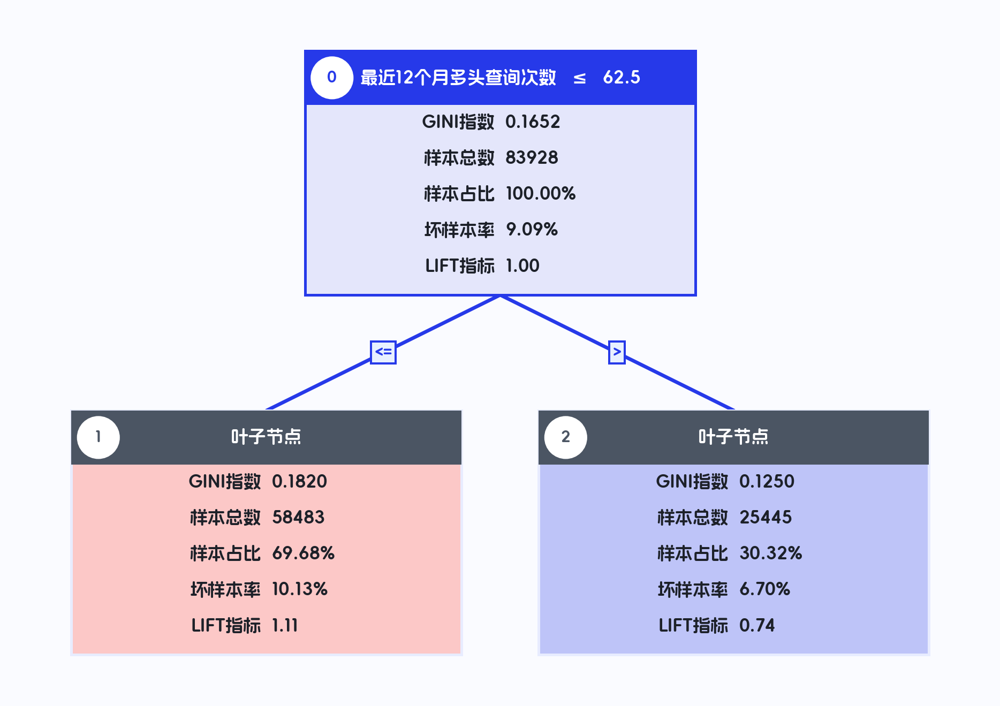
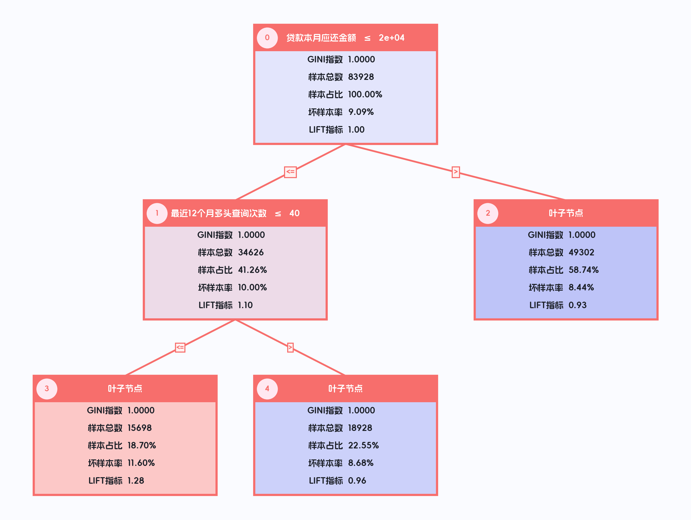
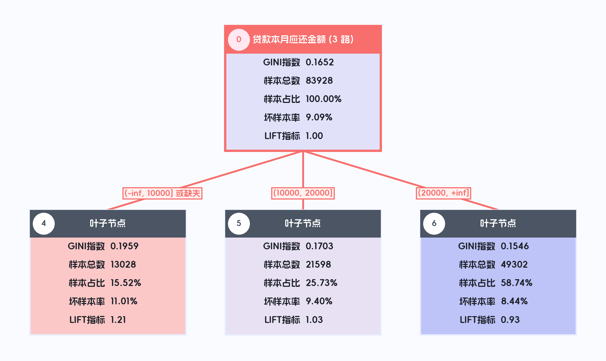

# 一笔订单落在哪片叶子？用 hscredit 画决策树、挖掘信贷规则

**贷款本月应还金额不超过 2 万元的订单，值得单独划成一组吗？** 策略评审时，我们先看这条线圈住多少笔订单、其中多少笔后来逾期。再往下拆，有两种切法可以试。一种看多头查询次数，另一种把应还金额再细分一档。哪种切法更能看出风险差异？

这次用 `hscredit` 的公开现金贷样本做一次推演。先画一棵自动树，看看数据把第一刀切在哪里。再用两种手工树检验上面的问题。文中的树图显示训练集统计，最后的表用留出的测试集复算各条规则。

## 准备两列特征，按客户留出测试集

在 Python 环境中运行 `pip install hscredit`。下面的代码可以在同一个 Notebook 中依次执行。`hscredit_dataset` 首次使用时会读取本地数据或下载并缓存公开数据集。按列加载就够了。

每行是一笔放款订单。我们使用授信时已经有的两个字段，并把**前六期历史最大逾期天数超过 30 天**（`MOB6 > 30`）记为坏样本。为了让每个分支都能用原始数值手算，本例只分析两列特征均有记录、且标签有效的订单。同一客户的订单始终分在同一侧。

```python
from sklearn.model_selection import GroupShuffleSplit
from hscredit import hscredit_dataset, plot_tree
from hscredit.report.mining import ManualTreeExtractor, MultiwayTreeExtractor

amount_due = "贷款本月应还金额"
queries = "最近12个月多头查询次数"
features = [amount_due, queries]
fields = {"DK_X2677": amount_due, "BASE_X187": queries}

data = hscredit_dataset(columns=["用户编码", "MOB6", *fields]).rename(columns=fields)
data = data.loc[data["MOB6"].ge(0)].dropna(subset=features).copy()
data["坏样本"] = data["MOB6"].gt(30).astype(int)
split = GroupShuffleSplit(n_splits=1, test_size=0.25, random_state=42)
i, j = next(split.split(data, groups=data["用户编码"]))
train, test = data.iloc[i].copy(), data.iloc[j].copy()
```

## 先画自动树，看懂一条路径

先训练一棵只切一次的二叉树。`plot_tree` 也能直接画已有的 sklearn 决策树分类器，传入与训练顺序一致的 `feature_names`，节点就会显示业务字段名。

```python
from sklearn.tree import DecisionTreeClassifier

auto = DecisionTreeClassifier(max_depth=1, min_samples_leaf=100, random_state=42)
auto.fit(train[features], train["坏样本"])
fig = plot_tree(auto, feature_names=features, backend="matplotlib",
                save="自动树.png")
```



根节点的 83,928 笔训练订单中，坏样本占 9.09%。第一刀落在多头查询次数 62.5 次。查询次数是整数，左边实际是查询不超过 62 次的订单，58,483 笔，坏样本率 10.13%。右边是查询至少 63 次的订单，25,445 笔，坏样本率 6.70%。图里的 Lift 分别为 1.11 和 0.74。这组数据里，查询较少的一侧逾期比例更高。

## 手工二叉树 · 在 2 万元以内按查询次数再分两组

把根节点改成评审时关心的 2 万元。再沿“应还金额 ≤ 2 万元”这一侧，按过去 12 个月的多头查询次数是否超过 40 次切一刀。这样，一笔应还 1.5 万元、查询 35 次的订单会满足两个条件，落在图中左下角的节点 3。

```python
binary = ManualTreeExtractor(target="坏样本", features=features, max_depth=1,
                             min_samples_leaf=100, random_state=42, n_jobs=1).fit(train)
binary.manual_split(train, node=0, feature=amount_due, threshold=20000)
print(binary.get_rule_table(leaf_only=True)[["节点编号", "指标含义"]])

# 上一步重建根节点后，表中编号 1 对应“应还金额 ≤ 20000”。
binary.manual_split(train, node=1, feature=queries, threshold=40)
fig = binary.plot(save="手工二叉树.png")
```



`manual_split` 会替换指定节点下面的子树。这张图中手工节点的 GINI 指数 1.0000 是当前实现写入的占位值。读图时看由订单汇总的样本数、坏样本率和 Lift。改动前查当前节点编号，改动后从根沿线读到叶子，把经过的条件用“且”连接起来，就得到一条规则。要让数据在指定字段上寻找切点，可以把二叉树的 `threshold` 设为 `None`。

## 手工多叉树 · 让三个金额档位并排比较

如果只用应还金额一个字段，在 2 万元以内增加一条 1 万元的分界线，两档的坏样本率会相差多少？多叉树允许在**同一个节点**传入两个切点，得到三个互斥区间。等于切点的订单归入左侧区间，所以正好 1 万元归第一档，正好 2 万元归第二档。

```python
multi = MultiwayTreeExtractor(target="坏样本", features=features, max_depth=1,
                              max_n_bins=3, min_samples_leaf=100, n_jobs=1).fit(train)
multi.manual_split(node=0, feature=amount_due, thresholds=[10000, 20000], grow=False)
fig = multi.plot(save="手工多叉树.png")
```



二叉树的 `threshold` 接收一个值，`manual_split` 要传入训练表。多叉树的 `thresholds` 接收升序切点列表，编辑时复用拟合数据。`grow=False` 让手工切出的三个分支停在叶子，便于逐档对照。

## 冻结切点，在测试集上复算规则

两棵手工树都提供 `report`。传入新数据，保持树结构不变，重新统计每片叶子的订单数、坏样本数和 Lift。这里的 **Lift = 该叶子的坏样本率 ÷ 同一数据集的整体坏样本率**。

```python
cols = ["节点编号", "样本总数", "样本占比", "坏样本数", "坏样本率", "LIFT值"]
for name, tree in [("二叉树", binary), ("多叉树", multi)]:
    result = tree.report(test, leaf_only=True, round_digits=False)
    print(name, result[cols].to_string(index=False))
```

测试集共 **27,992 笔**，其中 **2,511 笔**为坏样本，整体坏样本率 **8.97%**。下表用“应还”简写贷款本月应还金额，“查询”指最近 12 个月多头查询次数。各行坏样本率的分母都是该叶子命中的订单数。

**手工二叉树 · 测试集**

| 从根到叶的条件 | 坏样本 / 命中笔数 | 坏样本率 | Lift |
| --- | ---: | ---: | ---: |
| 应还 ≤ 2 万，查询 ≤ 40 次 | 576 / 5,241 | 10.99% | 1.23 |
| 应还 ≤ 2 万，查询 > 40 次 | 535 / 6,176 | 8.66% | 0.97 |
| 应还 > 2 万 | 1,400 / 16,575 | 8.45% | 0.94 |

**手工多叉树 · 测试集**

| 应还金额区间 | 坏样本 / 命中笔数 | 坏样本率 | Lift |
| --- | ---: | ---: | ---: |
| 不超过 1 万元 | 422 / 4,265 | 9.89% | 1.10 |
| 超过 1 万元，至多 2 万元 | 689 / 7,152 | 9.63% | 1.07 |
| 超过 2 万元 | 1,400 / 16,575 | 8.45% | 0.94 |

两棵树里，应还超过 2 万元的分支都命中 16,575 笔，其中 1,400 笔满足坏样本定义。这一行可以互相校验。差异出在其余 11,417 笔。按查询次数拆，两组坏样本率相差 **2.33 个百分点**。按金额再拆，差距约 **0.26 个百分点**。

叶子可以直接导出为 `Rule`。下面取出多叉树最左边的金额档，给测试订单逐笔打标。用原始字段再算一次，就能核对树的区间边界和命中笔数。

```python
by_node = dict(zip(multi.get_leaf_node_ids(), multi.get_rules()))
first = multi.get_node_table().set_index("节点编号").at[0, "子节点"][0]
hit = by_node[first].predict(test).astype(bool)
assert (hit == test[amount_due].le(10000)).all()
print("命中订单", int(hit.sum()), "其中坏样本", int(test.loc[hit, "坏样本"].sum()))
```

## 同一棵树，换一种输出

文中三张配图都用 Matplotlib 生成，PNG 可以直接插入公众号。树的层数多时，用 pyecharts 导出 HTML，便于在浏览器里缩放查看。要给评审报告配矢量图，可以用 Graphviz 保存 PDF。先在系统中安装 Graphviz，确认命令行能运行 `dot -V`。

```python
chart = plot_tree(multi, backend="pyecharts", save="金额分档.html")
```

```python
graph = plot_tree(binary, backend="graphviz", save="手工二叉树.pdf")
```

回到开头的问题。在这批月应还不超过 2 万元的订单中，我会先复核查询不超过 40 次的那组。它在训练集的坏样本率是 **11.60%**，在测试集是 **10.99%**，两次都高于各自的整体水平。它覆盖测试集 **18.72%** 的订单。下一步可以固定这条路径，按后续授信月份观察覆盖率和 Lift，检验这次分组看到的差异能否延续。

**延伸示例**　[决策树绘图 Notebook](https://github.com/hengshu-credit/hscredit/blob/main/examples/24_tree_viz_manual_tree_demo.ipynb) · [手工二叉树规则挖掘](https://github.com/hengshu-credit/hscredit/blob/main/examples/25_manual_tree_rule_mining.ipynb) · [多叉树编辑与报告](https://github.com/hengshu-credit/hscredit/blob/main/examples/26_multiway_tree.ipynb)
