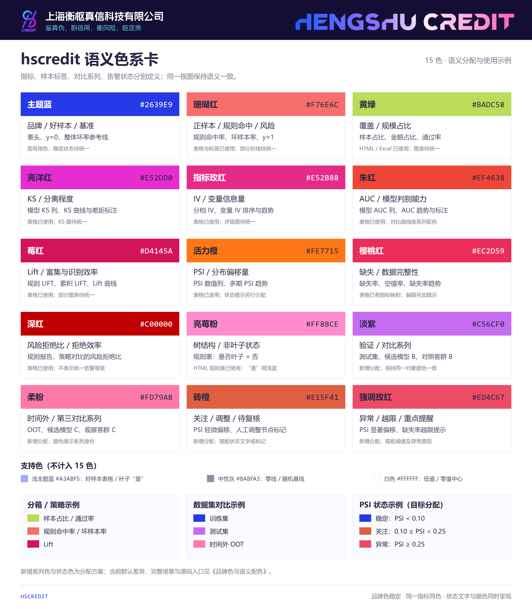

# 品牌色与语义配色

本指南以 hscredit 的 15 色品牌卡及现有图表、HTML 表格、Excel 报告为依据，定义每种颜色的用途和使用示例。**指标身份、样本标签、对比系列、告警状态分别表达不同含义**，使用时应明确图例。

## 使用规则

- **指标视图**：不同指标使用各自的固定颜色，例如 KS 用亮洋红、IV 用指标玫红；同一指标跨 HTML、Excel 和图表保持一致。
- **标签视图**：风控二分类约定 `y=0` 为好样本，用主题蓝；`y=1` 为坏样本，用珊瑚红。“正样本”不表示业务表现好。
- **系列对比视图**：同一指标比较训练集、测试集、时间外样本时，颜色表示数据集身份。建议训练集用主题蓝、测试集用淡紫、时间外样本用柔粉，并在所有子图中保持相同映射。
- **状态视图**：颜色表示是否需要关注。稳定用主题蓝、关注用砖橙、异常用强调玫红，并辅以文字、阈值线或标记。普通指标色不自动代表告警。
- **连续数值**：表格默认从白色渐变到指标色；色卡中的 HEX 是实色色块与色阶终点。深浅表示数值大小，不自动表示业务好坏。
- 用户显式指定的配色优先。图表中保留图例、线型、点型等辅助区分方式，避免仅凭颜色识别样本或状态。

## 15 色分配与具体落点

下表的“分配”是统一规范；“现有实现”说明当前代码已经使用到的范围。标记为“新增分配”的用途需要后续接入默认绘图或报告逻辑。

| 颜色 | HEX | 语义分配 | 具体使用示例 | 现有实现 |
|:---|:---|:---|:---|:---|
| 主题蓝 | `#2639E9` | 品牌、主系列、好样本、基准 | HTML/Excel 表头；分箱图的好样本柱；分标签 SHAP 重要性的 `y=0`；整体坏样本率参考线；训练集或基准模型系列 | 主题、标签和参考线已使用；作为“稳定”状态的统一用色尚待接入 |
| 珊瑚红 | `#F76E6C` | 正样本强调、规则命中及风险水平 | 规则报告“命中率”；坏样本率、逾期率、坏样本占比和数量；分箱图坏样本柱；分标签 SHAP 重要性的 `y=1` | 规则命中率已在 HTML/Excel 使用正样本强调色；部分坏率折线仍使用 `#F0556F` |
| 黄绿 | `#BADC58` | 覆盖、规模占比与通过 | 分箱表“样本占比”；金额分析“金额占比”；策略仿真“通过率” | HTML/Excel 已使用；部分图表仍使用主题蓝 |
| 亮洋红 | `#E52DD0` | KS、分离程度 | 模型效果表“KS”；分档表“分档KS值”；KS 曲线、最大差距线及数值标注 | 表格已使用；KS 图默认颜色待统一 |
| 指标玫红 | `#E52B88` | IV、变量信息量 | 特征筛选“IV”；分箱表“分档IV值”；变量 IV 排序图；多期 IV 趋势 | 表格已使用；IV 评级图目前使用主题蓝色阶 |
| 朱红 | `#EF4638` | AUC、模型判别能力 | 模型效果表“AUC”；跨期 AUC 趋势；单模型 ROC 的 AUC 注释或指标徽标 | 表格已使用；ROC 主曲线目前默认主题蓝，多模型 ROC 应按模型系列区分 |
| 莓红 | `#D4145A` | Lift、富集与识别效率 | 规则报告“LIFT值”“累积LIFT”；分箱 Lift；策略比较中的 Lift 曲线或柱 | 表格已使用；部分 Lift 图或二维图仍使用主题蓝/活力橙 |
| 活力橙 | `#FE7715` | PSI、分布偏移量 | PSI 数值列；多期 PSI 趋势；变量稳定性概览中的 PSI 指标 | 表格已使用；同时仍用于默认第三系列、部分 Lift 图和规则置换报告标题 |
| 樱桃红 | `#EC2D59` | 缺失、数据完整性 | EDA“缺失率”“空值率”“缺失占比”；字段缺失率排序；缺失率月度趋势 | 表格指标映射已使用；仅缺失率超阈值时才另加告警状态 |
| 深红 | `#C00000` | 风险拒绝比、拒绝效率 | 规则报告“风险拒绝比”；策略对比的风险拒绝比指标 | 表格已使用；数值越大不直接等价于风险更差，也不替代异常状态色 |
| 亮莓粉 | `#FF8BCE` | 树结构中的非叶子状态 | `style_rule_table` 中“是否叶子=否”；与“是”的浅蓝底色成对出现 | HTML 规则表已使用；不把“否”解释为坏样本或异常 |
| 淡紫 | `#C56CF0` | 对比系列、验证样本 | 训练/测试/OOT 效果对比中的测试集；候选模型 B；对照客群 B | 新增分配；不是固定性能指标或风险等级 |
| 柔粉 | `#FD79A8` | 时间外或第三对比系列 | 跨样本 ROC、KS、分布图中的 OOT；候选模型 C；观察客群 C | 新增分配；与亮莓粉的树结构含义分开 |
| 砖橙 | `#E15F41` | 关注、人工调整、待复核提示 | PSI 轻微偏移提示；规则树人工调整节点的角标/边框；待复核条目的状态标识 | 新增分配；不改变节点风险底色或指标自身颜色 |
| 强调玫红 | `#ED4C67` | 异常、阈值突破、重点提醒 | PSI 显著偏移提示；缺失率越限标记；模型效果跌破已设阈值的提醒 | 新增分配；与表示 IV 的 `#E52B88` 分别命名 |

## 支持色

支持色用于保持表格可读性，不计入 15 个品牌色。

| 颜色 | HEX | 用途 |
|:---|:---|:---|
| 浅主题蓝 | `#A3ABF5` | 好样本相关表格指标的色阶终点；“是否叶子=是”；有符号数据条的负值端。保留现有实现，不用深主题蓝铺满数据单元格。 |
| 中性灰 | `#8A8FA3` | 随机基线、零线、无状态的辅助参考；当前可视化主题的中性色。 |
| 白色 | `#FFFFFF` | 背景、低值起点、有符号指标的零值中心。 |

## 场景示例

### 分箱表与分箱图

同一分箱有样本占比 20%、坏样本率 8%、Lift 1.6：占比单元格使用黄绿色阶，坏率使用珊瑚红色阶，Lift 使用莓红色阶。数值仅用于说明配色，不代表真实分析结果。

图表如果展示好坏样本堆叠柱，两个堆叠部分应分别是主题蓝与珊瑚红；如果展示总体样本占比柱，则使用黄绿。坏率折线使用珊瑚红，整体坏率参考线沿用主题蓝并使用虚线。不要把每个分箱轮换为不同颜色。

适用入口：`df.show()`、`df.save()`、`bin_plot()`、分箱明细报告。

### 模型效果表与跨样本曲线

模型效果表中的 KS、AUC、PSI 列分别使用亮洋红、朱红、活力橙；特征分析表中的 IV 使用指标玫红。

训练、测试、OOT 三条 ROC 曲线分别用主题蓝、淡紫、柔粉，三条 KS 对比曲线也保留这组数据集颜色。此时图例表示“数据集”，而不是“AUC/KS 指标种类”。单模型 KS 明细图中的 KS 差距线可以用亮洋红，好/坏累计占比分别使用主题蓝与珊瑚红。

适用入口：`ModelReport`、`roc_plot()`、`ks_plot()`、跨数据集模型效果汇总。

### 规则树与规则效果表

节点的“样本占比”“坏样本率”“LIFT值”“风险拒绝比”分别使用黄绿、珊瑚红、莓红、深红。

规则“命中率”“规则集命中率”“命中率(统计范围)”和“命中率(当前规则)”统一使用正样本强调色珊瑚红 `#F76E6C`；例如命中率 20% 的单元格使用白到珊瑚红的色阶。这里强调的是规则命中事件，命中不等同于实际坏样本。样本占比与通过率仍使用黄绿。

“是否叶子=是”用浅主题蓝，“否”用亮莓粉。人工调整节点可以加砖橙角标或边框；这属于新增状态分配，节点风险底色继续表达风险水平。高缺失或规则越限时增加强调玫红提示，并写明异常原因。

适用入口：`style_rule_table()`、二叉/多叉规则树报告、`DecisionTreeViz`。

### PSI 监控

**看数值时**，所有 PSI 值使用活力橙色阶。**看状态时**，沿用当前 `get_psi_color()` 的分档边界，目标颜色分配如下：

| 示例 PSI | 状态 | 目标状态色 | 当前状态色 |
|:---|:---|:---|:---|
| 0.06 | 稳定，`PSI < 0.10` | 主题蓝 `#2639E9` | `#7884F1` |
| 0.16 | 关注，`0.10 ≤ PSI < 0.25` | 砖橙 `#E15F41` | `#9956A4` |
| 0.31 | 异常，`PSI ≥ 0.25` | 强调玫红 `#ED4C67` | `#E73B72` |

这是现有绘图函数的默认分档示例。其他指标的告警应使用该业务已定义的阈值，不能把 PSI 阈值套到缺失率、AUC 或坏样本率上。

适用入口：`get_psi_color()`、`metric_comparison_plot(..., color_scheme="psi")`、`feature_drift_comparison()`、偏移监控报告。

### 策略仿真与规则置换

“通过率”使用黄绿，“通过人群坏率”使用珊瑚红，“Lift”使用莓红，“风险拒绝比”使用深红。已选策略的说明可沿用主题蓝；待复核方案用砖橙状态标记，越限方案用强调玫红标记。

同一张策略仿真图采用黄绿通过率柱和珊瑚红坏率线。当前 `strategy_simulation_plot()` 仍为主题蓝柱与 `#F0556F` 坏率线，需后续接入这套指标映射。

### 有符号指标与模型解释

WOE、坏账改善等有符号指标保留当前“浅主题蓝—白—珊瑚红”约定，分别表示负值、零和正值。这里的颜色首先表达**数值方向**，不直接表示收益或风险好坏；解释需要结合指标公式。

SHAP 需先说明正在解释的是坏样本概率、好样本概率还是评分。若解释坏样本概率，目标约定为“提高风险的贡献用珊瑚红、降低风险的贡献用主题蓝”。SHAP 蜂群图的颜色通常表示特征值高低，不能据此直接判断贡献正负。当前单样本力图与瀑布图的正负方向用色需另做一致性核验，不能仅凭两种主色就认为已实现此约定。

## 当前代码与接入范围

规则命中率已接入 HTML/Excel 共用指标映射，默认使用正样本强调色珊瑚红；显式 `condition_color` 仍可覆盖。其余标注为待统一或新增分配的用途保留原默认行为。当前 `get_palette("extended")` 仍返回原有 10 色；淡紫、柔粉、砖橙、强调玫红尚未进入默认系列色板，黄绿用于样本占比、金额占比与通过率。

现有实现入口：

- `hscredit/utils/colors.py`：共享品牌色与指标色，包括 `PRIMARY_COLORS`、`METRIC_ACCENT_COLORS` 和浅主题蓝。
- `hscredit/excel/writer.py`：HTML/Excel 共用指标解析，包括 `_metric_color_role()`、`_metric_colors()`、`_metric_scale_colors()`，以及改善指标与 WOE 的正负端点。
- `hscredit/utils/pandas_extensions.py`：HTML 表格的指标色阶、居中数据条与叶子状态色。
- `hscredit/core/viz/style.py` 和 `utils.py`：图表主题、旧版坏率折线色、PSI 状态色和按顺序取色的系列色板。
- `hscredit/core/viz/binning_plots.py`、`variable_plots.py`、`strategy_plots.py`：分箱、变量与策略图表，需要按指标或系列视图分别接入，不能直接替换所有 `colors[0]`。
- `hscredit/core/viz/model_plots.py` 和 `tree_plots.py`：分别核对标签、SHAP 方向、节点风险底色与状态标记。

接入时应从共享颜色定义向各渲染入口传递语义，保留用户自定义 `colors`、`condition_color` 和主题的优先级；验证表格色阶终点、图例含义、好坏标签及数值方向，而不仅检查图片能否生成。
